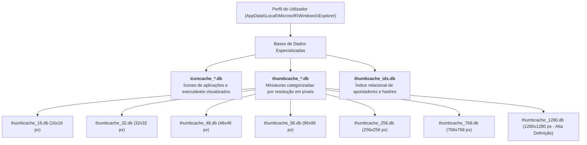

# Caches de Ícones e Miniaturas (IconCache e Thumbcache)

As bases **IconCache** (assinatura `Win4`) e **Thumbcache** (`thumbcache_*.db`) guardam ícones e miniaturas no perfil do utilizador, preservando vestígios visuais de ficheiros eliminados.

> [!TIP] Lógica de Funcionamento e Valor Forense
> * **Porque existe (Sistema)**: O Windows Explorer evita o custo computacional de abrir, descodificar e redimensionar centenas de imagens, PDFs, vídeos e ícones de executáveis cada vez que o utilizador abre uma pasta, mantendo caches gráficas centralizadas no perfil do utilizador (`%LOCALAPPDATA%\Microsoft\Windows\Explorer\`).
> * **Porque importa (Forense)**: Em crimes de posse de material ilícito, exfiltração de documentos ou espionagem, as miniaturas permanecem nos ficheiros `thumbcache_*.db` **mesmo após os ficheiros originais terem sido eliminados do disco ou a pen USB ter sido desconectada**. Cruzando o `Entry Hash` da miniatura com a base de dados do [[Windows Search]] (`Windows.db` / `Windows.edb`), é possível reconstituir o nome e o caminho original completo do ficheiro apagado.
> * **Pontos Críticos e Armadilhas para Exame**:
>   * **Regra de Ouro Probatória (Existência vs. Visualização Consciente)**: A presença de uma miniatura na `thumbcache_*.db` **NÃO prova que o utilizador abriu ou viu conscientemente o ficheiro**. Sempre que uma pasta é aberta no Explorer, um *worker thread* em segundo plano gera automaticamente miniaturas para todos os ficheiros dessa pasta.
>   * **Assinaturas e Evolução**: O ficheiro `IconCache.db` legado possui a assinatura mágica **`Win4`** (`57 69 6E 34`) no offset `0x04`. Nas caches de miniaturas, o Windows evoluiu de ficheiros `Thumbs.db` descentralizados em cada pasta (Windows XP) para bases centralizadas `thumbcache_*.db` por resolução no perfil do utilizador (Windows Vista ao 11).

---

## 1. Evolução Histórica e Assinatura da IconCache

A necessidade de armazenar ícones em cache remonta ao Windows 95, tendo a sua localização e nomenclatura sofrido ajustamentos ao longo das gerações do sistema:

| Versão do Windows | Nome do Ficheiro | Caminho no Sistema de Ficheiros |
| :--- | :--- | :--- |
| **Windows 95** | `ShellIconCache` | `%SystemDrive%\Windows\ShellIconCache` |
| **Windows NT / 2000** | `IconCache.db` | `%SystemDrive%\Winnt0\ShellIconCache\` |
| **Windows XP** | `IconCache.db` | `%SystemDrive%\Documents and Settings\<User>\Local Settings\Application Data\IconCache.db` |
| **Windows Vista, 7, 8, 10, 11** | `IconCache.db` e `iconcache_*.db` | `%UserProfile%\AppData\Local\IconCache.db` e `%LOCALAPPDATA%\Microsoft\Windows\Explorer\iconcache_*.db` |

### A Assinatura Binária Mágica: `Win4`
Conforme documentado no estudo de **Tiago Lourenço (ASSI-MCIF, 2021)**, o cabeçalho binário do ficheiro `IconCache.db` apresenta uma estrutura rígida de 16 bytes:

* **Assinatura Mágica (Offset `0x04`)**: **`57 69 6E 34`** (ASCII: `Win4`)

```text
Offset (h)  00 01 02 03 04 05 06 07 08 09 0A 0B 0C 0D 0E 0F  Decoded Text
00000000    48 00 00 00 57 69 6E 34 06 05 00 00 5A 29 00 00  H...Win4....Z)..
            [HeaderSz]  [ Signature] [FileVersion] [WinBuild]
```

* Offset `0x00` (4 bytes): Tamanho do cabeçalho (`0x48` = 72 bytes);
* Offset `0x04` (4 bytes): Assinatura mágica `57 69 6E 34` (`Win4`);
* Offset `0x08` (4 bytes): Versão interna do ficheiro;
* Offset `0x0C` (4 bytes): Número de compilação (*Windows Build Number*).

---

## 2. A Arquitetura Moderna da Thumbcache (Windows Vista ao Windows 11)

A partir do Windows Vista, a Microsoft abandonou o modelo antigo do Windows XP (que criava um ficheiro oculto `Thumbs.db` dentro de cada pasta de imagens, no formato OLE/CFB) e centralizou as caches de miniaturas e ícones numa pasta dedicada dentro do perfil de cada utilizador:

```text
%LOCALAPPDATA%\Microsoft\Windows\Explorer\
```

*(Caminho expandido: `C:\Users\<UserName>\AppData\Local\Microsoft\Windows\Explorer\`)*



### Comparação Lado a Lado: `IconCache` vs. `Thumbs.db` (XP) vs. `Thumbcache` (Vista–W11)

| Característica Técnica | `IconCache.db` / `iconcache_*.db` | `Thumbs.db` (Legado Windows XP) | `thumbcache_*.db` (Windows Vista a 11) |
| :--- | :--- | :--- | :--- |
| **Objeto Armazenado** | Ícones estáticos de aplicações (`.exe`, `.dll`) e tipos de ficheiros | Miniaturas de imagens da pasta local (e pastas de rede no W7+) | Miniaturas visuais de imagens, vídeos, PDFs e documentos Office |
| **Arquitetura de Armazenamento** | Centralizada por perfil de utilizador | **Descentralizada**: 1 ficheiro oculto dentro de cada diretório | **Centralizada por utilizador** em `%LOCALAPPDATA%\Microsoft\Windows\Explorer\` |
| **Formato / Assinatura** | `IconCache.db` legado: **`Win4`** (`57 69 6E 34` no offset `0x04`) | Contentor OLE **Compound File Binary (CFB)** (`D0 CF 11 E0`) | Formato proprietário CMMM (`43 4D 4D 4D`) dividido por resoluções (`16` a `1280+` px) |
| **Identificação da Entrada** | Caminhos/índices de recursos de ícones | Nome do ficheiro no catálogo interno `Catalog` | **`Entry Hash`** de 64 bits (sem guardar o caminho textual direto na base) |
| **Valor Forense Principal** | Provar que um executável ou ícone específico esteve presente e foi renderizado | Prova que a imagem existiu naquela pasta específica (frequentemente copiada junto com a pasta para pens USB) | Recuperar o conteúdo visual de ficheiros apagados e correlacionar o `Entry Hash` com o `Windows.db` |

### Diversidade de Formatos Processados na Thumbcache
A geração de miniaturas não se restringe a fotografias e imagens. O Windows gera entradas na Thumbcache para:

* **Ficheiros de Escritório**: Microsoft Office (`DOCX`, `PPTX`, `XLSX` — guardando uma imagem da 1.ª página/diapositivo);
* **Documentos Portáteis**: Adobe `PDF` (miniatura da capa/1.ª página);
* **Formatos de Imagem**: `JPEG`, `PNG`, `BMP`, `GIF`, `TIFF`;
* **Ficheiros de Vídeo**: `MP4`, `AVI`, `MKV` (fotograma extraído do vídeo);
* **Páginas Web e Outros**: `HTML`, etc.

---

## 3. A Regra de Ouro Probatória: Presença vs. Visualização Consciente

> [!CAUTION] Existência da Miniatura NÃO Prova Visualização pelo Utilizador
> Um dos erros mais graves em relatórios periciais de informática forense é afirmar que a presença de uma miniatura na `thumbcache_*.db` prova que o arguido ou utilizador **viu e examinou conscientemente a imagem**.
> 
> * **Como funciona o Windows Explorer**: Quando um utilizador abre uma pasta no Explorador de Ficheiros, o sistema operativo gera automaticamente, em segundo plano (*background worker thread*), as miniaturas de **todos os ficheiros contidos nessa pasta** para acelerar a exibição da lista.
> * **Falso Positivo de Visualização**: Se um diretório contiver centenas de imagens descarregadas por um script, sincronizadas por arquivo comprimido ou inseridas via pen USB, a simples abertura da pasta pai gera miniaturas de todos os ficheiros, mesmo que o utilizador nunca tenha aberto, clicado ou reparado nas imagens. Para provar abertura efetiva do ficheiro, o perito deve correlacionar a miniatura com **[[Ficheiros LNK (Shell Links) - Metadados e Formato Binário|Ficheiros LNK]]** na pasta `Recent` ou **[[Jump Lists - Arquitetura, AppIDs e Carving|Jump Lists]]** do visualizador de imagens/PDF.

---

## 4. Ferramenta Forense: `Thumbcache Viewer` e Anatomia de Comandos

O **Thumbcache Viewer** (desenvolvido por **Eric Kutcher** e mantido no projeto `https://thumbcacheviewer.github.io/`) é o utilitário de referência (disponível em versão GUI e CLI) para extração e reconstrução pericial.

```text
Colunas de Metadados Extraídas do Thumbcache:
Index | Offset (bytes) | Cache Size | Data Size | Dimensions | Entry Hash       | Data Checksum | Identifier String | Image
1655  | 14704412 B     | 26 KB      | 14 KB     | 256x256    | c85151c06ee67458 | 0x948271A3    | [Hash / Nome]     | [Preview]
```

### Utilização via Linha de Comandos (`thumbcache_viewer_cmd.exe`)
Para automação de exames periciais e exportação de relatórios:

```cmd
REM Extrair imagens de alta resolução (1280px) e gerar relatório HTML
thumbcache_viewer_cmd.exe -o "C:\Temp\Export_Imagens" -w -t "thumbcache_1280.db"

REM Processar em lote todas as bases de dados da pasta Explorer do utilizador com relatórios HTML e CSV
thumbcache_viewer_cmd.exe -o "C:\Temp\Export_Todas" -w -c -z -d "%LOCALAPPDATA%\Microsoft\Windows\Explorer"
```

#### Anatomia Detalhada dos Parâmetros do `thumbcache_viewer_cmd.exe`:

* **`-o <diretório>`**: Diretório de destino onde os ficheiros de imagem reconstruídos (JPEG/PNG/BMP) e os relatórios serão gravados.
* **`-t <ficheiro>`**: Processa uma base de dados `thumbcache_*.db` individual específica.
* **`-d <diretório>`**: Processa em lote todas as bases de dados `thumbcache_*.db` e `iconcache_*.db` existentes na pasta indicada.
* **`-w`**: Gera um relatório interativo em formato **HTML** contendo a galeria visual das miniaturas e os respetivos metadados (`Offset`, `Dimensions`, `Entry Hash`, `Data Checksum`).
* **`-c`**: Gera um relatório estruturado em formato **CSV** para filtragem e pesquisa rápida em folhas de cálculo.
* **`-z`**: Suprime a exportação de entradas vazias (0 bytes), extraindo apenas registos que contêm efetivamente dados de imagem.
* **`-e <ficheiro_edb_ou_db>`**: Permite indicar na linha de comandos a base de dados do Windows Search para mapeamento automático dos caminhos.

---

## 5. Mapeamento com a Base do Windows Search (`Windows.db` / `Windows.edb`)

Por conceção, as bases de dados da Thumbcache indexam as miniaturas através de um valor hash de 64 bits (**`Entry Hash`** / `System.ThumbnailCacheId`), não guardando o caminho textual completo nem o nome do ficheiro original.

Para reconstituir onde o ficheiro original residia no disco:

1. O **Thumbcache Viewer** integra a funcionalidade de cruzamento (*Object $\to$ Map File Paths to Cache Entry Hashes*).
2. Carrega a base de dados de indexação do [[Windows Search]]:
   * **`C:\ProgramData\Microsoft\Search\Data\Applications\Windows\Windows.db`** (motor **SQLite 3** no Windows 11 e Windows 10 recente) ou **`Windows.edb`** (motor **ESE** clássico).
3. O utilitário cruza a coluna `System_ThumbnailCacheId` do Windows Search com os `Entry Hash` da Thumbcache, reconstituindo o **nome do ficheiro original e o seu caminho completo de diretórios** (ex.: `C:\Users\patri\Desktop\Contrato.pdf`).

---

## 6. Enquadramento Laboratorial e Bibliografia

### Ficha Laboratorial
Os procedimentos de análise da pasta Explorer, extração de imagens com `thumbcache_viewer_cmd.exe` e correlação de atalhos constituem a base prática da **Ficha 07 – Shortcuts & thumbcache**.

### Referências Académicas

* **Quick, D., Tassone, C., & Choo, K.-K. R. (2014)**. *Forensic analysis of Windows thumbcache files*. [DOI: 10.1016/j.diin.2014.05.002](https://doi.org/10.1016/j.diin.2014.05.002).
* **Lourenço, T. (2021)**. *A cache de ícones IconCache.db e respetivo valor forense*. Trabalho de investigação, Mestrado em Cibersegurança e Informática Forense (ASSI-MCIF), Politécnico de Leiria.

---

## Perguntas de revisão

1. **Qual é a assinatura mágica do ficheiro `IconCache.db` legado, em que offset se localiza e que informação contém o cabeçalho nos primeiros 16 bytes?**

> [!success]- Ver Resposta
> A assinatura mágica é **`57 69 6E 34`** (que corresponde aos carateres ASCII **`Win4`**) e localiza-se no **offset `0x04`** (4 bytes). Os primeiros 16 bytes do cabeçalho contêm: tamanho do cabeçalho no offset `0x00` (`0x48` = 72 bytes), assinatura `Win4` no offset `0x04`, versão interna do ficheiro no offset `0x08` e o *Windows Build Number* no offset `0x0C`.

2. **Um relatório pericial conclui que "o utilizador abriu e visualizou conscientemente a fotografia `prova_crime.jpg` porque foi extraída uma miniatura de 256x256 px do ficheiro `thumbcache_256.db`". Esta conclusão é tecnicamente rigorosa?**

> [!success]- Ver Resposta
> **Não.** A presença de uma miniatura na `thumbcache_*.db` prova apenas que o ficheiro existiu no sistema (ou num suporte montado) e que a pasta onde se encontrava foi enumerada pelo Windows Explorer, cujo *background worker thread* gera miniaturas automaticamente para todos os ficheiros da pasta. Para provar que o utilizador abriu efetivamente a imagem, é necessário correlacionar com artefactos de interação direta, como um atalho `.lnk` na pasta `Recent` ou uma entrada nas `Jump Lists` do visualizador de imagens.

3. **Como é que as bases `thumbcache_*.db` identificam cada miniatura internamente e que artefacto complementar do sistema operativo deve ser usado para descobrir o nome e caminho original do ficheiro?**

> [!success]- Ver Resposta
> As bases `thumbcache_*.db` não guardam o nome nem o caminho textual do ficheiro, identificando cada miniatura apenas por um **`Entry Hash`** de 64 bits (`System.ThumbnailCacheId`). Para descobrir o nome e o caminho original do ficheiro, o perito deve cruzar esse `Entry Hash` com a base de dados do **Windows Search** (`C:\ProgramData\Microsoft\Search\Data\Applications\Windows\Windows.db` em SQLite 3 ou `Windows.edb` em ESE) usando o `Thumbcache Viewer`.

4. **Qual é a diferença arquitetural entre o armazenamento de miniaturas no Windows XP (`Thumbs.db`) e no Windows Vista ao Windows 11 (`thumbcache_*.db`)?**

> [!success]- Ver Resposta
> No Windows XP, as miniaturas eram guardadas de forma **descentralizada** num ficheiro oculto `Thumbs.db` (formato OLE/CFB) criado dentro de cada pasta individual. A partir do Windows Vista até ao Windows 11, o armazenamento passou a ser **centralizado por perfil de utilizador** no diretório `%LOCALAPPDATA%\Microsoft\Windows\Explorer\`, distribuído por múltiplos ficheiros `thumbcache_*.db` de acordo com a resolução em píxeis (`16`, `32`, `48`, `96`, `256`, `768`, `1280`, etc.).

5. **No utilitário de linha de comandos `thumbcache_viewer_cmd.exe`, qual é a função combinada dos parâmetros `-d`, `-o`, `-w` e `-c`?**

> [!success]- Ver Resposta
> O parâmetro **`-d`** indica o diretório contendo todas as bases `thumbcache_*.db` a processar em lote; **`-o`** define o diretório de destino para exportar as imagens extraídas; **`-w`** gera um relatório visual interativo em formato **HTML**; e **`-c`** exporta os metadados das entradas para um ficheiro **CSV**.

---

## Navegação

- [[Capítulo 1 - Sistemas Operativos, Serviços e Artefactos Forenses|Voltar ao Índice do Capítulo 1]]
- [[Jump Lists - Arquitetura, AppIDs e Carving]]
- [[Ficheiros LNK (Shell Links) - Metadados e Formato Binário]]
- [[Windows Search]]
- [[Taxonomia dos Artefactos de Execução no Windows]]
- [[Pesquisa de Evidências e Reconstrução de Eventos]]
- [[Código de Ética na Investigação Forense Digital (ISFCE)]]
- [[Organização de Estruturas de Dados em Binário]]
