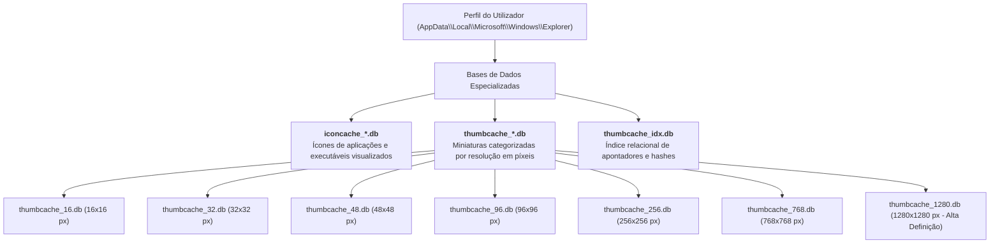

# Caches de Ícones e Miniaturas (IconCache e Thumbcache)

O subsistema de interface gráfica do Windows Explorer mantém bases de dados dedicadas à aceleração da renderização visual de ficheiros e pastas: a **IconCache** (para ícones de aplicações e tipos de ficheiros) e a **Thumbcache** (para miniaturas visuais de imagens, documentos e vídeos).

Em investigações forenses de computadores (designadamente em casos de fuga de informação confidencial, posse de ficheiros ilícitos ou espionagem industrial), estes artefactos permitem frequentemente **recuperar o conteúdo visual de ficheiros mesmo após estes terem sido apagados do disco**, bem como mapear o seu caminho original através da base de dados do [[Windows Search]].

---

## 1. Evolução Histórica e Assinatura da IconCache

A necessidade de armazenar ícones em cache remonta ao Windows 95, tendo a sua localização e nomenclatura sofrido ajustamentos ao longo das gerações do sistema:

| Versão do Windows | Nome do Ficheiro | Caminho no Sistema de Ficheiros |
| :--- | :--- | :--- |
| **Windows 95** | `ShellIconCache` | `%SystemDrive%\Windows\ShellIconCache` |
| **Windows NT / 2000** | `IconCache.db` | `%SystemDrive%\Winnt0\ShellIconCache\` |
| **Windows XP** | `IconCache.db` | `%SystemDrive%\Documents and Settings\<User>\Local Settings\Application Data\IconCache.db` |
| **Windows Vista, 7, 8, 10** | `IconCache.db` | `%UserProfile%\AppData\Local\IconCache.db` |

### A Assinatura Binária Mágica: `Win4`
Conforme documentado no estudo de **Tiago Lourenço (ASSI-MCIF, 2021)**, o cabeçalho binário do ficheiro legado `IconCache.db` apresenta uma estrutura rígida de 16 bytes:

* **Assinatura Mágica (Offset `0x04`)**: **`57 69 6E 34`** (ASCII: `Win4`)

```text
Offset (h)  00 01 02 03 04 05 06 07 08 09 0A 0B 0C 0D 0E 0F  Decoded Text
00000000    48 00 00 00 57 69 6E 34 06 05 00 00 5A 29 00 00  H...Win4....Z)..
            [HeaderSz]  [ Signature] [FileVersion] [WinBuild]
```
* Offset `0x00` (4 bytes): Tamanho do cabeçalho (`0x48` = 72 bytes);
* Offset `0x04` (4 bytes): Assinatura mágica `57 69 6E 34` (`Win4`);
* Offset `0x08` (4 bytes): Versão interna do ficheiro;
* Offset `0x0C` (4 bytes): Número de compilação (*Windows Build Number*).

---

## 2. A Arquitetura Moderna da Thumbcache (Windows Vista ao Windows 11)

A partir do Windows Vista, a Microsoft reformulou a gestão gráfica e centralizou as caches de miniaturas e ícones numa pasta dedicada dentro do perfil de cada utilizador:

```text
%LOCALAPPDATA%\Microsoft\Windows\Explorer\
```
*(Caminho expandido: `C:\Users\<UserName>\AppData\Local\Microsoft\Windows\Explorer\`)*



### Diversidade de Formatos Processados
A geração de miniaturas não se restringe a fotografias e imagens. O Windows gera entradas na Thumbcache para:
* **Ficheiros de Escritório**: Microsoft Office (`DOCX`, `PPTX`, `XLSX`);
* **Documentos Portáteis**: Adobe `PDF`;
* **Formatos de Imagem**: `JPEG`, `PNG`, `BMP`, `GIF`, `TIFF`;
* **Ficheiros de Vídeo**: `MP4`, `AVI`, `MKV`;
* **Páginas Web e Outros**: `HTML`, etc.

---

## 3. A Regra de Ouro Probatória: Presença vs. Visualização Consciente

> [!CAUTION] Existência da Miniatura NÃO Prova Visualização pelo Utilizador
> Um dos erros mais graves em relatórios periciais de informática forense é afirmar que a presença de uma miniatura na `thumbcache_*.db` prova que o arguido ou utilizador **viu e examinou conscientemente a imagem**.
> 
> * **Como funciona o Windows Explorer**: Quando um utilizador abre uma pasta no Explorador de Ficheiros, o sistema operativo gera automaticamente, em segundo plano (*background worker thread*), as miniaturas de **todos os ficheiros contidos nessa pasta** para acelerar a exibição da lista.
> * **Falso Positivo de Visualização**: Se um diretório contiver centenas de imagens descarregadas por um script, recebidas por email ou inseridas via pen USB, a simples navegação rápida pela pasta pai gera miniaturas de todos os ficheiros, mesmo que o utilizador nunca tenha aberto, clicado ou reparado nas imagens.

---

## 4. Ferramenta Forense: `Thumbcache Viewer`

O **Thumbcache Viewer** (desenvolvido por **Eric Kutcher** e mantido no projeto `https://thumbcacheviewer.github.io/`) é o utilitário de referência para extração e reconstrução pericial.

```text
Colunas de Metadados Extraídas do Thumbcache:
Index | Offset (bytes) | Cache Size | Data Size | Dimensions | Entry Hash       | Data Checksum | Identifier String | Image
1655  | 14704412 B     | 26 KB      | 14 KB     | 256x256    | c85151c06ee67458 | 0x948271A3    | [Hash / Nome]     | [Preview]
```

### 1. Utilização via Linha de Comandos (`thumbcache_viewer_cmd.exe`)
Para automação de exames periciais e exportação de relatórios:

```cmd
REM Extrair imagens de alta resolução (1280px) e gerar relatório HTML
thumbcache_viewer_cmd.exe -o "C:\Temp\Export_Imagens" -w -t "thumbcache_1280.db"

REM Processar em lote todas as bases de dados da pasta Explorer do utilizador
thumbcache_viewer_cmd.exe -o "C:\Temp\Export_Todas" -w -d "%LOCALAPPDATA%\Microsoft\Windows\Explorer"
```
* `-o <dir>`: Diretório de destino onde os ficheiros de imagem extraídos serão gravados;
* `-w`: Gera um relatório interativo em HTML contendo a galeria visual e os metadados;
* `-c`: Gera relatório em formato CSV;
* `-t <ficheiro>`: Aponta para uma base de dados específica;
* `-d <pasta>`: Processa todas as bases presentes no diretório.

---

## 5. Mapeamento com a Base do Windows Search (`Windows.db` / `Windows.edb`)

Por conceção, as bases de dados da Thumbcache indexam as miniaturas através de um valor hash de 64 bits (`Entry Hash`), não guardando o caminho textual completo do ficheiro original.

Para reconstituir onde o ficheiro original residia no disco:
1. O **Thumbcache Viewer** integra uma funcionalidade de cruzamento (*Map File Paths to Cache Entry Hashes*).
2. Carrega a base de dados de indexação do [[Windows Search]]:
   * `C:\ProgramData\Microsoft\Search\Data\Applications\Windows\Windows.db` (SQLite 3 no Windows moderno) ou `Windows.edb` (motor ESE clássico).
3. O utilitário cruza as hashes da Thumbcache com as tabelas de indexação de ficheiros do Windows Search, reconstituindo o **nome do ficheiro original e o seu caminho completo de diretórios** (ex.: `C:\Users\patri\Desktop\Contrato.pdf`).

---

## 6. Enquadramento Laboratorial e Bibliografia

### Ficha Laboratorial
Os procedimentos de análise da pasta Explorer, extração de imagens com `thumbcache_viewer_cmd.exe` e correlação de atalhos constituem a base prática da **Ficha 07 – Shortcuts & thumbcache**.

### Referências Académicas
* **Quick, D., Tassone, C., & Choo, K.-K. R. (2014)**. *Forensic analysis of Windows thumbcache files*. [DOI: 10.1016/j.diin.2014.05.002](https://doi.org/10.1016/j.diin.2014.05.002).
* **Lourenço, T. (2021)**. *A cache de ícones IconCache.db e respetivo valor forense*. Trabalho de investigação, Mestrado em Cibersegurança e Informática Forense (ASSI-MCIF), Politécnico de Leiria.

---

## Navegação

- [[Capítulo 1 - Sistemas Operativos, Serviços e Artefactos Forenses|Voltar ao Índice do Capítulo 1]]
- [[Jump Lists - Arquitetura, AppIDs e Carving]]
- [[Ficheiros LNK (Shell Links) - Metadados e Formato Binário]]
- [[Windows Search]]
- [[Taxonomia dos Artefactos de Execução no Windows]]
