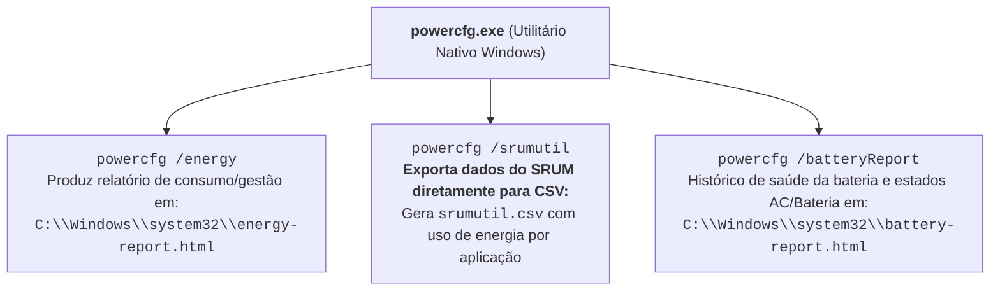
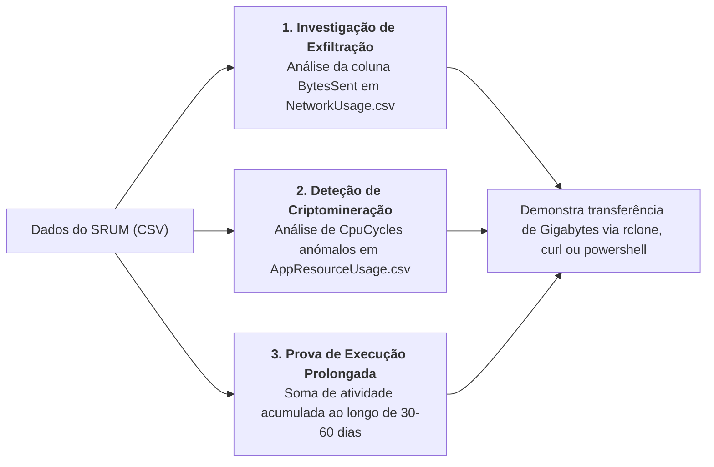

# Análise Forense do SRUM e Ferramentas Nativas (powercfg)

A exploração pericial dos dados mantidos pelo [[System Resource Usage Monitor (SRUM) - Arquitetura e Base ESE|SRUM]] permite aos analistas de segurança quantificar com rigor cirúrgico a atividade de um computador. 

Em incidentes de exfiltração de informação, malware furtivo ou intrusões com ferramentas de *Living off the Land* (LOLBins), o SRUM fornece a resposta a questões como: *Quantos gigabytes de dados foram transmitidos por determinado processo para a rede?* ou *Durante quanto tempo este binário consumiu ciclos de processamento?*

---

## 1. Visualização Nativa no Sistema: Gestor de Tarefas

No Windows 10 e Windows 11, o sistema disponibiliza uma interface gráfica preliminar:
* **Localização**: **Gestor de Tarefas (*Task Manager*)** $\to$ Separador **Histórico de Aplicações (*App History*)**.
* **Métricas Apresentadas**: Tempo de CPU acumulado, consumo de rede em MB, rede com tráfego limitado (*metered network*), atualizações de mosaicos dinâmicos (*tile updates*) e notificações.

> [!WARNING] Limitação Severa do Task Manager
> O Gestor de Tarefas apresenta apenas uma **pequena fração** da riqueza de dados preservada pelo SRUM. Ignora processos não instalados via loja ou não interativos, não discrimina endereços ou adaptadores de rede específicos e omite detalhes de conectividade. A perícia formal exige a extração direta da base de dados.

---

## 2. Utilitário Nativo da Linha de Comandos: `powercfg.exe`

O executável nativo do Windows **`powercfg.exe`** disponibiliza comandos de auditoria capazes de extrair relatórios diretamente para ficheiros HTML e CSV sem recorrer a software de terceiros:



### O Comando `powercfg /srumutil`
Constitui um atalho extraordinário em triagem de campo (*live triage*):
```cmd
powercfg.exe /srumutil
```
*O Windows interroga o subsistema SRUM e cria instantaneamente o ficheiro **`srumutil.csv`** no diretório de execução, contendo o consumo energético individual de cada aplicação que operou no sistema.*

---

## 3. Inspeção Visual de Baixo Nível: `ESE Database Viewer` (NirSoft)

O utilitário **`ESE Database Viewer`** da NirSoft permite abrir e consultar diretamente as tabelas do ficheiro `SRUDB.dat`:

```text
Inspeção da tabela de mapeamento: SruDbIdMapTable
IdType | IdIndex | IdBlob (Codificado em UTF-16LE Unicode)
0      | 139     | 5C 00 44 00 65 00 76 00 69 00 63 00 65 ... (Device\HarddiskVolume1\...\firefox.exe)
0      | 140     | 5C 00 44 00 65 00 76 00 69 00 63 00 65 ... (Device\HarddiskVolume1\...\cmd.exe)
```

* **Codificação de Texto**: Conforme evidente na captura, os caminhos de ficheiros na `SruDbIdMapTable` estão codificados em **UTF-16LE**. A ferramenta exibe os bytes brutos, exigindo descodificação Unicode para identificar os caminhos textuais legíveis.

---

## 4. Ferramenta de Referência Forense: `SrumECmd` (Eric Zimmerman)

O utilitário **`SrumECmd`** automatiza a totalidade da correlação pericial. O programa resolve o mapeamento dos `IdIndex` da `SruDbIdMapTable` e cruza-os com as tabelas de dados de métricas, gerando ficheiros CSV prontos para análise pericial:

```cmd
SrumECmd.exe -f "C:\Windows\System32\SRU\SRUDB.dat" --csv "C:\Temp\SRUM_Export"
```

```text
Saída típica do SrumECmd:
SrumECmd version 0.5.1.0
Author: Eric Zimmerman (ericzimmerman@gmail.com)

Command line: -f C:\Forensics\SRUDB.dat --csv C:\Temp\SRUM_Export
Processing 'C:\Forensics\SRUDB.dat'...
Processing complete!

Energy Usage count:             1,748
AppTimelineProvider count:     43,700
vfuprov count:                  5,877
App Resource Usage count:      72,602
Network Connection count:       2,223
Network Usage count:           21,283
Push Notification count:        1,227
```

### Relatórios CSV Gerados pelo SrumECmd:
1. **`..._AppResourceUsage.csv`**:
   * Identifica o binário, o SID do utilizador e contabiliza o número de ciclos de CPU (`CpuCycles`), leituras e escritas de bytes em disco.
2. **`..._NetworkUsage.csv`**:
   * Contabiliza os bytes enviados (**`BytesSent`**) e recebidos (**`BytesRecv`**) por cada aplicação e interface.
3. **`..._NetworkConnectivity.csv`**:
   * Mapeia os períodos de conexão, durações e o nome da rede (SSID / rede com fios).
4. **`..._EnergyUsage.csv`**:
   * Regista a descarga da bateria e consumo quando a máquina operava em modo bateria vs. ligada à tomada (AC).

---

## 5. Aplicações Típicas em Incidentes de Segurança



* **Quantificação de Exfiltração de Dados**: Se um executável como `rclone.exe`, `mega.exe`, `powershell.exe` ou `curl.exe` apresentar um valor elevado na coluna `BytesSent` (ex.: centenas de megabytes ou gigabytes), o analista dispõe de prova matemática irrefutável de envio massivo de dados para a rede.
* **Comprovação de Mineração (*Cryptojacking*)**: Processos suspeitos camuflados de serviços do sistema que acumulam milhões de ciclos de CPU no registo histórico.
* **Determinação da Janela de Compromisso**: O SRUM permite provar que determinado malware correu diariamente durante semanas antes de ser detetado, estabelecendo a linha do tempo completa do incidente.

---

## Navegação

- [[Capítulo 1 - Sistemas Operativos, Serviços e Artefactos Forenses|Voltar ao Índice do Capítulo 1]]
- [[System Resource Usage Monitor (SRUM) - Arquitetura e Base ESE]]
- [[Windows Activity Timeline - Arquitetura e Base SQLite]]
- [[Recuperação de Clipboard e Sincronização na Timeline]]
- [[Taxonomia dos Artefactos de Execução no Windows]]
