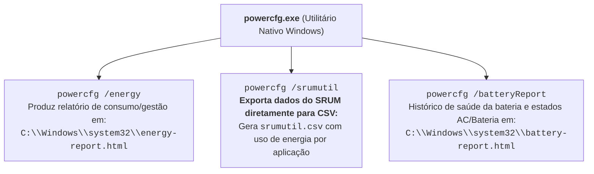
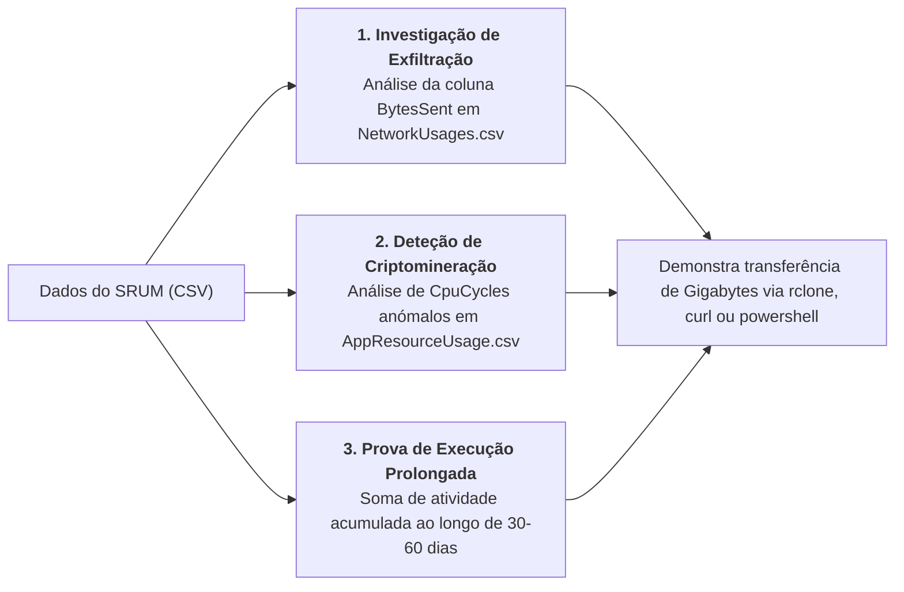

# Análise Forense do SRUM e Ferramentas Nativas (powercfg)

A extração forense do **SRUM** com `powercfg /srumutil`, `ESE Database Viewer` e **`SrumECmd`** permite quantificar exfiltração de dados (`BytesSent`), uso de CPU e conexões de rede.

> [!TIP] Lógica de Funcionamento e Valor Forense
> * **Porque existe (Sistema)**: O Windows inclui interfaces nativas (como o separador *App History* do Gestor de Tarefas e o utilitário CLI **`powercfg.exe`**) para que administradores e engenheiros de suporte auditem o consumo energético e de recursos a partir do [[System Resource Usage Monitor (SRUM) - Arquitetura e Base ESE|SRUM]].
> * **Porque importa (Forense)**: Em incidentes de intrusão, ransomware ou roubo de propriedade intelectual, ferramentas periciais como o **`SrumECmd`** cruzam automaticamente a base `SRUDB.dat` (resolvendo o `IdIndex` da `SruDbIdMapTable`) com o hive **`SOFTWARE`** (para traduzir perfis de rede nos nomes reais de redes Wi-Fi / SSIDs), provando matematicamente quantos megabytes/gigabytes um binário (`rclone.exe`, `powershell.exe`, `curl.exe`) enviou para o exterior e através de que rede.
> * **Pontos Críticos e Armadilhas para Exame**:
>   * **Limitação do Gestor de Tarefas**: O separador *Histórico de Aplicações* do Task Manager mostra apenas uma fração mínima do SRUM (focado em apps UWP/modernas), omitindo processos de sistema, serviços e detalhes de interfaces.
>   * **Cruzamento com o Hive `SOFTWARE`**: Executar o `SrumECmd` passando também o hive `SOFTWARE` (`-r SOFTWARE`) enriquece os relatórios de rede com o nome textual do perfil Wi-Fi/Ethernet (`L2ProfileId`).

---

## 1. Visualização Nativa no Sistema: Gestor de Tarefas

A exploração pericial dos dados mantidos pelo [[System Resource Usage Monitor (SRUM) - Arquitetura e Base ESE|SRUM]] permite aos analistas de segurança responder a questões críticas como: *Quantos gigabytes de dados foram transmitidos por determinado processo para a rede?* ou *Durante quanto tempo este binário consumiu ciclos de processamento?*

No Windows 10 e Windows 11, o sistema disponibiliza uma interface gráfica preliminar:

* **Localização**: **Gestor de Tarefas (*Task Manager*)** $\to$ Separador **Histórico de Aplicações (*App History*)**.
* **Métricas Apresentadas**: Tempo de CPU acumulado, consumo de rede em MB, rede com tráfego limitado (*metered network*), atualizações de mosaicos dinâmicos (*tile updates*) e notificações.

> [!WARNING] Limitação Severa do Task Manager
> O Gestor de Tarefas apresenta apenas uma **pequena fração** da riqueza de dados preservada pelo SRUM. Ignora a maioria dos executáveis Win32 clássicos, processos de linha de comandos e serviços, não discrimina adaptadores de rede específicos e omite detalhes de conectividade. A perícia formal exige a extração direta da base de dados.

---

## 2. Utilitário Nativo da Linha de Comandos: `powercfg.exe`

O executável nativo do Windows **`powercfg.exe`** disponibiliza comandos de auditoria capazes de extrair relatórios diretamente para ficheiros HTML e CSV em triagem *live*, sem recorrer a software de terceiros:



### Anatomia dos Comandos de Auditoria do `powercfg.exe`

| Comando CLI (Requer Elevação Admin) | Ficheiro de Saída Padrão | Conteúdo e Utilidade em Triagem Forense (*Live Response*) |
| :--- | :--- | :--- |
| **`powercfg.exe /srumutil`** | `.\srumutil.csv` (ou `/output <ficheiro.csv> /csv`) | Interroga a API do SRUM e despeja instantaneamente para CSV a telemetria de consumo energético e tempo em ecrã/CPU por aplicação e utilizador. |
| **`powercfg.exe /batteryreport`** | `C:\Windows\System32\battery-report.html` | Reconstrói o histórico exato dos estados de energia da máquina (*Active*, *Connected Standby*, *Suspended*), provando **a que horas exatas um portátil esteve ligado, suspenso ou ligado à corrente AC**. |
| **`powercfg.exe /energy`** | `C:\Windows\System32\energy-report.html` | Observa o sistema durante 60 segundos e gera um diagnóstico de processos, serviços e drivers que impedem a suspensão ou consomem recursos. |

```cmd
REM Extração rápida nativa do SRUM em triagem live
powercfg.exe /srumutil
```

---

## 3. Inspeção Visual de Baixo Nível: `ESE Database Viewer` (NirSoft)

O utilitário **`ESE Database Viewer`** da NirSoft permite abrir e consultar diretamente as tabelas brutas do ficheiro `SRUDB.dat`:

```text
Inspeção da tabela de mapeamento: SruDbIdMapTable
IdType | IdIndex | IdBlob (Codificado em UTF-16LE Unicode)
0      | 139     | 5C 00 44 00 65 00 76 00 69 00 63 00 65 ... (Device\HarddiskVolume1\...\firefox.exe)
0      | 140     | 5C 00 44 00 65 00 76 00 69 00 63 00 65 ... (Device\HarddiskVolume1\...\cmd.exe)
```

* **Codificação de Texto**: Conforme evidente na captura, os caminhos de ficheiros na coluna `IdBlob` da `SruDbIdMapTable` estão codificados em **[[Codificação de Caracteres - ASCII, Latin-1 e Unicode|UTF-16LE]]**. A ferramenta da NirSoft exibe os bytes hexadecimais brutos e exige que o analista correlacione manualmente o `IdIndex` com as tabelas nomeadas por GUID, tornando este método trabalhoso em grandes bases de dados.

---

## 4. Ferramenta de Referência Forense: `SrumECmd` (Eric Zimmerman)

O utilitário **`SrumECmd`** automatiza a totalidade da correlação pericial. O programa resolve o mapeamento dos `IdIndex` da `SruDbIdMapTable` (tanto os caminhos UTF-16LE das aplicações como os SIDs dos utilizadores), cruza-os com as tabelas GUID de métricas e, opcionalmente, lê o hive `SOFTWARE` para resolver os nomes das redes Wi-Fi/Ethernet, gerando ficheiros CSV prontos para análise:

```cmd
REM Processar um ficheiro SRUDB.dat isolado
SrumECmd.exe -f "C:\Forensics\SRU\SRUDB.dat" --csv "C:\Temp\SRUM_Export"

REM Processar toda a pasta SRU cruzando com o hive SOFTWARE extraído (Recomendado)
SrumECmd.exe -f "C:\Forensics\SRU\SRUDB.dat" -r "C:\Forensics\Config\SOFTWARE" --csv "C:\Temp\SRUM_Export"
```

### Anatomia Detalhada dos Parâmetros do `SrumECmd`:

* **`-f <ficheiro>`**: Caminho para a base de dados `SRUDB.dat` (que deve encontrar-se previamente em estado *Clean Shutdown*; caso contrário, reparar antes com `esentutl /r sru /d`).
* **`-r <hive_SOFTWARE>`**: Caminho opcional (mas altamente recomendado) para o hive de Registry `C:\Windows\System32\config\SOFTWARE`. Permite ao `SrumECmd` cruzar os identificadores `L2ProfileId` da tabela de conectividade com a chave `Microsoft\WlanSvc\Interfaces` para mostrar o **SSID exato da rede Wi-Fi**.
* **`-d <diretório>`**: Processa uma pasta contendo tanto o `SRUDB.dat` como o hive `SOFTWARE`.
* **`--csv <diretório>`**: Diretório de saída onde serão criados os ficheiros CSV (um ficheiro CSV por cada tabela/provider do SRUM).

```text
Saída típica do SrumECmd na consola:
SrumECmd version 0.5.1.0
Author: Eric Zimmerman (ericzimmerman@gmail.com)

Command line: -f C:\Forensics\SRUDB.dat --csv C:\Temp\SRUM_Export
Processing 'C:\Forensics\SRUDB.dat'...
Processing complete!

Energy Usage count:             1,748
AppTimelineProvider count:     43,700
vfuprov count:                  5,877
App Resource Usage count:      72,602
Network Connection count:       2,223
Network Usage count:           21,283
Push Notification count:        1,227
```

### Relatórios CSV Gerados pelo `SrumECmd`:

1. **`..._AppResourceUsage_Output.csv`** (`{D10CA2FE-...FA89}`):
   * Identifica o binário (`ExeInfo`), o SID do utilizador (`UserId`) e contabiliza o número de ciclos de CPU (`ForegroundCycleTime`, `BackgroundCycleTime`), leituras e escritas de bytes em disco (`ForegroundBytesRead`, `ForegroundBytesWritten`).
2. **`..._NetworkUsages_Output.csv`** (`{973F5D5C-...A174}`):
   * Contabiliza os bytes enviados (**`BytesSent`**) e recebidos (**`BytesRecvd`**) por cada aplicação, utilizador e interface de rede (`InterfaceLuid` / tipo de interface IANA).
3. **`..._NetworkConnections_Output.csv`** (`{DD6636C4-...3763}`):
   * Mapeia os períodos de conexão (`ConnectStartTime`), durações em segundos (`ConnectedTime`) e o nome do perfil de rede / SSID.
4. **`..._EnergyUsage_Output.csv`** (`{FEE4E14F-...2E37}`):
   * Regista a descarga da bateria e consumo energético por estado de alimentação.

---

## 5. Aplicações Típicas em Incidentes de Segurança



* **Quantificação de Exfiltração de Dados**: Se um executável como `rclone.exe`, `mega.exe`, `winscp.exe`, `powershell.exe` ou `curl.exe` apresentar um valor elevado na coluna **`BytesSent`** (ex.: `5368709120` bytes $\approx 5\,\text{GB}$) num intervalo horário específico, o analista dispõe de prova matemática irrefutável de envio massivo de dados para a rede, associada ao SID do utilizador que lançou o processo.
* **Comprovação de Mineração (*Cryptojacking*)**: Processos suspeitos camuflados de serviços do sistema que acumulam biliões de ciclos de CPU (`BackgroundCycleTime`) no registo histórico.
* **Determinação da Janela de Compromisso**: Mesmo que um atacante apague os ficheiros `.pf` do Prefetch, limpe os Event Logs (`.evtx`) e elimine o malware antes de sair, o SRUM (protegido pelo serviço DPS) preserva o histórico dos últimos 30 a 60 dias.

---

## Perguntas de revisão

1. **Porque é que um perito forense não se pode limitar a consultar o separador "Histórico de Aplicações" (*App History*) do Gestor de Tarefas do Windows para analisar os dados do SRUM?**

> [!success]- Ver Resposta
> Porque o Gestor de Tarefas apresenta apenas um resumo superficial focado em aplicações UWP/modernas, omitindo a maioria dos executáveis Win32 de linha de comandos (LOLBins como `powershell.exe`, `cmd.exe`, `rclone.exe`), serviços de sistema, discriminação temporal hora a hora e detalhes das interfaces de rede. A análise forense exige a extração direta do ficheiro `SRUDB.dat` com ferramentas como o `SrumECmd`.

2. **Que comando nativo do Windows permite exportar rapidamente métricas do SRUM para um ficheiro CSV durante uma triagem *live*, e que outro comando do mesmo utilitário permite reconstruir as horas exatas em que um portátil esteve ligado ou suspenso?**

> [!success]- Ver Resposta
> O utilitário nativo é o **`powercfg.exe`**:
> * **`powercfg.exe /srumutil`** gera imediatamente o ficheiro `srumutil.csv` com métricas de uso energético e atividade do SRUM;
> * **`powercfg.exe /batteryreport`** gera o relatório `battery-report.html`, que documenta cronologicamente todos os estados de energia (*Active*, *Connected Standby*, *Suspended*) e se o portátil estava ligado à corrente AC ou bateria.

3. **Ao utilizar o `ESE Database Viewer` (NirSoft) para inspecionar diretamente a tabela `SruDbIdMapTable` do `SRUDB.dat`, porque é que os caminhos dos executáveis na coluna `IdBlob` aparecem intercalados com bytes nulos (`00`)?**

> [!success]- Ver Resposta
> Porque o Windows armazena as strings de caminhos de aplicações na coluna `IdBlob` utilizando a codificação **UTF-16LE Unicode** (2 bytes por caráter, onde os carateres ASCII comuns têm o segundo byte a `0x00`, ex.: `5C 00 44 00` para `\D`).

4. **Na execução da ferramenta `SrumECmd.exe`, qual é a vantagem pericial de fornecer o parâmetro adicional `-r "C:\...\SOFTWARE"` juntamente com `-f "SRUDB.dat"`?**

> [!success]- Ver Resposta
> O parâmetro **`-r`** aponta para o hive de Registry `SOFTWARE`. Isto permite ao `SrumECmd` cruzar os identificadores numéricos de perfil de rede (`L2ProfileId`) presentes nas tabelas de rede do SRUM com as chaves de configuração de rede do Registry (`WlanSvc\Interfaces` / `NetworkList`), traduzindo os códigos nos **nomes reais (SSIDs) das redes Wi-Fi** às quais o computador esteve ligado durante uma exfiltração de dados.

5. **Num incidente de suspeita de exfiltração de documentos confidenciais através do utilitário `rclone.exe` (que entretanto foi apagado do disco pelo atacante), que ficheiro CSV gerado pelo `SrumECmd` e que colunas específicas provam o volume exato de dados roubados?**

> [!success]- Ver Resposta
> O perito deve analisar o ficheiro **`..._NetworkUsages_Output.csv`** (extraído da tabela `{973F5D5C-1D90-4944-BE8E-24B94231A174}`), filtrando a coluna **`ExeInfo`** por `rclone.exe`. A coluna **`BytesSent`** mostrará a quantidade exata de bytes transmitidos para a rede em cada janela horária, a coluna **`UserId` / `Sid`** identificará o utilizador responsável e a coluna **`Timestamp`** indicará a hora da descarga.

---

## Navegação

- [[Capítulo 1 - Sistemas Operativos, Serviços e Artefactos Forenses|Voltar ao Índice do Capítulo 1]]
- [[System Resource Usage Monitor (SRUM) - Arquitetura e Base ESE]]
- [[Windows Activity Timeline - Arquitetura e Base SQLite]]
- [[Recuperação de Clipboard e Sincronização na Timeline]]
- [[Taxonomia dos Artefactos de Execução no Windows]]
- [[Codificação de Caracteres - ASCII, Latin-1 e Unicode]]
- [[Diretrizes de Manuseamento - Identificação, Preservação, Isolamento e Correlação]]
- [[Princípios e Rota do Manuseamento de Evidência Digital]]
