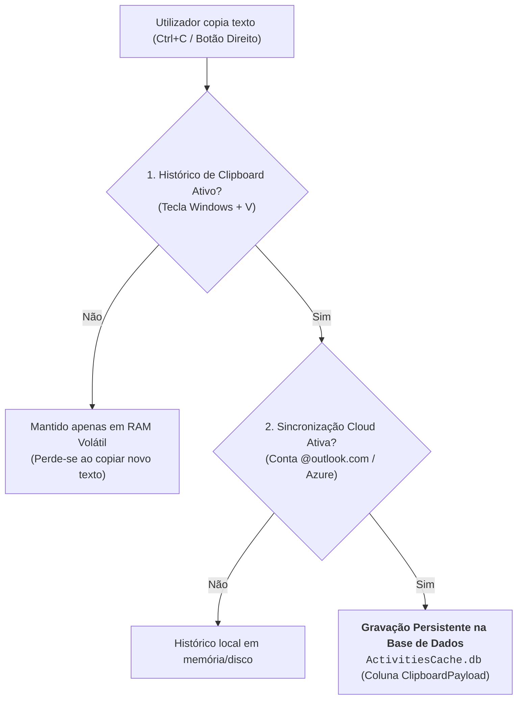

# Recuperação de Clipboard e Sincronização na Timeline

O Windows persiste textos copiados na coluna `ClipboardPayload` (JSON em Base64) da base `ActivitiesCache.db` durante **12 horas**, quando o histórico (`Win+V`) e o *Cloud Sync* estão ativos.

> [!TIP] Lógica de Funcionamento e Valor Forense
> * **Porque existe (Sistema)**: Para suportar o histórico da área de transferência (**`Windows + V`**) e a sincronização de recortes entre dispositivos (*Cloud Clipboard Sync*), o serviço `CDPUserSvc` precisa de serializar os fragmentos de texto copiados pelo utilizador e armazená-los temporariamente na base de dados da [[Windows Activity Timeline - Arquitetura e Base SQLite|Timeline]] (`ActivitiesCache.db`) para replicação na nuvem.
> * **Porque importa (Forense)**: Transforma um artefacto historicamente volátil (que antes só existia em memória RAM e era sobrescrito a cada novo `Ctrl+C`) num registo persistente em disco. Permite recuperar palavras-passe copiadas de gestores de credenciais, URLs privados, chaves criptográficas ou comandos de exfiltração copiados pelo suspeito.
> * **Pontos Críticos e Armadilhas para Exame**:
>   * **Duplo Requisito Obrigatório**: O texto copiado só é gravado em `ActivitiesCache.db` se estiverem simultaneamente ativos: **(1) Histórico de Clipboard (`Windows + V`)** e **(2) Sincronização na nuvem (*Sync across your devices*)** com conta Microsoft/Azure AD.
>   * **Janela de Retenção de 12 Horas**: As entradas na coluna `ClipboardPayload` têm um tempo de vida estrito de **12 horas**, após o qual o payload em Base64 é purgado da tabela `Activity`. A ferramenta **`Clippy`** analisa tanto o `.db` como o `.wal` para maximizar a recuperação.

---

## 1. Condições Prévias para a Gravação do Clipboard

A área de transferência (*Clipboard*) clássica do Windows era um artefacto puramente volátil em memória RAM. Contudo, a persistência do conteúdo copiado na base de dados `ActivitiesCache.db` ocorre sempre que duas configurações estão ativas no computador:



### Comparação dos Modos de Operação do Clipboard no Windows 10/11

| Configuração do Sistema | Onde Reside o Texto Copiado | Sobrevive a Novo `Ctrl+C`? | Grava em `ActivitiesCache.db` (`ClipboardPayload`)? |
| :--- | :--- | :---: | :---: |
| **Padrão (Sem `Win+V` e Sem Cloud Sync)** | Apenas na memória RAM volátil | Não (sobrescrito) | **Não** |
| **Apenas Histórico Local (`Win+V` Ativo, Sem Cloud Sync)** | Memória RAM (processos de utilizador / `CDPUserSvc`) | Sim (até 25 itens em sessão) | **Não** |
| **Histórico (`Win+V`) + Sincronização Cloud Ativos** | RAM + Base SQLite **`ActivitiesCache.db`** e **`.wal`** | **Sim** (em disco) | **Sim (Retenção de 12 horas em Base64)** |

1. **Histórico do Clipboard Ativo**: O operador ativou o histórico visual (acedido através do atalho de teclado **`Windows + V`**).
2. **Sincronização na Nuvem (*Cloud Sync*)**: O utilizador ativou a opção de partilha entre dispositivos nas definições de sistema (*Settings* $\to$ *System* $\to$ *Clipboard* $\to$ *Sync across your devices*), associada a uma conta Microsoft (`@outlook.com`, `@live.com`, `@hotmail.com` ou corporativa Azure AD).

---

## 2. Estrutura de Dados e Codificação Base64

Quando as duas condições estão reunidas, a instância do serviço de sistema `svchost.exe -k UnistackSvcGroup -s CDPUserSvc` insere um novo registo na base de dados SQLite do utilizador:

* **Ficheiro**: `%LOCALAPPDATA%\ConnectedDevicesPlatform\<Account_ID>\ActivitiesCache.db` (e `ActivitiesCache.wal`)
* **Tabela**: `Activity` (e `ActivityOperation`)
* **Coluna**: **`ClipboardPayload`**

### Formato do Payload JSON
O dado é encapsulado num array JSON contendo o formato do conteúdo (`formatName`: `"Text"`) e a carga de texto codificada em **[[Codificação Binário-para-Texto (Base16, Base64 e Base58)|Base64]]** na chave `content`:

```json
[
  {
    "content": "SXN0byDDqSB1bSB0ZXN0ZSE=",
    "formatName": "Text"
  }
]
```

### Processo de Descodificação Pericial
Ao extrair a string da chave `content`, o perito aplica descodificação padrão de Base64 (interpretando os bytes resultantes em UTF-8):

```text
"SXN0byDDqSB1bSB0ZXN0ZSE="  ---[Base64 Decode]--->  "Isto é um teste!"
```

> [!IMPORTANT] Janela Temporal de Retenção: 12 Horas
> O conteúdo textual armazenado no campo `ClipboardPayload` possui uma **validade estrita de 12 horas** (`ExpirationTime` / limpeza periódica). Após esse período, a tarefa de manutenção interna da Timeline purga a entrada ou esvazia a coluna `ClipboardPayload`, permanecendo apenas o registo genérico de atividade (embora vestígios de páginas SQLite apagadas possam por vezes permanecer em *freelist pages* ou no ficheiro `.wal` ainda não sobrescrito).

---

## 3. Ferramenta Especializada: `Clippy` (kacos2000) e Anatomia de Uso

Embora seja possível formular consultas SQL manuais à tabela `Activity` (ex.: `SELECT StartTime, ClipboardPayload FROM Activity WHERE ClipboardPayload IS NOT NULL;`), o investigador forense **kacos2000 (Costas Katsavounidis)** desenvolveu o utilitário de código aberto **`Clippy`**, desenhado propositadamente para automatizar a extração e descodificação.

### Extração Simultânea do Ficheiro Principal e do WAL
Uma das grandes mais-valias do `Clippy` reside no facto de realizar uma pesquisa binária/estrutural que analisa simultaneamente:

* O ficheiro da base de dados principal: **`ActivitiesCache.db`**;
* O ficheiro transacional de log: **`ActivitiesCache.wal`** (*Write-Ahead Log*).

Isto garante a recuperação de textos copiados **nos últimos segundos ou minutos antes do congelamento pericial da máquina**, que ainda não tinham sido consolidados na base principal, bem como entradas recentemente apagadas da tabela mas ainda presentes nas páginas do `.wal`.

### Anatomia de Execução e Saída do `Clippy`

1. **Execução do Utilitário**:
   * O analista executa o `Clippy.exe` (interface gráfica ou apontando para a pasta que contém `ActivitiesCache.db` e `ActivitiesCache.wal`).
   * A ferramenta procura todas as ocorrências do padrão JSON `"content":"..."` associadas a `formatName`, extrai a string Base64, descodifica-a automaticamente para texto limpo e regista o offset exato (decimal e hexadecimal) onde a evidência foi encontrada no ficheiro.

```text
Interface e Exportação Tabular do Clippy:
Entry | Offset (Dec) | Offset (Hex) | Length (B64) | Copied_Text
4460  | 29779101     | 0x01C6649D   | 48           | assoc .txt = txtfilelegacy
4461  | 29779543     | 0x01C66657   | 164          | https://www.aon.com/cyber-solutions/aon_cyber_labs/...
4463  | 29780575     | 0x01C66A5F   | 48           | C:\Users\Public\portable\forensics
4466  | 29781945     | 0x01C66FB9   | 32           | 2 Ferramentas Zimmerman
```

2. **Exportação Pericial**:
   * O utilitário exporta a totalidade das entradas recuperadas para um ficheiro CSV estruturado (**`FullClipboardText.csv`**), contendo o número de entrada, offsets em disco, tamanho do bloco Base64 e o texto descodificado, permitindo pesquisas imediatas por palavras-chave em investigações de exfiltração de dados ou introdução de palavras-passe.

---

## Perguntas de revisão

1. **Quais são os dois pré-requisitos obrigatórios de configuração no Windows para que os textos copiados pelo utilizador (`Ctrl+C`) sejam gravados persistentemente na base de dados `ActivitiesCache.db`?**

> [!success]- Ver Resposta
> É obrigatório que estejam simultaneamente ativas duas funcionalidades:
> 1. O **Histórico do Clipboard** (ativado através do atalho **`Windows + V`**);
> 2. A **Sincronização na Nuvem (*Cloud Sync* / *Sync across your devices*)**, associada a uma conta Microsoft (`@outlook.com`, `@live.com`) ou conta corporativa Azure AD.

2. **Em que tabela e coluna da base `ActivitiesCache.db` é guardado o texto copiado e qual é o seu formato e codificação?**

> [!success]- Ver Resposta
> O texto copiado é armazenado na tabela **`Activity`**, dentro da coluna **`ClipboardPayload`**. Os dados são guardados num objeto **JSON** (ex.: `[{"content":"...","formatName":"Text"}]`), onde o texto propriamente dito na chave `"content"` se encontra codificado em **Base64**.

3. **Qual é a janela temporal de retenção oficial dos dados na coluna `ClipboardPayload` e o que acontece após esse prazo?**

> [!success]- Ver Resposta
> O conteúdo armazenado em `ClipboardPayload` tem uma janela de retenção de **12 horas**. Passadas 12 horas, o mecanismo de manutenção da Timeline purga ou esvazia o conteúdo da coluna `ClipboardPayload` para proteger a privacidade e libertar espaço.

4. **Porque é que a ferramenta forense `Clippy` (kacos2000) é mais eficaz na recuperação de recortes do Clipboard do que uma consulta SQL simples apenas sobre a tabela `Activity` do ficheiro `ActivitiesCache.db`?**

> [!success]- Ver Resposta
> Porque o **`Clippy`** varre a nível binário tanto o ficheiro principal **`ActivitiesCache.db`** como o ficheiro de log transacional **`ActivitiesCache.wal`** (*Write-Ahead Log*), descodificando automaticamente os blocos Base64 e registando os seus offsets físicos. Isto permite recuperar textos copiados nos últimos segundos antes da apreensão (ainda retidos no `.wal`) e registos cujo tempo de 12 horas já expirou na tabela ativa mas cujos bytes ainda residem em páginas não sobrescritas do `.db` ou `.wal`.

---

## Navegação

- [[Capítulo 1 - Sistemas Operativos, Serviços e Artefactos Forenses|Voltar ao Índice do Capítulo 1]]
- [[Windows Activity Timeline - Arquitetura e Base SQLite]]
- [[System Resource Usage Monitor (SRUM) - Arquitetura e Base ESE]]
- [[Análise Forense do SRUM e Ferramentas Nativas (powercfg)]]
- [[Codificação Binário-para-Texto (Base16, Base64 e Base58)]]
- [[Diretrizes de Manuseamento - Identificação, Preservação, Isolamento e Correlação]]
