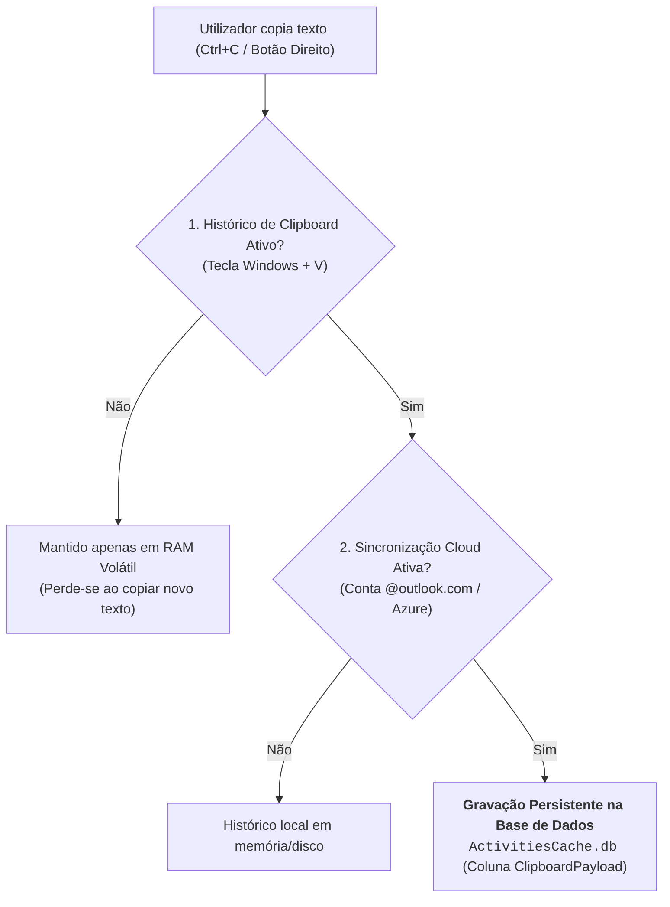

# Recuperação de Clipboard e Sincronização na Timeline

A área de transferência (*Clipboard*) do Windows é historicamente um dos artefactos mais voláteis do sistema operativo, perdendo-se com frequência na sobreposição de cópias subsequentes ou no encerramento da máquina.

No entanto, com a introdução do ecossistema moderno da [[Windows Activity Timeline - Arquitetura e Base SQLite|Windows Activity Timeline]], da funcionalidade de histórico do Clipboard (**Windows + V**) e do sincronismo com a nuvem (*Cloud Clipboard Sync*), o sistema operativo passou a gravar snippets de texto copiado na base de dados relacional de sistema, criando uma oportunidade pericial para a recuperação de palavras-passe, mensagens confidenciais e comandos de terminal.

---

## 1. Condições Prévias para a Gravação do Clipboard

A persistência do conteúdo copiado na base de dados `ActivitiesCache.db` não ocorre universalmente, exigindo que duas configurações estejam ativas no computador:



1. **Histórico do Clipboard Ativo**: O operador ativou o histórico visual (acedido através do atalho de teclado **`Windows + V`**).
2. **Sincronização na Nuvem (*Cloud Sync*)**: O utilizador ativou a opção de partilha entre dispositivos nas definições de sistema (*Settings* $\to$ *System* $\to$ *Clipboard* $\to$ *Sync across your devices*), associada a uma conta Microsoft (`@outlook.com`, `@live.com` ou corporativa Azure AD).

---

## 2. Estrutura de Dados e Codificação Base64

Quando as condições estão reunidas, a instância do serviço de sistema `svchost.exe -s CDPUserSvc` insere um novo registo na base de dados SQLite do utilizador:

* **Tabela**: `Activity`
* **Coluna**: `ClipboardPayload`

### Formato do Payload JSON
O dado é encapsulado num objeto JSON contendo o formato do conteúdo e a carga de texto codificada em **Base64**:

```json
[
  {
    "content": "SXN0byDDqSB1bSB0ZXN0ZSE=",
    "formatName": "Text"
  }
]
```

### Processo de Descodificação Pericial
Ao extrair a cadeia da chave `content`, o perito aplica descodificação padrão de Base64:
$$\texttt{"SXN0byDDqSB1bSB0ZXN0ZSE="} \xrightarrow{\text{Base64 Decode}} \mathbf{\text{"Isto é um teste!"}}$$

> [!IMPORTANT] Janela Temporal de Retenção: 12 Horas
> O conteúdo textual armazenado no campo `ClipboardPayload` possui uma **validade de 12 horas**. Após esse período, a tarefa de manutenção interna da Timeline purga a entrada ou esvazia a coluna `ClipboardPayload`, permanecendo apenas o registo genérico de atividade.

---

## 3. Ferramenta Especializada: `Clippy` (kacos2000)

Embora seja possível formular consultas SQL manuais à tabela `Activity`, o investigador forense **kacos2000** desenvolveu o utilitário de código aberto **`Clippy`**, desenhado propositadamente para este fim.

### Extração do Ficheiro Principal e do WAL
Uma das grandes mais-valias do `Clippy` reside no facto de analisar simultaneamente:
* O ficheiro da base de dados principal: `ActivitiesCache.db`;
* O ficheiro transacional de log: **`ActivitiesCache.wal`** (*Write-Ahead Log*).

Isto garante a recuperação de textos copiados **nos últimos segundos ou minutos antes do congelamento pericial da máquina**, que ainda não tinham sido consolidados na base principal.

```text
Interface e Exportação Tabular do Clippy:
Entry | Offset (Dec) | Offset (Hex) | Length (B64) | Copied_Text
4460  | 29779101     | 0x01C6649D   | 48           | assoc .txt = txtfilelegacy
4461  | 29779543     | 0x01C66657   | 164          | https://www.aon.com/cyber-solutions/aon_cyber_labs/...
4463  | 29780575     | 0x01C66A5F   | 48           | C:\Users\Public\portable\forensics
4466  | 29781945     | 0x01C66FB9   | 32           | 2 Ferramentas Zimmerman
```

O utilitário exporta a totalidade das entradas para um ficheiro CSV estruturado (`FullClipboardText.csv`), permitindo pesquisas imediatas por palavras-chave em investigações de exfiltração de dados ou introdução de palavras-passe.

---

## Navegação

- [[Capítulo 1 - Sistemas Operativos, Serviços e Artefactos Forenses|Voltar ao Índice do Capítulo 1]]
- [[Windows Activity Timeline - Arquitetura e Base SQLite]]
- [[System Resource Usage Monitor (SRUM) - Arquitetura e Base ESE]]
- [[Análise Forense do SRUM e Ferramentas Nativas (powercfg)]]
