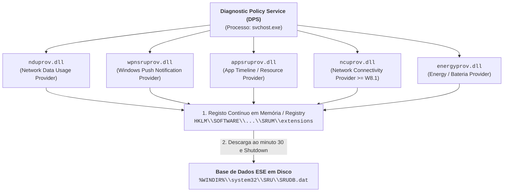

# System Resource Usage Monitor (SRUM) — Arquitetura e Base ESE

O **System Resource Usage Monitor (SRUM)** é um subsistema introduzido no Windows 8 e presente no Windows 10 e 11 concebido para monitorizar e registar de forma contínua o **consumo de recursos de hardware e rede** imputável a cada aplicação e processo executado no sistema.

Enquanto a maioria dos artefactos de execução (como o Prefetch) regista apenas contadores e carimbos de arranque, o SRUM regista **métricas quantitativas de atividade prolongada**: quantos ciclos de CPU um processo consumiu, quantos bytes transmitiu e recebeu na rede, e quanta energia de bateria gastou, preservando este histórico durante **pelo menos 30 a 60 dias**.

---

## 1. O Serviço DPS e as DLLs Provedoras (*Providers*)

O funcionamento do SRUM está alojado no serviço de sistema **Diagnostic Policy Service (DPS)**, gerido através de instâncias de `svchost.exe` com privilégios de rede restritos (`LocalServiceNetworkRestricted`).

O serviço DPS delega a recolha de telemetria a um conjunto de bibliotecas DLL especializadas (*providers*):



---

## 2. Metodologia de Armazenamento em Dois Níveis

Para minimizar o impacto de I/O em disco, o SRUM adota uma estratégia de gravação diferida em duas etapas:

1. **Nível 1 (Recolha em Tempo Real no Registry)**:
   * O sistema acumula as métricas continuamente no *hive* `SOFTWARE`, sob a chave:
     ```text
     HKLM\SOFTWARE\Microsoft\Windows NT\CurrentVersion\SRUM\extensions
     ```
   * Sob esta chave residem subpastas identificadas por GUIDs contendo contadores e buffers binários.
2. **Nível 2 (Descarga Periódica para Base de Dados ESE)**:
   * Os dados acumulados no Registry são consolidados e gravados em disco:
     * Ao **minuto 30 de cada hora** (ex.: 08h30, 09h30, 10h30...);
     * Imediatamente antes de qualquer processo ordenado de encerramento (**shutdown**).

---

## 3. O Ficheiro Físico `SRUDB.dat` e o Motor ESE

A base de dados física do SRUM reside no diretório protegido do sistema:

```text
%WINDIR%\system32\SRU\SRUDB.dat   (geralmente C:\Windows\System32\SRU\)
```

* **Motor de Base de Dados**: **Extensible Storage Engine (ESE)** (também conhecido por motor **JET Blue** da Microsoft, o mesmo formato transacional adotado pelo Active Directory, Exchange Server e o antigo `Windows.edb` do [[Windows Search]]).
* **Ficheiros Auxiliares Transacionais**:
  * `SRU.log` e ficheiros numerados (ex.: `SRU15A3A.log`): ficheiros de registo de transações (*transaction logs*);
  * `SRU.chk`: ficheiro de ponto de controlo (*checkpoint file*);
  * `SRUDB.jfm` e `SRUres*.jrs`: ficheiros de reserva e metadados de integridade.

### Evolução do Esquema de Tabelas
* **Windows 8**: 11 tabelas (4 de metadados e 7 de dados).
* **Windows 10 e Windows 11**: **16 tabelas (6 de metadados e 10 de dados)**, mantendo paridade estrutural com ligeiras variações no número de colunas.

---

## 4. Estrutura das Tabelas Principais por GUID

No motor ESE, as tabelas de métricas não possuem nomes alfabéticos amigáveis, sendo identificadas pelos GUIDs dos respetivos *providers*:

| Nome da Tabela ESE (GUID) | Finalidade e Métricas Preservadas |
| :--- | :--- |
| **`{DD6636C4-8929-4683-974E-22C046A43763}`** | **Conectividade de Rede**: Histórico de interfaces conectadas, duração das ligações e perfis de rede. |
| **`{D10CA2FE-6FCF-4F6D-848E-B2E99266FA89}`** | **Consumo de Recursos da Aplicação**: Ciclos de CPU consumidos, leituras/escritas de I/O em disco e mudanças de contexto. |
| **`{973F5D5C-1D90-4944-BE8E-24B94231A174}`** | **Tráfego de Rede (*Network Usage*)**: Bytes enviados (*BytesSent*) e recebidos (*BytesRecv*), distinguindo redes fixas de redes tarifadas (*metered*). |
| **`{D10CA2FE-6FCF-4F6D-848E-B2E99266FA86}`** | **Notificações Push**: Registos de alertas recebidos pelo Windows Push Notification Service. |
| **`{FEE4E14F-02A9-4550-B5CE-5FA2DA202E37}`** | **Consumo de Energia**: Métricas de consumo energético e descarga da bateria a curto prazo. |
| **`{FEE4E14F-02A9-4550-B5CE-5FA2DA202E37}LT`** | **Consumo de Energia a Longo Prazo (*Long Term*)**: Capacidade projetada vs. capacidade de carga completa da bateria ao longo dos ciclos. |

### A Tabela Chave de Mapeamento: `SruDbIdMapTable`
As tabelas de métricas não gravam o nome textual do executável em cada linha, mas antes um índice numérico (`IdIndex`).

A tabela de metadados **`SruDbIdMapTable`** funciona como catálogo mestre:
* Mapeia cada `IdIndex` (ex.: `139`) para o seu descritor de texto em formato **UTF-16LE Unicode** (`IdBlob`), identificando o caminho do executável:
  ```text
  IdIndex = 139  <==>  \Device\HarddiskVolume1\Program Files (x86)\Mozilla Firefox\firefox.exe
  ```

---

## 5. Reparação de Bases ESE Corrompidas (*Dirty Shutdown*)

Se um computador sob investigação foi desligado abruptamente (corte de energia, *hard reboot* ou apreensão pericial por remoção direta do cabo de alimentação), a base de dados ESE fica frequentemente marcada no estado **Dirty Shutdown**, contendo transações pendentes nos ficheiros `.log`.

Para reparar a base de dados antes de processar com ferramentas periciais, utiliza-se o utilitário nativo do Windows **`esentutl.exe`**:

```cmd
REM 1. Verificar o estado de integridade da base
esentutl.exe /mh "C:\Forensics\SRUDB.dat"

REM 2. Recuperação suave aplicando os ficheiros de log (Soft Recovery)
esentutl.exe /r sru /d

REM 3. Reparação forçada em caso de corrupção estrutural severa (Hard Repair)
esentutl.exe /p "C:\Forensics\SRUDB.dat"
```

---

## 6. Enquadramento Laboratorial e Bibliografia

### Ficha Laboratorial
A estrutura do `SRUDB.dat`, extração de métricas de rede e processos, e análise comparativa constituem o conteúdo da **Ficha 09 – SRUM**.

### Referência Académica
* **Khatri, Y. (2015)**. *Forensic implications of System Resource Usage Monitor (SRUM) data in Windows 8*. Digital Investigation, 12, 53-65. [DOI: 10.1016/j.diin.2015.01.002](http://dx.doi.org/10.1016/j.diin.2015.01.002).

---

## Navegação

- [[Capítulo 1 - Sistemas Operativos, Serviços e Artefactos Forenses|Voltar ao Índice do Capítulo 1]]
- [[Windows Activity Timeline - Arquitetura e Base SQLite]]
- [[Recuperação de Clipboard e Sincronização na Timeline]]
- [[Análise Forense do SRUM e Ferramentas Nativas (powercfg)]]
- [[Taxonomia dos Artefactos de Execução no Windows]]
