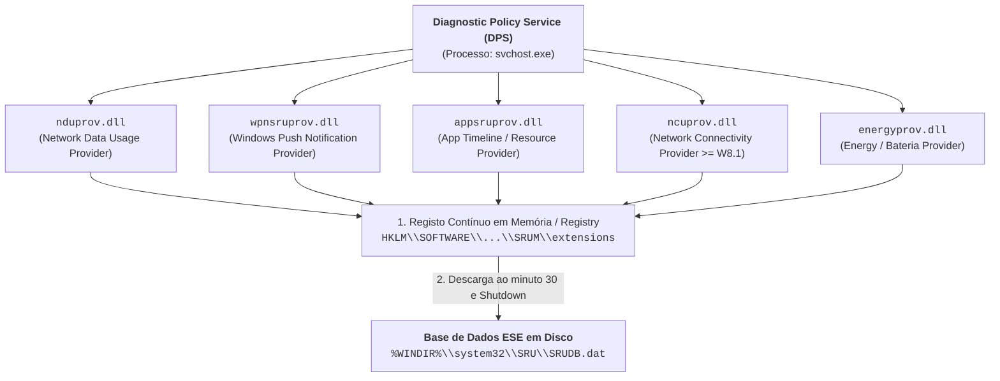

# System Resource Usage Monitor (SRUM) — Arquitetura e Base ESE

O **SRUM** (*System Resource Usage Monitor*) regista durante 30 a 60 dias na base ESE `SRUDB.dat` o consumo de CPU, bytes de rede enviados/recebidos e energia por aplicação e utilizador.

> [!TIP] Lógica de Funcionamento e Valor Forense
> * **Porque existe (Sistema)**: Introduzido no Windows 8, o SRUM permite ao sistema operativo (através do serviço *Diagnostic Policy Service* — DPS) monitorizar o impacto energético, o uso de CPU/disco e o tráfego de dados móveis/Wi-Fi de cada processo ao longo do tempo, alimentando o painel de *Histórico de Aplicações* do Gestor de Tarefas e os diagnósticos de bateria.
> * **Porque importa (Forense)**: Ao contrário do Prefetch (que só regista o arranque e os primeiros 10 segundos), o SRUM quantifica a **atividade contínua ao longo de 30 a 60 dias**, associando o caminho do executável e o SID do utilizador aos **bytes exatos enviados (`BytesSent`) e recebidos (`BytesRecv`)** na rede e aos ciclos de CPU consumidos — sendo decisivo para provar **exfiltração de dados** ou criptomineração, mesmo que o executável já tenha sido apagado.
> * **Pontos Críticos e Armadilhas para Exame**:
>   * **Arquitetura de 2 Níveis (Minuto 30)**: Para poupar escritas em disco, os *providers* acumulam métricas temporariamente no hive `SOFTWARE` (`...\SRUM\extensions`) e descarregam para a base ESE `%WINDIR%\System32\sru\SRUDB.dat` apenas **ao minuto 30 de cada hora** e antes de um **shutdown** ordeiro.
>   * **Reparação de *Dirty Shutdown***: Como `SRUDB.dat` usa o motor transacional **ESE (JET Blue)**, aquisições *live* ou desligamentos abruptos deixam a base em estado *Dirty Shutdown*. Antes de usar o `SrumECmd`, é obrigatório verificar o estado com `esentutl /mh` e aplicar os logs com **`esentutl /r sru /d`**.

---

## 1. O Serviço DPS e as DLLs Provedoras (*Providers*)

O funcionamento do SRUM está alojado no serviço de sistema **Diagnostic Policy Service (DPS)**, gerido através de instâncias de `svchost.exe` com privilégios de rede restritos (`LocalServiceNetworkRestricted`).

O serviço DPS delega a recolha de telemetria a um conjunto de bibliotecas DLL especializadas (*providers*):



---

## 2. Metodologia de Armazenamento em Dois Níveis

Para minimizar o impacto de I/O em disco e poupar bateria em portáteis, o SRUM adota uma estratégia de gravação diferida (*write-back caching*) em duas etapas:

**1. Nível 1 (Recolha em Tempo Real em Memória e no Registry):**

O sistema acumula as métricas continuamente em memória e no *hive* `SOFTWARE`, sob a chave:

```text
HKLM\SOFTWARE\Microsoft\Windows NT\CurrentVersion\SRUM\extensions
```

* Sob esta chave residem subchaves identificadas pelos GUIDs de cada *provider*, contendo parâmetros de configuração e buffers temporários.

**2. Nível 2 (Descarga Periódica para Base de Dados ESE em Disco):**

* Os dados acumulados são consolidados e gravados na base física `SRUDB.dat`:
  * Ao **minuto 30 de cada hora** (ex.: 08h30, 09h30, 10h30... — intervalo padrão de 60 minutos);
  * Imediatamente antes de qualquer processo ordenado de encerramento (**shutdown** / **restart**).

---

## 3. O Ficheiro Físico `SRUDB.dat` e o Motor ESE

A base de dados física do SRUM reside no diretório protegido do sistema (acessível apenas à conta `SYSTEM` e Administradores):

```text
%WINDIR%\system32\SRU\SRUDB.dat   (geralmente C:\Windows\System32\SRU\SRUDB.dat)
```

* **Motor de Base de Dados**: **Extensible Storage Engine (ESE)** (também conhecido por motor **JET Blue** da Microsoft, o mesmo formato transacional adotado pelo Active Directory `ntds.dit`, Exchange Server e o antigo `Windows.edb` do [[Windows Search]]).
* **Ficheiros Auxiliares Transacionais na Pasta `SRU\`**:
  * `SRU.log` e ficheiros numerados em hexadecimal (ex.: `SRU15A3A.log`): ficheiros de registo de transações (*transaction logs* de 1 MB);
  * `SRU.chk`: ficheiro de ponto de controlo (*checkpoint file*) que indica quais os logs já comitados no `.dat`;
  * `SRUDB.jfm` e `SRUres*.jrs`: ficheiros de mapa de descarga (*flush map*) e logs de reserva para falta de espaço em disco.

### Evolução do Esquema de Tabelas (Windows 8 vs. Windows 10/11)

| Versão do Sistema Operativo | Total de Tabelas em `SRUDB.dat` | Tabelas de Metadados / Sistema | Tabelas de Dados (Providers GUID) |
| :--- | :---: | :---: | :---: |
| **Windows 8 / 8.1** | **11 tabelas** | 4 tabelas | 7 tabelas |
| **Windows 10 e Windows 11** | **16 tabelas** | 6 tabelas | 10 tabelas (paridade estrutural entre W10 e W11) |

---

## 4. Estrutura das Tabelas Principais por GUID

No motor ESE, as tabelas de métricas não possuem nomes alfabéticos amigáveis, sendo identificadas pelos GUIDs dos respetivos *providers*:

| Nome da Tabela ESE (GUID) | DLL Provedora | Finalidade e Métricas Forenses Preservadas |
| :--- | :--- | :--- |
| **`{DD6636C4-8929-4683-974E-22C046A43763}`** | `ncuprov.dll` | **Conectividade de Rede (*Network Connectivity*)**: Histórico de interfaces conectadas (`InterfaceLuid`), hora de ligação (`ConnectStartTime`), duração (`ConnectedTime`) e perfil de rede (`L2ProfileId` — cruza com o SSID Wi-Fi no hive `SOFTWARE`). |
| **`{D10CA2FE-6FCF-4F6D-848E-B2E99266FA89}`** | `appsruprov.dll` | **Consumo de Recursos da Aplicação (*Application Resource Usage*)**: Ciclos de CPU em foreground/background (`ForegroundCycleTime`, `BackgroundCycleTime`), bytes lidos/escritos em disco (`ForegroundBytesRead`, `ForegroundBytesWritten`) e mudanças de contexto. |
| **`{973F5D5C-1D90-4944-BE8E-24B94231A174}`** | `nduprov.dll` | **Tráfego de Rede (*Network Data Usage*)**: Bytes enviados (**`BytesSent`**) e recebidos (**`BytesRecvd`**) por aplicação (`AppId`), utilizador (`UserId`) e interface (`InterfaceLuid`). Essencial para provar **exfiltração de dados**. |
| **`{D10CA2FE-6FCF-4F6D-848E-B2E99266FA86}`** | `wpnsruprov.dll` | **Notificações Push (*Windows Push Notifications*)**: Registos de alertas e payloads recebidos pelo Windows Push Notification Service. |
| **`{FEE4E14F-02A9-4550-B5CE-5FA2DA202E37}`** | `energyprov.dll` | **Consumo de Energia (*Energy Usage*)**: Métricas de consumo energético e descarga da bateria a curto prazo. |
| **`{FEE4E14F-02A9-4550-B5CE-5FA2DA202E37}LT`** | `energyprov.dll` | **Consumo de Energia a Longo Prazo (*Long Term*)**: Capacidade projetada (*DesignedCapacity*) vs. capacidade de carga real (*FullChargedCapacity*) e contadores de ciclos. |
| **`{DA73FB89-2BEA-4DDC-86B8-6E048C6DA477}`** | `energyprov.dll` | **Estimador de Energia (*Energy Estimator*)** (W10/W11): Telemetria granular de consumo energético por aplicação. |
| **`{5C8CF1C7-7257-4F13-B223-970EF5939312}`** | `appsruprov.dll` | **App Timeline Provider** (W10/W11): Registo temporal de início e duração de compilação/execução de aplicações. |

### A Tabela Chave de Mapeamento: `SruDbIdMapTable`
As tabelas de métricas (listadas por GUID acima) não gravam o nome textual do executável nem o SID textual do utilizador em cada linha (o que causaria enorme redundância), guardando apenas inteiros de chave estrangeira (`AppId` e `UserId`).

A tabela de metadados **`SruDbIdMapTable`** funciona como catálogo mestre de tradução:

* **`IdIndex`** (Chave Primária inteira, ex.: `139`): O índice referenciado nas colunas `AppId` ou `UserId` das tabelas GUID;
* **`IdType`**: Tipo de registo (`0`, `1` ou `2` para aplicações/binários Win32 ou UWP; **`3`** para **SIDs de utilizadores**);
* **`IdBlob`**: O descritor binário. Para aplicações, armazena o caminho completo do volume em formato **UTF-16LE Unicode**; para utilizadores (`IdType = 3`), armazena o **SID binário** da conta Windows:

```text
IdIndex = 139  <==>  \Device\HarddiskVolume1\Program Files (x86)\Mozilla Firefox\firefox.exe
```

---

## 5. Reparação de Bases ESE Corrompidas (*Dirty Shutdown*) e Anatomia do `esentutl`

Se um computador sob investigação foi desligado abruptamente (corte de energia, *hard reboot* ou aquisição *live* de um ficheiro `SRUDB.dat` aberto pelo sistema), a base de dados ESE fica marcada no estado **Dirty Shutdown**, contendo transações pendentes nos ficheiros `SRU*.log`. Ferramentas forenses como o `SrumECmd` recusarão processar ou apresentarão dados incompletos se a base não estiver no estado **Clean Shutdown**.

Para verificar e reparar uma cópia de trabalho da pasta `C:\Windows\System32\SRU\`, utiliza-se o utilitário nativo do Windows **`esentutl.exe`**:

```cmd
REM 1. Inspecionar o cabeçalho e verificar o estado (Clean Shutdown vs. Dirty Shutdown)
esentutl.exe /mh "C:\Forensics\SRU\SRUDB.dat"

REM 2. Executar Soft Recovery (reproduz os ficheiros SRU*.log para dentro do SRUDB.dat)
esentutl.exe /r sru /d

REM 3. Executar Hard Repair (apenas se os ficheiros .log tiverem sido perdidos ou corrompidos)
esentutl.exe /p "C:\Forensics\SRU\SRUDB.dat"
```

### Anatomia Detalhada dos Parâmetros do `esentutl.exe`:

* **`/mh <ficheiro.dat>`** (*Dump Metadata Header*): Lê o cabeçalho da base de dados ESE e exibe o campo `State:`. Se indicar `State: Dirty Shutdown`, é necessário recuperar a base antes do parsing.
* **`/r sru /d`** (*Soft Recovery* — **Método Recomendado em Forense**):
  * **`/r sru`**: Indica o prefixo de 3 letras dos ficheiros de log transacionais (`sru` corresponde a `SRU.log`, `SRU.chk` e `SRU*.log`).
  * **`/d`**: Define o diretório atual onde reside a base de dados `SRUDB.dat` (deve executar-se o comando dentro da pasta para onde se copiaram todos os ficheiros da pasta `SRU\`). Este método **não perde dados**, pelo contrário, consolida no `.dat` as transações mais recentes que estavam nos `.log`.
* **`/p <ficheiro.dat>`** (*Hard Repair*): Reconstrói a estrutura de páginas da base de dados descartando páginas corrompidas e ignorando os ficheiros `.log`. Deve ser usado apenas em último recurso, pois **pode eliminar registos incompletos**.

---

## 6. Enquadramento Laboratorial e Bibliografia

### Ficha Laboratorial
A estrutura do `SRUDB.dat`, extração de métricas de rede e processos, e análise comparativa constituem o conteúdo da **Ficha 09 – SRUM**.

### Referência Académica

* **Khatri, Y. (2015)**. *Forensic implications of System Resource Usage Monitor (SRUM) data in Windows 8*. Digital Investigation, 12, 53-65. [DOI: 10.1016/j.diin.2015.01.002](http://dx.doi.org/10.1016/j.diin.2015.01.002).

---

## Perguntas de revisão

1. **Qual é o serviço do Windows responsável pelo SRUM, onde reside fisicamente a sua base de dados e que motor de base de dados utiliza?**

> [!success]- Ver Resposta
> O SRUM é gerido pelo serviço **Diagnostic Policy Service (DPS)** (executado em `svchost.exe`). A sua base de dados física reside em **`%WINDIR%\System32\sru\SRUDB.dat`** e utiliza o motor transacional da Microsoft **Extensible Storage Engine (ESE / JET Blue)**.

2. **Como funciona a arquitetura de armazenamento em dois níveis do SRUM e em que momentos exatos os dados são transferidos para o ficheiro `SRUDB.dat`?**

> [!success]- Ver Resposta
> Para evitar escritas constantes no disco, as DLLs provedoras do SRUM acumulam inicialmente as métricas em memória e no hive `SOFTWARE` (na chave `HKLM\SOFTWARE\Microsoft\Windows NT\CurrentVersion\SRUM\extensions`). Os dados são descarregados (*flushed*) para a base de dados ESE `SRUDB.dat` apenas **ao minuto 30 de cada hora** (ciclo horário) e imediatamente antes de um **encerramento ordenado do sistema (*shutdown/restart*)**.

3. **Qual é a função da tabela `SruDbIdMapTable` dentro do `SRUDB.dat` e em que codificação são guardados os caminhos das aplicações na coluna `IdBlob`?**

> [!success]- Ver Resposta
> A **`SruDbIdMapTable`** é a tabela mestra de mapeamento que traduz os identificadores numéricos inteiros (`IdIndex`) usados nas tabelas de métricas GUID para o caminho real da aplicação ou para o SID do utilizador (`IdType = 3`). Os caminhos completos dos executáveis na coluna `IdBlob` encontram-se codificados em **UTF-16LE Unicode** (no formato de volume `\Device\HarddiskVolumeX\...`).

4. **Durante a análise forense de uma imagem de disco adquirida a quente (*live acquisition*), o cabeçalho do `SRUDB.dat` apresenta o estado `Dirty Shutdown`. Que sequência de comandos nativos deve o perito executar numa cópia da pasta `SRU\` para recuperar a base sem perda de dados?**

> [!success]- Ver Resposta
> O perito deve utilizar o utilitário nativo **`esentutl.exe`**:
> 1. Verificar o estado no cabeçalho: `esentutl.exe /mh SRUDB.dat`
> 2. Executar uma recuperação suave (*Soft Recovery*) a partir da pasta contendo o `.dat` e todos os ficheiros `SRU*.log` e `SRU.chk`: **`esentutl.exe /r sru /d`**. Este comando aplica as transações pendentes nos logs para dentro do `SRUDB.dat`, transitando o estado para `Clean Shutdown`.

5. **Quais são os GUIDs das duas tabelas do SRUM mais importantes para investigar, respetivamente, o tráfego de rede por aplicação (exfiltração) e o consumo de ciclos de CPU/I/O por aplicação?**

> [!success]- Ver Resposta
> * **Tráfego de Rede (*Network Data Usage* — `nduprov.dll`)**: **`{973F5D5C-1D90-4944-BE8E-24B94231A174}`** (contém `BytesSent` e `BytesRecvd`).
> * **Consumo de Recursos da Aplicação (*Application Resource Usage* — `appsruprov.dll`)**: **`{D10CA2FE-6FCF-4F6D-848E-B2E99266FA89}`** (contém ciclos de CPU e leituras/escritas em disco).

---

## Navegação e Notas Relacionadas

| Percurso | Nota | Contexto |
| :--- | :--- | :--- |
| **Anterior** | [[Recuperação de Clipboard e Sincronização na Timeline]] | `mesmo bloco` |
| **Seguinte** | [[Análise Forense do SRUM e Ferramentas Nativas (powercfg)]] | `mesmo bloco` |
| **Índice** | [[Capítulo 1 - Sistemas Operativos, Serviços e Artefactos Forenses]] · [[00 ASSI]] | `Bloco 14` |

### Conceitos Relacionados

* [[Windows Activity Timeline - Arquitetura e Base SQLite]] · `mesmo bloco`
* [[Taxonomia dos Artefactos de Execução no Windows]] · `Bloco 10`
* [[Codificação de Caracteres - ASCII, Latin-1 e Unicode]] · `AFD1 · Cap. 3`
* [[Camadas de Organização de Dados e Análise de Sistemas de Ficheiros]] · `AFD1 · Cap. 3`
* [[Diretrizes de Manuseamento - Identificação, Preservação, Isolamento e Correlação]] · `AFD1 · Cap. 1`
