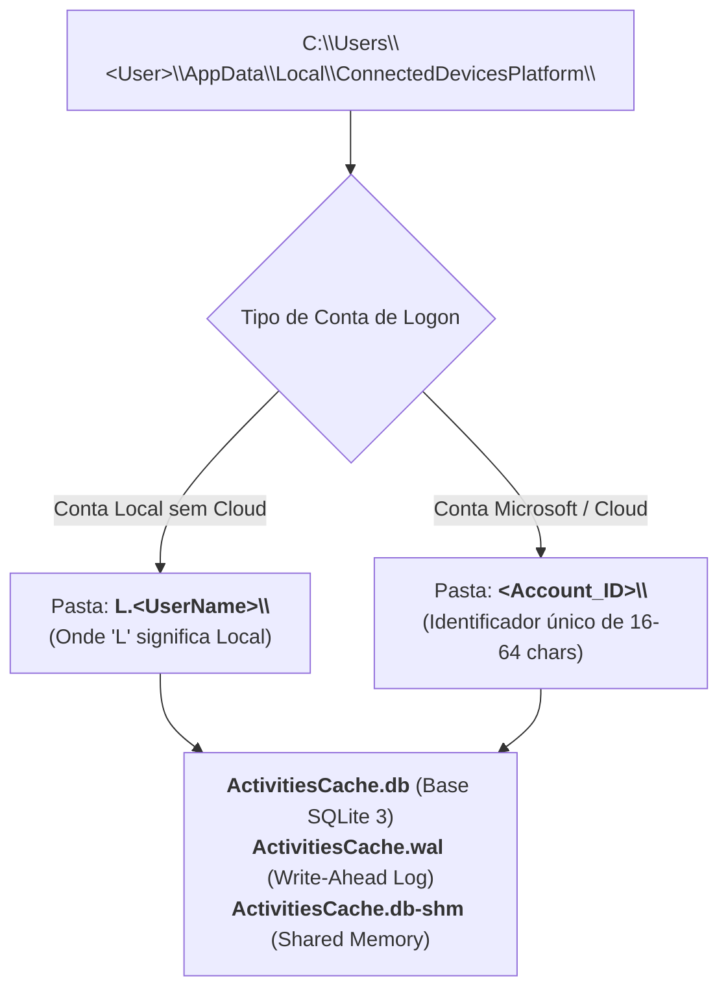
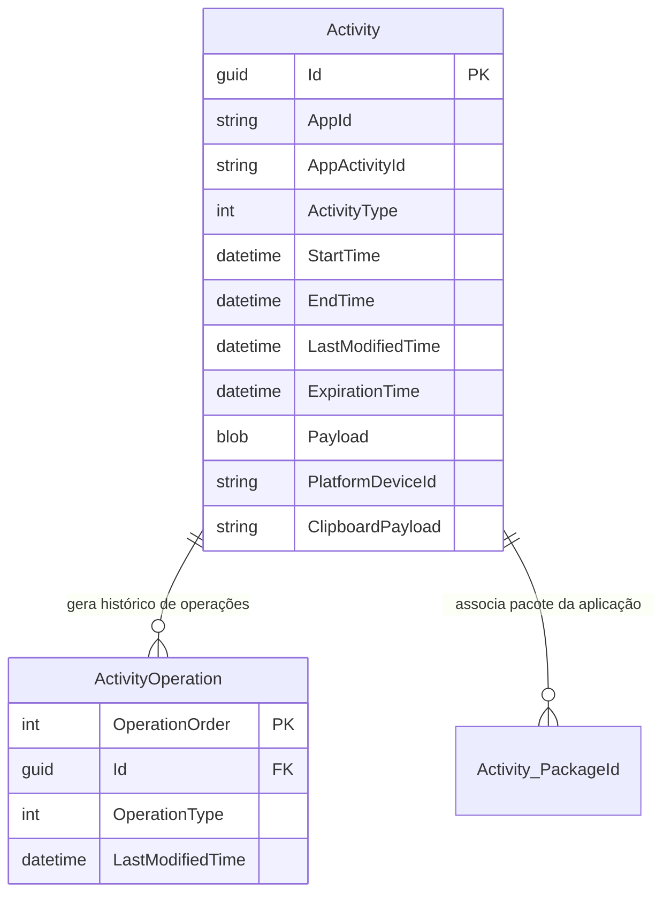

# Windows Activity Timeline — Arquitetura e Base SQLite

A funcionalidade **Windows Activity Timeline** foi introduzida no Windows 10 (versão 1803 / Abril de 2018) com o objetivo de disponibilizar ao utilizador um histórico visual e navegável das suas ações recentes no sistema operativo, permitindo retomar tarefas (*Pick up where you left off*) em múltiplos dispositivos sincronizados através de uma conta Microsoft (**MSA**) ou Azure AD.

Apesar de a Microsoft ter **removido a interface gráfica da Timeline no Windows 11**, os mecanismos de telemetria e as bases de dados relacionais subjacentes permanecem ativos, constituindo um artefacto forense de grande relevância para a reconstrução cronológica de utilização.

---

## 1. Localização Física e Motor de Base de Dados

Os registos da Timeline são geridos através do motor relacional **SQLite 3**, residindo num subdiretório específico do perfil do utilizador:

```text
%LOCALAPPDATA%\ConnectedDevicesPlatform\
```
*(Caminho expandido: `C:\Users\<UserName>\AppData\Local\ConnectedDevicesPlatform\`)*



* **`ActivitiesCache.db`**: A base de dados principal.
* **`ActivitiesCache.wal`**: Ficheiro transacional *Write-Ahead Log*. Em investigações periciais, as ações mais recentes dos últimos minutos residem no ficheiro `.wal` antes de serem consolidadas no ficheiro `.db`.

---

## 2. Processo Escritor: `CDPUserSvc` em `svchost.exe`

A gravação dos eventos na base de dados ocorre de forma **quase instantânea** após a realização da ação no sistema operativo. 

O processo responsável pela manutenção e escrita de `ActivitiesCache.db` é:

```text
svchost.exe -k UnistackSvcGroup -s CDPUserSvc
```

### Análise dos Parâmetros de Execução
* **`-k UnistackSvcGroup`**: Grupo de serviços partilhados associado à infraestrutura de aplicações modernas da **Universal Windows Platform (UWP)**.
* **`-s CDPUserSvc`** (*Connected Devices Platform User Service*):
  * É um serviço do tipo **`UserSvc`**: cada utilizador com sessão iniciada na máquina possui a sua própria instância independente do serviço (ex.: `CDPUserSvc_3a8b1`).
  * **Atribuições**: Gestão de conectividade e emparelhamento de dispositivos, sincronização com smartphones, histórico de atividades entre computadores e transferência de área de transferência na nuvem (*Cloud Clipboard*).

---

## 3. Estrutura Relacional da Base de Dados

Nas versões modernas do sistema operativo (Windows 10 e Windows 11), a base `ActivitiesCache.db` organiza-se em torno de várias tabelas centrais:



### Campos Forenses Chave na Tabela `Activity`
* **`Id`**: Identificador exclusivo global (GUID) da atividade.
* **`AppId`**: Nome ou identificador do pacote da aplicação (ex.: `microsoft.office.winword.exe.15`).
* **`StartTime` e `EndTime`**: Intervalo de tempo exato em que o utilizador interagiu com a aplicação ou documento.
* **`Payload`**: Bloco JSON que descreve o ficheiro aberto, título da janela exibida (*DisplayTitle*) e URI do recurso.
* **`PlatformDeviceId`**: Identificador codificado em **Base64** que identifica unicamente o dispositivo de hardware onde a ação decorreu.

---

## 4. O Campo `PlatformDeviceID` e Mapeamento no Registry

Quando o utilizador sincroniza múltiplos dispositivos na mesma conta, a Timeline regista ações ocorridas noutros computadores ou computadores portáteis.

Para identificar o nome da máquina associada ao código em Base64:
1. O campo `PlatformDeviceId` apresenta um código criptográfico (ex.: `0Yb2A9Xf+CNQxR57p1SOcH0DmUwpLCcqY/PUKTzth/Q=`).
2. O analista pode consultar a seguinte chave no hive do utilizador:
   ```text
   HKCU\Software\Microsoft\Windows\CurrentVersion\TaskFlow\DeviceCache\
   ```
   * Sob esta chave existem subpastas com o nome de cada `PlatformDeviceID`, contendo os seguintes valores:
     * **`DeviceName`**: Nome do computador na rede (ex.: `pat`);
     * **`DeviceMake`**: Fabricante do equipamento (ex.: `Packard Bell`);
     * **`DeviceModel`**: Modelo comercial (ex.: `EasyNote TS11HR`);
     * **`DeviceType`**: Código numérico do tipo de equipamento (desktop, laptop, tablet).

> [!WARNING] Descontinuação da Chave no Windows 11
> Esta chave de correlação em `TaskFlow\DeviceCache` foi **removida a partir do Windows 11 (24H2)**, refletindo a descontinuação progressiva da sincronização entre dispositivos.

---

## 5. A Timeline no Windows 11: Estatuto e Limitações Periciais

Ao contrário do Windows 10 (onde a Timeline registava até 30 dias de navegação na cloud com histórico minucioso de ficheiros abertos), no **Windows 11**:
* A interface gráfica da Timeline foi **completamente eliminada** da Taskbar.
* O sistema **deixou de sincronizar eventos entre dispositivos**.
* O número de itens registados diminuiu drasticamente, limitando-se a eventos internos esporádicos do sistema.
* **Impacto Pericial**: No Windows 11, o valor probatório da Timeline é **muito reduzido** em comparação com o Windows 10.

---

## 6. Ferramenta de Extração Forense: `WxTCmd` (Eric Zimmerman)

O utilitário **`WxTCmd`** (*Windows 10 Timeline Parser*), desenvolvido por **Eric Zimmerman**, é a ferramenta CLI de eleição para extrair a base de dados relacional e exportá-la em formatos planos (*CSV*):

```cmd
WxTCmd.exe -f "C:\Users\user\AppData\Local\ConnectedDevicesPlatform\L.user\ActivitiesCache.db" --csv "C:\Temp\Timeline_Export"
```

O comando exporta um ficheiro consolidado com as colunas essenciais:
* `Executable`: Executável responsável;
* `DisplayTitle`: Título visual do documento ou janela;
* `StartTime` / `EndTime`: Marcas temporais de utilização em UTC;
* `Duration`: Duração calculada da sessão com o ficheiro;
* `PlatformDeviceId`: Dispositivo de origem.

---

## 7. Enquadramento Laboratorial

A exploração da base de dados SQLite `ActivitiesCache.db`, identificação de registos locais e parsing com o `WxTCmd` é lecionada na **Ficha 08 – Windows Timeline**.

---

## Navegação

- [[Capítulo 1 - Sistemas Operativos, Serviços e Artefactos Forenses|Voltar ao Índice do Capítulo 1]]
- [[Recuperação de Clipboard e Sincronização na Timeline]]
- [[System Resource Usage Monitor (SRUM) - Arquitetura e Base ESE]]
- [[Análise Forense do SRUM e Ferramentas Nativas (powercfg)]]
- [[Codificação Binário-para-Texto (Base16, Base64 e Base58)]]
- [[Representação Forense de Data e Hora (Timestamps e SQLite)]]
- [[Registo, Etiquetagem e Fotografia Pericial (Regras LabCIF)]]
