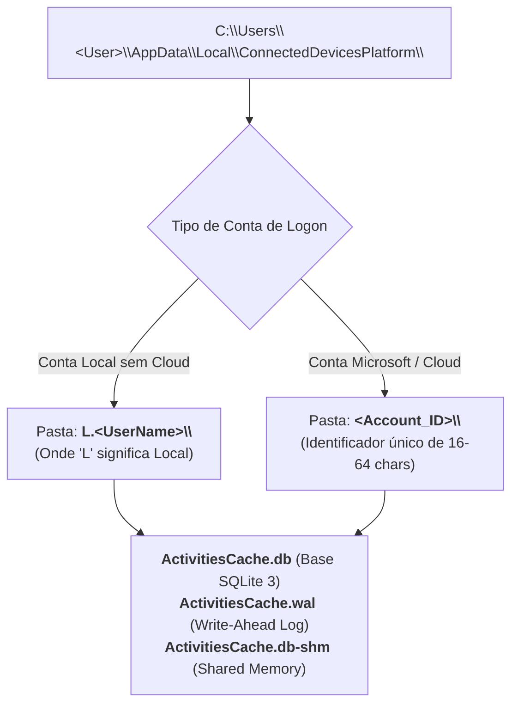
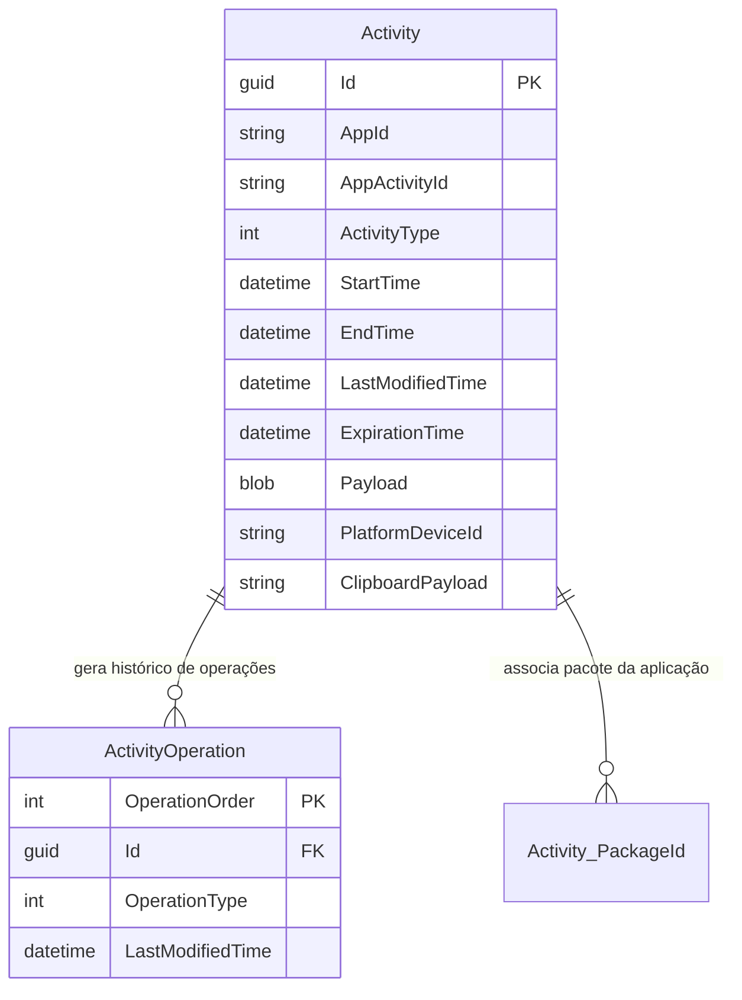

# Windows Activity Timeline — Arquitetura e Base SQLite

A **Windows Activity Timeline** armazena na base SQLite `ActivitiesCache.db` (escrita por `CDPUserSvc`) o histórico cronológico de aplicações, documentos, durações de foco e sincronização entre dispositivos.

> [!TIP] Lógica de Funcionamento e Valor Forense
> * **Porque existe (Sistema)**: Introduzida no Windows 10 (1803), a Timeline foi desenhada para permitir que o utilizador retomasse tarefas (*Pick up where you left off*) num histórico visual até 30 dias e sincronizasse atividades e a área de transferência (*Cloud Clipboard*) entre múltiplos computadores associados à mesma conta Microsoft (MSA) ou Azure AD, através do serviço `CDPUserSvc`.
> * **Porque importa (Forense)**: A base de dados SQLite 3 **`ActivitiesCache.db`** (e o seu ficheiro transacional **`ActivitiesCache.wal`**) é atualizada de forma quase instantânea, registando o executável (`AppId`), título da janela/ficheiro (`Payload`), hora de início e fim de interação (`StartTime` / `EndTime`) e o identificador em Base64 da máquina onde a ação ocorreu (`PlatformDeviceId`).
> * **Pontos Críticos e Armadilhas para Exame**:
>   * **Diferença Drástica Windows 10 vs. Windows 11**: No Windows 10, a Timeline tinha enorme valor probatório (histórico rico de ficheiros abertos e sincronização multi-dispositivo). No **Windows 11**, a interface gráfica foi removida, a sincronização entre dispositivos foi descontinuada, o registo de atividades caiu drasticamente e a chave de Registry `TaskFlow\DeviceCache` foi eliminada a partir da versão 24H2.
>   * **Importância do Ficheiro `.wal`**: Como o motor é SQLite 3 em modo *Write-Ahead Logging*, as ações mais recentes residem em `ActivitiesCache.wal` antes do *checkpoint* para `ActivitiesCache.db`. Nunca se deve copiar apenas o `.db` isolado.

---

## 1. Localização Física e Motor de Base de Dados

A funcionalidade **Windows Activity Timeline** foi introduzida no Windows 10 (versão 1803 / Abril de 2018). Os seus registos são geridos através do motor relacional **SQLite 3**, residindo num subdiretório específico do perfil do utilizador:

```text
%LOCALAPPDATA%\ConnectedDevicesPlatform\
```

*(Caminho expandido: `C:\Users\<UserName>\AppData\Local\ConnectedDevicesPlatform\`)*



* **`ActivitiesCache.db`**: A base de dados relacional principal em SQLite 3.
* **`ActivitiesCache.wal`**: Ficheiro transacional *Write-Ahead Log*. Em investigações periciais, as ações mais recentes dos últimos minutos residem no ficheiro `.wal` antes de serem consolidadas (*checkpointed*) no ficheiro `.db`.
* **`ActivitiesCache.db-shm`**: Índice de memória partilhada do motor SQLite.

---

## 2. Processo Escritor: `CDPUserSvc` em `svchost.exe`

A gravação dos eventos na base de dados ocorre de forma **quase instantânea** após a realização da ação no sistema operativo. 

O processo responsável pela manutenção e escrita de `ActivitiesCache.db` é:

```text
svchost.exe -k UnistackSvcGroup -s CDPUserSvc
```

### Análise dos Parâmetros de Execução

* **`-k UnistackSvcGroup`**: Grupo de serviços partilhados associado à infraestrutura de aplicações modernas da **Universal Windows Platform (UWP)**.
* **`-s CDPUserSvc`** (*Connected Devices Platform User Service*):
  * É um serviço do tipo **`UserSvc`** (*per-user service*): cada utilizador com sessão iniciada na máquina possui a sua própria instância independente do serviço sufixada por um LUID hexadecimal (ex.: `CDPUserSvc_3a8b1`).
  * **Atribuições**: Gestão de conectividade e emparelhamento de dispositivos, sincronização com smartphones, histórico de atividades entre computadores e transferência de área de transferência na nuvem (*Cloud Clipboard*).

---

## 3. Estrutura Relacional da Base de Dados

Nas versões modernas do sistema operativo (Windows 10 e Windows 11), a base `ActivitiesCache.db` organiza-se em torno de várias tabelas centrais (`Activity`, `ActivityOperation`, `Activity_PackageId`, `AppSettings` e `ManualSequence`):



### Campos Forenses Chave na Tabela `Activity`

* **`Id`**: Identificador exclusivo global (GUID) da atividade.
* **`AppId`**: JSON com o caminho ou identificador do pacote da aplicação (ex.: `microsoft.office.winword.exe.15`) e a plataforma (`x_exe_path`, `packageId`).
* **`ActivityType`**: Tipo numérico de evento (ex.: `5` = Abertura de aplicação/ficheiro pelo utilizador; `6` = Aplicação em foco / *In Focus*; `10` = Operação de [[Recuperação de Clipboard e Sincronização na Timeline|Clipboard]]; `16` = Copy/Paste).
* **`StartTime` e `EndTime`**: Intervalo de tempo exato (Unix Epoch UTC) em que o utilizador interagiu com a aplicação ou documento.
* **`Payload`**: Bloco JSON que descreve o ficheiro aberto, nome da aplicação (`appDisplayName`), título da janela exibida (`displayText`) e caminho/URI do recurso (`description`).
* **`PlatformDeviceId`**: Identificador codificado em **Base64** que identifica unicamente o dispositivo de hardware onde a ação decorreu.
* **`ClipboardPayload`**: Bloco JSON com o texto copiado para a área de transferência codificado em Base64 (válido durante 12 horas).

---

## 4. O Campo `PlatformDeviceID` e Mapeamento no Registry

Quando o utilizador sincroniza múltiplos dispositivos na mesma conta (no Windows 10), a Timeline regista localmente ações ocorridas noutros computadores ou portáteis do mesmo utilizador.

Para identificar o nome real da máquina associada ao código em Base64:

**1.** O campo `PlatformDeviceId` na tabela `Activity` apresenta um código Base64 (ex.: `0Yb2A9Xf+CNQxR57p1SOcH0DmUwpLCcqY/PUKTzth/Q=`).

**2.** O analista consulta a seguinte chave no hive `NTUSER.DAT` do utilizador:

```text
HKCU\Software\Microsoft\Windows\CurrentVersion\TaskFlow\DeviceCache\
```

* Sob esta chave existem subpastas com o nome exato de cada `PlatformDeviceID`, contendo os valores:
  * **`DeviceName`**: Nome NetBIOS/Host do computador na rede (ex.: `pat`);
  * **`DeviceMake`**: Fabricante do equipamento (ex.: `Packard Bell`);
  * **`DeviceModel`**: Modelo comercial (ex.: `EasyNote TS11HR`);
  * **`DeviceType`**: Código numérico do tipo de equipamento (desktop, laptop, tablet, telefone).

> [!WARNING] Descontinuação da Chave no Windows 11
> Esta chave de correlação em `TaskFlow\DeviceCache` foi **removida a partir do Windows 11 (24H2)**, refletindo a descontinuação progressiva da sincronização da Timeline entre dispositivos.

---

## 5. Comparação Lado a Lado: A Timeline no Windows 10 vs. Windows 11

| Dimensão Técnica e Pericial | Windows 10 (1803 a 22H2) | Windows 11 (21H2 a 24H2+) |
| :--- | :--- | :--- |
| **Interface Gráfica (GUI)** | **Ativa** na Taskbar (*Task View* / `Win + Tab`), mostrando até 30 dias de histórico visual | **Completamente eliminada** da interface de utilizador |
| **Base de Dados `ActivitiesCache.db`** | Presente e intensamente povoada em `%LOCALAPPDATA%\ConnectedDevicesPlatform\` | Presente no mesmo caminho, mas com número de entradas drasticamente reduzido |
| **Sincronização Cloud entre Dispositivos** | Suportada via conta Microsoft / Azure AD (até ser descontinuada na cloud) | **Desativada** para histórico de documentos (mantém suporte apenas para *Cloud Clipboard* se ativo) |
| **Registo de Ficheiros e Focus Time** | Registo minucioso de documentos abertos, janelas em foco (`ActivityType 5/6`) e durações | Regista apenas eventos internos esporádicos do sistema e Clipboard |
| **Chave `TaskFlow\DeviceCache`** | Presente no `NTUSER.DAT` para traduzir `PlatformDeviceId` na máquina real | **Removida a partir do Windows 11 24H2** |
| **Valor Probatório Global** | **Muito Elevado** (excelente para reconstruir cronologia detalhada do utilizador) | **Muito Reduzido** para abertura de ficheiros (mantém utilidade para [[Recuperação de Clipboard e Sincronização na Timeline\|Clipboard]]) |

---

## 6. Ferramenta de Extração Forense: `WxTCmd` (Eric Zimmerman)

O utilitário **`WxTCmd`** (*Windows 10 Timeline Parser*), desenvolvido por **Eric Zimmerman**, é a ferramenta CLI de eleição para processar a base de dados SQLite `ActivitiesCache.db` (fazendo o merge automático do `.wal` se presente na mesma pasta) e exportá-la em formatos planos (*CSV*):

```cmd
WxTCmd.exe -f "C:\Users\user\AppData\Local\ConnectedDevicesPlatform\L.user\ActivitiesCache.db" --csv "C:\Temp\Timeline_Export"
```

### Anatomia Detalhada dos Parâmetros do `WxTCmd`:

* **`-f <ficheiro>`**: Caminho completo para o ficheiro `ActivitiesCache.db` a analisar (recomenda-se manter os ficheiros `ActivitiesCache.wal` e `ActivitiesCache.db-shm` no mesmo diretório para que o motor SQLite consolide as transações pendentes).
* **`--csv <diretório>`**: Diretório de destino onde o `WxTCmd` gera os ficheiros CSV processados (`..._Activity.csv`, `..._ActivityOperations.csv` e `..._Activity_PackageIDs.csv`).
* **`--dt <formato>`**: Permite personalizar o formato de apresentação das datas/horas (por omissão em `yyyy-MM-dd HH:mm:ss` UTC).

O comando exporta relatórios consolidados com as colunas essenciais:

* `Executable`: Caminho ou identificador do executável responsável;
* `DisplayTitle` / `ContentInfo`: Título visual do documento ou janela e caminho do ficheiro;
* `StartTime` / `EndTime` / `LastModifiedTime`: Marcas temporais de utilização em UTC;
* `Duration`: Tempo de foco calculado (`EndTime - StartTime`) da sessão com o ficheiro;
* `PlatformDeviceId`: Código Base64 do dispositivo de origem.

---

## 7. Enquadramento Laboratorial

A exploração da base de dados SQLite `ActivitiesCache.db`, identificação de registos locais e parsing com o `WxTCmd` é lecionada na **Ficha 08 – Windows Timeline**.

---

## Perguntas de revisão

1. **Qual é o caminho físico da base de dados da Windows Activity Timeline, que motor de base de dados utiliza e que distinção existe no nome da subpasta consoante o tipo de conta do utilizador?**

> [!success]- Ver Resposta
> A base de dados chama-se **`ActivitiesCache.db`**, utiliza o motor **SQLite 3** e localiza-se em `%LOCALAPPDATA%\ConnectedDevicesPlatform\`. Se o utilizador usar uma **conta local** sem sincronização na nuvem, a subpasta tem o formato **`L.<NomeUtilizador>\`** (onde `L` significa *Local*). Se usar uma **conta Microsoft (MSA) ou Azure AD**, a subpasta assume um identificador alfanumérico único (`<Account_ID>\`).

2. **Qual é o processo e o serviço específico responsável por escrever quase instantaneamente na base de dados `ActivitiesCache.db`?**

> [!success]- Ver Resposta
> O processo escritor é **`svchost.exe -k UnistackSvcGroup -s CDPUserSvc`**, correspondente ao serviço **`CDPUserSvc`** (*Connected Devices Platform User Service*). Trata-se de um serviço *per-user* (`UserSvc`), pelo que cada utilizador autenticado possui a sua própria instância ativa em execução.

3. **Durante a análise da tabela `Activity`, o perito encontra um evento crítico com um código em Base64 na coluna `PlatformDeviceId`. Como pode provar se essa ação ocorreu no computador apreendido ou noutro equipamento sincronizado pelo suspeito?**

> [!success]- Ver Resposta
> No Windows 10 (e Windows 11 anterior à versão 24H2), o perito deve consultar a chave **`HKCU\Software\Microsoft\Windows\CurrentVersion\TaskFlow\DeviceCache\`** no hive `NTUSER.DAT` do utilizador. Nessa chave existe uma subchave com o nome exato do `PlatformDeviceId` em Base64, contendo os valores **`DeviceName`** (nome NetBIOS da máquina), **`DeviceMake`** (fabricante) e **`DeviceModel`** (modelo do equipamento).

4. **Como evoluiu o estatuto e o valor probatório da Windows Activity Timeline na transição do Windows 10 para o Windows 11?**

> [!success]- Ver Resposta
> No **Windows 10**, a Timeline possuía uma interface gráfica dedicada, sincronizava atividades entre dispositivos e registava minuciosamente a abertura e o tempo de foco de documentos e aplicações. No **Windows 11**, a interface gráfica foi eliminada, a sincronização de histórico entre dispositivos foi desativada, o número de eventos registados caiu drasticamente (reduzindo muito o seu valor probatório para abertura de ficheiros) e a chave `TaskFlow\DeviceCache` foi removida a partir da versão 24H2.

5. **Porque é essencial recolher o ficheiro `ActivitiesCache.wal` juntamente com o `ActivitiesCache.db` antes de executar o `WxTCmd.exe`?**

> [!success]- Ver Resposta
> Porque a base `ActivitiesCache.db` opera em modo SQLite **WAL (*Write-Ahead Log*)**. As atividades e textos copiados nos últimos minutos antes da aquisição forense são gravados primeiro no ficheiro transacional `ActivitiesCache.wal` e só mais tarde consolidados no `.db`. Recolher apenas o `.db` causaria a perda da evidência mais recente.

---

## Navegação

- [[Capítulo 1 - Sistemas Operativos, Serviços e Artefactos Forenses|Voltar ao Índice do Capítulo 1]]
- [[Recuperação de Clipboard e Sincronização na Timeline]]
- [[System Resource Usage Monitor (SRUM) - Arquitetura e Base ESE]]
- [[Análise Forense do SRUM e Ferramentas Nativas (powercfg)]]
- [[Codificação Binário-para-Texto (Base16, Base64 e Base58)]]
- [[Timestamps e Épocas Temporais (UNIX Epoch vs. Windows FILETIME)]]
- [[Registo, Etiquetagem e Fotografia Pericial (Regras LabCIF)]]
