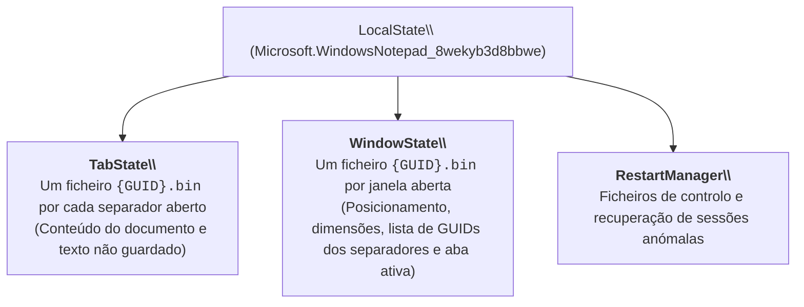
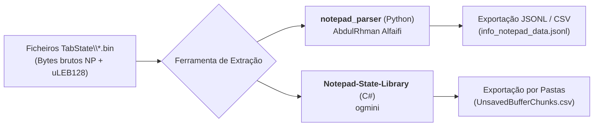

# Artefacto Forense do Bloco de Notas (Notepad Windows 11)

O **Bloco de Notas do Windows 11** (`Microsoft.WindowsNotepad`) grava em `LocalState\TabState\{GUID}.bin` (assinatura `NP`, texto UTF-16LE e inteiros `uLEB128`) o conteúdo de separadores abertos e não guardados.

> [!TIP] Lógica de Funcionamento e Valor Forense
> * **Porque existe (Sistema)**: No Windows 11, o clássico `notepad.exe` Win32 foi substituído por uma aplicação moderna empacotada em MSIX/UWP com suporte a múltiplos separadores (*tabs*) e persistência automática de sessão (*Continue previous session*). Para não perder trabalho do utilizador em caso de falha de energia ou reinício automático do Windows Update, a aplicação serializa continuamente cada separador para um ficheiro `{GUID}.bin` na pasta `TabState`.
> * **Porque importa (Forense)**: Muitos utilizadores e suspeitos usam o Bloco de Notas como "bloco de rascunho temporário" para colar palavras-passe, seeds de carteiras cripto, comandos de ataque ou notas confidenciais, fechando ou deixando a janela aberta **sem nunca clicar em "Guardar" (`Ctrl+S`)**. No Windows 11, esse **texto nunca guardado (*unsaved text*) fica integralmente gravado em disco** nos ficheiros `.bin` da pasta `TabState`, sobrevivendo a reboots e desligamentos forçados.
> * **Pontos Críticos e Armadilhas para Exame**:
>   * **Assinatura e Dupla Codificação**: Todo o ficheiro `TabState\{GUID}.bin` começa com os 2 bytes mágicos **`4E 50`** (ASCII **`NP`**). Todas as strings de texto estão em **UTF-16LE** (2 bytes por caráter), enquanto todos os comprimentos, posições de cursor e o próprio carimbo temporal *FILETIME* estão comprimidos em **[[Codificação uLEB128 em Estruturas de Dados do Windows|uLEB128]]**.
>   * **`TypeFlag = 1` vs. `TypeFlag = 0`**: No offset `0x03`, o byte `TypeFlag` distingue se o separador corresponde a um **ficheiro gravado em disco (`0x01`)** — incluindo o caminho UTF-16LE, `FileSize`, `LastWriteTimestamp` em `uLEB128` e hash **SHA-256** de 32 bytes — ou a um **rascunho nunca gravado (`0x00`)**, que omite os metadados de ficheiro e avança diretamente para as posições do cursor e o conteúdo textual.

---

## 1. Localização Física no Sistema de Ficheiros

Na modernização do Windows 11, os ficheiros de estado do Bloco de Notas deixaram de existir apenas na memória RAM do processo e passaram a residir no contentor privado do pacote MSIX/UWP de cada utilizador:

```text
%LOCALAPPDATA%\Packages\Microsoft.WindowsNotepad_8wekyb3d8bbwe\LocalState\
```

*(Caminho expandido: `C:\Users\<User>\AppData\Local\Packages\Microsoft.WindowsNotepad_8wekyb3d8bbwe\LocalState\`)*



---

## 2. Anatomia Binária dos Ficheiros `TabState` (`.bin`)

Cada separador ativo ou recuperável é representado por um ficheiro nomeado pelo seu GUID exclusivo (ex.: `04b74c4a-5e1b-46ec-9a90-0eb68371af75.bin`), acompanhado por vezes de ficheiros `.0.bin` e `.1.bin` de transação/estado.

O ficheiro segue uma especificação binária proprietária rigorosa, cuja estrutura bifurca no 4.º byte (`TypeFlag`) consoante o separador corresponda a um **ficheiro gravado em disco (`TypeFlag = 1`)** ou a um **separador de rascunho não gravado (`TypeFlag = 0`)**:

```text
Offset (h)  00 01 02 03 04 05 06 07 08 09 0A 0B 0C 0D 0E 0F  Decoded Text
00000000    4E 50 00 01 6F 43 00 3A 00 5C 00 55 00 73 00 65  NP..oC.:.\.U.s.e
            [Magic]  [T][L][Caminho UTF-16LE: C:\Use...]
```

*(No exemplo acima: `4E 50` = assinatura `NP`; `00` = Sequence Number; `01` no offset `0x03` = `TypeFlag 1` indicando separador gravado em disco; `6F` = `111` em `uLEB128` indicando um caminho de 111 carateres, que ocupa $111 \times 2 = 222$ bytes em UTF-16LE iniciados por `C:\Users\patri\OneDrive...`).*

### Tabela Comparativa da Estrutura Binária: `TypeFlag = 1` (Gravado) vs. `TypeFlag = 0` (Não Gravado)

| Ordem | Campo Estrutural | Tamanho / Codificação | `TypeFlag = 1` (Ficheiro em Disco) | `TypeFlag = 0` (*Unsaved Tab*) | Descrição Técnica e Valor Forense |
| :---: | :--- | :--- | :---: | :---: | :--- |
| **1** | **Signature / Magic Bytes** | 2 bytes fixos | **`4E 50`** (`NP`) | **`4E 50`** (`NP`) | Assinatura mágica constante: carateres ASCII **`NP`** (*Notepad*). |
| **2** | **Sequence Number** | `uLEB128` | Presente (`0x00`) | Presente (`0x00`) | Inteiro de sequência / versão do formato. |
| **3** | **TypeFlag** | `uLEB128` (1 byte) | **`0x01`** | **`0x00`** | Define o ramo estrutural: `0x01` tem ficheiro associado; `0x00` é rascunho apenas em cache. |
| **4** | **FilePathLength** | `uLEB128` | **Presente** | *Ausente* | Comprimento do caminho do ficheiro em **número de carateres** (ex.: `0x6F` = 111 chars). |
| **5** | **FilePath** | `2 × FilePathLength` (**UTF-16LE**) | **Presente** | *Ausente* | Caminho completo do ficheiro no disco codificado em UTF-16LE. |
| **6** | **FileSize** | `uLEB128` | **Presente** | *Ausente* | Tamanho original do ficheiro em bytes no disco no momento da abertura/gravação. |
| **7** | **Encoding & CR Type** | 2 bytes (`1B + 1B`) | **Presente** | *Ausente* | Codificação do ficheiro (ex.: `0x05` = UTF-8, `0x01` = ANSI) e quebra de linha (`0x01` = CRLF). |
| **8** | **LastWriteTimestamp** | `uLEB128` | **Presente** | *Ausente* | Carimbo **FILETIME** (64-bit UTC) da última gravação em disco, comprimido em `uLEB128`. |
| **9** | **FileHash** | 32 bytes fixos | **Presente** | *Ausente* | Hash criptográfico **SHA-256** do ficheiro original no disco. |
| **10** | **Unknown / Delimiter Flag** | `2 bytes` (`Type=1`) / `1 byte` (`Type=0`) | Presente (`.. 01`) | Presente (`01`) | Bytes de controlo que precedem as coordenadas do cursor (terminam em `0x01`). |
| **11** | **SelectionStartIndex** | `uLEB128` | Presente | Presente | Índice do caráter onde começa a seleção de texto ou onde estava posicionado o cursor. |
| **12** | **SelectionEndIndex** | `uLEB128` | Presente | Presente | Índice do caráter onde termina a seleção de texto (se igual ao Start, nenhum texto estava selecionado). |
| **13** | **Configuration Block** | Bloco variável (~4–5 bytes) | Presente | Presente | Parâmetros de visualização (*word wrap*, RTL, indicadores de estado). |
| **14** | **ContentLength** | `uLEB128` | Presente | Presente | Comprimento total do texto do separador em **número de carateres**. |
| **15** | **Content** | `2 × ContentLength` (**UTF-16LE**) | Presente | Presente | **O conteúdo textual integral do separador** (incluindo rascunhos não guardados) em UTF-16LE. |
| **16** | **Unsaved Flag** | 1 byte | Presente | Presente | Flag booleana: `0x00` se sincronizado com o disco; `0x01` se contém alterações pendentes (*dirty*). |
| **17** | **Checksum CRC32** | 4 bytes (**Big-Endian**) | Presente | Presente | Soma de verificação CRC-32 calculada sobre todos os bytes anteriores para validar integridade. |
| **18** | **Unsaved Buffer Chunks** | Bloco dinâmico opcional | Presente (se editado) | Presente (se editado) | Operações granulares de adição/remoção de carateres em memória ainda não fundidas no `Content`. |

> [!IMPORTANT] Codificação Numérica e Textual (A Chave de Exame)
> O ficheiro `.bin` do `TabState` combina três regras de representação de dados:
> 1. **Texto (`FilePath` e `Content`)**: Sempre codificado em **[[Codificação de Caracteres - ASCII, Latin-1 e Unicode|UTF-16LE]]** (2 bytes por caráter). Se o `ContentLength` for $N$, o bloco `Content` ocupa exatamente $2 \times N$ bytes.
> 2. **Inteiros Numéricos (`FilePathLength`, `FileSize`, `LastWriteTimestamp`, `SelectionStartIndex`, `SelectionEndIndex`, `ContentLength`)**: Todos codificados no formato de comprimento variável **`uLEB128`**, detalhado em [[Codificação uLEB128 em Estruturas de Dados do Windows]].
> 3. **Checksum CRC32**: Armazenado nos 4 bytes após a *Unsaved Flag* em ordem **[[Endianness e Ordem de Armazenamento|Big-Endian]]**.

---

## 3. Ferramentas Forenses de Extração e Anatomia de Comandos

Para converter os ficheiros `{GUID}.bin` em relatórios legíveis, existem duas ferramentas de referência desenvolvidas pela comunidade de investigação forense:



### 1. `notepad_parser` (AbdulRhman Alfaifi)
Utilitário em Python de elevado desempenho e estabilidade para extração automatizada:

```cmd
REM Exportar o histórico do Bloco de Notas para formato JSONL estruturado
notepad_parser.exe -f jsonl -o info_notepad_data.jsonl

REM Exportar diretamente para folha de cálculo CSV apontando para uma pasta recolhida
notepad_parser.exe -p "C:\Forensics\LocalState\TabState" -f csv -o info_notepad_data.csv
```

#### Anatomia dos Parâmetros do `notepad_parser`:

* **`-p <caminho>`** (opcional): Caminho para a pasta `TabState` ou `Packages` (se omitido numa máquina *live*, procura automaticamente no perfil do utilizador atual).
* **`-f <formato>`**: Define o formato de saída dos dados extraídos (`jsonl` para JSON Lines ou `csv` para tabela separada por vírgulas).
* **`-o <ficheiro_saida>`**: Nome e caminho do ficheiro de relatório a gerar.
* **Funcionamento**: Valida a assinatura `NP`, descodifica os campos `uLEB128`, converte o `LastWriteTimestamp` para data UTC legível, extrai o hash SHA-256 e reconstrói o texto completo em UTF-16LE.

### 2. `Notepad-State-Library` / `WindowsNotepadParser` (ogmini)
Biblioteca e utilitário em C# (.NET) que decompõe tanto `TabState` como `WindowState` e reconstrói os fragmentos não comitados (*Unsaved Buffer Chunks*):

```cmd
WindowsNotepadParser.exe -p "C:\Users\user\AppData\Local\Packages\Microsoft.WindowsNotepad_8wekyb3d8bbwe\LocalState" -o "C:\Temp\Notepad_Export"
```

* **`-p <diretório>`**: Diretório `LocalState` do pacote `Microsoft.WindowsNotepad`.
* **`-o <diretório>`**: Pasta de destino onde gera múltiplos ficheiros CSV (`SavedTabs.csv`, `UnsavedTabs.csv`, `WindowState.csv` e `UnsavedBufferChunks.csv`).

---

## 4. Enquadramento Laboratorial

A aquisição física da pasta `LocalState`, dissecação da estrutura binária `{GUID}.bin` com editor hexadecimal, cálculo do checksum CRC32 e recuperação de texto não gravado é lecionada na **Ficha 10 – Windows Notepad**.

---

## Perguntas de revisão

1. **Porque é que o Bloco de Notas do Windows 11 constitui uma mudança de paradigma forense em relação ao clássico `notepad.exe` do Windows 10 e anteriores?**

> [!success]- Ver Resposta
> No Windows 10 e anteriores, o texto digitado numa janela do `notepad.exe` que não fosse explicitamente guardado pelo utilizador (`Ctrl+S`) existia apenas na memória RAM volátil, perdendo-se ao fechar o programa ou desligar o PC. No Windows 11, a nova aplicação UWP/MSIX (`Microsoft.WindowsNotepad`) guarda automaticamente em disco o estado de todos os separadores abertos — incluindo **rascunhos nunca guardados (*unsaved text*)** — na pasta `%LOCALAPPDATA%\Packages\Microsoft.WindowsNotepad_8wekyb3d8bbwe\LocalState\TabState\`, sobrevivendo a reinícios e cortes de energia.

2. **Ao abrir um ficheiro `{GUID}.bin` da pasta `TabState` num editor hexadecimal, quais são os primeiros 4 bytes de um separador correspondente a um ficheiro gravado em disco vs. um separador nunca gravado?**

> [!success]- Ver Resposta
> * Nos primeiros 2 bytes (offset `0x00`–`0x01`), ambos apresentam a assinatura mágica **`4E 50`** (carateres ASCII **`NP`**).
> * No offset `0x02`, ambos apresentam o `Sequence Number` (tipicamente `00`).
> * No offset `0x03` (`TypeFlag`), um separador associado a um ficheiro gravado em disco apresenta o byte **`01`** (`TypeFlag = 1`), enquanto um separador de rascunho nunca gravado apresenta o byte **`00`** (`TypeFlag = 0`).

3. **Quais são os seis metadados exclusivos que existem num ficheiro `TabState` com `TypeFlag = 1` mas que estão completamente ausentes quando `TypeFlag = 0`?**

> [!success]- Ver Resposta
> Quando `TypeFlag = 1` (ficheiro gravado em disco), o ficheiro `.bin` inclui imediatamente após a flag:
> 1. **`FilePathLength`** (em `uLEB128`);
> 2. **`FilePath`** (caminho completo em UTF-16LE);
> 3. **`FileSize`** (tamanho em bytes em `uLEB128`);
> 4. **`Encoding & CR Type`** (2 bytes para codificação e tipo de quebra de linha);
> 5. **`LastWriteTimestamp`** (carimbo FILETIME 64-bit comprimido em `uLEB128`);
> 6. **`FileHash`** (hash criptográfico **SHA-256** de 32 bytes do ficheiro em disco).

4. **Se o campo `ContentLength` de um ficheiro `TabState` tiver o valor descodificado de `50` carateres, quantos bytes ocupará fisicamente o campo `Content` imediatamente a seguir e porquê?**

> [!success]- Ver Resposta
> Ocupará exatamente **`100 bytes`** ($50 \times 2$), porque todo o texto no ficheiro `.bin` do Bloco de Notas (tanto o `FilePath` como o `Content`) é armazenado na codificação **UTF-16LE**, onde cada caráter ocupa 2 bytes.

5. **Como é garantida a integridade dos dados dentro de um ficheiro `{GUID}.bin` do `TabState` e que particularidade de *endianness* possui esse campo?**

> [!success]- Ver Resposta
> A integridade é verificada através de um **Checksum CRC32** de 4 bytes, posicionado imediatamente após o byte `Unsaved Flag` (no final do bloco principal de conteúdo) e armazenado em formato **Big-Endian**.

---

## Navegação e Notas Relacionadas

| Percurso | Nota | Contexto |
| :--- | :--- | :--- |
| **Anterior** | [[Análise Forense do SRUM e Ferramentas Nativas (powercfg)]] | `Bloco 14` |
| **Seguinte** | [[Codificação uLEB128 em Estruturas de Dados do Windows]] | `mesmo bloco` |
| **Índice** | [[Capítulo 1 - Sistemas Operativos, Serviços e Artefactos Forenses]] · [[00 ASSI]] | `Bloco 15` |

### Conceitos Relacionados

* [[Matriz de Correlação Forense e Cronologia de Ativação dos Artefactos]] · `mesmo bloco`
* [[Registry em Aplicações Modernas (MSIX e Helium)]] · `Bloco 06`
* [[Codificação de Caracteres - ASCII, Latin-1 e Unicode]] · `AFD1 · Cap. 3`
* [[Organização de Estruturas de Dados em Binário]] · `AFD1 · Cap. 3`
* [[Preservação do Sistema e Integridade de Dados]] · `AFD1 · Cap. 1`
* [[Endianness e Ordem de Armazenamento]] · `AFD1 · Cap. 3`
