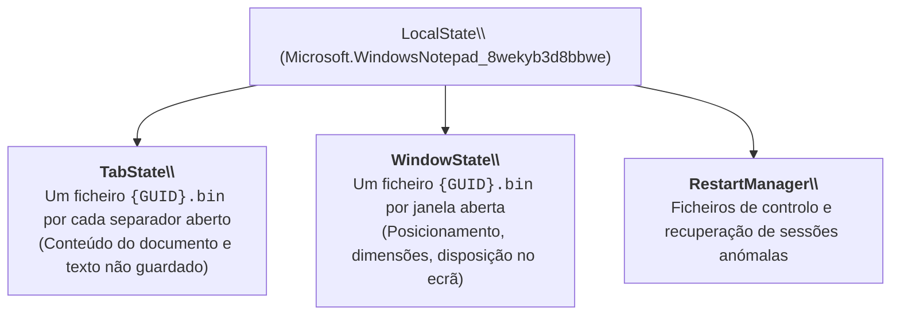
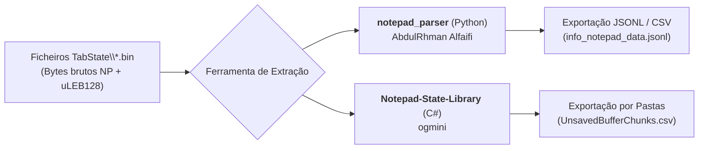

# Artefacto Forense do Bloco de Notas (Notepad Windows 11)

Na modernização do Windows 11, o clássico Bloco de Notas Win32 foi substituído por uma aplicação moderna empacotada em arquitetura UWP / MSIX (`Microsoft.WindowsNotepad`).

Entre as novas funcionalidades, destaca-se o suporte a múltiplos **separadores (*tabs*)** e um mecanismo avançado de **tolerância a falhas e restauro de sessão**: o Bloco de Notas grava continuamente em segundo plano o conteúdo dos separadores abertos, **incluindo texto nunca gravado pelo utilizador (*unsaved text*)**, sobrevivendo a encerramentos forçados, falhas de energia e reinícios do sistema (*reboots*).

Em investigações forenses, este artefacto permite recuperar rascunhos, credenciais copiadas temporariamente, chaves privadas ou notas voláteis que o suspeito acreditava nunca terem sido escritas no disco.

---

## 1. Localização Física no Sistema de Ficheiros

Os ficheiros de estado do Bloco de Notas residem no contentor privado do pacote UWP do utilizador:

$$\texttt{\%LOCALAPPDATA\%\textbackslash Packages\textbackslash Microsoft.WindowsNotepad\_8wekyb3d8bbwe\textbackslash LocalState\textbackslash}$$
*(Caminho expandido: `C:\Users\<User>\AppData\Local\Packages\Microsoft.WindowsNotepad_8wekyb3d8bbwe\LocalState\`)*



---

## 2. Anatomia Binária dos Ficheiros `TabState` (`.bin`)

Cada separador ativo ou recuperável é representado por um ficheiro nomeado pelo seu GUID exclusivo (ex.: `04b74c4a-5e1b-46ec-9a90-0eb68371af75.bin`).

O ficheiro segue uma especificação binária proprietária rigorosa (conforme mapeado na biblioteca *Notepad-State-Library*):

```text
Offset (h)  00 01 02 03 04 05 06 07 08 09 0A 0B 0C 0D 0E 0F  Decoded Text
00000000    4E 50 00 01 6F 43 00 3A 00 5C 00 55 00 73 00 65  NP..oC.:.\.U.s.e
            [Magic]                                            [Texto UTF-16LE...]
```

### Estrutura de Campos (Separador com Conteúdo Não Gravado)

| Campo | Tamanho / Tipo | Descrição e Função Técnica |
| :--- | :--- | :--- |
| **Signature / Magic Bytes** | 2 bytes | Assinatura mágica constante: **`0x4E 0x50`** (carateres ASCII **`NP`** de Notepad). |
| **Sequence Number** | `uLEB128` | Inteiro de sequência (frequentemente `0`). |
| **TypeFlag** | `uLEB128` | Flag de tipologia interna (igual a `0`). |
| **Unknown Flag** | 1 byte | Byte de controlo (`0x01`). |
| **SelectionStartIndex** | `uLEB128` | Posição de início da seleção de texto (cursor). |
| **SelectionEndIndex** | `uLEB128` | Posição de fim da seleção de texto. |
| **Configuration Block** | Bloco variável | Parâmetros de quebra de linha (*word wrap*) e codificação. |
| **ContentLength** | `uLEB128` | Comprimento do texto do documento em bytes. |
| **Content** | Variável (**UTF-16LE**) | O **conteúdo textual do separador** codificado em UTF-16 Little-Endian. |
| **Unsaved Flag** | 1 byte | Flag de documento não gravado (`0` se vazio/salvo). |
| **Checksum CRC32** | 4 bytes | Valor de integridade CRC-32 para validação contra corrupção de ficheiro. |
| **Unsaved Buffer Chunks** | Bloco dinâmico | Fragmentos de alterações em memória pendentes antes do fecho formal da app. |

> [!IMPORTANT] Codificação Numérica e Textual
> O ficheiro combina dois formatos técnicos distintos:
> 1. **Texto**: Todas as strings (caminhos de ficheiros e conteúdo das notas) estão codificadas em **UTF-16LE** (2 bytes por caráter).
> 2. **Inteiros Numéricos**: Todos os contadores e comprimentos são codificados no formato de compressão **`uLEB128`**, detalhado em [[Codificação uLEB128 em Estruturas de Dados do Windows]].

---

## 3. Ferramentas Forenses de Extração

Para converter os ficheiros `{GUID}.bin` em relatórios legíveis, existem duas ferramentas de referência desenvolvidas pela comunidade de segurança:



### 1. `notepad_parser` (AbdulRhman Alfaifi)
Utilitário em Python de elevado desempenho e estabilidade:
```cmd
REM Exportar o histórico do Bloco de Notas para formato JSONL estruturado
notepad_parser.exe -f jsonl -o info_notepad_data.jsonl

REM Exportar diretamente para folha de cálculo CSV
notepad_parser.exe -f csv -o info_notepad_data.csv
```
*O utilitário processa automaticamente o diretório `LocalState\TabState`, valida a assinatura `NP`, descodifica o `uLEB128` e extrai o texto original.*

### 2. `Notepad-State-Library` (ogmini)
Biblioteca em C# (.NET) que decompõe cada separador e reconstrói os fragmentos não comitados (*Unsaved Buffer Chunks*):
```cmd
WindowsNotepadParser.exe -o C:\Temp\Notepad_Export
```
*Gera múltiplos ficheiros CSV com o conteúdo recuperado (com a ressalva de poder apresentar alguma instabilidade em formatos de compilações muito recentes do Windows).*

---

## 4. Enquadramento Laboratorial

A aquisição física da pasta `LocalState`, dissecação da estrutura binária `{GUID}.bin`, cálculo do checksum CRC32 e recuperação de texto não gravado é lecionada na **Ficha 10 – Windows Notepad**.

---

## Navegação

- [[Capítulo 1 - Sistemas Operativos, Serviços e Artefactos Forenses|Voltar ao Índice do Capítulo 1]]
- [[Codificação uLEB128 em Estruturas de Dados do Windows]]
- [[Matriz de Correlação Forense e Cronologia de Ativação dos Artefactos]]
- [[Registry em Aplicações Modernas (MSIX e Helium)]]
