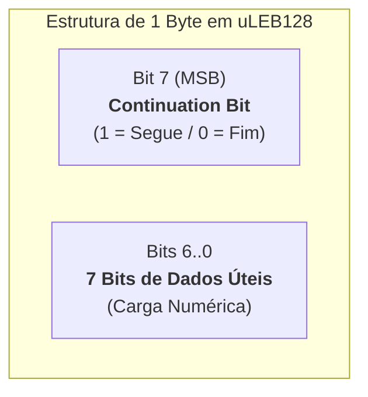

# Codificação uLEB128 em Estruturas de Dados do Windows

O formato **uLEB128** (**Unsigned Little Endian Base 128**) é um método padrão da indústria para codificar números inteiros sem sinal em sequências de bytes de **comprimento variável** (*variable-length quantity*).

Historicamente popularizado no formato de depuração DWARF, no WebAssembly e no formato DEX do Android, o uLEB128 foi adotado pela Microsoft em estruturas binárias de aplicações modernas no Windows 11, nomeadamente nos ficheiros `TabState` do [[Artefacto Forense do Bloco de Notas (Notepad Windows 11)|Bloco de Notas]].

---

## 1. Princípio de Funcionamento e Regra dos 7 Bits

Em arquiteturas convencionais de 32 ou 64 bits, um número inteiro pequeno (como o número `5`) ocupa 4 ou 8 bytes fixos na memória ou no disco (ex.: `0x00000005`), desperdiçando espaço com múltiplos bytes de valor zero.

O uLEB128 resolve esta ineficiência comprimindo o número:
* Cada byte codificado armazena **7 bits úteis** do valor numérico.
* O **bit mais significativo (MSB — Bit 7)** funciona exclusivamente como **bit de continuação (*continuation bit*)**:
  * Se **`Bit 7 = 1`**: Indica que **existem mais bytes a seguir** na sequência.
  * Se **`Bit 7 = 0`**: Indica que este é o **último byte** do número.
* **Ordenação Little-Endian**: Os blocos de 7 bits são organizados da direita para a esquerda (o primeiro byte transporta os 7 bits menos significativos).



---

## 2. Exemplo Passo a Passo: Codificar o Número Decimal 301

Para ilustrar o mecanismo detalhado nas aulas teóricas do Prof. Patrício Domingues, vejamos a codificação exata do valor **`301`**:

### Passo 1: Converter o Valor Decimal para Binário
$$301_{10} = 256 + 32 + 8 + 4 + 1 = \mathbf{100101101_2} \quad \text{(9 bits)}$$

### Passo 2: Dividir em Grupos de 7 Bits (da direita para a esquerda)
Completando com zeros à esquerda no grupo final:
* **Grupo 1 (Menos significativo)**: $\texttt{0101101}$ (corresponde a $45_{10}$)
* **Grupo 2 (Mais significativo)**: $\texttt{0000010}$ (corresponde a $2_{10}$)

### Passo 3: Atribuir o Bit de Continuação (Bit 7)
* **Byte 1 (Grupo 1)**:
  Como ainda existe o Grupo 2 a seguir, o bit de continuação é obrigatoriamente **`1`**:
  $$\text{Byte 1} = \mathbf{1} \mathbin{\Vert} \texttt{0101101} = \mathbf{10101101_2} = \mathbf{\text{0xAD}}$$
* **Byte 2 (Grupo 2)**:
  Como este é o último grupo, o bit de continuação é obrigatoriamente **`0`**:
  $$\text{Byte 2} = \mathbf{0} \mathbin{\Vert} \texttt{0000010} = \mathbf{00000010_2} = \mathbf{\text{0x02}}$$

### Passo 4: Sequência Final de Bytes no Ficheiro
O número 301 é armazenado fisicamente em disco como uma sequência de apenas dois bytes:
$$\mathbf{\text{AD 02}}$$

```text
Comparação de Ocupação em Disco:
Inteiro padrão de 32-bit LE:  2D 01 00 00  (4 bytes)
Inteiro codificado em uLEB128: AD 02        (2 bytes - poupança de 50%)
```

---

## 3. Algoritmo de Descodificação (Leitura Pericial)

Em desenvolvimento de scripts forenses de parsing, a rotina para ler um número uLEB128 a partir de um fluxo binário pode ser implementada da seguinte forma:

```python
def read_uleb128(stream):
    """
    Lê um inteiro sem sinal codificado em uLEB128 de um fluxo binário.
    """
    result = 0
    shift = 0
    while True:
        byte = stream.read(1)
        if not byte:
            raise EOFError("Fim de ficheiro inesperado ao ler uLEB128")
        
        val = byte[0]
        # Extrai os 7 bits de dados
        result |= (val & 0x7F) << shift
        
        # Se o bit mais significativo for 0, terminámos
        if (val & 0x80) == 0:
            break
            
        shift += 7
        
    return result

# Teste com os bytes [0xAD, 0x02]:
# 1. Byte 0xAD (10101101): val & 0x7F = 0x2D (45). result = 45. Segue.
# 2. Byte 0x02 (00000010): val & 0x7F = 2. (2 << 7) = 256. result = 45 + 256 = 301. Fim.
```

---

## 4. Relevância em Análise Forense

1. **Validação de Tamanhos de Documentos**: Nos ficheiros `TabState` do Bloco de Notas, campos como `ContentLength`, `SelectionStartIndex` e `SelectionEndIndex` utilizam uLEB128. Um leitor que tente interpretar estes campos como inteiros fixos de 16 ou 32 bits sofrerá desalinhamento de *offsets*, corrompendo a extração do texto do documento.
2. **Identificação de Campos Dinâmicos**: A presença de uLEB128 em formatos binários recentes reflete a convergência das estruturas de dados da Microsoft para padrões de serialização modernos e compactos.

---

## Navegação

- [[Capítulo 1 - Sistemas Operativos, Serviços e Artefactos Forenses|Voltar ao Índice do Capítulo 1]]
- [[Artefacto Forense do Bloco de Notas (Notepad Windows 11)]]
- [[Matriz de Correlação Forense e Cronologia de Ativação dos Artefactos]]
- [[Sistemas de Numeração e Conversão entre Bases]]
- [[Endianness e Ordem de Armazenamento]]
- [[Organização de Estruturas de Dados em Binário]]
