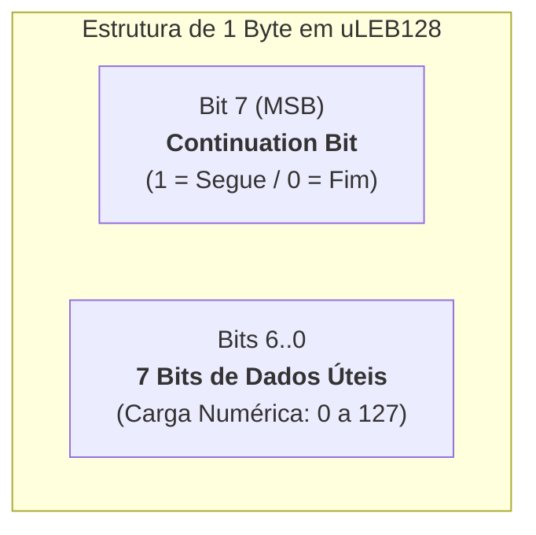

# Codificação uLEB128 em Estruturas de Dados do Windows

O **uLEB128** (*Unsigned Little Endian Base 128*) comprime inteiros sem sinal em sequências de bytes variáveis (7 bits de dados + 1 *continuation bit* MSB), sendo usado no `TabState` do Windows 11.

> [!TIP] Lógica de Funcionamento e Valor Forense
> * **Porque existe (Sistema)**: Em estruturas binárias modernas (como DWARF, WebAssembly, Android DEX e os ficheiros `TabState` do [[Artefacto Forense do Bloco de Notas (Notepad Windows 11)|Bloco de Notas do Windows 11]]), gravar inteiros de 32 ou 64 bits com tamanho fixo desperdiça espaço em disco quando a maioria dos valores (comprimentos de texto, posições de cursor, flags) são números pequenos inferiores a 128. O `uLEB128` usa apenas **1 byte** para números de `0` a `127`, **2 bytes** até `16383`, e assim sucessivamente.
> * **Porque importa (Forense)**: Como os comprimentos de strings (`FilePathLength`, `ContentLength`), posições de cursor e até o carimbo `FILETIME` nos ficheiros `TabState\{GUID}.bin` estão codificados em `uLEB128`, o perito tem de saber codificar e descodificar manualmente este formato em exame e na escrita de parsers forenses para não desalinhar a leitura dos *offsets* seguintes.
> * **Pontos Críticos e Armadilhas para Exame**:
>   * **Regra do Bit 7 (MSB)**: Em cada byte lido, apenas os **7 bits inferiores (`Bits 6..0`, máscara `0x7F`)** contêm valor numérico. O **Bit 7 (MSB, máscara `0x80`)** é o *continuation bit*: se for **`1`** (byte $\ge \text{0x80}$), o número continua no byte seguinte; se for **`0`** (byte $\le \text{0x7F}$), esse é o último byte do inteiro.
>   * **Ordem Little-Endian dos Grupos de 7 Bits**: O primeiro byte armazenado em disco contém os **7 bits menos significativos** do número; o segundo byte contém os 7 bits seguintes (multiplicados por $2^7 = 128$), e assim por diante. Exemplo clássico de aula: **$301_{10} \longrightarrow \textbf{\texttt{AD 02}}$**.

---

## 1. Princípio de Funcionamento e Regra dos 7 Bits

Em arquiteturas convencionais de 32 ou 64 bits, um número inteiro pequeno (como o número `5`) ocupa 4 ou 8 bytes fixos na memória ou no disco (ex.: `05 00 00 00`), desperdiçando espaço com múltiplos bytes nulos.

O **uLEB128** (*Unsigned Little Endian Base 128*) resolve esta ineficiência comprimindo o número em grupos de 7 bits:

* Cada byte codificado armazena **7 bits úteis** do valor numérico (Base $2^7 = 128$).
* O **bit mais significativo (MSB — Bit 7)** funciona exclusivamente como **bit de continuação (*continuation bit*)**:
  * Se **`Bit 7 = 1`** (valor hexadecimal do byte entre `0x80` e `0xFF`): Indica que **existem mais bytes a seguir** na sequência.
  * Se **`Bit 7 = 0`** (valor hexadecimal do byte entre `0x00` e `0x7F`): Indica que este é o **último byte** do número.
* **Ordenação Little-Endian**: Os blocos de 7 bits são gravados do menos significativo para o mais significativo (o primeiro byte no ficheiro transporta os 7 bits da direita).



### Tabela de Intervalos e Ocupação em Bytes (`uLEB128` vs. Inteiro Fixo)

| Intervalo de Valores Decimais | Bits Úteis | Bytes em `uLEB128` | Bytes em `uint32` / `uint64` | Exemplo Decimal $\to$ Hexadecimal em `uLEB128` |
| :--- | :---: | :---: | :---: | :--- |
| **`0` a `127`** ($2^7 - 1$) | 7 bits | **1 byte** | 4 / 8 bytes | $111_{10} \to \mathbf{\texttt{6F}}$ (Bit 7 = `0`, termina logo no 1.º byte) |
| **`128` a `16 383`** ($2^{14} - 1$) | 14 bits | **2 bytes** | 4 / 8 bytes | $301_{10} \to \mathbf{\texttt{AD 02}}$ ($45 + 2 \times 128 = 301$) |
| **`16 384` a `2 097 151`** ($2^{21} - 1$) | 21 bits | **3 bytes** | 4 / 8 bytes | $65535_{10} \to \mathbf{\texttt{FF FF 03}}$ |
| **Carimbo `FILETIME` (64-bit)** | ~60 bits | **9 bytes** | 8 bytes | Timestamps elevados requerem 9 grupos de 7 bits ($9 \times 7 = 63$ bits) |

---

## 2. Exemplo Passo a Passo: Codificar e Descodificar o Número Decimal 301

Para ilustrar o mecanismo detalhado nas aulas teóricas do Prof. Patrício Domingues, vejamos a codificação e descodificação exata do valor **`301`**:

### A. Processo de Codificação ($301_{10} \longrightarrow \texttt{AD 02}$)

#### Passo 1: Converter o Valor Decimal para Binário

$$301_{10} = 256 + 32 + 8 + 4 + 1 = \mathbf{100101101_2} \quad \text{(9 bits)}$$

#### Passo 2: Dividir em Grupos de 7 Bits (da direita para a esquerda — Little-Endian)
Completando com zeros à esquerda no grupo mais significativo:

* **Grupo 1 (7 bits da direita — menos significativos)**: $\texttt{0101101}_2$ (corresponde a $32 + 8 + 4 + 1 = 45_{10}$)
* **Grupo 2 (restantes bits à esquerda — mais significativos)**: $\texttt{0000010}_2$ (corresponde a $2_{10}$)

#### Passo 3: Atribuir o Bit de Continuação (Bit 7 / MSB)

**Byte 1 (Grupo 1):** Como ainda existe o Grupo 2 a seguir, o bit de continuação (MSB) é obrigatoriamente **`1`**:

$$\text{Byte 1} = \mathbf{1} \mathbin{\Vert} \texttt{0101101}_2 = \mathbf{1010\,1101_2} = \mathbf{\text{0xAD}}$$

**Byte 2 (Grupo 2):** Como este é o último grupo, o bit de continuação (MSB) é obrigatoriamente **`0`**:

$$\text{Byte 2} = \mathbf{0} \mathbin{\Vert} \texttt{0000010}_2 = \mathbf{0000\,0010_2} = \mathbf{\text{0x02}}$$

#### Passo 4: Sequência Final de Bytes no Ficheiro
O número 301 é armazenado fisicamente em disco como uma sequência de apenas dois bytes:

$$\mathbf{\text{AD 02}}$$

```text
Comparação de Ocupação em Disco para o valor 301 (0x012D):
Inteiro padrão de 32-bit LE:   2D 01 00 00  (4 bytes)
Inteiro codificado em uLEB128: AD 02        (2 bytes - poupança de 50%)
```

### B. Processo Inverso: Descodificação Rápida Manual ($\texttt{AD 02} \longrightarrow 301_{10}$)
Se num exame surgir a sequência hexadecimal **`AD 02`** num campo `uLEB128`:

**1.** Ler o 1.º byte **`0xAD`** ($173_{10}$): como $\text{0xAD} \ge \text{0x80}$, o Bit 7 é `1` (há mais bytes). Retira-se o Bit 7 subtraindo $128$ (ou aplicando `& 0x7F`): $173 - 128 = \mathbf{45}$.

**2.** Ler o 2.º byte **`0x02`** ($2_{10}$): como $\text{0x02} < \text{0x80}$, o Bit 7 é `0` (**último byte!**). O seu valor útil é $\mathbf{2}$.

**3.** Multiplicar cada grupo pela respetiva potência de $128$ ($2^7$):

$$\text{Valor} = 45 \times 128^0 + 2 \times 128^1 = 45 + 256 = \mathbf{301_{10}}$$

---

## 3. Algoritmo de Descodificação em Python (Leitura Pericial)

Em desenvolvimento de scripts forenses de parsing, a rotina para ler um número `uLEB128` a partir de um fluxo binário implementa exatamente as operações bit-a-bit `& 0x7F` (extração dos 7 bits de dados) e `& 0x80` (teste do bit de continuação):

```python
def read_uleb128(stream):
    """
    Lê um inteiro sem sinal codificado em uLEB128 de um fluxo binário.
    """
    result = 0
    shift = 0
    while True:
        byte = stream.read(1)
        if not byte:
            raise EOFError("Fim de ficheiro inesperado ao ler uLEB128")
        
        val = byte[0]
        # Extrai os 7 bits de dados (máscara 0x7F = 01111111_2) e desloca
        result |= (val & 0x7F) << shift
        
        # Se o bit mais significativo (0x80 = 10000000_2) for 0, terminámos
        if (val & 0x80) == 0:
            break
            
        shift += 7
        
    return result

# Teste passo a passo com os bytes [0xAD, 0x02]:
# 1. Byte 0xAD (10101101): val & 0x7F = 0x2D (45). result = 45 << 0 = 45. (val & 0x80) != 0 -> Segue (shift = 7).
# 2. Byte 0x02 (00000010): val & 0x7F = 0x02 (2).  result = 45 | (2 << 7) = 45 + 256 = 301. (val & 0x80) == 0 -> Fim.
```

---

## 4. Relevância em Análise Forense

1. **Validação de Tamanhos de Documentos e Caminhos**: Nos ficheiros `TabState` do [[Artefacto Forense do Bloco de Notas (Notepad Windows 11)|Bloco de Notas]], campos como `FilePathLength`, `FileSize`, `LastWriteTimestamp`, `SelectionStartIndex`, `SelectionEndIndex` e `ContentLength` utilizam `uLEB128`. Um leitor que tente interpretar estes campos como inteiros fixos de 16 ou 32 bits sofrerá desalinhamento imediato de *offsets*, corrompendo a extração do texto UTF-16LE do documento.
2. **Delimitador Automático de Campo**: Graças ao bit de continuação (MSB = `0` no byte final), o formato `uLEB128` é auto-delimitado: o parser sabe exatamente em que byte termina o inteiro e onde começa o campo seguinte, sem precisar de separadores adicionais.

---

## Perguntas de revisão

1. **Qual é a função do Bit 7 (MSB) e dos Bits 6 a 0 em cada byte de um número codificado em `uLEB128`?**

> [!success]- Ver Resposta
> Em cada byte de um inteiro `uLEB128`, os **Bits 6 a 0 (7 bits inferiores)** armazenam a carga útil numérica, enquanto o **Bit 7 (MSB — *Most Significant Bit*)** funciona como **bit de continuação (*continuation bit*)**: se `Bit 7 = 1` (byte $\ge \text{0x80}$), significa que o número continua no byte seguinte; se `Bit 7 = 0` (byte $\le \text{0x7F}$), significa que esse é o último byte do número.

2. **Qual é o maior número inteiro sem sinal que pode ser representado num único byte em `uLEB128` e como é codificado o número imediatamente a seguir (`128`)?**

> [!success]- Ver Resposta
> O maior número representável num único byte é **`127`** ($2^7 - 1 = \texttt{01111111}_2 = \mathbf{\texttt{0x7F}}$). O número **`128`** ($\texttt{10000000}_2$ em 8 bits) já requer 2 grupos de 7 bits (`0000001` e `0000000`), sendo codificado em 2 bytes como **`80 01`** (`0x80` tem os 7 bits de dados a zero e o bit de continuação a `1`; `0x01` tem o valor $1 \times 128^1 = 128$ e o bit de continuação a `0`).

3. **Demonstre passo a passo como se descodifica a sequência hexadecimal `AD 02` (codificada em `uLEB128`) para o seu valor decimal original.**

> [!success]- Ver Resposta
> 1. Primeiro byte **`0xAD`** ($173_{10} = \texttt{10101101}_2$): o Bit 7 é `1` (continua). Extraindo os 7 bits inferiores ($173 - 128$ ou `0xAD & 0x7F`), obtém-se **`45`** ($\texttt{0101101}_2$).
> 2. Segundo byte **`0x02`** ($2_{10} = \texttt{00000010}_2$): o Bit 7 é `0` (termina). Extraindo os 7 bits inferiores, obtém-se **`2`**.
> 3. Como a ordenação é *Little-Endian* em base 128: $\text{Resultado} = 45 + (2 \times 128) = 45 + 256 = \mathbf{301_{10}}$.

4. **Num ficheiro `TabState` do Bloco de Notas do Windows 11, a partir do offset `0x04` (campo `FilePathLength`), encontram-se os bytes `6F 43 00 3A 00`. Quantos bytes ocupa o campo `FilePathLength` e qual é o seu valor decimal?**

> [!success]- Ver Resposta
> O primeiro byte lido no offset `0x04` é **`0x6F`** ($111_{10} = \texttt{01101111}_2$). Como o seu Bit 7 é **`0`** ($\text{0x6F} < \text{0x80}$), o inteiro `uLEB128` termina imediatamente nesse único byte! Assim, o campo `FilePathLength` ocupa apenas **1 byte** e tem o valor decimal de **`111` carateres** (e os bytes seguintes `43 00 3A 00` já são o início da string `C:` em UTF-16LE).

---

## Navegação

- [[Capítulo 1 - Sistemas Operativos, Serviços e Artefactos Forenses|Voltar ao Índice do Capítulo 1]]
- [[Artefacto Forense do Bloco de Notas (Notepad Windows 11)]]
- [[Matriz de Correlação Forense e Cronologia de Ativação dos Artefactos]]
- [[Sistemas de Numeração e Conversão entre Bases]]
- [[Endianness e Ordem de Armazenamento]]
- [[Organização de Estruturas de Dados em Binário]]
