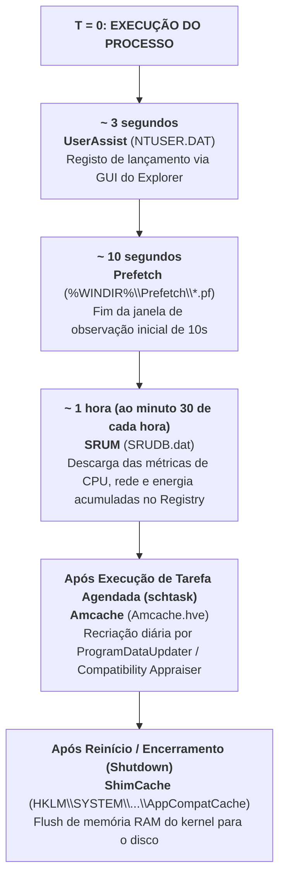

# Matriz de Correlação Forense e Cronologia de Ativação dos Artefactos

Na investigação de incidentes de cibersegurança e perícia forense em sistemas Windows, nenhum artefacto isolado deve ser interpretado fora de contexto. A confirmação robusta de que um programa malicioso ou um ficheiro confidencial foi acedido exige a **correlação cruzada** de múltiplas fontes de prova.

Para esse efeito, o investigador deve dominar duas dimensões essenciais:
1. **A Cronologia de Ativação (*Activation Timeline*)**: Em que momento exato, após o lançamento de um executável, é que cada subsistema do Windows comuta os dados da memória volátil para o disco?
2. **O Mapa de Localizações Críticas**: Onde residem fisicamente os ficheiros e chaves de sistema no Windows 10 e Windows 11?

---

## 1. Cronologia do "Tempo de Ativação" dos Artefactos de Execução

Conforme sistematizado nas lições do Prof. Patrício Domingues (Slide 156), os artefactos do sistema não são gravados simultaneamente. Cada componente possui a sua própria janela temporal de comutação:

### Síntese dos Prazos de Persistência em Disco:
* **UserAssist** ($\approx 3\,\text{s}$): Atualiza o valor `Count` poucos segundos após o processo ganhar foco na shell gráfica.
* **Prefetch** ($\approx 10\,\text{s}$): O serviço SysMain aguarda a conclusão da janela de 10 segundos de observação de DLLs antes de gerar ou atualizar o ficheiro `.pf`.
* **SRUM** ($\approx 1\,\text{h}$): As métricas acumulam-se em memória e no hive `SOFTWARE`; são consolidadas no ficheiro físico `SRUDB.dat` ao **minuto 30 de cada hora** e antes do encerramento.
* **Amcache** (Dependente de Tarefa Agendada): A consolidação de novos binários no hive `Amcache.hve` ocorre quando o escalonador executa as tarefas `Microsoft Compatibility Appraiser` ou `ProgramDataUpdater` (ciclo padrão de 24 horas).
* **ShimCache** (Apenas no *Shutdown/Restart*): Os dados residem em **memória RAM do kernel** durante toda a sessão ativa, sendo comitados no hive `SYSTEM` exclusivamente quando o sistema operativo encerra de forma ordeira.

> [!CAUTION] Impacto na Resposta a Incidentes (Live Triage vs. Post-Mortem)
> Se um computador sob investigação for apreendido através de desligamento forçado ("puxar a ficha da tomada"):
> * A **ShimCache** em disco **não conterá as execuções da sessão corrente** (perdem-se os dados em RAM);
> * O **SRUM** não terá a descarga da última hora;
> * Em contrapartida, o **Prefetch** e o **UserAssist** já estarão persistidos em disco para processos que tenham corrido há mais de 10 segundos.

---

## 2. Matriz Consolidada de Artefactos de Execução e Atividade (W10 / W11)

| Artefacto Forense | Localização Física / Chave de Registry | O que Regista | Valor Probatório Principal |
| :--- | :--- | :--- | :--- |
| **[[Volume Shadow Service (VSS) - Arquitetura e Funcionamento\|VSS]]** | `C:\System Volume Information` | Snapshots pontuais de volumes | Recuperação de versões anteriores de ficheiros apagados e hives históricos. |
| **[[Serviço Prefetch e SysMain - Arquitetura e Funcionamento\|Prefetch]]** | `%WINDIR%\Prefetch\*.pf` | Nome do executável, contadores, últimas 8 execuções e DLLs | **Prova de execução incontestável** (global do sistema, sem identificar utilizador). |
| **[[Application Compatibility e ShimCache (AppCompatCache)\|ShimCache]]** | `HKLM\SYSTEM\CurrentControlSet\Control\Session Manager\AppCompatCache` | Caminho do ficheiro, tamanho, carimbo de modificação (1024 entradas) | **Prova de presença/existência** no disco, partilha UNC ou pen USB (não prova execução no W10/W11). |
| **[[AmCache - Arquitetura, Hives e Evolução para SQLite\|Amcache]]** | `%WINDIR%\AppCompat\Programs\Amcache.hve` (e SQLite3 no W11) | Caminho, metadados PE e **Hash SHA-1** | Inventário de binários presentes e correlação direta com o VirusTotal. |
| **[[Mecanismos de Compatibilidade no Windows (WOW64, Shims, PCA, ShimCache e AmCache)\|Windows PCA (W11)]]** | `%SYSTEMROOT%\appcompat\pca` (ex.: `PcaAppLaunchDic.txt`, `PcaGeneralDb*.txt`) e `HKCU\...\AppCompatFlags\Layers` | Registos de execução e falhas monitorizados pelo *Program Compatibility Assistant* | Evidência adicional de execução de aplicações e caminhos invocados no Windows 11. |
| **[[Jump Lists - Arquitetura, AppIDs e Carving\|Jump Lists]]** | `%APPDATA%\Microsoft\Windows\Recent\AutomaticDestinations\` e `CustomDestinations\` | Ficheiros recentemente abertos pelo utilizador por AppID | **Persiste após desinstalação da app**; carving de `.customDestinations-ms` com `AB FB BF BA`. |
| **[[Ficheiros LNK (Shell Links) - Metadados e Formato Binário\|Ficheiros LNK]]** | `%APPDATA%\Microsoft\Windows\Recent\` | Atalhos para documentos, pastas e URLs (máx. 149) | Metadados de ficheiros apagados (MAC timestamps, Serial de volume USB, MAC da NIC). |
| **[[Caches de Ícones e Miniaturas (IconCache e Thumbcache)\|Thumbcache]]** | `%LOCALAPPDATA%\Microsoft\Windows\Explorer\thumbcache_*.db` | Miniaturas visuais em várias resoluções | Conteúdo visual de imagens e PDFs apagados (não prova visualização consciente). |
| **[[Artefacto Forense UserAssist\|UserAssist]]** | `HKCU\Software\Microsoft\Windows\CurrentVersion\Explorer\UserAssist` | Aplicações GUI lançadas no Explorer (ROT13) | Execução interativa pelo utilizador daquela conta específica. |
| **[[System Resource Usage Monitor (SRUM) - Arquitetura e Base ESE\|SRUM]]** | `%WINDIR%\system32\sru\SRUDB.dat` | Ciclos de CPU, bytes de rede (Up/Down) e bateria ao longo de 30–60 dias | Quantificação matemática de **exfiltração de dados** e mineração de criptomoedas. |
| **BAM (Background Activity Monitor)** | `HKLM\SYSTEM\CurrentControlSet\Services\bam\UserSettings\<SID>` | Execução de processos no Windows 10 $\ge$ 17.09 e Windows 11 | Registo de execução associado ao SID de cada utilizador com carimbos temporais. |
| **Capability Access Manager (CAM)** | `C:\ProgramData\Microsoft\Windows\CapabilityAccessManager` (e `ConsentStore` no Registry) | Histórico de acesso de aplicações a recursos sensíveis (câmara, microfone, localização) | Auditoria de que aplicações (UWP e Win32) acederam a periféricos de captura e quando. |
| **RecentApps** *(W10 apenas)* | `HKCU\Software\Microsoft\Windows\CurrentVersion\Search\RecentApps` | Caminhos de aplicações e últimos 10 ficheiros | Interação de utilizador no W10 (**Removido formalmente no Windows 11**). |
| **[[Windows Activity Timeline - Arquitetura e Base SQLite\|Timeline]]** | `%LOCALAPPDATA%\ConnectedDevicesPlatform\...\ActivitiesCache.db` | Histórico de atividades e Clipboard (Win+V) | Sequência de tarefas e extração de texto copiado nas últimas 12 horas. |
| **[[Artefacto Forense do Bloco de Notas (Notepad Windows 11)\|Notepad TabState]]** | `%LOCALAPPDATA%\Packages\Microsoft.WindowsNotepad_...\LocalState\TabState` | Ficheiros `{GUID}.bin` em UTF-16LE com uLEB128 | **Recuperação de texto não guardado** que sobrevive a reinícios do sistema. |

---

## 3. Guia de Diretórios e Ficheiros Críticos para Triagem Forense

Conforme compilado na síntese de pastas críticas de sistema (Slide 157):

| Diretório / Ficheiro do Windows | Descrição Pericial e Foco de Investigação |
| :--- | :--- |
| `C:\Windows\System32\drivers\etc\hosts` | Ficheiro de resolução estática de nomes DNS (inspecionar redirecionamentos maliciosos). |
| `C:\Windows\System32\drivers\etc\networks` | Ficheiro de configuração de redes conhecidas. |
| `C:\Windows\System32\config\SAM` | Base de contas de utilizador locais e hashes de palavras-passe (NTLM). |
| `C:\Windows\System32\config\SECURITY` | Políticas de segurança local, segredos LSA e credenciais em cache. |
| `C:\Windows\System32\config\SOFTWARE` | Definições globais de software, extensões do SRUM e histórico de instalação. |
| `C:\Windows\System32\config\SYSTEM` | Configurações de arranque, ControlSets, serviços, discos montados e **ShimCache**. |
| `C:\Windows\System32\winevt\Logs\` | Registo de eventos do Windows (**Event Logs `.evtx`**). |
| `C:\Windows\repair\SAM` | Cópia de segurança legada de utilizadores e palavras-passe. |
| `C:\ProgramData\Microsoft\Windows\Start Menu\Programs\Startup` | Pasta de arranque automático (*Startup*) transversal a todos os utilizadores. |
| `C:\Users\<User>\AppData\Roaming\Microsoft\Windows\Start Menu\Programs\Startup` | Pasta de arranque automático privada do utilizador. |
| `C:\Windows\Prefetch\` | Diretório de ficheiros de Prefetch (`.pf`). |
| `C:\Windows\AppCompat\Programs\Amcache.hve` | *Hive* independente de compatibilidade e inventário de binários (SHA-1). |
| `C:\Users\<User>\NTUSER.dat` | Hive do perfil de utilizador (UserAssist, RunMRU, TypedPaths, RecentDocs). |

---

## Navegação

- [[Capítulo 1 - Sistemas Operativos, Serviços e Artefactos Forenses|Voltar ao Índice do Capítulo 1]]
- [[Artefacto Forense do Bloco de Notas (Notepad Windows 11)]]
- [[Codificação uLEB128 em Estruturas de Dados do Windows]]
- [[Cheat Sheet - Artefactos de Execução e Sistema no Windows]]
- [[Taxonomia dos Artefactos de Execução no Windows]]
- [[Investigação Digital e Evidência Digital]]
- [[Investigação Forense Digital - Análise Live vs Post-Mortem]]
- [[Fases da Investigação Forense Digital]]
- [[Pesquisa de Evidências e Reconstrução de Eventos]]
- [[Diretrizes de Manuseamento - Identificação, Preservação, Isolamento e Correlação]]
