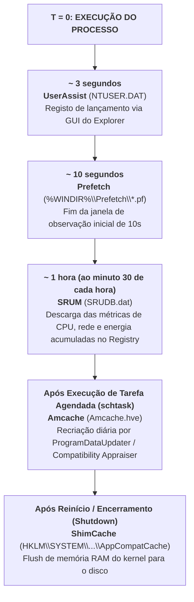

# Matriz de Correlação Forense e Cronologia de Ativação dos Artefactos

A **Matriz de Correlação Forense** articula os artefactos do Windows 10/11 com a sua **Cronologia de Ativação** ($T_0 \to \text{UserAssist} \to \text{Prefetch} \to \text{SRUM} \to \text{Amcache} \to \text{ShimCache}$).

> [!TIP] Lógica de Funcionamento e Valor Forense
> * **Porque existe (Sistema)**: Os subsistemas de telemetria, otimização e compatibilidade do Windows operam com políticas de *caching* assíncronas para não degradar o desempenho do sistema no momento em que o utilizador lança uma aplicação ($T_0$). Enquanto alguns componentes gravam no disco em segundos, outros retêm os dados em memória RAM e só descarregam de hora a hora, através de tarefas agendadas ou no encerramento do sistema.
> * **Porque importa (Forense)**: Nenhum artefacto isolado conta a história completa nem é imune a falhas de interpretação. A **correlação cruzada** permite distinguir a **mera presença de um binário** (`ShimCache`, `Amcache`) da sua **execução efetiva** (`Prefetch`, `UserAssist`, `BAM`) e do seu **impacto quantitativo na rede** (`SRUM`). Além disso, conhecer os tempos de ativação explica porque é que um computador desligado abruptamente da tomada apresenta determinados artefactos em disco e outros não.
> * **Pontos Críticos e Armadilhas para Exame**:
>   * **Ordem Temporal de Persistência em Disco**: **`UserAssist`** ($\approx 3\text{s}$) $\longrightarrow$ **`Prefetch`** ($\approx 10\text{s}$) $\longrightarrow$ **`SRUM`** ($\approx 1\text{h}$, ao minuto 30) $\longrightarrow$ **`Amcache`** (após tarefa agendada `Compatibility Appraiser`) $\longrightarrow$ **`ShimCache`** (**apenas no Shutdown / Restart**).
>   * **Consequência de Corte Abrupto de Energia**: Se um computador for desligado puxando o cabo de alimentação 5 minutos após a execução de um malware, o **`UserAssist`** e o **`Prefetch`** já terão registado a execução em disco, mas a **`ShimCache`** em disco (hive `SYSTEM`) e o **`SRUM`** (`SRUDB.dat`) ainda não terão comitado os dados dessa sessão!

> [!INFO] Simulador Interativo (Browser)
> Testa diferentes momentos de corte de energia ($T+1\text{s}$ até *Shutdown* ordeiro) e vê que artefactos sobrevivem em disco em [`_assets/assi_uleb128_cronologia.html`](../../../_assets/assi_uleb128_cronologia.html).

---

## 1. Cronologia do "Tempo de Ativação" dos Artefactos de Execução

Na investigação de incidentes de cibersegurança e perícia forense em sistemas Windows, o investigador deve dominar duas dimensões essenciais:

1. **A Cronologia de Ativação (*Activation Timeline*)**: Em que momento exato, após o lançamento de um executável ($T = 0$), é que cada subsistema do Windows comuta os dados da memória volátil para o disco?
2. **O Mapa de Localizações Críticas**: Onde residem fisicamente os ficheiros e chaves de sistema no Windows 10 e Windows 11?

Conforme sistematizado nas lições do Prof. Patrício Domingues (Slide 156), os artefactos do sistema não são gravados simultaneamente. Cada componente possui a sua própria janela temporal de comutação:

### Tabela Comparativa dos Prazos de Persistência e Impacto de Corte de Energia

| Ordem | Artefacto de Execução | Latência de Escrita em Disco após $T_0$ | Gatilho Técnico de Persistência (*Flush*) | Sobrevive em Disco se o PC perder Energia aos $T + 2\text{ min}$? |
| :---: | :--- | :---: | :--- | :---: |
| **1.º** | **[[Artefacto Forense UserAssist\|UserAssist]]** | **$\approx 3\text{ segundos}$** | Atualização da chave `Count` (ROT13) no `NTUSER.DAT` logo após o processo GUI ganhar foco no Explorer. | **Sim** (se lançado via GUI) |
| **2.º** | **[[Serviço Prefetch e SysMain - Arquitetura e Funcionamento\|Prefetch]]** | **$\approx 10\text{ segundos}$** | O serviço `SysMain` monitoriza os primeiros 10s de page faults/DLLs do processo e grava o ficheiro `.pf`. | **Sim** |
| **3.º** | **[[System Resource Usage Monitor (SRUM) - Arquitetura e Base ESE\|SRUM (`SRUDB.dat`)]]** | **$\approx 1\text{ hora}$ (minuto 30)** | Acumula em memória/hive `SOFTWARE` e descarrega para `SRUDB.dat` ao **minuto 30 de cada hora** (ou no shutdown). | **Não** em `SRUDB.dat` (a menos que tenha cruzado o minuto 30) |
| **4.º** | **[[AmCache - Arquitetura, Hives e Evolução para SQLite\|Amcache]]** | **Tarefa Agendada (~24h)** | Atualização em lote quando correm as tarefas agendadas `Microsoft Compatibility Appraiser` / `ProgramDataUpdater` (ou instalação MSI). | **Não** (para binários portáteis recém-executados fora da janela da tarefa) |
| **5.º** | **[[Application Compatibility e ShimCache (AppCompatCache)\|ShimCache]]** | **Apenas no *Shutdown / Restart*** | Mantida exclusivamente em **memória RAM do kernel** durante a sessão; gravada no hive `SYSTEM` apenas no encerramento ordeiro. | **Não** (só recuperável por análise de memória RAM) |

> [!CAUTION] Impacto na Resposta a Incidentes (Live Triage vs. Post-Mortem)
> Se um computador sob investigação for apreendido através de desligamento forçado ("puxar a ficha da tomada") sem recolha prévia de memória RAM ou triagem *live*:
> * A **ShimCache** em disco **não conterá as execuções/enumerações da sessão corrente** (perdem-se os dados retidos em RAM);
> * O **SRUM** (`SRUDB.dat`) não terá a descarga dos eventos ocorridos desde o último minuto 30;
> * Em contrapartida, o **Prefetch** e o **UserAssist** já estarão persistidos em disco para processos que tenham corrido há mais de 10 segundos.

---

## 2. Matriz Consolidada de Artefactos de Execução e Atividade (W10 / W11)

| Artefacto Forense | Localização Física / Chave de Registry | O que Regista | Valor Probatório Principal (O que Prova vs. O que NÃO Prova) |
| :--- | :--- | :--- | :--- |
| **[[Volume Shadow Service (VSS) - Arquitetura e Funcionamento\|VSS]]** | `C:\System Volume Information` | Snapshots pontuais de volumes (blocos copy-on-write) | Recuperação de versões anteriores de ficheiros apagados, bases de dados em uso e hives históricos. |
| **[[Serviço Prefetch e SysMain - Arquitetura e Funcionamento\|Prefetch]]** | `%WINDIR%\Prefetch\*.pf` | Nome do executável, contadores, últimas 8 execuções, volumes e DLLs carregadas nos primeiros 10s | **Prova de execução incontestável** no sistema (global da máquina; **não identifica diretamente o utilizador**, salvo cruzamento do caminho das pastas do perfil). |
| **[[Application Compatibility e ShimCache (AppCompatCache)\|ShimCache]]** | `HKLM\SYSTEM\CurrentControlSet\Control\Session Manager\AppCompatCache` | Caminho do ficheiro, tamanho, carimbo `LastModifiedTime` do ficheiro (máx. 1024 entradas) | **Prova de presença/existência** no disco, partilha UNC ou pen USB (**NÃO prova execução** no W10/W11 devido à remoção da `InsertFlag` e à enumeração simples pelo Explorer). |
| **[[AmCache - Arquitetura, Hives e Evolução para SQLite\|Amcache]]** | `%WINDIR%\AppCompat\Programs\Amcache.hve` (e SQLite3 no W11 >25H2) | Caminho, metadados PE, `FileKeyLastWriteTimestamp` e **Hash SHA-1** | Inventário de binários presentes e correlação direta do **SHA-1** com o VirusTotal (**prova existência**, não necessariamente execução isolada). |
| **[[Mecanismos de Compatibilidade no Windows (WOW64, Shims, PCA, ShimCache e AmCache)\|Windows PCA (W11)]]** | `%SYSTEMROOT%\appcompat\pca` (ex.: `PcaAppLaunchDic.txt`, `PcaGeneralDb*.txt`) e `HKCU\...\AppCompatFlags\Layers` | Registos de execução e falhas monitorizados pelo *Program Compatibility Assistant* | **Prova de execução** adicional de aplicações interativas e caminhos invocados no Windows 11. |
| **[[Jump Lists - Arquitetura, AppIDs e Carving\|Jump Lists]]** | `%APPDATA%\Microsoft\Windows\Recent\AutomaticDestinations\` e `CustomDestinations\` | Ficheiros recentemente abertos pelo utilizador agrupados por `AppID` | **Prova abertura de ficheiro pelo utilizador**; **persiste após desinstalação da app**; carving de `.customDestinations-ms` com `AB FB BF BA`. |
| **[[Ficheiros LNK (Shell Links) - Metadados e Formato Binário\|Ficheiros LNK]]** | `%APPDATA%\Microsoft\Windows\Recent\` | Atalhos para documentos, pastas e URLs (máx. 149 entradas) | **Prova abertura de documento pelo utilizador**; preserva metadados de ficheiros apagados (MAC timestamps do alvo, Serial de volume USB, MAC da NIC). |
| **[[Caches de Ícones e Miniaturas (IconCache e Thumbcache)\|Thumbcache]]** | `%LOCALAPPDATA%\Microsoft\Windows\Explorer\thumbcache_*.db` | Miniaturas visuais em várias resoluções indexadas por `Entry Hash` | Recupera o **conteúdo visual** de imagens e PDFs apagados (**NÃO prova visualização consciente**, pois o Explorer gera miniaturas de toda a pasta em background). |
| **[[Artefacto Forense UserAssist\|UserAssist]]** | `HKCU\Software\Microsoft\Windows\CurrentVersion\Explorer\UserAssist` | Aplicações GUI lançadas no Explorer (nomes cifrados em **ROT13**, dados de 72 bytes) | **Prova execução interativa via GUI** pelo utilizador específico daquela conta (`Count`, `Focus Time`, `Last Executed`). |
| **[[System Resource Usage Monitor (SRUM) - Arquitetura e Base ESE\|SRUM]]** | `%WINDIR%\system32\sru\SRUDB.dat` | Ciclos de CPU, bytes de rede (`BytesSent` / `BytesRecvd`) e bateria ao longo de 30–60 dias | **Prova execução prolongada e quantifica exfiltração de dados** e mineração de criptomoedas, associada ao SID do utilizador. |
| **BAM (Background Activity Monitor)** | `HKLM\SYSTEM\CurrentControlSet\Services\bam\UserSettings\<SID>` (ou `State\UserSettings\<SID>`) | Caminho completo do executável (formato `\Device\HarddiskVolumeX\...`) e timestamp `FILETIME` | **Prova de execução** no Windows 10 $\ge$ 1709 e Windows 11 associada diretamente ao **SID de cada utilizador** (mantém tipicamente os últimos 7 dias / ciclo de boot). |
| **Capability Access Manager (CAM)** | `C:\ProgramData\Microsoft\Windows\CapabilityAccessManager` e `HKLM/HKCU\...\CapabilityAccessManager\ConsentStore` | Timestamps `LastUsedTimeStart` e `LastUsedTimeStop` de acesso a câmara, microfone e localização | **Prova de acesso a periféricos sensíveis**: audita exatamente que aplicações (UWP e Win32) ligaram a webcam ou o microfone e durante quanto tempo. |
| **RecentApps** *(W10 apenas)* | `HKCU\Software\Microsoft\Windows\CurrentVersion\Search\RecentApps` | Caminhos de aplicações lançadas e últimos 10 ficheiros acedidos por app | Interação de utilizador no Windows 10 (**Removido formalmente no Windows 11** e no W10 pós-1803 em favor da Timeline). |
| **[[Windows Activity Timeline - Arquitetura e Base SQLite\|Timeline]]** | `%LOCALAPPDATA%\ConnectedDevicesPlatform\...\ActivitiesCache.db` | Histórico de atividades SQLite e [[Recuperação de Clipboard e Sincronização na Timeline\|Clipboard]] (`Win+V` + Cloud) | Sequência de tarefas (muito rica no W10, reduzida no W11) e **extração de texto copiado (`ClipboardPayload` Base64) nas últimas 12 horas**. |
| **[[Artefacto Forense do Bloco de Notas (Notepad Windows 11)\|Notepad TabState]]** | `%LOCALAPPDATA%\Packages\Microsoft.WindowsNotepad_...\LocalState\TabState` | Ficheiros `{GUID}.bin` (assinatura `NP`) em UTF-16LE com inteiros `uLEB128` | **Recuperação de texto não guardado (*unsaved text*)** em separadores do Bloco de Notas que sobrevive a reinícios do sistema. |

---

## 3. Guia de Diretórios e Ficheiros Críticos para Triagem Forense

Conforme compilado na síntese de pastas críticas de sistema (Slide 157):

| Diretório / Ficheiro do Windows | Descrição Pericial e Foco de Investigação |
| :--- | :--- |
| `C:\Windows\System32\drivers\etc\hosts` | Ficheiro de resolução estática de nomes DNS (inspecionar redirecionamentos maliciosos ou bloqueio de domínios de antivírus/EDR). |
| `C:\Windows\System32\drivers\etc\networks` | Ficheiro de configuração de redes simbólicas conhecidas. |
| `C:\Windows\System32\config\SAM` | Hive de contas de utilizador locais, RIDs, contadores de login e hashes de palavras-passe (NTLM). |
| `C:\Windows\System32\config\SECURITY` | Hive de políticas de segurança local, segredos LSA e credenciais de domínio em cache (*Cached Logons*). |
| `C:\Windows\System32\config\SOFTWARE` | Hive global de software instalado, chaves de persistência `Run`, perfis de rede Wi-Fi (`NetworkList`/`WlanSvc`) e extensões do SRUM. |
| `C:\Windows\System32\config\SYSTEM` | Hive de configurações de arranque, `ControlSet001`, serviços, `BAM`, dispositivos USB (`USBSTOR`) e **ShimCache (`AppCompatCache`)**. |
| `C:\Windows\System32\winevt\Logs\` | Diretório central de registos de eventos do Windows (**Event Logs `.evtx`**, ex.: `Security.evtx`, `System.evtx`, `Microsoft-Windows-Sysmon%4Operational.evtx`). |
| `C:\Windows\repair\SAM` | Cópia de segurança legada de utilizadores e palavras-passe. |
| `C:\ProgramData\Microsoft\Windows\Start Menu\Programs\Startup` | Pasta de arranque automático (*Startup*) transversal a todos os utilizadores da máquina. |
| `C:\Users\<User>\AppData\Roaming\Microsoft\Windows\Start Menu\Programs\Startup` | Pasta de arranque automático privada do perfil do utilizador. |
| `C:\Windows\Prefetch\` | Diretório de ficheiros de otimização e prova de execução **Prefetch (`.pf`)**. |
| `C:\Windows\AppCompat\Programs\Amcache.hve` | *Hive* independente de compatibilidade e inventário de binários com hashes **SHA-1**. |
| `C:\Users\<User>\NTUSER.dat` | Hive principal do perfil de utilizador (`UserAssist`, `RunMRU`, `TypedPaths`, `RecentDocs`, `MountPoints2`). |

---

## Perguntas de revisão

1. **Ordene cronologicamente os cinco artefactos de execução (`ShimCache`, `Prefetch`, `UserAssist`, `SRUM`, `Amcache`) desde o instante $T = 0$ em que o utilizador clica duas vezes num executável GUI no Windows Explorer até ao encerramento da máquina.**

> [!success]- Ver Resposta
> A ordem cronológica de persistência em disco após $T = 0$ é:
> 1. **`UserAssist`** ($\approx 3\text{ segundos}$): gravado no `NTUSER.DAT` quase imediatamente após a aplicação GUI ganhar foco;
> 2. **`Prefetch`** ($\approx 10\text{ segundos}$): o ficheiro `.pf` é gravado pelo serviço `SysMain` após concluir os 10 segundos de monitorização inicial do processo;
> 3. **`SRUM`** ($\approx 1\text{ hora}$): descarregado da memória/Registry para a base ESE `SRUDB.dat` ao **minuto 30 de cada hora** (ou antes do shutdown);
> 4. **`Amcache`** (após **Tarefa Agendada**): consolidado quando corre a tarefa `Microsoft Compatibility Appraiser` / `ProgramDataUpdater`;
> 5. **`ShimCache`** (**apenas no *Shutdown / Restart***): mantido em memória RAM do kernel durante toda a sessão e comitado no hive `SYSTEM` exclusivamente durante o encerramento ordenado.

2. **Um analista forense encontra o binário `mimikatz.exe` listado na `ShimCache` (`AppCompatCache`) e na `Amcache.hve` de um servidor Windows 10, mas não existe qualquer ficheiro `MIMIKATZ-*.pf` na pasta `C:\Windows\Prefetch` (apesar de o Prefetch estar ativo), nem registos no `UserAssist`, `BAM` ou `SRUM`. O que pode o perito concluir com rigor?**

> [!success]- Ver Resposta
> O perito pode concluir com rigor que o ficheiro `mimikatz.exe` **esteve presente no sistema** (ou numa pasta aberta/enumerada pelo Windows Explorer), mas **não existem provas da sua execução**. No Windows 10 e 11, a `ShimCache` e a `Amcache` são artefactos de **presença/existência** (povoados pela simples visualização da pasta no Explorer ou varrimento de compatibilidade), enquanto a prova de execução efetiva exigiria vestígios no `Prefetch`, `BAM`, `PCA`, `UserAssist` ou consumo de recursos no `SRUM`.

3. **Durante uma busca policial, um computador Windows 11 onde um suspeito acabou de executar um script malicioso há 2 minutos (às 14h10) foi desligado puxando diretamente o cabo de alimentação da tomada, sem aquisição de RAM. Quais dos artefactos (`Prefetch`, `UserAssist`, `SRUM`, `ShimCache`) terão registado essa execução no disco rígido?**

> [!success]- Ver Resposta
> * **Estarão em disco**: O **`UserAssist`** ($\approx 3\text{s}$, se lançado via GUI) e o **`Prefetch`** ($\approx 10\text{s}$), pois já tinham ultrapassado a sua janela de comutação quando a energia foi cortada aos 2 minutos.
> * **NÃO estarão em disco**: A **`ShimCache`** (pois só descarrega da RAM para o hive `SYSTEM` num *shutdown* ordenado) e o **`SRUM`** em `SRUDB.dat` (pois a execução ocorreu às 14h10 e o corte deu-se às 14h12, antes da descarga horária das 14h30).

4. **Que artefactos específicos do Windows 10/11 permitem, respetivamente: (a) associar a execução de um processo diretamente ao SID de um utilizador no hive `SYSTEM`; e (b) provar que uma aplicação ligou o microfone ou a webcam do computador num determinado intervalo de tempo?**

> [!success]- Ver Resposta
> * **(a)** O **BAM (*Background Activity Monitor*)**, localizado em `HKLM\SYSTEM\CurrentControlSet\Services\bam\UserSettings\<SID>` (ou `State\UserSettings\<SID>`), que regista o caminho completo do executável e o carimbo temporal `FILETIME` agrupado pelo SID de cada utilizador.
> * **(b)** O **CAM (*Capability Access Manager*)**, através da chave `ConsentStore` no Registry (`HKLM` e `HKCU\...\CapabilityAccessManager\ConsentStore\webcam` ou `microphone`) e da sua base de dados em `C:\ProgramData\Microsoft\Windows\CapabilityAccessManager`, que regista `LastUsedTimeStart` e `LastUsedTimeStop` para cada aplicação Win32 ou UWP.

5. **Qual é o estado do artefacto `RecentApps` no Windows 11 e que outros artefactos cumprem a função de reconstruir os ficheiros abertos pelo utilizador nessa versão do sistema operativo?**

> [!success]- Ver Resposta
> A chave de Registry **`RecentApps`** (`HKCU\...\Search\RecentApps`) existia apenas em versões iniciais do Windows 10 e foi **formalmente removida no Windows 11** (bem como a utilidade de histórico de ficheiros da Timeline). No Windows 11, a reconstrução de ficheiros abertos pelo utilizador faz-se primordialmente através das **Jump Lists** (`AutomaticDestinations` e `CustomDestinations`), dos **Ficheiros LNK** na pasta `Recent`, das listas **`RecentDocs` / `ComDlg32`** no `NTUSER.DAT` e, para rascunhos de texto, da pasta **`TabState`** do Bloco de Notas.

---

## Navegação e Notas Relacionadas

| Percurso | Nota | Contexto |
| :--- | :--- | :--- |
| **Anterior** | [[Codificação uLEB128 em Estruturas de Dados do Windows]] | `mesmo bloco` |
| **Seguinte** | [[Ficha Prática e Questionário - Shell, Atividade e Matriz Forense]] | `mesmo bloco` |
| **Índice** | [[Capítulo 1 - Sistemas Operativos, Serviços e Artefactos Forenses]] · [[00 ASSI]] | `Bloco 15` |

### Conceitos Relacionados

* [[Artefacto Forense do Bloco de Notas (Notepad Windows 11)]] · `mesmo bloco`
* [[Cheat Sheet - Artefactos de Execução e Sistema no Windows]] · `mesmo bloco`
* [[Taxonomia dos Artefactos de Execução no Windows]] · `Bloco 10`
* [[Investigação Digital e Evidência Digital]] · `AFD1 · Cap. 1`
* [[Investigação Forense Digital - Análise Live vs Post-Mortem]] · `AFD1 · Cap. 1`
* [[Fases da Investigação Forense Digital]] · `AFD1 · Cap. 1`
* [[Pesquisa de Evidências e Reconstrução de Eventos]] · `AFD1 · Cap. 1`
* [[Diretrizes de Manuseamento - Identificação, Preservação, Isolamento e Correlação]] · `AFD1 · Cap. 1`
