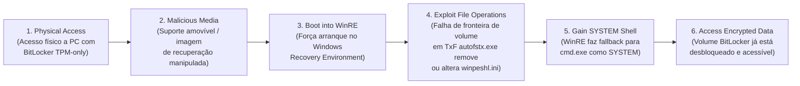

k
# System e OS Hardening e Vulnerabilidade BitLocker YellowKey (CVE-2026-45585)

O **Hardening** protege firmware, portas físicas, FDE (**BitLocker**, `LUKS2`, `FileVault`) e configuração do SO; contudo, o **BitLocker YellowKey (`CVE-2026-45585`)** contorna o modo `TPM-only` via WinRE.

> [!TIP] Lógica de Funcionamento e Valor Forense
> * **Porque existe (Sistema)**: O endurecimento em camadas reduz a superfície de ataque desde o firmware (`BIOS/UEFI`, `SecureBoot`, FDE) até ao sistema operativo (remoção de GUI, *logging* remoto, *patching* controlado e menor privilégio). Para privilegiar a usabilidade sem intervenção no arranque, o BitLocker em modo **`TPM-only`** liberta automaticamente a chave do volume sempre que a cadeia assinada local de arranque ou de recuperação (**WinRE**) é validada.
> * **Porque importa (Segurança / Forense)**: A ausência de autenticação pré-arranque (`TPM+PIN`) e de bloqueio do arranque externo permite que ataques como o **`YellowKey` (`CVE-2026-45585`)** abusem de binários genuínos assinados pela Microsoft no WinRE para obter uma consola `SYSTEM` com o volume cifrado já desbloqueado — comprometendo confidencialidade sem quebrar o `SecureBoot`.
> * **Pontos Críticos e Armadilhas para Exame**:
>   * **Pré-requisitos do `YellowKey` (`CVE-2026-45585`)**: divulgado em **maio de 2026** por `Nightmare-Eclipse` (com PoC público); **exige acesso físico** e afeta **Windows 11 `24H2`/`25H2`/`26H1`** e **Windows Server 2025** configurados com **BitLocker `TPM-only` sem PIN**;
>   * **Mecanismo exato**: o subsistema transacional NTFS (**`TxF` / `autofstx.exe` / `FsTx`**) possui uma falha de fronteira de volume no WinRE que remove ou modifica **`winpeshl.ini`**, forçando o `winpeshl.exe` a fazer *fallback* para **`cmd.exe` como `SYSTEM`** com o disco já decifrado pelo TPM;
>   * **Mitigações**: atualização **`KB5089549`**, script provisório da Microsoft para o WinRE, adoção de **`TPM+PIN`** e restrição de arranque externo/WinRE;
>   * **Nuance de *patching* em *OS Hardening***: nem sempre é possível aplicar *patches* de imediato em produção devido à necessidade de testar previamente a **compatibilidade** com o software existente.

---

## 1. *Server / System Hardening* vs. *OS Hardening* (Slides 42–43, 46)

### 1.1. Cinco Medidas de *Server / System Hardening* (Firmware e Hardware — Slides 42–43)

1. **Atualizar a BIOS/UEFI**: manter o firmware da *motherboard* atualizado para corrigir falhas de arranque e microcódigo;
2. **Ativar o `SecureBoot`**: garante por assinaturas criptográficas que o sistema apenas arranca código legítimo e assinado;
3. **Ativar password na BIOS/UEFI**: impede que um atacante com acesso físico altere a ordem de arranque ou desative o `SecureBoot`;
4. **Desativar portas USB não utilizadas**: bloqueio configurável diretamente nas opções da BIOS/UEFI em grande parte do hardware;
5. **Configurar cifragem completa de disco (*Full Disk Encryption — FDE*)**:
   * **Windows**: **`BitLocker`** *(ressalva: a configuração `TPM-only` sem PIN ficou exposta ao `CVE-2026-45585`)*;
   * **Linux**: **`dm-crypt` com `LUKS2`** (*Linux Unified Key Setup 2*);
   * **macOS**: **`FileVault`**;
   * **Multiplataforma**: **`VeraCrypt`**.

### 1.2. Quatro Pilares de *OS Hardening* (Sistema Operativo — Slide 46)

1. **Não instalar componentes desnecessários**: por exemplo, instalar **Linux Server sem interface gráfica (*no GUI*)**, diminuindo pacotes vulneráveis, serviços ativos e consumo de recursos;
2. **Configurar *logging* remoto**: enviar os registos de eventos para um **servidor de *logs* dedicado** (SIEM / Syslog remoto) para os **agregar e proteger** contra apagamento ou adulteração local caso a máquina seja comprometida;
3. **Manter o software atualizado e corrigido (*Patching*)**: aplicar atualizações regularmente, ressalvando que **o software existente tem frequentemente de ser testado quanto à compatibilidade** antes da instalação em produção;
4. **Gerir rigorosamente contas e privilégios de utilizador**: aplicar o menor privilégio e **revogar acessos imediatamente** quando o utilizador deixa de necessitar desse nível (mudança de funções ou saída).

### 1.3. Quadro Comparativo: *Server/System Hardening* vs. *OS Hardening*

| Dimensão | *Server / System Hardening* (Hardware & Pré-Arranque) | *OS Hardening* (Sistema Operativo & Serviços) |
| :--- | :--- | :--- |
| **Camada de atuação** | Firmware (`BIOS/UEFI`), portas físicas e volume de disco | Kernel, pacotes instalados, serviços, *logs* e contas de utilizador |
| **Controlos centrais** | Atualização de BIOS/UEFI, `SecureBoot`, password na BIOS/UEFI, bloqueio de portas USB, FDE (`BitLocker`, `LUKS2`, `FileVault`, `VeraCrypt`) | Instalação mínima sem GUI (Linux Server), servidor dedicado de *logs*, *patching* testado para compatibilidade, gestão/revogação de contas |
| **Ameaças mitigadas** | Arranque não autorizado via USB (*Evil Maid* / `FlowCloud`), roubo físico de discos, adulteração de *bootloader* | Exploração de serviços supérfluos, destruição local de registos forenses, escalada de privilégios e falhas conhecidas não corrigidas |

---

## 2. Caso de Estudo Técnico: `BitLocker's YellowKey` (`CVE-2026-45585` — Slides 43–45)

### 2.1. Identificação e Condições de Exploração (Slide 44)

* **Designação**: **`BitLocker's YellowKey` (`CVE-2026-45585`)** — vulnerabilidade de *bypass* ao BitLocker divulgada em **maio de 2026** pelo investigador **`Nightmare-Eclipse`**, com *Proof-of-Concept (PoC)* público;
* **Pré-requisito**: **requer acesso físico** ao equipamento alvo;
* **Sistemas afetados**: **Windows 11 (`24H2`, `25H2` e `26H1`)** e **Windows Server 2025**;
* **Condição crítica**: utilização do **BitLocker no modo `TPM-only` por omissão sem PIN**.

### 2.2. As 6 Fases da Cadeia de Ataque via WinRE (Slides 44–45)

1. **Fase 1 — *Physical Access***: o atacante acede fisicamente a um equipamento Windows 11 ($\ge$ `24H2`) ou Windows Server 2025 com BitLocker em modo `TPM-only` (sem PIN de pré-arranque);
2. **Fase 2 — *Malicious Media***: prepara um suporte amovível ou imagem de recuperação manipulada (*crafted removable media / recovery image*);
3. **Fase 3 — *Boot into WinRE***: força o arranque do sistema no **Windows Recovery Environment (`WinRE`)** ou fluxo de recuperação associado;
4. **Fase 4 — *Exploit File Operations***: durante a inicialização da recuperação, o mecanismo de repetição de *logs* transacionais do NTFS (**Transactional NTFS — `TxF`**, processado por **`autofstx.exe` / `FsTx`**) apresenta uma **falha de validação de fronteira de volume**, permitindo que uma transação originada no volume externo manipulado **remova ou modifique o ficheiro `winpeshl.ini`** na imagem em memória do WinRE;
5. **Fase 5 — *Gain SYSTEM Shell***: sem um `winpeshl.ini` válido para iniciar a interface gráfica restrita de recuperação, o inicializador **`winpeshl.exe`** executa um ***fallback* automático para uma consola interativa `cmd.exe` com privilégios de `SYSTEM`**;
6. **Fase 6 — *Access Encrypted Data***: como o arranque utilizou a cadeia legítima assinada do WinRE local, o TPM já libertou a chave criptográfica e **o volume BitLocker do sistema encontra-se integralmente desbloqueado e acessível** a partir dessa consola `cmd.exe`.

### 2.3. Mitigação e Correção (`How to fix?` — Slide 44)

1. **Aplicar as atualizações da Microsoft**: instalar a atualização cumulativa **`KB5089549` (Maio de 2026)**;
2. **Executar o script de mitigação provisória da Microsoft**: atualiza diretamente a partição/imagem do ambiente WinRE;
3. **Configurar o BitLocker com `TPM+PIN`** em vez de `TPM-only`, exigindo um segredo do utilizador antes de o TPM desbloquear a chave no arranque;
4. **Restringir o arranque externo e proteger o WinRE**, através de password na BIOS/UEFI e desativação do arranque por portas USB.

---

## Além da aula

* **Articulação com `UEFI Secure Boot`, `PKfail` e Fluxo `Winload`/`WinRE` (`ASSI` Cap. 1 e `AFD1` Cap. 2)**: O `BitLocker's YellowKey` demonstra porque é que o [[UEFI Secure Boot]] (analisado em [[Processo de Arranque UEFI, Secure Boot e Fluxo do Windows]] e [[UEFI Secure Boot]]) não bloqueia ataques que operam através de binários assinados genuinamente pela Microsoft como o WinRE. Ao contrário do [[PKfail - Vulnerabilidade do UEFI Secure Boot]] e [[PKfail - Vulnerabilidade do UEFI Secure Boot]] — onde uma chave *Platform Key* comprometida permitia assinar código malicioso — o `YellowKey` explora a lógica do subsistema transacional `TxF` dentro do próprio ambiente legítimo de recuperação.
* **Relação com Ataques Físicos em Viagens (`ASSI` Cap. 2 Bloco 01)**: Conforme analisado em [[Ataques Físicos em Viagens - Evil Maid (FlowCloud) e Burner Phones]], a proteção contra compromissos físicos em quartos de hotel depende em conjunto da desativação do *boot* USB na UEFI e da configuração do BitLocker com `TPM+PIN`.

---

## Perguntas de revisão

1. **Quais são as cinco medidas de *Server / System Hardening* e que soluções de FDE correspondem a Windows, Linux, macOS e multiplataforma?**

> [!success]- Ver Resposta
> As cinco medidas são: (1) atualizar BIOS/UEFI, (2) ativar `SecureBoot`, (3) definir password na BIOS/UEFI, (4) desativar portas USB não utilizadas e (5) configurar cifragem completa de disco (FDE): **`BitLocker`** (Windows), **`dm-crypt` com `LUKS2`** (Linux), **`FileVault`** (macOS) e **`VeraCrypt`** (multiplataforma).

2. **Que sistemas operativos e configurações são afetados pelo `BitLocker's YellowKey` (`CVE-2026-45585`) e qual é o pré-requisito indispensável ao atacante?**

> [!success]- Ver Resposta
> Divulgada em maio de 2026 por `Nightmare-Eclipse`, a vulnerabilidade afeta o **Windows 11 (`24H2`, `25H2` e `26H1`)** e o **Windows Server 2025** configurados com **BitLocker em modo `TPM-only` (sem PIN)**. O pré-requisito indispensável é o atacante dispor de **acesso físico** à máquina.

3. **Explique o papel do WinRE, do subsistema `TxF` (`autofstx.exe` / `FsTx`) e do ficheiro `winpeshl.ini` nas fases 3 a 6 do ataque `YellowKey`.**

> [!success]- Ver Resposta
> Após forçar o arranque no **WinRE** (Fase 3), o atacante explora uma falha de validação de fronteira de volume na repetição transacional NTFS (**`TxF`**, via **`autofstx.exe` / `FsTx`**) usando um suporte externo manipulado para apagar ou alterar **`winpeshl.ini`** na imagem do WinRE (Fase 4). Sem um `winpeshl.ini` válido, o `winpeshl.exe` executa *fallback* para uma consola **`cmd.exe` como `SYSTEM`** (Fase 5). Como o WinRE arrancou pela cadeia assinada legítima, o TPM já desbloqueou o volume BitLocker, dando acesso pleno aos dados cifrados (Fase 6).

4. **Indique as quatro medidas de mitigação para o `BitLocker's YellowKey`.**

> [!success]- Ver Resposta
> (1) Instalar a atualização **`KB5089549`** (maio de 2026); (2) executar o script de mitigação provisória da Microsoft para atualizar o WinRE; (3) configurar o BitLocker com **`TPM+PIN`** em vez de `TPM-only`; e (4) restringir o arranque externo e proteger o acesso ao WinRE (password na BIOS/UEFI e desativação de *boot* USB).

5. **Quais são os quatro pilares de *OS Hardening* e qual a ressalva operacional na aplicação de *patches*?**

> [!success]- Ver Resposta
> (1) Não instalar componentes desnecessários (ex.: Linux Server sem GUI); (2) enviar *logs* para um servidor dedicado para os agregar e proteger; (3) manter o software atualizado e corrigido — tendo em conta que **nem sempre é possível aplicar *patches* de imediato porque é necessário testar previamente a compatibilidade com o software existente**; e (4) gerir contas de utilizador revogando privilégios assim que deixam de ser necessários.

---

## Navegação e Notas Relacionadas

| Percurso | Nota | Contexto |
| :--- | :--- | :--- |
| **Anterior** | [[Pen Drives USB Falsas e Verificação com ValiDrive (Ficha 11)]] | `Bloco 02` |
| **Seguinte** | [[Gestão de Vulnerabilidades, CVE e Sistemas de Pontuação (CVSS e CWE)]] | `Comum/` · `mesmo bloco` |
| **Índice** | [[Capítulo 2 - Administração de Sistemas]] · [[00 ASSI]] | `Bloco 03` |

### Conceitos Relacionados

* [[Ataques Físicos em Viagens - Evil Maid (FlowCloud) e Burner Phones]] · `Bloco 01`
* [[Gestão de Ativos (Asset Management) e Políticas de Armazenamento Amovível (VeraCrypt)]] · `Bloco 02`
* [[UEFI Secure Boot]] · `Cap. 1`
* [[PKfail - Vulnerabilidade do UEFI Secure Boot]] · `Cap. 1`
* [[Processo de Arranque UEFI, Secure Boot e Fluxo do Windows]] · `AFD1 · Cap. 2`
