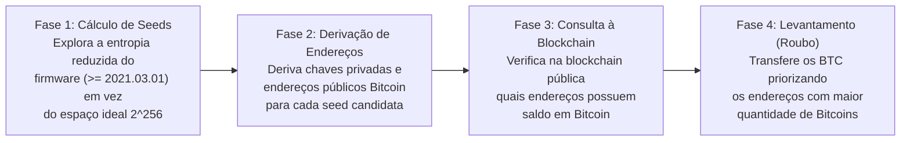

# Caso de Estudo `Coldcard` (`1800 BTC`) — Falha de Entropia e Reconstrução de *Seeds*

O caso `Coldcard` (`MK3 >= 2021`) ilustra como um bug de firmware que trocou o TRNG por um PRNG em `MicroPython + C` reduziu a entropia das *seeds* `BIP-39`, permitindo reconstruir carteiras e roubar `1800 BTC`.

> [!TIP] Lógica de Funcionamento e Valor Forense
> * **Porque existe (Sistema / Ameaça)**: Carteiras de hardware *air-gapped* protegem *seeds* `BIP-39` de 24 palavras ($2^{256}$ combinações), mas dependem inteiramente de um gerador físico verdadeiro de aleatoriedade (`TRNG`) no momento da criação da chave; um `PRNG` determinístico de baixa entropia torna o espaço de busca enumerável.
> * **Porque importa (Segurança / Forense)**: Mesmo sem ligação à rede (*air-gapped*), a previsibilidade na geração inicial expõe endereços públicos na *blockchain* a drenagem silenciosa, agravada pela visibilidade do código *open source* que permite aos atacantes reproduzir exatamente a falha.
> * **Pontos Críticos e Armadilhas para Exame**:
>   * Fabricante **Coinkite**, modelos `Mk2`, `Mk3`, `Mk4`, `Mk5` e `Q` — **mais vulnerável: `MK3` ($\ge 2021$)**, unidades vendidas a partir de **`2021.03.01`**.
>   * Substituição do **`TRNG`** do hardware por **`PRNG`** em software (`MicroPython + C`) com parâmetros de baixa entropia (*device ID*, data/hora, estado de arranque).
>   * Ataque de **`2026.07.30`** (`"Weak" Seed Cryptographic Reconstruction Attack`) em **4 fases**: Cálculo de *seeds* $\to$ Derivação de endereços $\to$ Consulta à *blockchain* $\to$ Levantamento prioritário dos maiores saldos.
>   * Impacto: **`1800 BTC`** (**`~$100 milhões USD`**) roubados de **`~7000` endereços Bitcoin**.

---

## 1. A Carteira de Hardware `Coldcard` e a Falha de Firmware de 2021 (Slides 43–44)

* **Produto e Propósito**: a **`Coldcard`** ([Coinkite Coldcard (YouTube)](https://www.youtube.com/watch?v=qNjgs1WJfK0)) é uma carteira de hardware dedicada a **Bitcoin**, produzida desde 2017 pela empresa canadiana **Coinkite** para manter chaves privadas e *seeds* de recuperação **`BIP-39` de 24 palavras** completamente *offline* (*air-gapped*).
* **Gama e Código Aberto**: possui firmware *open source* verificável distribuído pelos modelos `Mk2`, `Mk3`, `Mk4`, `Mk5` e `Q`, sendo o **modelo mais vulnerável o `MK3` ($\ge 2021$)**.
* **O Erro Introduzido em 2021 (Dispositivos a partir de `2021.03.01`)**:
  * Uma atualização de firmware substituiu o gerador físico verdadeiro de números aleatórios do próprio hardware (**`TRNG` — *True Random Number Generator***) por um gerador em software (**`PRNG`**) implementado com bibliotecas **`MicroPython + C`**;
  * Esse `PRNG` utilizava parâmetros previsíveis e de baixa entropia (como identificador do dispositivo / *device ID*, data/hora, estado de arranque, entre outros), **reduzindo drasticamente a aleatoriedade** real das *seeds* de 24 palavras face ao espaço teórico de **$2^{256}$** possibilidades;
  * Como o **firmware era *open source***, qualquer atacante podia inspecionar o código-fonte e determinar exatamente o conjunto reduzido de estados possíveis do gerador.

---

## 2. O Ataque de `2026.07.30` (*"Weak" Seed Cryptographic Reconstruction Attack* — Slides 44–45)

Em **`2026.07.30`** (seguindo-se incidentes semelhantes), atacantes exploraram a vulnerabilidade através de um processo em **4 fases**:

1. **Fase 1 — Calcular valores possíveis de *seed***: enumerar o subconjunto reduzido de *seeds* geráveis pelo `PRNG` defeituoso dos dispositivos vendidos desde `2021.03.01` (substituindo uma busca impossível de $2^{256}$ por um cálculo exequível em hardware potente);
2. **Fase 2 — Determinar os endereços Bitcoin correspondentes**: derivar matematicamente o par de chaves (chave privada e endereço público Bitcoin) associado a cada *seed* candidata;
3. **Fase 3 — Consultar a *blockchain***: pesquisar no registo público da *blockchain* Bitcoin quais desses endereços possuem fundos depositados;
4. **Fase 4 — Levantamento (*Withdrawal*)**: assinar transações válidas com as chaves reconstruídas e transferir os fundos, **dando prioridade aos endereços com maior quantidade de Bitcoins**.

### Impacto Financeiro e Descoberta Tardia (Slide 45)

* **Total desviado**: **`1800 BTC`** retirados de cerca de **`~7000` endereços Bitcoin**, correspondendo a aproximadamente **`~$100 milhões USD`**;
* Muitas vítimas só detetaram o roubo semanas mais tarde, ao tentarem movimentar os fundos armazenados nas suas carteiras *offline*.

---

## Além da aula

* **Codificação de Endereços Bitcoin em `Base58Check` (`AFD1` Cap. 3 Bloco 04)**: Os endereços públicos consultados na Fase 3 do ataque (tal como os endereços usados em esquemas de *copy-paste hijacking* e *email sextortion*) utilizam a representação [[Codificação Binário-para-Texto (Base16, Base64 e Base58)|Base58Check]] para eliminar caracteres visualmente ambíguos e incluir *checksum* contra erros de digitação.
* **Entropia e Proteção de Chaves**: Os fundamentos matemáticos de medição da entropia em bits são tratados em [[Entropia de Passwords e Entropia de Ficheiros (ent e Detect It Easy)]], enquanto o risco de furto no *clipboard* ao copiar endereços Bitcoin é analisado em [[Gestores de Passwords (Cloud vs KeePassXC), KeeShare e Copy-Paste Hijacking]].

---

## Perguntas de revisão

1. **Qual foi a causa técnica da falha introduzida no firmware da `Coldcard` em 2021 e qual o modelo mais afetado?**

> [!success]- Ver Resposta
> Nos dispositivos vendidos a partir de **`2021.03.01`**, uma atualização de firmware substituiu o gerador físico verdadeiro de números aleatórios do hardware (**`TRNG`**) por um gerador em software (**`PRNG`** em **`MicroPython + C`**) dependente de parâmetros de baixa entropia e previsíveis (como *device ID*, data/hora e estado de arranque). O modelo mais vulnerável foi o **`MK3` ($\ge 2021$)**, agravado pelo facto de o firmware ser *open source*.

2. **Descreva as 4 fases do *"Weak" Seed Cryptographic Reconstruction Attack* ocorrido em `2026.07.30`.**

> [!success]- Ver Resposta
> (1) Calcular os valores possíveis de *seed* explorando a aleatoriedade reduzida do `PRNG` em vez do espaço teórico de $2^{256}$; (2) Derivar as chaves privadas e endereços públicos Bitcoin correspondentes; (3) Consultar a *blockchain* pública para identificar endereços com saldo; (4) Efetuar o levantamento dos `BTC`, priorizando os endereços com maiores montantes.

3. **Qual foi o impacto quantificado do caso `Coldcard` e por que razão muitas vítimas demoraram a detetar o roubo?**

> [!success]- Ver Resposta
> Foram roubados **`1800 BTC`** (cerca de **`~$100 milhões USD`**) de aproximadamente **`~7000` endereços Bitcoin**. Como as carteiras eram mantidas *offline* (*air-gapped*) para armazenamento a longo prazo, muitas vítimas só descobriram o desvio semanas depois, quando tentaram movimentar os fundos.

---

## Navegação e Notas Relacionadas

| Percurso | Nota | Contexto |
| :--- | :--- | :--- |
| **Anterior** | [[Entropia de Passwords e Entropia de Ficheiros (ent e Detect It Easy)]] | `mesmo bloco` |
| **Seguinte** | [[Higiene de Credenciais - Clean Desk, Google Dorks, PINs e Shoulder Surfing]] | `mesmo bloco` |
| **Índice** | [[Capítulo 2 - Administração de Sistemas]] · [[00 ASSI]] | `Bloco 05` |

### Conceitos Relacionados

* [[Gestores de Passwords (Cloud vs KeePassXC), KeeShare e Copy-Paste Hijacking]] · `mesmo bloco`
* [[Codificação Binário-para-Texto (Base16, Base64 e Base58)]] · `AFD1 · Cap. 3`
