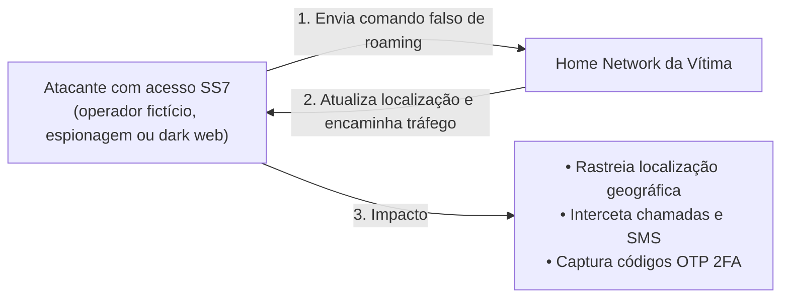

# Falhas de Autenticação por SMS — Protocolo SS7, SIM-Jacking, Vishing e StingRay

A verificação fora de banda por SMS encontra-se descontinuada pelo NIST devido às falhas do protocolo SS7 (1975), a ataques de SIM-Jacking nas operadoras, ao Vishing e às torres falsas StingRay.

> [!TIP] Lógica de Funcionamento e Valor Forense
> * **Porque existe (Sistema / Segurança)**: O envio de códigos de uso único (OTP) por SMS surgiu como canal secundário *Out-of-Band (OOB)* para confirmar a posse de um telemóvel além da palavra-passe principal.
> * **Porque importa (Segurança / Forense)**: O encaminhamento de SMS depende de protocolos legados sem autenticação (`SS7`), de processos humanos de suporte nas operadoras e de ligações rádio passíveis de *downgrade*, permitindo intercetar códigos 2FA e sequestrar pedidos de reposição de password sem comprometer fisicamente o dispositivo da vítima.
> * **Pontos Críticos e Armadilhas para Exame**:
>   * O NIST declara o SMS OOB **descontinuado (*deprecated*)**; quando ainda usado, o verificador **`SHALL`** validar que o número pertence a uma rede móvel real (não VoIP) e **`SHALL NOT`** permitir alterar o número sem 2FA.
>   * O **`SS7` (`CCSS#7`, 1975)** assenta em confiança mútua sem autenticação; em **`4G` (`Diameter`)**, a autenticação e o controlo de acessos continuam a ser opcionais.
>   * O **`SIM-Jacking`** transfere o número da vítima para o SIM do atacante através de três vetores: enganar a operadora, subornar funcionários ou explorar *bugs* Web da operadora.

---

## 1. Diretrizes NIST para SMS *Out-of-Band (OOB)* e Descontinuação (Slide 81)

As normas do NIST definem requisitos estritos sempre que a autenticação por SMS ainda é mantida em operação, embora recomendem formalmente a sua substituição:

* **Requisitos Obrigatórios quando o SMS ainda é utilizado**:
  1. Se a verificação *out-of-band* for realizada por SMS numa rede móvel pública, o verificador **DEVE (*SHALL*) verificar que o número de telefone pré-registado está efetivamente associado a uma rede móvel real e não a um serviço VoIP** ou outro serviço baseado em software;
  2. **Alterar o número de telefone pré-registado NÃO DEVE (*SHALL NOT*) ser possível sem autenticação a dois fatores (2FA) no momento da alteração**.
* **Posição Normativa Atual**: **a verificação *Out-of-Band (OOB)* por SMS está descontinuada (*deprecated*)**:
  * Os SMS são vulneráveis a sequestro através de serviços VoIP ou *SIM hijacking*;
  * Falhas estruturais no protocolo de sinalização **`SS7`** permitem desviar mensagens SMS com códigos de uso único (**OTP — *One-Time Passcode***) para dispositivos controlados pelo atacante, conforme demonstrado em ataques reais contra contas **Gmail, Twitter e Facebook**.

---

## 2. O Protocolo `SS7` (`CCSS#7`) e as Suas Falhas Estruturais (Slide 82)

### 2.1. Funções e Origem Histórica da Vulnerabilidade

* **O que é o `SS7` (`Signalling System No. 7`, designado `CCSS#7` nos EUA)**: conjunto de protocolos de sinalização telefónica que permite às redes de operadores móveis trocar informação operacional entre si para três finalidades:
  1. **Encaminhar chamadas de voz e mensagens SMS** entre diferentes operadores;
  2. **Assegurar a faturação (*billing*)** correta entre redes;
  3. **Suportar o *roaming***, permitindo que um assinante opere noutra rede móvel fora da sua área doméstica.
* **Porque é Vulnerável**:
  * O `SS7` foi especificado em **`1975`**, numa época em que existiam apenas poucos operadores de telecomunicações estatais que **confiavam mutuamente uns nos outros e não incluíram mecanismos de autenticação ou segurança**;
  * É amplamente utilizado nas redes **`2G` e `3G`**; embora as redes **`4G`** empreguem o protocolo **`Diameter`**, as respetivas funcionalidades de autenticação e controlo de acessos são opcionais.

### 2.2. Mecânica do Ataque por *Roaming* Falso via `SS7`

* Qualquer agente que consiga interligar-se à rede `SS7` (agência de espionagem, operador telefónico ilegítimo ou acesso adquirido na *dark web*) envia um comando à rede doméstica (*home network*) do alvo indicando falsamente que o utilizador entrou em ***roaming* noutra rede**.
* A partir desse redirecionamento, o atacante passa a **rastrear a localização geográfica** do assinante, **intercetar chamadas e SMS** e **capturar códigos 2FA**.

---

## 3. `SIM-Jacking` (*SIM Swapping*) e Casos Reais (Slides 83–84)

### 3.1. Definição, Impacto e Três Vetores de Execução

* **O que é o `SIM-Jacking`**: assumir o controlo do número de telefone da vítima transferindo-o para um cartão SIM na posse do atacante.
* **Impacto Operacional**: ao controlar o número, o atacante redireciona pedidos de recuperação de password (*password-reset*) para o seu próprio telemóvel e contorna a autenticação 2FA baseada em SMS.
* **Três Formas de Executar `SIM-Jacking` (Slide 83)**:
  1. **Enganar a operadora telefónica (*deceiving the phone carrier*)** recorrendo a engenharia social junto do apoio ao cliente ou lojas físicas;
  2. **Subornar funcionários da operadora (*bribing employees*)** para efetuarem a portabilidade ou substituição do cartão SIM;
  3. **Explorar vulnerabilidades nas operações Web da operadora** (*bugs* nos portais de gestão de clientes).
* **Mitigação Eficaz**: substituir o SMS por **2FA baseado em `TOTP`** (app autenticadora) ou por **`Passkeys` (`FIDO2`)**, conforme detalhado em [[Autenticação 2FA (Protocolo TOTP RFC 6238) e Passkeys (FIDO2 - WebAuthn e CTAP)]].

### 3.2. Casos Reais de `SIM-Jacking` (Slides 83–84)

| Caso Real | Vetor e Mecanismo | Impacto Documentado |
| :--- | :--- | :--- |
| **[Michael Terpin vs. AT&T](https://bit.ly/2JwskVE)** | Ataque de *SIM swap* sobre a operadora permitiu tomar controlo do número de telemóvel e aceder às contas da vítima. | Perda de **`$24 milhões USD`** em criptomoedas; processo judicial contra a AT&T no valor de **`$224 milhões USD`**. |
| **[Robert Ross Harris / *Crowd Machine*](https://motherboard.vice.com/en_us/article/7x3may/cops-arrest-sim-swapper-14-million-cryptocurrency)** (Slide 84) | Sequestro do número de telefone do CEO da startup de *blockchain* *Crowd Machine* para roubar as chaves privadas das carteiras da empresa. | Roubo de **`$14 milhões USD`** em criptomoedas; detenção de Robert Ross Harris, juntando-se às detenções de outros *SIM swappers* (**Joel Ortiz**, 20 anos, e **Xzavyer Narvaez**, 19 anos). |

---

## 4. `Vishing` e Interceção Celular com `StingRay` (Slide 85)

* **`Vishing` (*Voice phishing*)**: ataque de engenharia social executado através de chamada telefónica para manipular operadores de atendimento ou vítimas. Na [demonstração da DEF CON](https://www.youtube.com/watch?v=lc7scxvKQOo), uma especialista faz-se passar pela esposa do cliente — com som de bebé a chorar em fundo para induzir urgência — e convence a funcionária da operadora a conceder acesso total à conta, viabilizando alterações de número ou de SIM.
* **`StingRay` (*Fake cell towers*)**: equipamento intercetor (*IMSI-catcher*) que simula uma torre celular legítima com sinal mais forte para capturar as ligações rádio dos telemóveis nas proximidades, **intercetar chamadas de voz** e **forçar o *downgrade* das comunicações para `2G` ou `3G` de modo a decifrar chamadas e mensagens SMS**.

---

## Além da aula

* **Ligação entre `StingRay`, `SMS Blaster` e Segurança em Viagens (`ASSI` Cap. 2 Blocos 01 e 04)**: O princípio de torre celular falsa do `StingRay` coincide diretamente com as estações portáteis `SMS Blaster` estudadas em [[Smishing, Estações SMS Blaster (Downgrade 2G) e Quishing (Códigos QR)]], onde o *downgrade* forçado para `2G` (sem cifragem nem autenticação, mitigável no Android 12+ ao desligar o `2G`) permite injetar SMS em massa num raio de `3 km`, e constitui um dos riscos críticos em deslocações internacionais analisados em [[Ataques Físicos em Viagens - Evil Maid (FlowCloud) e Burner Phones]].
* **Eliminação da Dependência das Operadoras Móveis (`ASSI` Cap. 2 Bloco 06)**: Tanto as falhas de sinalização `SS7` como o `SIM-Jacking` e a interceção `StingRay` demonstram que a segurança da autenticação nunca deve depender do canal celular; a migração para [[Autenticação 2FA (Protocolo TOTP RFC 6238) e Passkeys (FIDO2 - WebAuthn e CTAP)|TOTP e Passkeys FIDO2]] remove a operadora de telecomunicações do modelo de confiança.

---

## Perguntas de revisão

1. **Quais são os dois requisitos obrigatórios do NIST quando o SMS ainda é utilizado como verificação *Out-of-Band (OOB)*, e qual é a posição normativa atual sobre esta prática?**

> [!success]- Ver Resposta
> O verificador **DEVE (`SHALL`)** confirmar que o número pré-registado pertence a uma rede móvel real e não a um serviço VoIP/software, e **NÃO DEVE (`SHALL NOT`)** permitir alterar o número pré-registado sem autenticação a dois fatores (2FA) no momento da alteração. Atualmente, a verificação OOB por SMS encontra-se **descontinuada (*deprecated*)** pelo NIST devido à exposição a VoIP, *SIM hijacking* e falhas do protocolo `SS7`.

2. **Porque é que o protocolo `SS7` (`CCSS#7`) é estruturalmente vulnerável, qual é o seu equivalente em redes `4G` e como permite intercetar códigos 2FA?**

> [!success]- Ver Resposta
> Especificado em **1975** num contexto de poucos operadores estatais, o `SS7` assenta em confiança mútua total e não possui autenticação. É usado sobretudo em `2G` e `3G` (enquanto o protocolo **`Diameter`** do `4G` mantém a autenticação como opcional). Um atacante com acesso à rede `SS7` envia um comando falso de ***roaming*** à rede doméstica da vítima, permitindo rastrear a sua localização, intercetar chamadas e desviar mensagens SMS com códigos OTP.

3. **Indique os três vetores utilizados num ataque de `SIM-Jacking` (*SIM Swapping*) e ilustre o impacto com os casos reais da AT&T e da *Crowd Machine*.**

> [!success]- Ver Resposta
> Os três vetores são: (1) enganar a operadora por engenharia social no apoio ao cliente/lojas; (2) subornar funcionários da operadora; e (3) explorar *bugs* nas operações Web da operadora. No caso **Michael Terpin vs. AT&T**, o atacante desviou `$24M` em criptomoedas (originando um processo de `$224M`); no caso **Crowd Machine**, **Robert Ross Harris** sequestrou o número do CEO e roubou **`$14 milhões USD`** em criptomoedas.

4. **O que distingue um ataque de `Vishing` de uma interceção com `StingRay` e porque força o `StingRay` o *downgrade* para `2G`/`3G`?**

> [!success]- Ver Resposta
> O **`Vishing`** explora a engenharia social em chamadas de voz (como o exemplo da DEF CON com áudio de bebé a chorar para enganar uma operadora), enquanto o **`StingRay`** é uma torre celular falsa que capta ligações rádio locais e força o **downgrade para `2G`/`3G`** porque estas gerações possuem cifragem fraca ou inexistente, permitindo ao intercetor decifrar chamadas de voz e mensagens SMS.

---

## Navegação e Notas Relacionadas

| Percurso | Nota | Contexto |
| :--- | :--- | :--- |
| **Anterior** | [[Contingência de Credenciais (Cantor Fitzgerald) e Perguntas de Segurança (Sarah Palin)]] | `Bloco 05` |
| **Seguinte** | [[Autenticação 2FA (Protocolo TOTP RFC 6238) e Passkeys (FIDO2 - WebAuthn e CTAP)]] | `mesmo bloco` |
| **Índice** | [[Capítulo 2 - Administração de Sistemas]] · [[00 ASSI]] | `Bloco 06` |

### Conceitos Relacionados

* [[Smishing, Estações SMS Blaster (Downgrade 2G) e Quishing (Códigos QR)]] · `Bloco 04`
* [[Ataques Físicos em Viagens - Evil Maid (FlowCloud) e Burner Phones]] · `Bloco 01`
* [[Cheat Sheet - Administração de Sistemas e Controlo de Acessos]] · `mesmo cap.`
