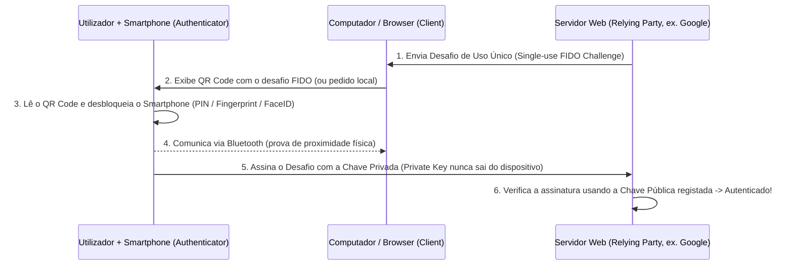

# Autenticação 2FA (Protocolo TOTP RFC 6238) e Passkeys (FIDO2 — WebAuthn e CTAP)

A autenticação 2FA com TOTP (RFC 6238) usa um segredo Base32 e intervalos de 30 s, mas sofre phishing em tempo real; as Passkeys (FIDO2) vinculam chaves assimétricas ao domínio.

> [!TIP] Lógica de Funcionamento e Valor Forense
> * **Porque existe (Sistema / Segurança)**: Uma password única é vulnerável a reutilização e fugas; o `TOTP` acrescenta um código temporário independente da rede móvel, enquanto o `FIDO2` elimina segredos partilháveis ao autenticar por desafio-resposta assimétrico vinculado ao domínio.
> * **Porque importa (Segurança / Forense)**: Mesmo códigos numéricos `TOTP` podem ser capturados por proxies de phishing em tempo real ou serviços criminosos (`OTP.Agency`), ao passo que uma `Passkey` bloqueia automaticamente domínios falsos e impõe verificação de proximidade física via **Bluetooth** em sessões *cross-device*.
> * **Pontos Críticos e Armadilhas para Exame**:
>   * **`TOTP` (`RFC 6238`)**: $\text{Truncate}(\text{HMAC}(\text{Secret Key}, \lfloor \text{Current Time} / N \rfloor))$ com segredo em **Base32** e passo temporal típico $N = 30\text{s}$.
>   * **`Passkeys` (`FIDO2`)**: assentam em **`WebAuthn`** (Client $\leftrightarrow$ Relying Party) e **`CTAP1/U2F` + `CTAP2`** (Client $\leftrightarrow$ Authenticator via USB, NFC ou BLE); a chave privada **nunca atravessa a rede**.
>   * **Ponto de falha (*loophole*)**: se o smartphone que guarda a Passkey for roubado e o atacante o conseguir desbloquear, acede às contas associadas.

---

## 1. Más Práticas da CISA, Google 2FA e *Backup Codes* (Slides 87–89)

### 1.1. Lista de Más Práticas Críticas da CISA (*Bad Practices* — Slide 87)
A agência norte-americana CISA identifica três práticas excepcionalmente perigosas em infraestruturas críticas e organizacionais:

1. Utilização de software sem suporte ou em fim de vida (*unsupported or end-of-life software*);
2. Utilização de palavras-passe e credenciais conhecidas, fixas ou por omissão (*known/fixed/default passwords*);
3. **Utilização de autenticação de fator único (*single-factor authentication*) para acesso remoto ou administrativo a sistemas**.

### 1.2. Caso de Estudo: Google 2FA e Códigos de Recuperação (Slides 88–89)

* A ativação do 2FA na conta Google combina a palavra-passe regular com um segundo fator (SMS, chamada de voz ou **App Autenticadora** como *Google Authenticator* / *Microsoft Authenticator* configurada na fase inicial através da leitura de um código QR).
* **Recuperação em Caso de Perda ou Avaria do Dispositivo (Slide 89)**: o serviço gera um conjunto de **códigos de recuperação de uso único (*backup codes*, ex.: 10 códigos de 8 dígitos)** que devem ser impressos ou guardados em local físico seguro para evitar o bloqueio permanente da conta.

---

## 2. Protocolo `TOTP` (`RFC 6238`) e Limitações do 2FA Tradicional (Slides 90–92)

### 2.1. Fórmula e Funcionamento Técnico do `TOTP` (Slides 90–91)
O algoritmo **TOTP (*Time-based One-Time Password*, especificado no [RFC 6238](http://bit.ly/2zCJZGA))** calcula códigos temporários sincronizados entre servidor e cliente sem comunicação ativa durante o login:

$$\text{TOTP} = \text{Truncate}\Big(\text{HMAC}\big(\text{Secret Key}, \;\lfloor \text{Current Time} / N \rfloor\big)\Big)$$

* **Os Dois Parâmetros de Entrada**:
  1. **Segredo partilhado (*Shared secret / secret key*)**: chave aleatória (tipicamente codificada em **Base32**, ex.: `JBSWY3DPEHPK3PXP`) transmitida uma única vez durante o registo através de código QR;
  2. **Tempo atual discretizado**: o tempo avança em janelas discretas de **$N$ segundos** (sendo **$N = 30\text{ segundos}$** o valor padrão) para absorver pequenos desvios de relógio entre o servidor e o autenticador.
* **Primitiva Criptográfica**: o cálculo apoia-se em **HMAC (*Hash-based Message Authentication Code*)**, usando tipicamente `HMAC-SHA1`, `HMAC-SHA256` ou `HMAC-SHA512`.
* **Ferramentas de Geração (Slide 91)**: além das aplicações móveis e de demonstradores online como o [gerador TOTP xanxys.net](http://www.xanxys.net/totp/), o gestor de passwords **`KeePassXC`** integra suporte nativo para configurar e gerar códigos **TOTP** por entrada.

### 2.2. Bypass de 2FA Tradicional e Caso `OTP.Agency` (Slide 92)

* Apesar dos avisos explícitos nas mensagens (*"DO NOT SHARE THIS CODE!"*), códigos OTP numéricos continuam vulneráveis a **phishing em tempo real** (proxies *adversary-in-the-middle*) e a ataques de **fadiga de 2FA (*2FA fatigue* / *MFA push bombing*)**.
* **Caso Real — Plataforma Criminosa `OTP.Agency` (Reino Unido — Slide 92)**:
  * Três administradores declararam-se culpados de fraude ([relatório BleepingComputer](https://www.bleepingcomputer.com/news/legal/admins-of-mfa-bypass-service-plead-guilty-to-fraud/)) por operarem a **`OTP.Agency`**, um serviço comercial de contorno de MFA (*MFA bypass-as-a-service*) com bots automatizados de engenharia social e chamadas falsas;
  * A plataforma anunciava a captura de códigos OTP para **mais de 30 serviços financeiros e digitais, incluindo o `Apple Pay`**, com subscrições semanais entre **`£30`** (plano básico) e **`£380`** (plano elite).

---

## 3. `Passkeys` e Arquitetura `FIDO2` (`WebAuthn` + `CTAP1/CTAP2`) (Slides 93–103 — Ficha 11)

### 3.1. Princípios Criptográficos e os Dois Protocolos `FIDO2` (Slides 94–95, 97)
As **`Passkeys`** implementam autenticação forte sem palavras-passe com base nas normas **`FIDO2` (*Fast Identity Online 2*)**, articulando duas especificações complementares:

| Camada / Protocolo `FIDO2` | Intervenientes | Função Técnica |
| :--- | :--- | :--- |
| **`WebAuthn`** (*Web Authentication*) | **Client** (Browser / SO) $\leftrightarrow$ **Relying Party** (Servidor Web / App) | API padronizada no navegador e no sistema operativo para criar, registar e verificar credenciais de chave pública junto do serviço Web. |
| **`CTAP`** (`CTAP1/U2F` e `CTAP2`) | **Client** $\leftrightarrow$ **Authenticator** (Smartphone, YubiKey, TPM) | Protocolo de comunicação local via **USB**, **NFC** ou **Bluetooth (BLE)** entre o cliente e o dispositivo autenticador físico. |

* **Criptografia Assimétrica e Analogia da Fechadura (Slides 94–95)**:
  * **Chave Privada (*Private Key* — a "chave digital")**: permanece armazenada e isolada dentro do **dispositivo autenticador**, exigindo desbloqueio local (biometria, PIN ou padrão) e proximidade física — **nunca é transmitida pela rede**;
  * **Chave Pública (*Public Key* — o "buraco da fechadura digital")**: fica registada no servidor do serviço (*Relying Party*);
  * **Vinculação Estrita ao Domínio (*Domain specific*)**: cada par de chaves está criptograficamente ligado à origem exata (`google.com` ou `github.com`), conferindo **imunidade contra phishing** (uma página falsa como `g0ogle.com` não recebe resposta assinada da Passkey);
  * **Ponto de Falha (*Loophole*, Slide 95)**: embora elimine passwords e códigos OTP, cria um risco caso o smartphone seja roubado e o atacante consiga desbloqueá-lo.

### 3.2. Registo, Desafio-Resposta e Fluxo *Cross-Device* via QR + Bluetooth (Slides 98–99)

1. **Fase de Registo (Slide 98)**: a Passkey é gerada no dispositivo autenticador e a chave privada **nunca é transmitida pela rede**, enviando-se apenas a chave pública para o servidor.
2. **Fluxo Desafio-Resposta em 3 Passos (Slide 99)**:
   * **Passo 1**: o servidor envia um **desafio criptográfico de uso único (*single-use challenge*)**;
   * **Passo 2**: após aprovação do utilizador no dispositivo (biometria ou PIN), o autenticador **assina o desafio com a chave privada**;
   * **Passo 3**: o servidor valida a assinatura através da **chave pública** previamente registada.
3. **Autenticação *Cross-Device* (Computador $\leftrightarrow$ Smartphone — Slide 99)**:
   * O navegador no computador exibe um **código QR contendo um desafio FIDO**;
   * O utilizador lê o código QR com a câmara do smartphone e desbloqueia o telefone (PIN, impressão digital ou FaceID);
   * **O smartphone comunica obrigatoriamente via `Bluetooth` com o computador** (**exige Bluetooth ativo em ambos os dispositivos**), fornecendo prova criptográfica de proximidade física que inviabiliza ataques remotos.

### 3.3. Adoção Global e Exercícios da `Ficha 11` (Slides 96, 100–103)

* Em **outubro de 2023**, a **Google** passou a definir as **Passkeys** como método de autenticação por omissão nas contas **Gmail e YouTube** (Slide 100), acompanhada por serviços como **Amazon**, **GitHub** (Slide 101) e **WhatsApp**.
* Recursos oficiais e ambientes práticos associados à **`Ficha 11 (2FA, PassKey)`** (Slide 103): diretório [passkeys.directory](https://passkeys.directory) e plataformas de demonstração [passkeys.io](https://www.passkeys.io/) e [passkeys-demo.appspot.com](https://passkeys-demo.appspot.com/).

---

## Além da aula

* **Paralelo com Assinaturas Digitais Forenses (`AFD1` Cap. 1 Bloco 02)**: O modelo desafio-resposta das **Passkeys (`FIDO2`)** — assinar localmente com a chave privada e verificar remotamente com a chave pública — aplica exatamente o mesmo paradigma de criptografia assimétrica usado na assinatura digital de imagens e manifestos periciais estudada em [[Preservação do Sistema e Integridade de Dados]] e [[Armazenamento da Aquisição - Clonagem vs Imagem, Formatos, Aquisição Remota e Assinatura de Hashes]].
* **Neutralização do `Quishing` e Integração com o `KeePassXC` (`ASSI` Cap. 2 Blocos 04 e 05)**: Ao contrário de um código QR de [[Smishing, Estações SMS Blaster (Downgrade 2G) e Quishing (Códigos QR)|Quishing]] (que abre um URL `https://...` remoto), o código QR `FIDO2` exige troca direta via **Bluetooth** entre o telemóvel e o computador, falhando perante atacantes distantes. Já a gestão de segredos `TOTP` e chaves em bases locais `.kdbx` integra-se diretamente com os fluxos do [[Gestores de Passwords (Cloud vs KeePassXC), KeeShare e Copy-Paste Hijacking|KeePassXC]].

---

## Perguntas de revisão

1. **Quais são as três más práticas críticas da CISA, e que função desempenham os *backup codes* (ex.: 10 códigos de 8 dígitos) na autenticação 2FA da Google?**

> [!success]- Ver Resposta
> A CISA condena: (1) software sem suporte ou em fim de vida; (2) passwords conhecidas, fixas ou por omissão; e (3) **autenticação de fator único para acesso remoto ou administrativo**. Os *backup codes* são códigos de recuperação de uso único que devem ser impressos ou guardados em local seguro para recuperar o acesso à conta caso o dispositivo 2FA seja perdido ou avariado.

2. **Descreva a fórmula do protocolo `TOTP` (`RFC 6238`), indicando os dois parâmetros de entrada, o intervalo temporal típico $N$ e a primitiva criptográfica subjacente.**

> [!success]- Ver Resposta
> $\text{TOTP} = \text{Truncate}(\text{HMAC}(\text{Secret Key}, \lfloor \text{Current Time} / N \rfloor))$. Os dois parâmetros de entrada são o **segredo partilhado** (codificado em **Base32**, partilhado uma única vez por código QR) e o **tempo atual** dividido em intervalos discretos de **$N = 30\text{ segundos}$** para tolerar desvios de relógio. A primitiva subjacente é o **HMAC** (`HMAC-SHA1`, `HMAC-SHA256` ou `HMAC-SHA512`).

3. **Como funcionava a plataforma criminosa `OTP.Agency` e porque é que o 2FA baseado em códigos numéricos não impede o seu contorno?**

> [!success]- Ver Resposta
> A `OTP.Agency` (Reino Unido) operava como um serviço *MFA bypass-as-a-service* com subscrições entre `£30` e `£380` por semana, utilizando bots e chamadas automatizadas de engenharia social para capturar códigos OTP em mais de 30 serviços (incluindo o `Apple Pay`). Como os códigos numéricos são transferíveis e não estão ligados criptograficamente ao domínio de destino, podem ser reencaminhados em tempo real para um atacante via phishing ou manipulação telefónica.

4. **Na arquitetura `FIDO2` das Passkeys, qual é o papel do `WebAuthn` e do `CTAP1/CTAP2`, onde residem as chaves privada e pública e qual é a principal vulnerabilidade residual (*loophole*)?**

> [!success]- Ver Resposta
> O **`WebAuthn`** é a API de cliente que gere credenciais entre o navegador/SO (*Client*) e o servidor (*Relying Party*), enquanto o **`CTAP` (`CTAP1/U2F` e `CTAP2`)** gere a comunicação local (USB, NFC ou Bluetooth) entre o *Client* e o *Authenticator*. A **chave privada** nunca sai do dispositivo autenticador, e a **chave pública** fica armazenada no servidor, vinculada ao domínio exato (resistindo ao phishing). O principal risco residual ocorre se o smartphone for roubado e o atacante o conseguir desbloquear.

5. **Explique passo a passo o fluxo de autenticação *cross-device* com Passkey entre um computador e um smartphone, destacando a função obrigatória do Bluetooth.**

> [!success]- Ver Resposta
> (1) O servidor envia um desafio FIDO de uso único ao navegador do computador, que o exibe num **código QR**; (2) o utilizador lê o código QR com o smartphone e desbloqueia o dispositivo (PIN/biometria); (3) o smartphone e o computador comunicam obrigatoriamente por **Bluetooth** para provar proximidade física no mesmo espaço; (4) o smartphone assina o desafio com a chave privada local e o servidor valida a assinatura com a chave pública registada.

## Notas relacionadas

- [[Capítulo 2 - Administração de Sistemas]]
- [[Falhas de Autenticação por SMS - Protocolo SS7, SIM-Jacking, Vishing e StingRay]]
- [[Smishing, Estações SMS Blaster (Downgrade 2G) e Quishing (Códigos QR)]]
- [[Gestores de Passwords (Cloud vs KeePassXC), KeeShare e Copy-Paste Hijacking]]
- [[Preservação do Sistema e Integridade de Dados]]
- [[Armazenamento da Aquisição - Clonagem vs Imagem, Formatos, Aquisição Remota e Assinatura de Hashes]]
- [[Cheat Sheet - Administração de Sistemas e Controlo de Acessos]]
