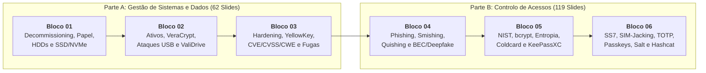

# Capítulo 2 — Administração de Sistemas (*System and Data Management & Access Control*)

Mapa de estudo do **Capítulo 2** de [[00 ASSI|ASSI]] (Prof. Patrício Domingues), cobrindo **181 diapositivos** organizados em **25 notas atómicas focadas** e **1 Cheat Sheet de revisão rápida**.

> [!TIP] Guia de Consulta Rápida para Exame
> Para tabelas de comparação rápida (`P-1`–`P-7`, HDD vs. SSD, `NIST 2003 vs. 2024`, `Argon2 > PBKDF2`, `hashcat` e os 31 casos de estudo), consulta a **[[Cheat Sheet - Administração de Sistemas e Controlo de Acessos]]**.

---

## Parte A — Gestão de Sistemas e Dados (*System and Data Management* — 62 Slides)

### 1. Decommissioning, Sanitização e Destruição de Dados (`01 - Decommissioning e Sanitização`)

| Nota                                                                                              | O que vais estudar                                                                                                               |
| :------------------------------------------------------------------------------------------------ | :------------------------------------------------------------------------------------------------------------------------------- |
| [[Decommissioning de Equipamentos, Destruição de Papel (P-1 a P-7) e Enquadramento Legal UE]]     | Abate técnico, *Dumpster Diving*, trituração `P-1` a `P-7`, impressoras, caso Morgan Stanley e leis UE (`WEEE`, `RoHS`, `RGPD`). |
| [[Ataques Físicos em Viagens - Evil Maid (FlowCloud) e Burner Phones]]                            | Ataques físicos em hotéis (caso `FlowCloud` 2026), regras para *Burner Phones*, alfândega e torres `StingRay`.                   |
| [[Sanitização e Destruição de Discos Magnéticos (HDDs) - Wiping, Degaussing e Destruição Física]] | Níveis de Jones & Afrifa, *wiping* (`Eraser`, `DBAN`), *degaussing*, trituração (`IL4`–`IL6`) e `DiskMantler`.                   |
| [[Certificação de Sanitização, Audit Trail e Guia NCSC para Dispositivos Usados]]                 | Certificados individuais (`Active@ KillDisk`), rasto de auditoria (*when/what/who/where/how*) e guia NCSC de compra/venda.       |
| [[Arquitetura SSD e Memória NAND (Wear Leveling e Garbage Collection)]] · Nota Partilhada: AFD1, ASSI                                | Estudo Alnaqbi (2025), *over-provisioning* NAND, *Cryptographic Erasure*, SATA `Secure Erase` e `nvme sanitize -a 2`.            |

---

### 2. Gestão de Ativos, Segurança em Armazenamento USB e ValiDrive (`02 - Gestão de Ativos e USB`)

| Nota | O que vais estudar |
| :--- | :--- |
| [[Gestão de Ativos (Asset Management) e Políticas de Armazenamento Amovível (VeraCrypt)]] | Alertas de certificados (caso Equifax), limites de MAC, proibição USB na IBM e hierarquia *Policy / Standard / Procedure* com `VeraCrypt`. |
| [[Vetores de Ataque USB (BadUSB, Rubber Ducky, LNK, USB-Killer) e Defesas (GPO, Pad Jack, ESD Dogs)]] | Categorias A–D de Nissim (`Rubber Ducky`, `BadUSB`, `.LNK`, `USB-Killer`), casos `FIN7`/`Raspberry Robin`, `gpedit.msc`, `Pad Jack` e `ESD dogs`. |
| [[Pen Drives USB Falsas e Verificação com ValiDrive (Ficha 11)]] | Anatomia das pens falsas (*Real Part* vs. *Fake Part*) e deteção em 576 regiões com `ValiDrive` (**Ficha 11**). |

---

### 3. Hardening, Vulnerabilidades (CVE, CVSS, CWE), Licenciamento e Fugas de Dados (`03 - Hardening, CVE e Fugas`)

| Nota                                                                                       | O que vais estudar                                                                                                                |
| :----------------------------------------------------------------------------------------- | :-------------------------------------------------------------------------------------------------------------------------------- |
| [[System e OS Hardening e Vulnerabilidade BitLocker YellowKey (CVE-2026-45585)]]           | Medidas de *Server* e *OS Hardening* e dissecação em 6 fases do bypass `BitLocker YellowKey` via `WinRE` / `TxF`.                 |
| [[Gestão de Vulnerabilidades, CVE e Sistemas de Pontuação (CVSS e CWE)]] · Nota Partilhada: ASSI, COD1 | Estrutura `CVE`/`SCAP`, *Vulnerability* (`SharePoint 2025`) vs. *Exposure* (`Apollo`/`PDL`), escala `CVSS` e **Top 10 CWE 2025**. |
| [[Licenciamento de Software, Fugas em Partilha de Dados (SAS Tokens) e Falhas de Redação]] | Software pirata (casos *Rafael Quinn* e *NSA keygen*), fuga `38 TB` Azure `SAS Tokens` (Wiz), caso `AIMA` e falhas de rasura PDF. |

---

## Parte B — Controlo de Acessos (*Access Control* — 119 Slides)

### 4. Educação de Utilizadores, Engenharia Social (Phishing, Smishing, Quishing) e BEC (`04 - Engenharia Social e BEC`)

| Nota | O que vais estudar |
| :--- | :--- |
| [[Educação de Utilizadores, Phishing, Spear-Phishing e Reforço Positivo]] | Estudo Google/Berkeley, *Spear-Phishing*, `Train + test` (DBIR), proibição de *"road apples"* (Cabul 2008) e reforço positivo. |
| [[Smishing, Estações SMS Blaster (Downgrade 2G) e Quishing (Códigos QR)]] | Taxas de abertura SMS, rede `Smishing Triad`, estações `SMS Blaster` (*downgrade* `2G` / Banguecoque) e cadeia de ataque `Quishing`. |
| [[Business Email Compromise (BEC) e Fraudes Executivas com Deepfake de Áudio e Vídeo]] | Anatomia e estatísticas FBI IC3, caso *Evaldas Rimasauskas* (>\$100M) e fraudes com *deepfakes* de áudio (\$35M) e vídeo (\$25.6M). |

---

### 5. Passwords, Diretrizes NIST, Entropia (Coldcard) e Gestores de Passwords (KeePassXC) (`05 - Passwords, NIST e KeePassXC`)

| Nota | O que vais estudar |
| :--- | :--- |
| [[Segurança de Passwords, Paradigma xkcd e Diretrizes NIST (2003 vs SP 800-63-4)]] | Caso `IHG`, paradoxo `xkcd`, `haveibeenpwned`, comparação **NIST 2003 vs. SP 800-63-4 (2024)** e os *7 Passos* da Wired. |
| [[Limite do bcrypt (Okta Bypass), Credential Stuffing e Caso FortiBleed]] | Força bruta `RTX 5090`, truncagem aos `56–72 bytes` do `bcrypt` (bypass `Okta`), *Credential Stuffing* e ataque `FortiBleed` (2026). |
| [[Entropia de Passwords e Entropia de Ficheiros (ent e Detect It Easy)]] | Fórmula $E = L \times \log_2(R)$, script Python e medição de entropia de ficheiros (`~4.5` vs. `~7.9 bits/byte`) com `ent` e `DIE`. |
| [[Caso de Estudo Coldcard (1800 BTC) - Falha de Entropia e Reconstrução de Seeds]] | Falha no gerador `MicroPython + C` do modelo `MK3` (2021) e ataque em 4 fases que roubou `1800 BTC` de `~7000` endereços. |
| [[Higiene de Credenciais - Clean Desk, Google Dorks, PINs e Shoulder Surfing]] | *Clean Desk* (Havai, `TV5Monde`, chaves `TSA`), *Google Dorks* (Trello), desgaste de teclados, PINs, *Sextortion*, `SB-327` e *Shoulder Surfing*. |
| [[Gestores de Passwords (Cloud vs KeePassXC), KeeShare e Copy-Paste Hijacking]] | Gestores *cloud* vs. locais, proteção *auto-fill* contra phishing, *Copy-paste hijacking* (`13 BTC`), `KeePassXC` e `KeeShare` (**Ficha 10**). |
| [[Contingência de Credenciais (Cantor Fitzgerald) e Perguntas de Segurança (Sarah Palin)]] | Falha de contingência no 11 de Setembro (*Cantor Fitzgerald*), caso *Sarah Palin* (OSINT) e respostas aleatórias no `KeePassXC` (**Ficha 10**). |

---

### 6. Falhas SS7, SIM-Jacking, 2FA (TOTP), Passkeys (FIDO2) e Armazenamento de Passwords (Hashcat) (`06 - 2FA, Passkeys e Hashcat`)

| Nota | O que vais estudar |
| :--- | :--- |
| [[Falhas de Autenticação por SMS - Protocolo SS7, SIM-Jacking, Vishing e StingRay]] | Descontinuação do SMS OOB pelo NIST, falhas de confiança no `SS7` (1975), casos de `SIM-Jacking` (\$14M/\$24M), *Vishing* e `StingRay`. |
| [[Autenticação 2FA (Protocolo TOTP RFC 6238) e Passkeys (FIDO2 - WebAuthn e CTAP)]] | Fórmula `TOTP RFC 6238`, serviço `OTP.Agency`, criptografia de **Passkeys (`FIDO2`)** (`WebAuthn` + `CTAP`) e fluxo QR + Bluetooth (**Ficha 11**). |
| [[Armazenamento Seguro de Passwords (Salting e Key Stretching) e Casos RockYou e LastPass]] | *Rainbow Tables*, `per-credential salt`, ordem `Argon2 > PBKDF2 > scrypt > bcrypt`, casos `RockYou` (2009) e `LastPass` (500 iterações). |
| [[Cracking e Auditoria de Passwords com Hashcat (Hashcat 101 e Máscaras)]] | Arquitetura CPU/GPU, os 4 argumentos base (`-m`, `-a 0`/`-a 3`), tabela completa dos **8 *charsets*** (`?l`–`?b`) e anatomia de comando. |

---

## Navegação

- [[00 ASSI|Voltar ao Índice Geral de ASSI]]
- [[Cheat Sheet - Administração de Sistemas e Controlo de Acessos|Ir para a Cheat Sheet do Capítulo 2]]
- [[Capítulo 1 - Sistemas Operativos, Serviços e Artefactos Forenses|Recuar para o Capítulo 1 de ASSI]]
- [[Capítulo 3 - YARA - MOTW - Strings|Avançar para o Capítulo 3 de ASSI]]
- [[Capítulo 1 - Método de Investigação|Pontes com AFD1 — Capítulo 1 (Método de Investigação, Integridade de Hashes e Regras LabCIF)]]
- [[Capítulo 2 - Arranque e Aquisição Forense|Pontes com AFD1 — Capítulo 2 (Arranque Forense UEFI, Triagem de Registry e Aquisição)]]
- [[Capítulo 3 - Organização de Dados|Pontes com AFD1 — Capítulo 3 (Organização de Dados, Codificação ASCII/Unicode e Base58/Base64)]]
- [[Home|Voltar ao Hub Central do MCIF]]
