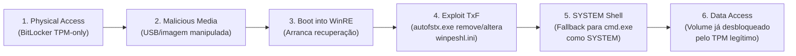

# Cheat Sheet — Administração de Sistemas e Controlo de Acessos

Guia de consulta rápida do Capítulo 2 de ASSI, condensando matrizes de sanitização de dados, hardening, gestão de vulnerabilidades, engenharia social, entropia, Passkeys, Hashcat e armadilhas de exame.

> [!TIP] Finalidade desta Folha de Consulta Rápida
> Este documento sintetiza os 181 diapositivos do Capítulo 2 (`62` de *System and Data Management* + `119` de *Access Control*), as **Fichas Laboratoriais 10 e 11** e todas as notas atómicas dos Blocos `01` a `06`. Serve de guia de bolso para revisão rápida, preparação de exame e resposta a incidentes.

---

## 1. Matriz de Sanitização e Destruição

### Papel (DIN 66399: `P-1` a `P-7`), Impressoras e Enquadramento Legal

* **Densidade Digital vs. Papel**: **$1\text{ GB} \approx 650\,000$ folhas de papel**; cerca de **60% dos PCs** descartados ainda retêm dados. **Impressoras e fotocopiadoras empresariais** possuem discos rígidos e memória não volátil que têm de ser limpos antes do *decommissioning* ([[Decommissioning de Equipamentos, Destruição de Papel (P-1 a P-7) e Enquadramento Legal UE]]).
* **Reconstrução e Outros Métodos**: papel em tiras é reconstruível manualmente (Embaixada dos EUA em Teerão, 1979) ou por software como o **`UNSHREDDER`** (caso Michael Cohen, 2018); alternativas definitivas incluem **água com lixívia** e **fogo**.

| Classe DIN 66399 | Nível de Criticidade dos Dados | Área Máxima / Largura da Tira |
| :---: | :--- | :--- |
| **`P-1`** | Dados gerais (menos segura) | Área $\le 2000\text{ mm}^2$ **ou** tira $\le 12\text{ mm}$ |
| **`P-2`** | Dados internos | Área $\le 800\text{ mm}^2$ **ou** tira $\le 6\text{ mm}$ |
| **`P-3`** | Dados sensíveis e confidenciais | Área $\le 320\text{ mm}^2$ **ou** tira $\le 2\text{ mm}$ |
| **`P-4`** | Particularmente sensíveis e confidenciais | Área $\le 160\text{ mm}^2$ **e** tira $\le 6\text{ mm}$ (ex.: $4 \times 40\text{ mm}$) |
| **`P-5`** | Dados secretos | Área $\le 30\text{ mm}^2$ **e** tira $\le 2\text{ mm}$ (ex.: $2 \times 15\text{ mm}$) |
| **`P-6`** | Padrões de segurança invulgarmente elevados | Área $\le 10\text{ mm}^2$ **e** tira $\le 1\text{ mm}$ (ex.: $0.8 \times 12\text{ mm}$) |
| **`P-7`** | Dados estritamente secretos (*Top Secret*, ex.: DoD `K-12.2P7`) | Área $\le 5\text{ mm}^2$ **e** tira $\le 1\text{ mm}$ (ex.: $0.8 \times 5\text{ mm}$) |

* **Enquadramento Legal UE**: **WEEE** (responsabilidade do fabricante no fim de vida e reciclagem de *e-waste*), **RoHS** (limita chumbo, mercúrio e cádmio) e **RGPD/GDPR** (coimas até **`20M€`** ou **`4%` do volume de negócios anual global**, o que for mais elevado).

### Suportes Digitais: HDDs Magnéticos vs. SSD / NVMe / Memórias Flash

Segundo **Jones & Afrifa (2020)**, existem três níveis de tratamento: **1. Discarding** (descarte simples — inseguro), **2. Clearing / Purging** (sobreposição ou limpeza de firmware/magnética) e **3. Destroying** (destruição física).

| Suporte / Método | Mecanismo Técnico e Ferramentas | Reutilizável? | Armadilhas Críticas |
| :--- | :--- | :---: | :--- |
| **HDD — Software *Wiping*** ([[Sanitização e Destruição de Discos Magnéticos (HDDs) - Wiping, Degaussing e Destruição Física\|Wiping HDD]]) | Sobreposição *single/multiple pass* (**`Eraser`**: Gutmann 35, DoD 5220.22-M 7/3, Schneier 7, *Cluster Tip Area*, *ADS*; **`Boot&Nuke / DBAN`**; **`CCleaner`**; **`Active@ KillDisk`**). | **Sim** | Demorado; **ineficaz em SSDs/Flash** (Alnaqbi et al., 2025: 3 passes DoD numa pen 16 GB deixaram **`391`** ficheiros recuperáveis com `PhotoRec` e **`1946`** com `Scalpel`). |
| **HDD — *Degaussing*** | Campo magnético intenso (`1 ciclo = 1 min`); cumpre NIST, PIPEDA, HIPAA, PCI DSS. | **Não (HDD)**<br>*(Sim em algumas tapes/disquetes)* | Destrói as *servo tracks* gravadas em fábrica no HDD; **tem efeito ZERO em SSDs / NAND Flash**. |
| **HDD — *Disk Crusher* / *Super Shredder*** | Prensagem ou trituração (`JBF 54-60`): partículas padrão **`15–30 mm`**; ativos **`IL4`/`IL5`/`IL6`** exigem **`6 mm`**. | **Não** | Destruir drives funcionais que podiam ser *wiped* gera desperdício económico e ambiental. |
| **HDD — `DiskMantler`** | Desmontagem por vibração em **`~60 segundos`** separando placa, motor, pratos e ímanes para reciclagem. | Peças separadas | **NÃO destrói os dados** contidos nos pratos magnéticos. |
| **SSD / Flash — *Cryptographic Erasure*** ([[Eliminação Segura de Dados em SSDs SATA, NVMe e Memórias Flash\|SSD & NVMe]]) | Cifragem integral prévia (**`VeraCrypt`** ou SED) seguida de destruição definitiva da chave mestra. | **Sim** | Inutiliza instantaneamente todos os blocos, incluindo os **`5%–10%` de *over-provisioning*** ocultos ao SO. |
| **SSD SATA — *Secure Erase*** | Descarga elétrica interna via controlador: função **`Secure Erase` da BIOS/UEFI** ou utilitário do fabricante (ex.: **`Samsung Magician`**). | **Sim** | Obrigatório porque o *wear leveling* grava em blocos limpos sem apagar logo células antigas. |
| **NVMe — `Format NVM` e `Sanitize`** | **`Format NVM`** (opção *Cryptographic Erase*) e **`Sanitize`** (`nvme sanitize -a 2 /dev/nvme1`, onde `2 = block sanitize`). | **Sim** | O comando **`Sanitize` não pode ser interrompido** — mesmo após desligar a corrente, o controlador retoma-o ao reiniciar. |

* **Governança e Viagens** ([[Certificação de Sanitização, Audit Trail e Guia NCSC para Dispositivos Usados|Certificação & NCSC]] e [[Ataques Físicos em Viagens - Evil Maid (FlowCloud) e Burner Phones|Viagens]]): manter controlo *in-house*, emitir **certificado por dispositivo**, manter **audit trail** (*When, what, who, where, how?* + S/N, método, foto, responsável), seguir guia **NCSC** (*back up, sign out, remove SIM/SD, erase* ao vender; *reputable retailer, factory reset, update OS* ao comprar), e usar *burner phones* / *loaners* sem Bluetooth nem Wi-Fi em viagens críticas (*Evil Maid* / `FlowCloud`).

---

## 2. Matriz de Armazenamento Amovível, USB & Hardening

### Gestão de Ativos e Hierarquia Normativa de Armazenamento Amovível

* **Alertas de *Asset Management*** ([[Gestão de Ativos (Asset Management) e Políticas de Armazenamento Amovível (VeraCrypt)|Asset Management]]): (1) renovação de licenças e expiração de certificados digitais (caso **Equifax**); (2) fim de garantias de hardware; (3) MAC addresses desconhecidos na rede (**cuidado**: *MAC spoofing* fácil e **MAC aleatório por omissão no Android**); (4) máquinas sem cifragem ou sem antivírus.
* **Três Níveis Normativos (`Policy` > `Standard` > `Procedure`)**:
  1. **`Policy`**: cifragem obrigatória para todo o armazenamento amovível (alternativa radical: proibição global como na **IBM em 2018**);
  2. **`Standard`**: algoritmo mínimo **`AES` combinado com outro algoritmo forte**;
  3. **`Procedure`**: cifrar com **`VeraCrypt`** usando **`AES-Twofish`**, **`Serpent-AES`** ou **`AES-Twofish-Serpent`**.

### Os 4+1 Ataques USB, Defesas e `ValiDrive`

| Categoria (Nissim et al., 2017) | Mecanismo Técnico | Exemplos / Casos Reais | Defesas e Deteção |
| :---: | :--- | :--- | :--- |
| **A) Microcontrolador** | Emula teclado HID e injeta teclas rapidamente. | **`USB Rubber Ducky`** | **GPO** (`gpedit.msc` $\to$ *Removable Storage Access*, indisponível no Windows Home). |
| **B) Firmware (`BadUSB`)** | Altera firmware do controlador para agir como HID ou criar partição oculta. | **FIN7** (correio postal $\to$ PowerShell/`GRIFFON`) | **`USB Pad Jack`** (*Multi-lock* cabo cortável; *Single-lock* parte ao remover — *tamper-evident*). |
| **C) Protocolos / SO** | Explora `.LNK` (`CVE-2010-2568`), `AutoRun` ou carregadores. | **`Stuxnet`**, **`Raspberry Robin`** (lojas de impressão + `.LNK`) | Desativar portas USB na BIOS/UEFI; políticas *Deny execute/all*. |
| **D) Elétricos** | Carrega condensadores da porta e descarrega alta tensão. | **`USB-Killer`** | Bloqueio físico de portas (`Pad Jack`) e controlo físico. |
| **Bónus) *USB Drop*** | Abandono ou venda de pens infetadas (*"Road apples"*). | **NATO Cabul (2008, `Agent.btz`)** | Educação estrita + **`ESD Dogs`** (cães K9 detetam composto **TPPO** em eletrónica oculta). |

* **Pen Drives Falsas e `ValiDrive` (`Ficha 11`)** ([[Pen Drives USB Falsas e Verificação com ValiDrive (Ficha 11)|ValiDrive]]): firmware adulterado anuncia *reported capacity* irreal (ex.: `2 TB`) dividida numa *Real Part* pequena (`~62 GB`) e numa *Fake Part* inexistente que descarta ou sobrescreve dados; o freeware **`ValiDrive`** testa aleatoriamente **`576` regiões** sem destruir dados existentes (verde = real, vermelho = falso).

### *System / OS Hardening* e `BitLocker's YellowKey` (`CVE-2026-45585`)

* ***Server & OS Hardening*** ([[System e OS Hardening e Vulnerabilidade BitLocker YellowKey (CVE-2026-45585)|Hardening & YellowKey]]): atualizar BIOS/UEFI, ativar **SecureBoot**, password na BIOS/UEFI, desativar USBs, aplicar FDE (**`BitLocker`**, **`dm-crypt/LUKS2`**, **`FileVault`**, **`VeraCrypt`**), remover GUI em servidores Linux, enviar *logs* para **servidor dedicado**, testar compatibilidade de *patches* e revogar acessos obsoletos.
* **`BitLocker's YellowKey` (`CVE-2026-45585` — Maio 2026, *Nightmare-Eclipse*)**: afeta **Windows 11 (`24H2`, `25H2`, `26H1`) e Windows Server 2025** com BitLocker **`TPM-only` sem PIN**, exigindo **acesso físico**.



* **Mitigação `YellowKey`**: instalar **`KB5089549`**, aplicar script provisório WinRE da Microsoft, configurar **`TPM+PIN`** e bloquear arranque externo na BIOS/UEFI.

---

## 3. Matriz de Vulnerabilidades e Fugas

| Domínio | Definição / Escala / Padrão | Casos e Referências Críticas ([[Gestão de Vulnerabilidades e Exposições - CVE, SCAP, CVSS e Top CWE\|CVE/CVSS/CWE]] & [[Licenciamento de Software, Fugas em Partilha de Dados (SAS Tokens) e Falhas de Redação\|SAS/Licenciamento]]) |
| :--- | :--- | :--- |
| **`CVE` & `SCAP`** | Lançado em **1999 pela MITRE**; formato **`CVE-YYYY-NNNNN`**; catalogado via **SCAP** por um *Assigning CNA*. | Falhas famosas: `CVE-2010-2772` (*Stuxnet*), `CVE-2020-0796` (*SMBGhost*), `CVE-2020-1472` (*Zerologon*), `CVE-2020-0601` (*CurveBall*), `CVE-2020-1938` (*GhostCat*), `CVE-2020-16898` (*Bad Neighbor*), `CVE-2020-1350` (*SIGRed*). |
| ***Vulnerability* vs. *Exposure*** | **Vulnerability**: fraqueza explorável no código/sistema.<br>**Exposure**: erro de configuração (ex.: *cloud* aberta) que expõe dados. | **Vulnerability**: Zero-Day **SharePoint On-Premise** `CVE-2025-53770` (`CVSS 9.8` via `/_layouts/15/ToolPane.aspx` $\to$ `spinstall0.aspx`), `CVE-2025-49704`/`49706`/`53771`.<br>**Exposure**: **Apollo** (`126M` e-mails sem password) e **People Data Labs** (`1.2B` registos / `4 TB` em Elasticsearch aberto). |
| **Escala `CVSS`** | **`0.0`** None \| **`0.1–3.9`** Low \| **`4.0–6.9`** Medium \| **`7.0–8.9`** High \| **`9.0–10.0`** Critical. | Bases principais: **NVD** (`nvd.nist.gov`), **CVE Details** e **VulDB**. |
| **Top 5 `CWE` 2025** | **1.** `CWE-79` XSS (`60.39`)<br>**2.** `CWE-89` SQLi (`28.72`)<br>**3.** `CWE-352` CSRF (`19.65`)<br>**4.** `CWE-862` Missing Authorization (`18.01`)<br>**5.** `CWE-787` Out-of-bounds Write (`15.61`) | Completam o Top 10: `CWE-22` (Path Traversal), `CWE-416` (Use After Free), `CWE-125` (Out-of-bounds Read), `CWE-78` (OS Command Injection) e `CWE-94` (Code Injection). |
| **Licenciamento & Fugas** | Auditar software em execução; tokens **SAS** no Azure; campos `BCC` em e-mail; **redação destrutiva** em PDFs. | **Rafael Quinn** (75 PCs piratas $\to$ >`$200k`); **NSA** (*keygen* MS Office trojanizado + Kaspersky); **Microsoft AI / Wiz** (`SAS Token` de conta no GitHub expôs **`38 TB`** + `30,000` msgs Teams); **AIMA** (`547` imigrantes em `CC`); **Redação PDF** (retângulo preto sobre texto selecionável). |

---

## 4. Engenharia Social & Fraude Executiva

* **Educação, *Phishing* e Reforço Positivo** ([[Educação de Utilizadores, Phishing, Spear-Phishing e Reforço Positivo|User Education]]):
  * **Thomas et al. (2017)**: `250,000` logins/semana, `788,000` via *keyloggers*, `12M` via *phishing*, `1.9B` em *data breaches* e apenas **`3.1%`** com 2FA após recuperação. *Verizon DBIR*: **`95%`** dos *phishing* com fuga instalam software; **`81%`** das intrusões usam senhas roubadas/fracas.
  * **Abordagem `Train + test`**: formação contínua com simulações práticas; proibir *"road apples"* (NATO Cabul 2008); **nunca punir ou envergonhar** vítimas — aplicar **reforço positivo** (*melhor reportar um falso positivo do que ignorar um incidente real*) integrado em *Incident Response*.
  * **Evolução**: *Phishing* genérico $\to$ ***Spear-Phishing*** direcionado (imita colegas/superiores) e suborno interno.
* **Canais Móveis e Códigos QR** ([[Smishing, Estações SMS Blaster (Downgrade 2G) e Quishing (Códigos QR)|Smishing & Quishing]] e [[Falhas de Autenticação por SMS - Protocolo SS7, SIM-Jacking, Vishing e StingRay|SS7 & SIM-Jacking]]):
  * **Smishing**: **`98%` de taxa de abertura** (vs. `20%` no e-mail), **`60%` lidos em 1–5 min**, resposta **`4.5x`** mais provável (ex.: *Smishing Triad* com `100k` SMS/dia $\to$ `438,669` cartões).
  * **`SMS Blaster` vs. `StingRay`**: estações móveis falsas de sinal mais forte que forçam ***downgrade* para `2G` (sem cifragem nem autenticação)**; o `SMS Blaster` difunde sem conhecer números (Banguecoque: `1M` SMS / `3 km`), mitigável no **Android 12+ desligando o `2G`**.
  * **Quishing**: 4 passos (*E-mail com QR* $\to$ *Leitura no telemóvel fora do perímetro PC* $\to$ *Recolha de credenciais/tokens* $\to$ *Account takeover*).
  * **SS7 / SIM-Jacking / Vishing**: `SS7` (1975, sem autenticação, *roaming* falso; `4G Diameter` tem segurança opcional) + `SIM-Jacking` (enganar/subornar operadora ou explorar *bugs* Web).
* ***Business Email Compromise (BEC)* e *Deepfakes*** ([[Business Email Compromise (BEC) e Fraudes Executivas com Deepfake de Áudio e Vídeo|BEC & Deepfakes]]):
  * **FBI IC3**: subiu de `$360M` (2016) para **`$1.8 mil milhões` (2020)**; perda média de **`$96,372` por vítima**.
  * **4 Modalidades (BBB)**: **1. *CEO Fraud***; **2. Fatura de Fornecedor (*Vendor Invoice*)** (ex.: Evaldas Rimasauskas $\to$ `>$100M` Google/Facebook); **3. Transações Imobiliárias / Advogados**; **4. Compra de *Gift Cards***.
  * **IA Generativa**: **Deepfake de Áudio** (`$35M` nos EAU; bastam `< 5 min` de áudio amostrado, ou `2–3h` para alta qualidade) e **Deepfake de Vídeo em Tempo Real** (`$25.6M` em Hong Kong via videoconferência falsa com 15 transferências). **Defesa**: verificação *out-of-band* iniciada pela equipa financeira.

---

## 5. Passwords, Entropia & Armazenamento

### Diretrizes NIST, `xkcd`, `bcrypt` e Entropia

| Tema | Regra / Fórmula / Comparação Crítica | Detalhes de Exame ([[Segurança de Passwords, Paradigma xkcd e Diretrizes NIST (2003 vs SP 800-63-4)\|NIST & xkcd]], [[Limite do bcrypt (Okta Bypass), Credential Stuffing e Caso FortiBleed\|bcrypt & FortiBleed]], [[Entropia de Passwords e Entropia de Ficheiros (ent e Detect It Easy)\|Entropia]]) |
| :--- | :--- | :--- |
| **NIST 2003 vs. `SP 800-63-4` (2024)** | **2003 (Bill Burr)**: rotação forçada a cada 90 dias + mistura obrigatória de tipos.<br>**2024 (`SP 800-63-4`)**: **$\ge 8$ caracteres (idealmente $\ge 15$ até $64$)**, permite ASCII/Unicode e **PROÍBE alterações periódicas** (salvo *breach*). | Baseado em fugas reais; `123456` aparece **`210,461,208` vezes** em `haveibeenpwned.com/Passwords`. |
| **Paradigma `xkcd`** | `Tr0ub4dor&3` (`~28 bits`, ~3 dias a $1000\text{/s}$) vs. `correct horse battery staple` (`44 bits`, ~550 anos). | Frases-passe longas são simultaneamente **mais fáceis de memorizar** e **exponencialmente mais fortes**. |
| **Limite do `bcrypt`** | Maioria das implementações trunca silenciosamente após **`56–72 bytes`** (cifra *Blowfish*). | **Caso Okta (Nov 2024)**: `bcrypt(userId + ":" + username + ":" + password)` ignorava a password quando `username > 56 bytes`. |
| **Fórmula da Entropia** | $$E = \log_2(R^L) = L \times \log_2(R)$$ | Cresce **linearmente com o comprimento $L$** e apenas com **$\log_2(R)$**; média **$2^{n-1}$** e máximo **$2^n$** tentativas. Ex.: `123456` = $15.51\text{ bits}$; hex 32 chars ($R=15$) = $125\text{ bits}$. |
| **Entropia de Ficheiros (`0–8 bits/byte`)** | **Baixa ($\approx 4.5\text{ bits/byte}$)**: texto estruturado, comprime bem.<br>**Alta ($\approx 7.9\text{ bits/byte}$)**: comprimido, cifrado ou *packed*, não comprime. | Medição via **`ent`** (Linux) e **`Detect It Easy (DIE)`** (Windows). Falha de entropia real no firmware `MicroPython + C` das carteiras **`Coldcard MK3`** ($\ge 2021$) permitiu roubar **`1800 BTC`** (`~$100M`). |

### Higiene, Gestores, Armazenamento Seguro, `TOTP` e `Passkeys`

* **Higiene e Contingência** ([[Higiene de Credenciais - Clean Desk, Google Dorks, PINs e Shoulder Surfing|Higiene]], [[Gestores de Passwords (Cloud vs KeePassXC), KeeShare e Copy-Paste Hijacking|Gestores]], [[Contingência de Credenciais (Cantor Fitzgerald) e Perguntas de Segurança (Sarah Palin)|Contingência]]): política *Clean Desk*; **Google Dorks** (Trello); desgaste de teclados (`#2 #3 #5 #0` $\to$ 24 comb.); PINs previsíveis (`1234`, `19xx`); lei `SB-327` contra *default passwords*; *Shoulder Surfing*; **Cloud** (`Bitwarden`, `1Password`, `LastPass`, `Google PM` — *auto-fill* bloqueia `mail.g0ogle.com`) vs. **Local** (`KeePass`/`KeePassXC` `.kdbx` `AES-256`/`ChaCha20`/`Twofish`, **`KeeShare`** com assinaturas criptográficas, risco de *copy-paste hijacking*); contingência com **dispersão geográfica** (*Cantor Fitzgerald*); responder a perguntas de segurança com **string aleatória no KeePassXC (`Ficha 10`)**.
* **Armazenamento no Servidor** ([[Armazenamento Seguro de Passwords (Salting e Key Stretching) e Casos RockYou e LastPass|Salting & Key Stretching]]): **nunca** *plaintext* nem hash rápido (`MD5`); usar **`per-credential salt`** (único por credencial — não por utilizador nem global — anula *Rainbow Tables* e hashes iguais) + **`Key Stretching`** por ordem de preferência: **1. `Argon2`** > **2. `PBKDF2`** > **3. `scrypt`** > **4. `bcrypt`**.
  * **4 Cenários**: (1) *Plaintext* = *"game over"*; (2) *Sem salt / salt global* = dicionário + *Rainbow Tables*; (3) *Hash rápido + per-credential salt* = GPU rápida; (4) *`Per-credential salt` + `Key Stretching` lento* = força bruta inviável.
* **`TOTP` (`RFC 6238`) vs. `Passkeys` (`FIDO2` — `Ficha 11`)** ([[Autenticação 2FA (Protocolo TOTP RFC 6238) e Passkeys (FIDO2 - WebAuthn e CTAP)|2FA & Passkeys]]):
  * **`TOTP`**: $\text{Truncate}(\text{HMAC}(\text{Secret}_{\text{Base32}}, \lfloor \text{Time} / 30 \rfloor))$ + *backup codes* (`10` x `8` dígitos) + suporte nativo no `KeePassXC`; vulnerável a *phishing* em tempo real / *2FA fatigue* (`OTP.Agency`).
  * **`Passkeys` (`FIDO2`)**: **`WebAuthn`** (Client $\leftrightarrow$ Relying Party) + **`CTAP1/U2F` & `CTAP2`** (Client $\leftrightarrow$ Authenticator via USB/NFC/BLE). Chave privada nunca sai do dispositivo; chave pública fica no servidor ligada ao domínio exato (**imune a phishing**). Fluxo *cross-device*: **QR Code FIDO + Bluetooth obrigatório** entre PC e smartphone. *Loophole*: roubo + desbloqueio do smartphone.

---

## 6. Guia Rápido de Linha de Comandos (CLI)

```bash
# 1. Sanitização irreversível de disco NVMe (2 = block sanitize)
nvme sanitize -a 2 /dev/nvme1

# 2. Medição de entropia por byte e compressibilidade de ficheiro (Linux)
ent ficheiro_suspeito.bin

# 3. Hashcat: Força bruta por máscara de 7 caracteres imprimíveis ASCII (95^7) contra MD5 (-m 0)
hashcat -m 0 -a 3 -o results.txt FileWithHashesToCrack ?a?a?a?a?a?a?a

# 4. Hashcat: Ataque de dicionário (-a 0) contra MD5 (-m 0) ou Windows NTLM (-m 1000) com RockYou
hashcat -m 0 -a 0 -o cracked.txt hashes.txt /usr/share/wordlists/rockyou.txt
hashcat -m 1000 -a 0 -o cracked_ntlm.txt sam_hashes.txt /usr/share/wordlists/rockyou.txt
```

### Tabela dos 8 *Built-in Charsets* do `hashcat` (`-a 3`)

| Máscara | Equivalente | Universo de Caracteres |
| :---: | :--- | :--- |
| **`?l`** | `abcdefghijklmnopqrstuvwxyz` | 26 letras minúsculas ASCII |
| **`?u`** | `ABCDEFGHIJKLMNOPQRSTUVWXYZ` | 26 letras maiúsculas ASCII |
| **`?d`** | `0123456789` | 10 dígitos decimais |
| **`?h`** | `0123456789abcdef` | 16 hexadecimais em minúsculas |
| **`?H`** | `0123456789ABCDEF` | 16 hexadecimais em maiúsculas |
| **`?s`** | ``!"#$%&'()*+,-./:;<=>?@[\]^_`{\|}~`` (e espaço) | 33 símbolos especiais imprimíveis ASCII |
| **`?a`** | **`?l?u?d?s`** | Todos os **95** caracteres ASCII imprimíveis |
| **`?b`** | `0x00 - 0xff` | Todos os 256 valores de byte binário |

---

## 7. Tabela Rápida dos Casos de Estudo do Capítulo 2

| Caso de Estudo | Causa Técnica / Falha | Lição de Exame |
| :--- | :--- | :--- |
| **Embaixada EUA em Teerão (1979) / Michael Cohen (`UNSHREDDER`, 2018)** | Trituração simples em tiras (*strip-cut*) ou recuperação computacional. | Papel mal triturado pode ser reconstruído por humanos ou software; usar classes `P-4` a `P-7`, fogo ou lixívia. |
| **Estudo do MIT (158 HDDs usados)** | Venda de discos no mercado secundário (`28` sem tentativa de limpeza). | Recuperados `>5000` cartões de crédito; 60% dos PCs descartados retêm dados sensíveis. |
| **Campanha `FlowCloud` (CrowdStrike 2026)** | *Evil Maid Attack* em hotel: arranque por USB em portáteis desligados. | Proteger arranque com password na UEFI, desativar boot USB, SecureBoot e `TPM+PIN`. |
| **Morgan Stanley (`$35M` SEC, 2022)** | Delegação de abate de HDDs não cifrados em empresa de mudanças não certificada. | Manter controlo *in-house*, cifrar dados em repouso e exigir certificação individual + *audit trail*. |
| **Equifax (2017, ~147M)** | Certificado SSL/TLS interno de inspeção expirado há 10–19 meses. | *Asset Management* exige alertas automáticos de expiração de certificados e licenças. |
| **Proibição USB na IBM (2018)** | Risco de fuga de dados por perda e infeção via armazenamento amovível. | Banir USBs ou impor `Policy > Standard > Procedure` com cifragem `VeraCrypt` em cascata. |
| **Grupo FIN7 (`BadUSB` postal)** | Envio de pacotes com ursos, vales e `BadUSB` que emulava teclado (`GRIFFON`). | Pens USB aparentemente inofensivas podem injetar comandos PowerShell como dispositivo HID. |
| **Malware `Raspberry Robin`** | Atalho `.LNK` em pens USB contaminadas em lojas de impressão expostas. | Bloquear execução de dispositivos amovíveis via GPO (`gpedit.msc`) e educar utilizadores. |
| **BitLocker `YellowKey` (`CVE-2026-45585`)** | `TPM-only` sem PIN + falha de fronteira de volume em `TxF` (`autofstx.exe`) no WinRE. | `TPM-only` permite obter `cmd.exe` como `SYSTEM` com volume aberto; mitigar com `KB5089549` e **`TPM+PIN`**. |
| **SharePoint (`CVE-2025-53770`, CVSS `9.8`)** | RCE crítico via `/_layouts/15/ToolPane.aspx` escrevendo `spinstall0.aspx`. | Vulnerabilidade crítica de código exige *patching* prioritário e monitorização de *webshells*. |
| **Apollo (`126M`) / People Data Labs (`1.2B`, `4 TB`)** | Bases de dados e servidores Elasticsearch na *cloud* deixados sem password. | Exemplo clássico de **Exposure** (má configuração) distinto de uma vulnerabilidade de software. |
| **Rafael Quinn (Panamá, 75 PCs)** | Uso de software Microsoft pirata detetado em *software due diligence*. | Custou >`$100k` em multas + `$100k` em licenças; gerir e auditar licenças em execução. |
| **Contratado da NSA (*Keygen*)** | Uso doméstico de *keygen* trojanizado para MS Office + desativação do AV. | Software pirata abre portas a *malware* e exfiltração de ativos altamente classificados. |
| **Microsoft AI Research / Wiz (`38 TB`)** | *Account-level SAS Token* no Azure publicado num repositório GitHub (`robust-models-transfer`). | Tokens SAS mal configurados expuseram backups, chaves e `30,000` mensagens do Teams. |
| **AIMA (Portugal, 2024)** | Envio de e-mail a `547` imigrantes com todos os endereços visíveis em `Para`/`CC`. | Usar sempre **`BCC`** em comunicações em massa para prevenir violações de dados pessoais (RGPD). |
| **NATO / Pentágono em Cabul (2008)** | Venda de pens USB baratas infetadas (`Agent.btz`) em quiosques junto à base. | *"Road apples"* comprometem até redes militares *air-gapped*; proibir suportes desconhecidos. |
| **Smishing Triad (`100k` SMS/dia)** | Burlas postais falsas (USPS) via SMS recolhendo **`438,669`** cartões em `1,133` domínios. | O SMS tem `98%` de abertura e elevada urgência, exigindo formação e filtros anti-fraude. |
| **Banguecoque `SMS Blaster`** | Torre celular falsa portátil forçando *downgrade* para `2G` (`1M` SMS / `3 km`). | `2G` não cifra nem autentica; mitigar no **Android 12+** desativando o `2G`. |
| **Evaldas Rimasauskas (`>$100M`)** | Empresa homónima da *Quanta Computer* na Letónia com faturas falsas para Google/Facebook. | BEC sobre faturação de fornecedores exige validação independente de alterações de IBAN. |
| **EAU (`$35M`) / Hong Kong (`$25.6M`)** | *Deepfakes* de áudio (`<5 min` de amostra) e videoconferência em direto com CFO falso. | *"Seeing/hearing is no longer believing"*: exigir confirmação *out-of-band* independente. |
| **IHG (`Qwerty1234` $\to$ *LockBit*)** | Acesso ao cofre corporativo protegido por password trivial. | Passwords curtas e previsíveis expõem toda a organização a *ransomware*. |
| **Okta (`bcrypt` bypass, Nov 2024)** | `bcrypt(userId + ":" + username + ":" + password)` truncado aos `56–72 bytes`. | Concatenar `username` antes da password anula a senha se o prefixo exceder 56–72 bytes. |
| **`FortiBleed` (Junho 2026)** | Agregação de credenciais antigas, configs e hashes de `86,644` firewalls Fortinet. | Nunca deixar credenciais sem rotação após CVEs antigas nem dispensar 2FA administrativo. |
| **`Coldcard MK3` (`1800 BTC` / `~$100M`)** | Firmware ($\ge 2021$) trocou TRNG de hardware por software `MicroPython + C` previsível. | Sem entropia verdadeira na geração de chaves, *seeds* de 24 palavras são reconstruíveis. |
| **Havai (2017) / `TV5Monde` (2015) / `TSA`** | *Post-its* e chaves mestras fotografadas/filmadas em entrevistas e reportagens. | Política *Clean Desk* e sanitização visual antes de gravações (até chaves físicas são copiáveis em 3D). |
| **Cantor Fitzgerald (11/09/2001)** | Partilha de passwords apenas com 4 colegas próximos no mesmo piso do WTC. | Planos de contingência exigem **dispersão geográfica** fora do mesmo edifício. |
| **Sarah Palin (Yahoo Mail, 2008)** | Recuperação de conta via data de nascimento, código postal e pergunta biográfica pública. | Evitar perguntas de segurança; se obrigatórias, usar *string* aleatória no `KeePassXC`. |
| **`RockYou` (2009, `32M` plaintext)** | SQLi expôs `32M` de senhas em texto limpo sem aviso aos utilizadores. | Deu origem a `/usr/share/wordlists/rockyou.txt.gz` (`14,340,000` senhas únicas); nunca guardar em *plaintext*. |
| **`LastPass` (2022)** | PC doméstico de DevOps (Plex vulnerável) $\to$ roubo de backups com `500` iterações PBKDF2 antigas. | Usar `Key Stretching` moderno (`Argon2` ou `PBKDF2` $\ge 300\,000$–`600\,000` iterações). |
| **`OTP.Agency` (Reino Unido)** | *MFA bypass-as-a-service* (`£30`–`£380`/semana) com bots telefónicos (>30 serviços, `Apple Pay`). | Códigos OTP numéricos podem ser obtidos por engenharia social; preferir `Passkeys FIDO2`. |
| **`Crowd Machine` (`$14M`) / Michael Terpin (`$24M`)** | `SIM-Jacking` nas operadoras transferiu o número das vítimas para SIM do atacante. | Descontinuar SMS 2FA (NIST) devido a *SIM Swapping* e falhas de sinalização `SS7`. |

---

## 8. "Top 10" Armadilhas Clássicas de Exame do Capítulo 2

> [!CAUTION] Os 10 Erros Mais Frequentes no Capítulo 2 de ASSI
>
> 1. **Aplicar *overwriting* (`DoD 5220.22-M`) ou *degaussing* para apagar SSDs/pens USB**: O *degaussing* tem **efeito zero** em memória NAND Flash e o *overwriting* falha devido aos `5%–10%` de blocos ocultos (*over-provisioning*) e ao *wear leveling* (Alnaqbi et al., 2025). Use *Cryptographic Erasure*, `SATA Secure Erase` ou `nvme sanitize -a 2`.
> 2. **Acreditar que o `DiskMantler` destrói os dados do disco rígido**: Em ~60 segundos a máquina apenas separa fisicamente os componentes para reciclagem; os pratos mantêm todos os dados intactos até serem sanitizados ou desmagnetizados.
> 3. **Confiar em listas de endereços MAC como controlo de acesso robusto ou em `gpedit.msc` no Windows Home**: Os endereços MAC são facilmente falsificáveis e o **Android usa MAC aleatório por omissão**; além disso, a consola `gpedit.msc` não existe nativamente nas edições *Home* do Windows.
> 4. **Assumir que BitLocker com TPM (`TPM-only`) protege contra acesso físico**: No Windows 11 ($\ge 24\text{H2}$) e Server 2025 sem PIN, a falha **`BitLocker's YellowKey` (`CVE-2026-45585`)** abusa do `TxF` no WinRE para obter consola `SYSTEM` com o volume já desbloqueado. Exija **`TPM+PIN`** e `KB5089549`.
> 5. **Confundir `Vulnerability` com `Exposure` ou `CVE` com `CWE`**: *Vulnerability* é fraqueza explorável no código (`SharePoint CVE-2025-53770`); *Exposure* é erro de configuração (`Apollo`/`PDL`). O `CVE` identifica uma ocorrência num produto específico; a `CWE` classifica a classe abstrata de fraqueza (`CWE-79` XSS, `CWE-89` SQLi).
> 6. **Exigir rotação obrigatória de passwords a cada 90 dias e complexidade artificial**: O **NIST `SP 800-63-4` (2024)** proíbe expirações periódicas sem indício de fuga e privilegia comprimento ($\ge 15$ até $64$ caracteres), conforme o princípio **`xkcd`**.
> 7. **Passar entradas longas (> 56–72 bytes) ao `bcrypt` com o `username` antes da password**: A truncagem do `bcrypt` nos primeiros `56–72` bytes faz com que um `username` longo anule completamente a verificação da password (bug da **Okta**).
> 8. **Achar que a entropia cresce igualmente com o alfabeto $R$ e com o comprimento $L$**: Na fórmula $E = L \times \log_2(R)$, $E$ cresce **linearmente** com $L$, mas apenas **logaritmicamente** com $R$; aumentar $L$ rende muito mais segurança.
> 9. **Usar `salt` global ou por utilizador em vez de `per-credential salt` (ou confundir 2FA `TOTP` com `Passkeys`)**: O *salt* tem de ser único **por cada credencial armazenada**, combinado com `Key Stretching` (`Argon2 > PBKDF2 > scrypt > bcrypt`). E ao contrário do `TOTP`, só as **`Passkeys` (`FIDO2`)** são vinculadas ao domínio e imunes a *phishing* em tempo real (exigindo **Bluetooth** em *cross-device*).
> 10. **Esquecer o tamanho do alfabeto `?a` no `hashcat` ou confundir `-a 0` com `-a 3`**: **`-a 0`** é ataque de **dicionário** e **`-a 3`** é **força bruta por máscara**; `?a` representa `?l?u?d?s` (`95` caracteres ASCII imprimíveis), logo `?a?a?a?a?a?a?a` testa **$95^7$** combinações.

---

## Navegação

- [[Capítulo 2 - Administração de Sistemas|Voltar ao Índice do Capítulo 2]]
- [[Cheat Sheet - Registry e Forense|Consultar Cheat Sheet Cap. 1 Parte 1 (Registry)]]
- [[Cheat Sheet - Artefactos de Execução e Sistema no Windows|Consultar Cheat Sheet Cap. 1 Parte 2 (Artefactos Windows)]]
- [[Decommissioning de Equipamentos, Destruição de Papel (P-1 a P-7) e Enquadramento Legal UE]]
- [[Eliminação Segura de Dados em SSDs SATA, NVMe e Memórias Flash]]
- [[System e OS Hardening e Vulnerabilidade BitLocker YellowKey (CVE-2026-45585)]]
- [[Gestão de Vulnerabilidades e Exposições - CVE, SCAP, CVSS e Top CWE]]
- [[Segurança de Passwords, Paradigma xkcd e Diretrizes NIST (2003 vs SP 800-63-4)]]
- [[Falhas de Autenticação por SMS - Protocolo SS7, SIM-Jacking, Vishing e StingRay]]
- [[Autenticação 2FA (Protocolo TOTP RFC 6238) e Passkeys (FIDO2 - WebAuthn e CTAP)]]
- [[Armazenamento Seguro de Passwords (Salting e Key Stretching) e Casos RockYou e LastPass]]
- [[Cracking e Auditoria de Passwords com Hashcat (Hashcat 101 e Máscaras)]]
