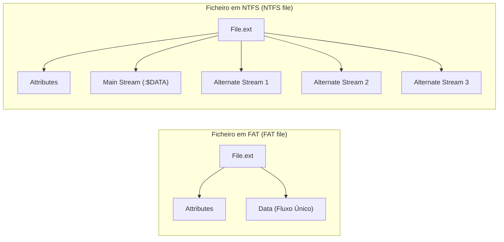

# Alternate Data Streams (ADS) no NTFS — Arquitetura, Manipulação em CMD e PowerShell

No sistema de ficheiros **NTFS**, as **Alternate Data Streams (ADS)** associam fluxos de dados adicionais a um ficheiro, suportando a **MOTW** (`Zone.Identifier`) ou a ocultação de *payloads* e executáveis.

> [!TIP] Lógica de Funcionamento e Valor Forense
> * **Porque existe (Sistema)**: No NTFS (*New Technology File System*), o conteúdo visível de um ficheiro reside no atributo sem nome `:$DATA` (*Main Stream*), permitindo anexar atributos `$DATA` secundários com nome (`NomeFicheiro:NomeADS:$DATA`) para guardar metadados auxiliares como a [[Mark of the Web (MOTW) e Zone.Identifier - Formato, Zonas URLZONE e Verbosidade dos Browsers|Mark of the Web (MOTW)]].
> * **Porque importa (Forense)**: Como o comando `dir` clássico e o Explorador do Windows reportam apenas o tamanho da stream principal `:$DATA`, atacantes conseguem ocultar binários inteiros (como `nc.exe`) em ficheiros de texto aparentemente banais ou de `0 bytes`.
> * **Pontos Críticos e Armadilhas para Exame**:
>   * **FAT vs. NTFS**: o sistema FAT suporta apenas um fluxo único (`Data`); copiar ou mover um ficheiro NTFS para uma unidade FAT/FAT32 **elimina silenciosamente todas as ADS** (incluindo `Zone.Identifier`).
>   * **Contabilidade de `dir /r`**: o sumário final (`1 File(s) 10 bytes`) **não soma** os bytes armazenados nas ADS listadas (`9` + `9` bytes).
>   * **Remoção e efeito na MOTW**: o `cmd.exe` não apaga ADS nativamente mantendo o ficheiro intacto; executar `streams.exe -d` (Sysinternals) remove todas as ADS anexadas, apagando também a `Zone.Identifier` (MOTW).

---

## 1. Arquitetura de *Streams* no NTFS vs. FAT (`$DATA`)

* **Atributo de Dados Predefinido (`$DATA`)**:
  * No NTFS, uma *Alternate Data Stream (ADS)* constitui um **atributo de ficheiro** adicional.
  * **Por omissão**, os dados normais e visíveis de um ficheiro estão armazenados no atributo **`$DATA`** (fluxo principal sem nome, representado como `:$DATA`).
  * O NTFS possibilita que dados adicionais sejam guardados noutras *streams* (atributos `$DATA` secundários com nome) designadas por **Alternate Data Streams (ADS)**.
* **Comparação Estrutural: Ficheiro FAT vs. Ficheiro NTFS (Slide 4)**:
  * **Sistema FAT (`FAT file`)**: um ficheiro (`File.ext`) possui apenas `Attributes` e um único bloco de dados (`Data`). Não suporta fluxos alternativos.
  * **Sistema NTFS (`NTFS file`)**: um ficheiro (`File.ext`) possui `Attributes`, o seu fluxo principal (**`Main Stream`** — `:$DATA`) e pode conter múltiplos fluxos alternativos independentes (**`Alternate Stream 1`**, **`Alternate Stream 2`**, **`Alternate Stream 3`**, etc.).



---

## 2. Tabela Comparativa: Operações de ADS em CMD vs. PowerShell

No Windows, o acesso a uma ADS na linha de comandos recorre à sintaxe `NomeFicheiro:NomeADS` no `cmd.exe` ou ao parâmetro `-Stream` nos *cmdlets* nativos do PowerShell:

| Operação | CMD (`cmd.exe`) / Sysinternals | PowerShell (`-Stream`) |
| :--- | :--- | :--- |
| **Criar ADS** | `echo "dados para ADS" > exemplo.txt:exemploADS` *(Slide 5)* | `Set-Content -Path exemplo.txt -Stream exemploADS -Value "dados para ADS"` |
| **Listar ADS** | `dir /r` *(Slide 5)* | `Get-Item -Path caminhoFicheiro -Stream *` *(Slides 6–7)* |
| **Ler conteúdo** | `more < NomeFicheiro:NomeADS` *(Slide 8)* | `Get-Content -Path ficheiro -Stream Zone.Identifier` *(Slide 8)* |
| **Ocultar EXE** | `type nc.exe > ficheiro.txt:nc.exe` *(Slide 9)* | Escrita em fluxo de bytes (`Set-Content ... -Stream nc.exe -Encoding Byte`) ou via `cmd /c` |
| **Apagar todas as ADS** | Sem comando nativo no CMD; usar **`streams.exe -d ficheiro_com_stream`** (Sysinternals, *Slide 9*) | `Remove-Item -Path ficheiro -Stream NomeADS` (ou filtrar `Stream -ne ':$DATA'`); `Unblock-File` apaga especificamente a `Zone.Identifier` |

---

## 3. Manipulação de ADS via Linha de Comandos (`CMD` — Slides 5, 8 e 9)

### A. Criar uma ADS e Acrescentar uma Segunda ADS (Slide 5)

**1. Criar uma primeira ADS (`exemploADS`) no ficheiro `exemplo.txt`:**

```cmd
echo "dados para ADS" > exemplo.txt:exemploADS
```

* `"dados para ADS"` é o conteúdo gravado na *stream*;
* `exemploADS` é o identificador (nome) da ADS criada.

**2. Acrescentar uma segunda ADS (`exemploADS+MCIF`) ao mesmo ficheiro `exemplo.txt`:**

```cmd
echo "MCIF" > exemplo.txt:exemploADS+MCIF
```

### B. Determinar se um Ficheiro tem ADS (`dir /r`)

O comando `dir` padrão apenas exibe o fluxo principal. Para listar as *Alternate Data Streams* existentes numa diretoria, utiliza-se o parâmetro **`/r`**:

```cmd
dir /r
```

**Saída demonstrada na aula (Slide 5)**:

```text
               10 exemplo.txt
                9 exemplo.txt:exemploADS:$DATA
                9 exemplo.txt:exemploADS+MCIF:$DATA
               1 File(s)             10 bytes
```

> [!IMPORTANT] Ocultação de Tamanho no Fluxo Principal
> Repare-se no sumário final do `dir /r` (`1 File(s) 10 bytes`): o tamanho reportado para o ficheiro `exemplo.txt` (`10 bytes`) **não soma** os bytes ocupados pelas suas ADS (`9` + `9` bytes). Um ficheiro pode ter `0 bytes` no fluxo principal e esconder megabytes de dados numa ADS.

### C. Visualizar o Conteúdo de uma ADS via CMD (`more <`)

Para ler o texto contido numa ADS a partir do `cmd.exe`, redireciona-se a *stream* para o comando **`more`** (Slide 8):

```cmd
more < NomeFicheiro:NomeADS
```

### D. Ocultar um Ficheiro Executável (`EXE`) numa ADS (`type`)

É possível ocultar um binário executável completo (ex.: `nc.exe` — *Netcat*) dentro de uma ADS associada a um ficheiro de texto banal (Slide 9):

```cmd
type nc.exe > ficheiro.txt:nc.exe
```

### E. Apagar ADS de um Ficheiro (`streams.exe` da Sysinternals)

O Windows `cmd.exe` não possui um comando nativo direto para apagar apenas as ADS mantendo o ficheiro principal intacto. Para esse efeito, recorre-se ao utilitário **`streams.exe`** da suite **Sysinternals** (`sysinternals.com`, Slide 9):

```cmd
streams.exe -d ficheiro_com_stream
```

* **`-d`**: apaga todas as *Alternate Data Streams* anexadas ao ficheiro indicado.
* **Implicação de Segurança**: apagar as *streams* de um ficheiro remove a sua [[Mark of the Web (MOTW) e Zone.Identifier - Formato, Zonas URLZONE e Verbosidade dos Browsers|Mark of the Web (MOTW)]], uma vez que a MOTW reside na ADS `Zone.Identifier`.

---

## 4. Inspeção Forense de ADS via PowerShell (Slides 6–8)

O **PowerShell** permite interagir nativamente com *Alternate Data Streams* através do parâmetro **`-Stream`** nos *cmdlets* `Get-Item` e `Get-Content`:

### A. Listar Todas as *Streams* de um Ficheiro (`Get-Item -Stream *`)

```powershell
get-item -path caminhoFicheiro -stream *
```

**Saída completa de propriedades demonstrada no Slide 6 (para `info_01.png`)**:

```text
PSPath        : Microsoft.PowerShell.Core\FileSystem::C:\Users\patri\Downloads\ADS\info_01.png::$DATA
PSParentPath  : Microsoft.PowerShell.Core\FileSystem::C:\Users\patri\Downloads\ADS
PSChildName   : info_01.png::$DATA
PSDrive       : C
PSProvider    : Microsoft.PowerShell.Core\FileSystem
PSIsContainer : False
FileName      : C:\Users\patri\Downloads\ADS\info_01.png
Stream        : :$DATA
Length        : 127267

PSPath        : Microsoft.PowerShell.Core\FileSystem::C:\Users\patri\Downloads\ADS\info_01.png:Zone.Identifier
PSParentPath  : Microsoft.PowerShell.Core\FileSystem::C:\Users\patri\Downloads\ADS
PSChildName   : info_01.png:Zone.Identifier
PSDrive       : C
PSProvider    : Microsoft.PowerShell.Core\FileSystem
PSIsContainer : False
FileName      : C:\Users\patri\Downloads\ADS\info_01.png
Stream        : Zone.Identifier
Length        : 50
```

* O primeiro bloco corresponde à **Stream `"$DATA"`** (os `127267` bytes da imagem PNG propriamente dita);
* O segundo bloco corresponde à **Stream `"Zone.Identifier"`** (`50` bytes associados à *Mark Of The Web*).

### B. Listar *Streams* Filtrando Apenas Nome, Stream e Tamanho (`Select-Object`)

Para obter uma tabela concisa (Slide 7):

```powershell
Get-Item -path FICHEIRO -stream * | Select-Object -Property Filename, Stream, Length
```

**Saída em tabela**:

```text
FileName                                Stream          Length
--------                                ------          ------
C:\Users\patri\Downloads\ADS\info_01.png :$DATA          127267
C:\Users\patri\Downloads\ADS\info_01.png Zone.Identifier     50
```

### C. Visualizar o Conteúdo de uma ADS via PowerShell (`Get-Content -Stream`)

Para ler os dados contidos numa *stream* específica (ex.: `Zone.Identifier`, Slide 8):

```powershell
get-Content -path ficheiro -stream Zone.Identifier
```

**Saída demonstrada no Slide 8 (ficheiro descarregado via Microsoft Teams / SharePoint do IPLeiria)**:

```ini
[ZoneTransfer]
ZoneId=3
ReferrerUrl=https://teams.microsoft.com/
HostUrl=https://myipleiria-my.sharepoint.com/personal/
```

---

## Implicações Forenses

* **Triagem Obrigatória de ADS em Sistemas NTFS**: Qualquer exame pericial que se limite a listar tamanhos de ficheiros normais ignorará dados e binários escondidos em ADS (como `ficheiro.txt:nc.exe`).
* **Deteção de Cópia entre Sistemas de Ficheiros**: Como o sistema FAT/FAT32 apenas suporta uma *stream* por ficheiro, mover um ficheiro de um volume NTFS para uma pen USB formatada em FAT32 elimina silenciosamente todas as suas ADS (incluindo a `Zone.Identifier`).

---

## Além da aula

**Articulação Direta com Montagem e Triagem em [[00 AFD1|AFD1]]:**

* Na nota [[Aquisição e Montagem em Linux - Formato EWF (ewf-tools, ewfmount e xmount)]] (Capítulo 2 de AFD1), estudou-se o comando de montagem de partições NTFS em Linux:

```bash
sudo mount -t ntfs -o ro,loop,show_sys_files,streams_interface=windows,offset=$[63*512] /mnt/raw/ewf1 /mnt/loop/
```

A opção **`streams_interface=windows`** serve para que o driver NTFS em Linux exponha as *Alternate Data Streams* estudadas nesta aula usando a notação `ficheiro:nome_stream`.

* Na nota [[Ferramentas Portáteis de Triagem, Pesquisa e FTK Imager Lite]], o **FTK Imager** é utilizado na triagem em Windows para inspecionar visualmente na árvore da MFT todos os atributos `$DATA` alternativos de um ficheiro.

---

## Perguntas de revisão

1. **Qual é a diferença estrutural entre os sistemas de ficheiros FAT e NTFS quanto a fluxos de dados e o que acontece às ADS ao copiar um ficheiro NTFS para uma pen FAT32?**

> [!success]- Ver Resposta
> Em FAT, um ficheiro possui apenas `Attributes` e um fluxo único de dados (`Data`). No NTFS, além do fluxo principal sem nome (`:$DATA` / *Main Stream*), um ficheiro pode alojar múltiplos atributos `$DATA` secundários com nome (**ADS**). Ao copiar ou mover um ficheiro NTFS para FAT/FAT32, todas as ADS (incluindo `Zone.Identifier`) são **eliminadas silenciosamente**.

2. **Na saída de `dir /r` apresentada na aula (`10 exemplo.txt`, `9 exemplo.txt:exemploADS:$DATA`, `9 exemplo.txt:exemploADS+MCIF:$DATA`), porque é que o total final indica `1 File(s) 10 bytes`?**

> [!success]- Ver Resposta
> Porque o `dir` contabiliza apenas o tamanho do fluxo principal (`:$DATA`, `10 bytes`), **omitindo do total** os bytes armazenados nas ADS (`9` + `9` bytes). Um ficheiro pode apresentar `0 bytes` na listagem normal e ocultar megabytes de dados ou executáveis numa ADS.

3. **Quais os comandos em CMD para criar uma ADS, ler o seu conteúdo, ocultar `nc.exe` dentro de `ficheiro.txt` e remover todas as ADS de um ficheiro?**

> [!success]- Ver Resposta
> * **Criar**: `echo "dados para ADS" > exemplo.txt:exemploADS`
> * **Ler conteúdo**: `more < NomeFicheiro:NomeADS`
> * **Ocultar executável**: `type nc.exe > ficheiro.txt:nc.exe`
> * **Apagar todas as ADS**: Como o CMD não tem comando nativo para apagar apenas as streams, utiliza-se o utilitário da Sysinternals **`streams.exe -d ficheiro_com_stream`** (o que também elimina a MOTW/`Zone.Identifier`).

4. **Como se listam todas as *streams* (com nome do ficheiro, nome da stream e tamanho) e se lê a stream `Zone.Identifier` em PowerShell?**

> [!success]- Ver Resposta
> Listam-se as streams com `Get-Item -path FICHEIRO -stream * | Select-Object -Property Filename, Stream, Length` e lê-se o conteúdo da stream com `get-Content -path ficheiro -stream Zone.Identifier`.

---

## Navegação e Notas Relacionadas

| Percurso | Nota | Contexto |
| :--- | :--- | :--- |
| **Anterior** | [[Loki-RS (Versão Rust) - Compilação, Atualização e Parâmetros CLI]] | `Bloco 01` |
| **Seguinte** | [[Ferramentas Gráficas de Análise de ADS e Caso de Estudo WastedLocker]] | `mesmo bloco` |
| **Índice** | [[Capítulo 3 - YARA - MOTW - Strings]] · [[00 ASSI]] | `Bloco 02` |

### Conceitos Relacionados

* [[Mark of the Web (MOTW) e Zone.Identifier - Formato, Zonas URLZONE e Verbosidade dos Browsers]] · `mesmo bloco`
* [[Exceções à MOTW (Ficheiros Compactados, 7-Zip, certutil LOLBin) e Microsoft Defender SmartScreen]] · `mesmo bloco`
* [[Aquisição e Montagem em Linux - Formato EWF (ewf-tools, ewfmount e xmount)]] · `AFD1 · Cap. 2`
* [[Ferramentas Portáteis de Triagem, Pesquisa e FTK Imager Lite]] · `AFD1 · Cap. 2`
