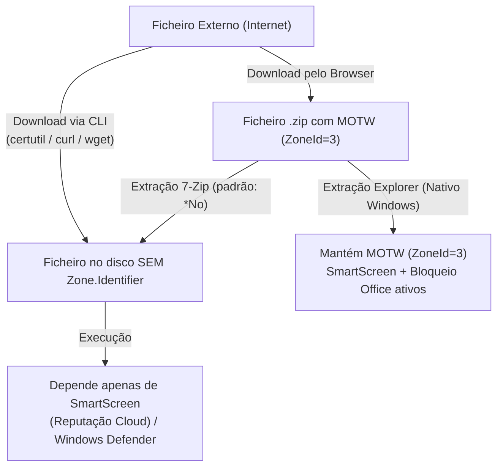

# Exceções à MOTW (Ficheiros Compactados, 7-Zip, `certutil` LOLBin) e Microsoft Defender SmartScreen

Arquivos compactados extraídos pelo **7-Zip** e transferências por CLI (**`certutil`**, `curl`, `wget`) omitem a **MOTW**, sendo compensados pela proteção baseada em reputação do **Microsoft Defender SmartScreen**.

> [!TIP] Lógica de Funcionamento e Valor Forense
> * **Porque existe (Sistema)**: A criação ou propagação da stream `Zone.Identifier` depende da aplicação que grava ou extrai os ficheiros no disco; ferramentas que não propagam a stream deixam ficheiros externos sem marcação Web, exigindo uma camada complementar na *cloud* baseada em reputação (**SmartScreen**).
> * **Porque importa (Forense)**: Um ficheiro suspeito na pasta `Downloads` sem `Zone.Identifier` não prova origem local; pode ter sido extraído de um `.zip` com o **7-Zip** ou transferido com um **LOLBin** (`certutil.exe`), obrigando o perito a cruzar o arquivo `.zip` original e registos de execução.
> * **Pontos Críticos e Armadilhas para Exame**:
>   * **Descompactador Nativo vs. 7-Zip**: o Explorador do Windows propaga a MOTW do `.zip` para os ficheiros extraídos; o **7-Zip por omissão NÃO propaga** (`Options` $\to$ `7-Zip` $\to$ `Propagate Zone.Id stream:` = `* No`, configurável para `Yes` ou `For Office files`).
>   * **Abuso de `certutil.exe` (LOLBin)**: tanto `-verifyctl -f URL` como `-urlcache -split -f URL` descarregam sem adicionar MOTW, mas antivírus modernos como o Windows Defender bloqueiam com `Access is denied.`
>   * **SmartScreen (`Reputation-based protection`)**: avalia **n.º de downloads** e **reputação do sítio web** na *cloud* através de 3 controlos (`Check apps and files`, `SmartScreen for Microsoft Edge`, `Phishing protection`).

---

## 1. Matriz Comparativa das Exceções à MOTW



| Ferramenta / Mecanismo | Cenário de Uso | Cria / Propaga `Zone.Identifier`? | Comportamento Padrão e Mitigação |
| :--- | :--- | :---: | :--- |
| **Descompactador Nativo (Windows)** | Extração de `.zip` com MOTW (`ZoneId=3`) | **Sim** | Propaga automaticamente a `Zone.Identifier` para todos os ficheiros extraídos. |
| **7-Zip (`7Z`)** | Extração de `.zip` / `.7z` com MOTW | **Não** *(por omissão)* | Deixa os ficheiros extraídos como se fossem locais; configurar **`Propagate Zone.Id stream:`** para **`Yes`** ou **`For Office files`**. |
| **`certutil.exe` (LOLBin)** | Download via `-verifyctl` ou `-urlcache -split` | **Não** | Descarrega sem MOTW abusando de binário assinado do Windows; bloqueado pelo Windows Defender (`Access is denied.`). |
| **`curl` / `wget` (CLI)** | Transferência direta por linha de comandos | **Não** | Não escrevem a ADS `Zone.Identifier` ao gravar ficheiros no disco. |

---

## 2. Gestores de Ficheiros Compactados e o Caso do 7-Zip (Slide 21)

Alguns gestores de ficheiros compactados (`ZIP`, `7Z`, etc.) **não propagam a [[Mark of the Web (MOTW) e Zone.Identifier - Formato, Zonas URLZONE e Verbosidade dos Browsers|MOTW]]** aos ficheiros que descompactam:

* **Caso de Uso**:
  1. O utilizador descarrega da Web (**Zona 3** — `ZoneId=3`) um ficheiro `.zip` que contém outros ficheiros no seu interior;
  2. O arquivo `.zip` em si recebe a ADS `Zone.Identifier` (`ZoneId=3`);
  3. Porém, quando é feita a descompactação com uma ferramenta que não propaga a stream, **a MOTW não é adicionada aos ficheiros descompactados**, fazendo com que o Windows os trate como ficheiros locais confiáveis.
* **Contraste: Descompactador Nativo do Windows vs. 7-Zip**:
  * **Descompactador nativo do Windows (Explorer)**: **propaga a MOTW** do arquivo `.zip` para todos os ficheiros extraídos.
  * **Aplicação 7-Zip (`7Z`)**: **por omissão, NÃO propaga a MOTW** aos ficheiros extraídos.
* **Como Ativar a Propagação da MOTW no 7-Zip (Administração Segura)**:
  * Na janela **`Options`** do 7-Zip (separador **`7-Zip`**), existe a definição **`Propagate Zone.Id stream:`**, cujo valor predefinido é **`* No`**, podendo ser alterado pelo utilizador ou administrador para:
    * **`No`** (não propagar — padrão);
    * **`Yes`** (propagar a `Zone.Identifier` para todos os ficheiros extraídos);
    * **`For Office files`** (propagar apenas para ficheiros do Microsoft Office).

---

## 3. Utilitário `certutil` (*Living off the Land*) e CLI (`curl`, `wget`) (Slide 22)

### A. Uso do Utilitário `certutil.exe` para Descarregar Ficheiros

#### Porquê uma exceção à MOTW?

* Quando empregue para descarregar ficheiros a partir de um URL remoto, o **`certutil` não acrescenta a MOTW** (`Zone.Identifier`) ao ficheiro guardado no disco;
* O `certutil.exe` **existe nativamente no Windows** (destinado originalmente à gestão de certificados e listas de revogação);
* Constitui um exemplo clássico de ***Living off the Land* (LoL / LOLBin)** — o abuso de binários nativos e assinados pelo próprio sistema operativo para realizar ações maliciosas (semelhante ao abuso do [[Serviço BITS|bitsadmin]] visto no Capítulo 1).

#### As Duas Sintaxes de Download com `certutil.exe` Apresentadas na Aula

**1. Usando `-verifyctl`:**

```cmd
certutil.exe -verifyctl -f URL
```

**2. Ou usando `-urlcache -split`:**

```cmd
certutil.exe -urlcache -split -f URL
```

#### Bloqueio por Software Antivírus

Devido ao abuso generalizado desta técnica por *malware*, **software antivírus moderno (ex.: Windows Defender) bloqueia ativamente as tentativas de download via `certutil`**, devolvendo na consola o erro demonstrado no Slide 22:

```text
c:\>certutil.exe -urlcache -split -f http://www.google.com
Access is denied.
```

### B. Outras Exceções de Linha de Comandos

* Utilitários de transferência em linha de comandos como **`curl`**, **`wget`**, entre outros, também **não acrescentam a ADS `Zone.Identifier` (MOTW)** aos ficheiros que descarregam.

---

## 4. Microsoft Defender SmartScreen — Sistema Baseado na Reputação (Slides 23 e 24)

Para além da MOTW, o **Windows 10 e o Windows 11** possuem um mecanismo adicional para avaliar a confiabilidade de ficheiros descarregados da Web:

### Arquitetura Baseada na Reputação (*Reputation-based system*)

* Associado ao **Windows Defender SmartScreen**;
* O sistema mantém uma **base de dados na *cloud*** referente à **"reputação" do ficheiro** descarregado, avaliando dois indicadores fundamentais:
  1. **N.º de downloads** desse ficheiro;
  2. **Reputação do sítio web** de onde o ficheiro foi obtido.

### Configurações em `Windows Security` $\to$ `Reputation-based protection` (Slide 24)

Na consola de segurança do Windows (pesquisando por *"reputation-based protection"*), esta proteção desdobra-se em três controlos principais:

1. **`Check apps and files`**: o Microsoft Defender SmartScreen protege o dispositivo verificando aplicações e ficheiros não reconhecidos provenientes da Web antes da sua execução;
2. **`SmartScreen for Microsoft Edge`**: protege contra sítios Web e downloads maliciosos no navegador Microsoft Edge;
3. **`Phishing protection`**: protege a palavra-passe do utilizador contra sítios e aplicações maliciosos de *phishing*.

---

## Referência Laboratorial: Ficha 15

No Slide 25 da apresentação é indicada a realização da **Ficha 15** referente à prática de **Mark Of The Web (MOTW)** e **[[Alternate Data Streams (ADS) no NTFS - Arquitetura, Manipulação em CMD e PowerShell|Alternate Data Streams (ADS)]]**.

*(Nota: Quando o enunciado da Ficha 15 for disponibilizado, será integrado como nota de exercício neste bloco).*

---

## Implicações Forenses

* **Ausência de MOTW num Ficheiro Suspeito na Pasta `Downloads`**: Se durante uma investigação pericial for encontrado um executável malicioso ou um atalho `.lnk` (ver [[Abuso e Vetores de Ataque com Ficheiros LNK]]) sem a stream `Zone.Identifier`, o perito não deve descartar a hipótese de ter vindo da Internet. Deve verificar:
  1. Se existia um arquivo `.zip`/`.7z` na pasta `Downloads` (que tem `Zone.Identifier`) e se o ficheiro foi extraído com o **7-Zip** (que por omissão omite a MOTW);
  2. Se nos logs de linha de comandos, PowerShell ou [[Serviço Prefetch e SysMain - Arquitetura e Funcionamento|Prefetch]] há registo de execução de **`certutil.exe`**, **`curl.exe`**, **`wget`** ou **`streams.exe -d`**.

---

## Além da aula

* **Ponte com Campanhas de Engenharia Social via LNK e Arquivos ZIP (Capítulo 1 de ASSI)**: Na nota [[Abuso e Vetores de Ataque com Ficheiros LNK]], vimos que campanhas como o *Emotet* e o *APT10* distribuem atalhos `.lnk` maliciosos dentro de ficheiros `.zip` anexados a e-mails ou descarregados da Web. O facto de o **7-Zip** não propagar a `Zone.Identifier` por omissão explica porque é que muitas vítimas que utilizam o 7-Zip executam esses atalhos ou documentos extraídos sem que o Windows exiba o aviso de segurança do SmartScreen ou o *Protected View* do Office.

---

## Perguntas de revisão

1. **Porque é que um ficheiro extraído de um `.zip` descarregado da Web (`ZoneId=3`) pode ficar sem MOTW, e como se comparam o descompactador nativo do Windows e o 7-Zip?**

> [!success]- Ver Resposta
> Enquanto o arquivo `.zip` recebe `Zone.Identifier` (`ZoneId=3`) do navegador, o **7-Zip** por omissão **não propaga** essa stream aos ficheiros extraídos (ao contrário do **descompactador nativo do Windows**, que propaga a MOTW para todos os ficheiros extraídos), fazendo com que o Windows trate os ficheiros extraídos pelo 7-Zip como locais.

2. **Que opção do 7-Zip corrige a não propagação da MOTW e quais os três valores disponíveis?**

> [!success]- Ver Resposta
> Em **`Options`** $\to$ separador **`7-Zip`** $\to$ **`Propagate Zone.Id stream:`** (cujo padrão é `* No`), pode selecionar-se **`No`** (não propagar), **`Yes`** (propagar para todos os ficheiros extraídos) ou **`For Office files`** (propagar apenas para ficheiros do Microsoft Office).

3. **Porque é que o `certutil.exe` é classificado como LOLBin na evasão de MOTW, quais são as duas sintaxes de download e como reage o Windows Defender?**

> [!success]- Ver Resposta
> O `certutil.exe` é um binário nativo e assinado do Windows (destinado a certificados) que pode descarregar ficheiros sem adicionar a stream `Zone.Identifier` usando **`certutil.exe -verifyctl -f URL`** ou **`certutil.exe -urlcache -split -f URL`** (tal como `curl` e `wget`). Atualmente, o Windows Defender bloqueia esta técnica devolvendo **`Access is denied.`**

4. **Como funciona o Microsoft Defender SmartScreen no Windows 10/11, que dois indicadores avalia na *cloud* e que três controlos compõem a secção `Reputation-based protection`?**

> [!success]- Ver Resposta
> É um sistema baseado na reputação que consulta uma base de dados na *cloud* avaliando o **n.º de downloads** do ficheiro e a **reputação do sítio web** de origem. Em `Windows Security` $\to$ `Reputation-based protection`, integra três controlos: **`Check apps and files`**, **`SmartScreen for Microsoft Edge`** e **`Phishing protection`**.

---

## Navegação e Notas Relacionadas

| Percurso | Nota | Contexto |
| :--- | :--- | :--- |
| **Anterior** | [[Mark of the Web (MOTW) e Zone.Identifier - Formato, Zonas URLZONE e Verbosidade dos Browsers]] | `mesmo bloco` |
| **Seguinte** | [[Conceito de Strings e Comando strings em Unix-Linux]] | `muda para Bloco 03` |
| **Índice** | [[Capítulo 3 - YARA - MOTW - Strings]] · [[00 ASSI]] | `Bloco 02` |

### Conceitos Relacionados

* [[Alternate Data Streams (ADS) no NTFS - Arquitetura, Manipulação em CMD e PowerShell]] · `mesmo bloco`
* [[Ferramentas Gráficas de Análise de ADS e Caso de Estudo WastedLocker]] · `mesmo bloco`
* [[Serviço BITS]] · `Cap. 1`
* [[Abuso e Vetores de Ataque com Ficheiros LNK]] · `Cap. 1`
