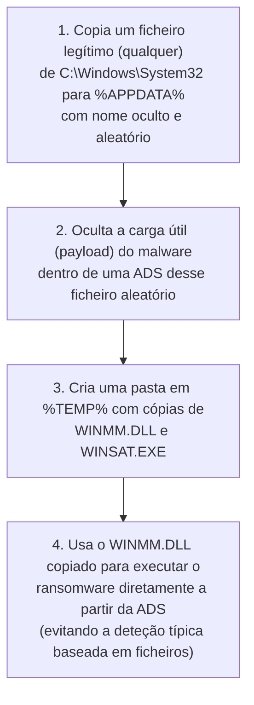

# Ferramentas Gráficas de Análise de ADS e Caso de Estudo WastedLocker

Na análise forense de ADS em NTFS, **`AlternateStreamView`** e **`Alternate Data Stream Manager`** detetam e extraem fluxos ocultos, técnica usada pelo ransomware **WastedLocker** para esconder o seu *payload*.

> [!TIP] Lógica de Funcionamento e Valor Forense
> * **Porque existe (Sistema)**: Utilitários gráficos especializados enumeram recursivamente os atributos `$DATA` secundários de volumes NTFS ou permitem gerir e extrair fluxos de ficheiros individuais sem recorrer à sintaxe de consola do [[Alternate Data Streams (ADS) no NTFS - Arquitetura, Manipulação em CMD e PowerShell|CMD e PowerShell]].
> * **Porque importa (Forense)**: Em ataques avançados como o **WastedLocker (2020)**, binários legítimos do sistema operativo são usados como fachada para executar um *payload* armazenado numa ADS; ferramentas com inspeção de metadados MFT e *Hex preview* permitem localizar e extrair o binário malicioso intacto.
> * **Pontos Críticos e Armadilhas para Exame**:
>   * **Discrepância de *Timestamps* (`Entry Modified`)**: no `AlternateStreamView`, copiar um ficheiro antigo do `System32` preserva `File Created Time` e `File Modified Time` (ex.: `11/05/2020`), mas anexar uma ADS atualiza **`Entry Modified`** na MFT (`28/02/2025`), revelando o momento exato da injeção.
>   * **Tamanho lógico vs. alocado**: distinguir `Stream Size` (`50` bytes) de `Stream Allocated Size` (`56` bytes).
>   * **Cadeia do WastedLocker (4 passos)**: (1) copia ficheiro legítimo de `System32` para `%APPDATA%` com nome oculto e aleatório; (2) oculta o *payload* numa ADS; (3) copia `WINMM.DLL` e `WINSAT.EXE` para `%TEMP%`; (4) `WINMM.DLL` executa o ransomware diretamente da ADS.

---

## 1. Comparação Rápida das Ferramentas Gráficas de ADS

| Critério | `AlternateStreamView` (NirSoft) | `Alternate Data Stream Manager` (Dmitry Brant) |
| :--- | :--- | :--- |
| **Foco Principal** | Varrimento recursivo em lote de discos/pastas e auditoria de metadados NTFS | Inspeção e manipulação interativa de fluxos num ficheiro ou pasta específica |
| **Entrada / Pesquisa** | Seleção de unidade ou diretoria para descoberta automática de todas as ADS | *Drag & drop*, botões `Pick file...` / `Pick folder...` e separador `Search` |
| **Metadados MFT** | Exibe `Stream Size`, `Stream Allocated Size`, `File Created/Modified Time` e **`Entry Modified`** | Lista o fluxo `<unnamed>` e cada ADS com o respetivo tamanho (`Size`) |
| **Operações / Visualização** | Exportação de *streams*, cópia de metadados e janela `Properties` detalhada | `New`, `Rename`, `Delete`, `Load...`, `Export...` + **`Text preview`** e **`Hex preview`** |

---

## 2. Detalhe das Ferramentas Gráficas de Análise de ADS

### A. `AlternateStreamView` (NirSoft — Slide 10)

* **Fonte Oficial**: [AlternateStreamView — NirSoft](https://www.nirsoft.net/utils/alternate_data_streams.html)
* **Funcionamento**: Utilitário portátil da NirSoft que pesquisa recursivamente num disco ou pasta todas as *Alternate Data Streams* existentes e apresenta-as numa tabela consolidada, permitindo exportar as *streams*, copiar metadados ou abrir a janela de propriedades detalhadas de cada entrada.
* **Metadados Forenses Exibidos na Janela `Properties` (captura de ecrã do Slide 10 para `data.json:Zone.Identifier`)**:
  * **`Stream Name`**: `:Zone.Identifier:$DATA`
  * **`Filename`**: `c:\users\patri\downloads\data.json`
  * **`Full Stream Name`**: `c:\users\patri\downloads\data.json:Zone.Identifier`
  * **`Stream Size`**: `50` (tamanho lógico real dos dados na ADS, em bytes)
  * **`Stream Allocated Size`**: `56` (espaço alocado para a *stream*, em bytes)
  * **`Extension`**: `json`
  * **`File Modified Time`**: `11/05/2020 01:36:05`
  * **`File Created Time`**: `11/05/2020 01:36:04`
  * **`Entry Modified`**: `28/02/2025 18:59:13` (*timestamp* de modificação do registo na MFT)
  * **`File Attributes`**: `A` (*Archive*)

### B. `Alternate Data Stream Manager` (Dmitry Brant — Slide 11)

* **Fonte Oficial**: [Alternate Data Stream Manager — Dmitry Brant](https://dmitrybrant.com/adsmanager)
* **Funcionamento**: Ferramenta gráfica interativa onde o analista pode arrastar um ficheiro ou pasta (*"Drag a file or folder into this window to view all of its data streams"*) ou selecionar através dos botões **`Pick file...`** e **`Pick folder...`**, contando também com um separador **`Search`** para pesquisa em lote.
* **Capacidades de Inspeção e Manipulação (captura de ecrã do Slide 11 para `alternatestreamview-x64.zip`)**:
  * **Lista `File stream(s)`**: exibe lado a lado o fluxo principal sem nome (**`<unnamed>`**, com `Size` `71141`) e cada fluxo alternativo (**`Zone.Identifier`**, com `Size` `50`);
  * **Botões de Operação sobre *Streams***:
    1. **`New`**: criar uma nova ADS no ficheiro;
    2. **`Rename`**: renomear a ADS selecionada;
    3. **`Delete`**: apagar a ADS selecionada;
    4. **`Load...`**: carregar o conteúdo de um ficheiro externo para dentro da ADS selecionada;
    5. **`Export...`**: extrair e guardar o conteúdo da ADS selecionada como um ficheiro autónomo no disco para análise pericial.
  * **Painel `Selected stream preview`**: permite inspecionar imediatamente o conteúdo da *stream* selecionada alternando entre dois modos de visualização:
    * **`Text preview`** (ex.: `[ZoneTransfer]\nZoneId=3\nHostUrl=about:internet`);
    * **`Hex preview`** (vista hexadecimal essencial quando a ADS contém dados binários ou executáveis).

---

## 3. Caso de Estudo: Ransomware *WastedLocker* (2020)

No Slide 12 é analisado o caso real do ransomware **WastedLocker** (ataque de ransomware de 2020), que demonstra como grupos de ameaça avançados recorrem a **Alternate Data Streams (ADS)** para ocultar software malicioso e evadir mecanismos tradicionais de deteção:

### Etapas da Cadeia de Ataque do *WastedLocker* (Slide 12)

1. **Cópia e Camuflagem em `%APPDATA%`**:
   * O atacante copia um ficheiro legítimo (qualquer) da pasta `Windows\System32` para a diretoria **`%APPDATA%`**, atribuindo-lhe um **nome oculto e aleatório**.
2. **Ocultação da Carga Útil (*Payload*) numa ADS**:
   * Oculta a carga útil do *malware* (o binário do ransomware) **dentro da ADS** associada a esse ficheiro aleatório em `%APPDATA%`.
3. **Preparação de Execução em `%TEMP%` (`WINMM.DLL` + `WINSAT.EXE`)**:
   * Cria uma pasta dentro de **`%TEMP%`** contendo cópias de **`WINMM.DLL`** e **`WINSAT.EXE`**.
4. **Execução Direta a partir da ADS (*DLL Side-Loading*)**:
   * Utiliza o **`WINMM.DLL`** copiado (carregado pelo binário legítimo `WINSAT.EXE`) para **executar o ransomware diretamente a partir da ADS**.
   * **Efeito Defensivo**: evita a deteção típica baseada em ficheiros, uma vez que o ficheiro principal em `%APPDATA%` é um binário legítimo assinado do `System32` e o executável invocado em `%TEMP%` (`WINSAT.EXE`) também é um executável legítimo do Windows.

---

## Implicações Forenses

* **Discrepância de *Timestamps* (`Entry Modified` vs. `File Created/Modified`)**: Na captura do `AlternateStreamView` do Slide 10, enquanto `File Created Time` e `File Modified Time` datam de `11/05/2020`, o campo **`Entry Modified`** (data de modificação da entrada na MFT) marca `28/02/2025`. Na análise de ataques como o *WastedLocker*, copiar um ficheiro antigo do `System32` preserva a data de modificação original do ficheiro, mas a adição de uma ADS atualiza imediatamente o *timestamp* `Entry Modified` (`$STANDARD_INFORMATION` / `$FILE_NAME` na MFT), denunciando o momento exato em que a ADS maliciosa foi injetada.

---

## Além da aula

* **Correlação do *WastedLocker* com os Artefactos de Execução de ASSI (Capítulo 1)**:
  * Embora o *WastedLocker* esconda a sua *payload* numa ADS para evitar o antivírus, a execução de `WINSAT.EXE` a partir de uma subpasta anómala em `%TEMP%` deixa rasto indelével nos artefactos estudados no Capítulo 1 de ASSI:
    1. Ficheiro **`WINSAT.EXE-<HASH>.pf`** no [[Serviço Prefetch e SysMain - Arquitetura e Funcionamento|Prefetch]] (cujo hash de caminho depende da localização `%TEMP%` e cuja lista de ficheiros e DLLs acedidos nos primeiros 10 segundos revelará tanto a `WINMM.DLL` em `%TEMP%` como o ficheiro oculto em `%APPDATA%`);
    2. Registo de execução e hash SHA-1 na [[AmCache - Arquitetura, Hives e Evolução para SQLite|AmCache]] e na [[Application Compatibility e ShimCache (AppCompatCache)|ShimCache]].

---

## Perguntas de revisão

1. **Que metadados forenses exibe o `AlternateStreamView` na janela `Properties` e qual é a importância da discrepância entre `File Modified Time` e `Entry Modified`?**

> [!success]- Ver Resposta
> Exibe `Stream Name`, `Filename`, `Full Stream Name`, `Stream Size`, `Stream Allocated Size`, `Extension`, `File Modified Time`, `File Created Time`, `Entry Modified` e `File Attributes`. A discrepância entre `File Modified Time` (ex.: `11/05/2020`) e `Entry Modified` (ex.: `28/02/2025`) ocorre porque copiar um ficheiro antigo preserva as datas de criação/modificação do ficheiro, mas anexar uma ADS atualiza o registo na MFT (`Entry Modified`), denunciando quando o fluxo oculto foi criado.

2. **Que cinco operações sobre *streams* e que dois modos de pré-visualização disponibiliza o `Alternate Data Stream Manager`?**

> [!success]- Ver Resposta
> Oferece os botões **`New`**, **`Rename`**, **`Delete`**, **`Load...`** e **`Export...`** (essencial para extrair o binário oculto numa ADS como ficheiro autónomo), além do painel `Selected stream preview` com **`Text preview`** (para texto como `Zone.Identifier`) e **`Hex preview`** (para conteúdo binário/executável).

3. **Descreva os quatro passos da cadeia de ataque do ransomware *WastedLocker* (2020) e explique como evade a deteção baseada em ficheiros.**

> [!success]- Ver Resposta
> (1) Copia um ficheiro legítimo de `Windows\System32` para `%APPDATA%` atribuindo-lhe nome oculto e aleatório; (2) oculta a *payload* do ransomware dentro de uma ADS desse ficheiro; (3) cria uma pasta em `%TEMP%` com cópias de `WINMM.DLL` e `WINSAT.EXE`; e (4) executa o ransomware diretamente a partir da ADS usando o `WINMM.DLL` copiado. Evade a deteção típica baseada em ficheiros porque tanto o ficheiro hospedeiro em `%APPDATA%` como o `WINSAT.EXE` são binários legítimos do Windows.

4. **Como é possível detetar retrospectivamente a execução do *WastedLocker* mesmo com a *payload* ocultada numa ADS?**

> [!success]- Ver Resposta
> Através de artefactos de execução do Windows: o ficheiro **`WINSAT.EXE-<HASH>.pf`** no Prefetch denuncia a execução de `WINSAT.EXE` a partir de `%TEMP%` e os módulos carregados (`WINMM.DLL` e o ficheiro em `%APPDATA%`), complementado pelos registos em **AmCache** e **ShimCache** e pelo varrimento de ADS com o `AlternateStreamView`.

---

## Navegação e Notas Relacionadas

| Percurso | Nota | Contexto |
| :--- | :--- | :--- |
| **Anterior** | [[Alternate Data Streams (ADS) no NTFS - Arquitetura, Manipulação em CMD e PowerShell]] | `mesmo bloco` |
| **Seguinte** | [[Mark of the Web (MOTW) e Zone.Identifier - Formato, Zonas URLZONE e Verbosidade dos Browsers]] | `mesmo bloco` |
| **Índice** | [[Capítulo 3 - YARA - MOTW - Strings]] · [[00 ASSI]] | `Bloco 02` |

### Conceitos Relacionados

* [[Exceções à MOTW (Ficheiros Compactados, 7-Zip, certutil LOLBin) e Microsoft Defender SmartScreen]] · `mesmo bloco`
* [[Serviço Prefetch e SysMain - Arquitetura e Funcionamento]] · `Cap. 1`
* [[AmCache - Arquitetura, Hives e Evolução para SQLite]] · `Cap. 1`
