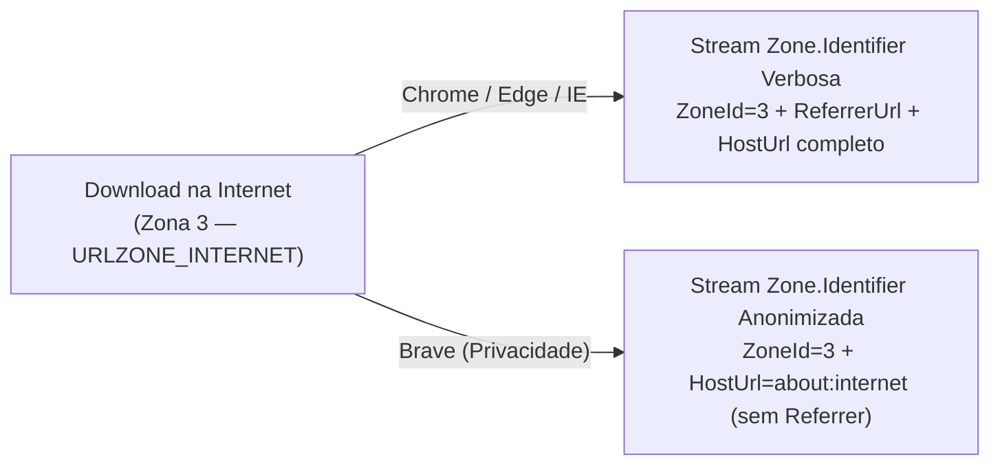

# Mark of the Web (MOTW) e `Zone.Identifier` — Formato, Zonas `URLZONE` e Verbosidade dos Browsers

A **Mark of the Web (MOTW)** identifica a proveniência de ficheiros descarregados através da ADS **`Zone.Identifier`**, classificando a confiança da origem em zonas **`URLZONE`** de `0` a `4`.

> [!TIP] Lógica de Funcionamento e Valor Forense
> * **Porque existe (Sistema)**: Introduzida no **Windows XP SP2**, a MOTW associa uma zona de segurança (`[ZoneTransfer]`) aos ficheiros obtidos pela rede mediante uma [[Alternate Data Streams (ADS) no NTFS - Arquitetura, Manipulação em CMD e PowerShell|ADS]] NTFS (`Zone.Identifier`), permitindo ao sistema operativo e a aplicações (como o Office) aplicar restrições de execução.
> * **Porque importa (Forense)**: Em navegadores verbosos (Edge, Chrome, IE), a stream `Zone.Identifier` regista no próprio ficheiro descarregado o URL exato de origem (`HostUrl`) e a página de referência (`ReferrerUrl`), permitindo comprovar proveniência externa e reconstituir downloads mesmo após a limpeza do histórico do navegador.
> * **Pontos Críticos e Armadilhas para Exame**:
>   * **Edge/IE/Chrome vs. Brave**: Edge, IE e Chrome são **verbosos** (`ReferrerUrl` + `HostUrl` completos, capazes de preservar parâmetros sensíveis como coordenadas de mapas); o **Brave** marca `ZoneId=3`, omite `ReferrerUrl` e anonimiza com `HostUrl=about:internet`.
>   * **Mapeamento `ZoneId` vs. `URLZONE`**: `0` (`URLZONE_LOCAL_MACHINE`), `1` (`URLZONE_INTRANET`), `2` (`URLZONE_TRUSTED`), `3` (`URLZONE_INTERNET` — downloads Web), `4` (`URLZONE_UNTRUSTED`), além de `URLZONE_INVALID` (sem classificação).
>   * **6 propriedades possíveis**: `ZoneId`, `AppZoneId`, `HostIpAddress`, `HostUrl`, `LastWriterPackageFamilyName` e `ReferrerUrl`.

---

## 1. Conceito, Origem e Implementação pelos Navegadores

* **Histórico e Integração Técnica**:
  * Existe desde o **Windows XP Service Pack 2 (SP2)**;
  * Está integrada no mecanismo de identificação **`Zone.Identifier`**, implementado como uma [[Alternate Data Streams (ADS) no NTFS - Arquitetura, Manipulação em CMD e PowerShell|Alternate Data Stream (ADS)]] no sistema de ficheiros NTFS (`NomeDoFicheiro:Zone.Identifier:$DATA`).
* **Implementação pelos Navegadores Web**:
  * O mecanismo MOTW é implementado pelos principais navegadores (**Firefox, Chrome, Edge, Brave, Internet Explorer**, entre outros);
  * Sempre que um ficheiro é descarregado da Internet, o navegador acrescenta automaticamente a ADS **`Zone.Identifier`** ao ficheiro gravado no disco.

---

## 2. Verbosidade entre Browsers (Edge/IE/Chrome vs. Brave) e Geolocalização Forense



Embora os principais navegadores criem a stream `Zone.Identifier` com `ZoneId=3`, **a quantidade de informação forense registada varia significativamente consoante o browser utilizado** (Slides 15 e 16):

| Propriedade / Comportamento | Microsoft Edge / IE / Chrome (Verboso) | Brave (Anonimizado / Privacidade) |
| :--- | :--- | :--- |
| **`ZoneId`** | `ZoneId=3` (Zona Internet) | `ZoneId=3` (Zona Internet) |
| **`ReferrerUrl`** | **Registado** (URL exato da página que originou o download) | **Omitido** (não gravado na stream) |
| **`HostUrl`** | **Registado na íntegra** (URL completo do ficheiro, incluindo *query strings*) | **Anonimizado** (`HostUrl=about:internet`) |
| **Valor Probatório** | Permite rastrear o site de origem, motores de pesquisa e parâmetros como coordenadas GPS | Confirma apenas que o ficheiro veio da Internet, ocultando os endereços exatos |

### A. Ficheiro Descarregado pelo Microsoft Edge (Verboso)
Os *browsers* da Microsoft (**Edge, Internet Explorer**, etc.) e o Chrome gravam tanto o URL da página de referência (`ReferrerUrl`) como o URL exato do ficheiro (`HostUrl`):

```ini
[ZoneTransfer]
ZoneId=3
ReferrerUrl=https://www.nirsoft.net/utils/url_protocol_view.html
HostUrl=https://www.nirsoft.net/utils/urlprotocolview.zip
```

### B. Ficheiro Descarregado pelo Brave (Anonimizado)
O navegador **Brave** (focado em privacidade) marca o ficheiro como proveniente da Internet (`ZoneId=3`), mas omite o `ReferrerUrl` e substitui o endereço de origem por `about:internet`:

```ini
[ZoneTransfer]
ZoneId=3
HostUrl=about:internet
```

### C. Caso Prático da Aula: Mapa ViaMichelin no Microsoft Edge (Slide 16)
Ao inspecionar com `get-Content -path FICHEIRO -stream Zone.Identifier` uma imagem de mapa descarregada através de um browser da Microsoft, obteve-se:

```ini
[ZoneTransfer]
ZoneId=3
ReferrerUrl=https://www.google.com/
HostUrl=https://map.viamichelin.com/map/carte?map=viamichelin&z=10&lat=39.74563&lon=-8.81203&width=550&height=382&format=png&version=latest&layer=background&debug_pattern=.*
```

* **Valor Probatório**: devido à verbosidade do browser na propriedade `HostUrl`, ficaram preservados no próprio ficheiro `.png` o nível de zoom (`z=10`) e as **coordenadas geográficas exatas de latitude e longitude (`lat=39.74563&lon=-8.81203`)** correspondentes à região de **Leiria**, bem como o facto de o utilizador ter chegado lá a partir do Google (`ReferrerUrl=https://www.google.com/`).

---

## 3. Formato da Stream `Zone.Identifier`, Valores `ZoneId` e Constantes `URLZONE`

A stream `Zone.Identifier` tem o formato base:

```ini
[ZoneTransfer]
ZoneId=x
```

onde **`x`** assume um valor inteiro no intervalo **`[0-4]`**.

### Tabela Completa de Zonas (`ZoneId` `[0-4]` e Constantes `URLZONE_*` — Slides 17 e 18)

| Valor `ZoneId` | Designação da Zona (Slide 17) | Constante `URLZONE` (Slide 18) | Significado e Nível de Confiança |
| :---: | :--- | :--- | :--- |
| *(Sem ID)* | *(Sem classificação)* | **`URLZONE_INVALID`** | Empregue quando **não existe classificação** válida. |
| **`0`** | **My Computer** | **`URLZONE_LOCAL_MACHINE`** | **Máquina local** (ficheiros originados localmente no próprio computador). |
| **`1`** | **Local Intranet Zone** | **`URLZONE_INTRANET`** | **Intranet** (rede local corporativa / partilhas internas). |
| **`2`** | **Trusted sites Zone** | **`URLZONE_TRUSTED`** | **Sítios confiáveis** (sítios explicitamente marcados como fidedignos). |
| **`3`** | **Internet Zone** | **`URLZONE_INTERNET`** | **Sítios web (considerados não confiáveis)** — zona padrão aplicada aos downloads da Internet. |
| **`4`** | **Restricted Sites Zone** | **`URLZONE_UNTRUSTED`** | **Sítios NÃO confiáveis** (sítios explicitamente restritos ou maliciosos). |

---

## 4. Propriedades da `Zone.Identifier` e Configuração `URLZONE` no Windows

### A. As 6 Propriedades Possíveis na `Zone.Identifier` (Slide 18)
As propriedades gravadas dentro da stream `Zone.Identifier` variam consoante a aplicação que criou ou transferiu o ficheiro, podendo incluir:

1. **`ZoneId`**: identificador numérico da zona de segurança (`0` a `4`, mapeado às constantes `URLZONE_*`);
2. **`AppZoneId`**: identificador de zona específico da aplicação;
3. **`HostIpAddress`**: endereço IP do servidor de onde o ficheiro foi transferido;
4. **`HostUrl`**: URL direto do ficheiro descarregado;
5. **`LastWriterPackageFamilyName`**: nome da família do pacote da aplicação (ex.: app [[Aplicações UWP (Universal Windows Platform) - Visão Geral|UWP / MSIX]]) que escreveu a stream pela última vez;
6. **`ReferrerUrl`**: URL da página Web que referenciou/originou o download.

### B. Configuração Gráfica das Zonas `URLZONE` (Slide 19)
No Windows, a configuração das permissões de segurança associadas a cada `URLZONE` é gerida através da caixa de diálogo **"Internet Properties"** (`inetcpl.cpl`), no separador **`Security`**:

* Permite selecionar qualquer uma das 4 zonas configuráveis (**`"Internet"`**, **`"Local intranet"`**, **`"Trusted sites"`**, **`"Restricted sites"`**) e **aplicar diferentes níveis de segurança e permissões** (ex.: nível *Medium-high* para a zona *Internet*, que solicita confirmação antes de descarregar conteúdo potencialmente inseguro e bloqueia controlos ActiveX não assinados).

---

## Implicações Forenses

* **Proveniência e Atribuição de Ação ao Utilizador**: Num exame forense (ver [[Pesquisa de Evidências e Reconstrução de Eventos]] em AFD1), encontrar um ficheiro com `ZoneId=3`, `ReferrerUrl` e `HostUrl` comprova não só que o ficheiro veio da Internet (e não foi criado localmente nem copiado de uma pen USB sem ADS), mas também qual o servidor exato de origem e a página onde o utilizador clicou — mesmo que o utilizador tenha entretanto limpado o histórico do navegador.

---

## Além da aula

* **Ligação de `LastWriterPackageFamilyName` com Aplicações Modernas (Capítulo 1 de ASSI)**: Nas notas [[Aplicações UWP (Universal Windows Platform) - Visão Geral]] e [[UWP - Artefactos Forenses e Estrutura de Dados]], vimos que cada aplicação da Microsoft Store possui um *Package Family Name* único. Quando um anexo é guardado por uma aplicação UWP/MSIX (como o cliente de e-mail moderno ou o Microsoft Teams), a propriedade `LastWriterPackageFamilyName` na `Zone.Identifier` identifica inequivocamente a aplicação responsável pela descarga.

---

## Perguntas de revisão

1. **O que é a *Mark of the Web* (MOTW), desde que versão do Windows existe e em que stream NTFS reside?**

> [!success]- Ver Resposta
> É o mecanismo nativo do Windows para identificar a proveniência e o nível de confiança de um ficheiro. Existe desde o **Windows XP Service Pack 2 (SP2)** e está integrado na Alternate Data Stream NTFS **`Zone.Identifier`** (`NomeDoFicheiro:Zone.Identifier:$DATA`).

2. **Compare a verbosidade da stream `Zone.Identifier` entre o Microsoft Edge/IE/Chrome e o navegador Brave, dando o exemplo do mapa ViaMichelin.**

> [!success]- Ver Resposta
> O **Microsoft Edge / IE / Chrome** são verbosos e gravam o `ReferrerUrl` e o `HostUrl` completos (no exemplo ViaMichelin da aula, ficou gravado `ReferrerUrl=https://www.google.com/` e as coordenadas exatas `lat=39.74563&lon=-8.81203` em Leiria dentro do `HostUrl`). Já o **Brave** grava `ZoneId=3`, omite `ReferrerUrl` e substitui o endereço por `HostUrl=about:internet`.

3. **Liste os valores de `ZoneId` (`0` a `4`), as respetivas designações e todas as 6 constantes `URLZONE_*` associadas.**

> [!success]- Ver Resposta
> * *(Sem ID)*: **`URLZONE_INVALID`** (sem classificação válida);
> * **`0` — My Computer**: **`URLZONE_LOCAL_MACHINE`** (máquina local);
> * **`1` — Local Intranet Zone**: **`URLZONE_INTRANET`** (intranet);
> * **`2` — Trusted sites Zone**: **`URLZONE_TRUSTED`** (sítios confiáveis);
> * **`3` — Internet Zone**: **`URLZONE_INTERNET`** (sítios web não confiáveis — padrão para downloads);
> * **`4` — Restricted Sites Zone**: **`URLZONE_UNTRUSTED`** (sítios não confiáveis/restritos).

4. **Indique as 6 propriedades possíveis na stream `Zone.Identifier` e onde se configuram os níveis de segurança das zonas no Windows.**

> [!success]- Ver Resposta
> As 6 propriedades são: **`ZoneId`**, **`AppZoneId`**, **`HostIpAddress`**, **`HostUrl`**, **`LastWriterPackageFamilyName`** e **`ReferrerUrl`**. As permissões das 4 zonas configuráveis (`Internet`, `Local intranet`, `Trusted sites` e `Restricted sites`) configuram-se em **`inetcpl.cpl`** (*Internet Properties*) no separador **`Security`**.

---

## Notas relacionadas

- [[Alternate Data Streams (ADS) no NTFS - Arquitetura, Manipulação em CMD e PowerShell]]
- [[Ferramentas Gráficas de Análise de ADS e Caso de Estudo WastedLocker]]
- [[Exceções à MOTW (Ficheiros Compactados, 7-Zip, certutil LOLBin) e Microsoft Defender SmartScreen]]
- [[Aplicações UWP (Universal Windows Platform) - Visão Geral]]
- [[Pesquisa de Evidências e Reconstrução de Eventos]]
- [[Capítulo 3 - YARA - MOTW - Strings]]
