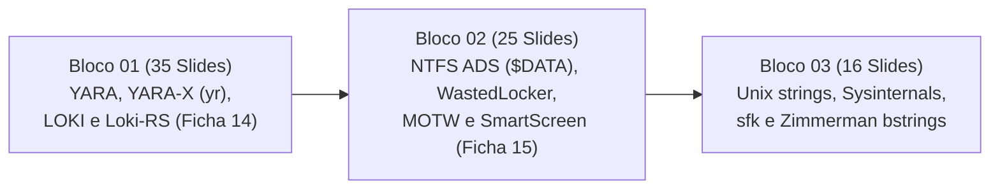

# Capítulo 3 — YARA - MOTW - Strings

Mapa de estudo do **Capítulo 3** de [[00 ASSI|ASSI]] (Prof. Patrício Domingues), cobrindo **76 diapositivos** das três apresentações (*YARA & LOKI*, *MOTW / ADS* e *"strings" utilities*) organizados em **13 notas atómicas focadas** e **1 Cheat Sheet de revisão rápida** na pasta `ASSI/Capítulo 03 - YARA - MOTW - Strings/`.

> [!TIP] Guia de Consulta Rápida para Exame
> Para tabelas comparativas (`YARA` vs. `YARA-X`, `LOKI` vs. `Loki-RS`, `CMD` vs. `PowerShell` em ADS, `ZoneId 0–4`, exceções `7-Zip`/`certutil`, `strings` vs. `strings.exe`/`sfk`/`bstrings`), sintaxes CLI e o *Top 8* de armadilhas de exame, consulta a **[[Cheat Sheet - YARA, MOTW e Extração de Strings]]**.

---

## 1. Pesquisa de Padrões, Malware e IOCs (`01 - YARA, YARA-X e Scanner LOKI` — 35 Slides)

| Nota | Slides | O que vais estudar |
| :--- | :---: | :--- |
| [[YARA - Introdução, Estrutura de Regras, Metadados e Condições]] | 1–9, 13 | Deteção binária *signature-based*, marcador PE `4D5A`, ciclo VirusTotal (`2013`–`2025`), secções `meta:`/`strings:`/`condition:` e `uint16(0) == 0x5a4d`. |
| [[YARA - Tipos de Strings, Modificadores, Formato Hexadecimal, Base64 e Regex]] | 7–12 | Modificadores (`nocase`, `wide`, `ascii`, `fullword`, `base64` em 3 alinhamentos), hex (`??`, `A?`, `[4-6]`) e metacaracteres Regex. |
| [[Execução e Compilação no YARA (yara e yarac), Casos Reais (UPX, WannaCry) e LLMs]] | 14–20, 34 | Compilação `yarac` (`yara -C`), flags CLI, casos `suspicious_strings.yar`, `upx_packed`, `WannaCry_Ransomware` e validação de regras LLM (`T1055.002`). |
| [[YARA-X (Reimplementação em Rust) e Ferramenta CLI yr]] | 21–25 | Reimplementação em Rust com segurança de memória, comparação YARA v4.x vs. YARA-X e subcomandos CLI `yr`. |
| [[Scanner de IOCs LOKI (Versão Python) - Métodos de Deteção e Configuração]] | 26–30 | Os 4 métodos do LOKI (*File Name*, *YARA*, *Hash*, *C2*), YAML, `LOKI UPGRADER` (`signature-base`) e `pe-sieve64.exe`. |
| [[Loki-RS (Versão Rust) - Compilação, Atualização e Parâmetros CLI]] | 31–35 | Reescrita multi-thread em Rust, compilação `cargo b --release`, `loki-util.exe --update`, parâmetros `loki.exe` e **Ficha 14**. |

---

## 2. Fluxos Alternativos NTFS e Proveniência Web (`02 - ADS e Mark of the Web` — 25 Slides)

| Nota | Slides | O que vais estudar |
| :--- | :---: | :--- |
| [[Alternate Data Streams (ADS) no NTFS - Arquitetura, Manipulação em CMD e PowerShell]] | 1–9 | NTFS `$DATA` vs. FAT, manipulação CMD (`echo`, `dir /r`, `more <`, `type`), `streams.exe -d` e PowerShell `-Stream`. |
| [[Ferramentas Gráficas de Análise de ADS e Caso de Estudo WastedLocker]] | 10–12 | Ferramentas `AlternateStreamView` (`Entry Modified`) e `ADS Manager`, e ataque `WastedLocker` (`%APPDATA%` ADS + `%TEMP%\WINSAT.EXE`/`WINMM.DLL`). |
| [[Mark of the Web (MOTW) e Zone.Identifier - Formato, Zonas URLZONE e Verbosidade dos Browsers]] | 13–19 | Stream `Zone.Identifier`, zonas `0`–`4` (`URLZONE_*`), 6 propriedades, `inetcpl.cpl` e verbosidade Edge/ViaMichelin vs. `about:internet` no Brave. |
| [[Exceções à MOTW (Ficheiros Compactados, 7-Zip, certutil LOLBin) e Microsoft Defender SmartScreen]] | 20–25 | Propagação Explorer vs. 7-Zip (`No` por omissão), LOLBin `certutil`, `curl`/`wget`, SmartScreen (*reputation-based*) e **Ficha 15**. |

---

## 3. Extração e Pesquisa de Strings (`03 - Extração e Pesquisa de Strings (strings e bstrings)` — 16 Slides)

| Nota | Slides | O que vais estudar |
| :--- | :---: | :--- |
| [[Conceito de Strings e Comando strings em Unix-Linux]] | 1–6, 16 | Conceito de *string*, comando Unix `strings` (mínimo `4`, `-t d/o/x`, `-d`, `-s`, `-e S` acentos, `grep`) e limitação em cifrados. |
| [[Extração de Strings no Windows - Sysinternals strings e Swiss File Knife (sfk)]] | 7–9, 16 | Ausência de comando nativo no Windows, Sysinternals `strings.exe` (ANSI+Unicode, mínimo `3`, `-nobanner`) e `sfk strings` (`-ls+WORD`). |
| [[Eric Zimmerman bstrings - Parâmetros, Expressões Regulares e Exercícios]] | 10–16 | Flags do `bstrings` (`-m`, `-x`, `-b`, `-q`, `-s`, `--ls`, `--lr`), 27 regex integradas (`-p`) e exercício em `notepad.exe`. |

---

## Navegação

- [[00 ASSI|Voltar ao MOC Geral de ASSI]]
- [[Cheat Sheet - YARA, MOTW e Extração de Strings|Ir para a Cheat Sheet do Capítulo 3]]
- [[Capítulo 1 - Sistemas Operativos, Serviços e Artefactos Forenses|Ir para o Capítulo 1 de ASSI]]
- [[Capítulo 2 - Administração de Sistemas|Recuar para o Capítulo 2 de ASSI (Administração de Sistemas e Controlo de Acessos)]]
- [[Capítulo 4 - Logs|Avançar para o Capítulo 4 de ASSI (Logs no Windows, Threat Hunting e Logs Ad-Hoc)]]
- [[Capítulo 1 - Método de Investigação|Pontes com AFD1 — Capítulo 1 (Método de Investigação Forense)]]
- [[Capítulo 2 - Arranque e Aquisição Forense|Pontes com AFD1 — Capítulo 2 (Arranque e Aquisição Forense)]]
- [[Capítulo 3 - Organização de Dados|Pontes com AFD1 — Capítulo 3 (Organização de Dados, Endianness e Codificações)]]
- [[Home|Voltar ao Hub Central do MCIF]]
