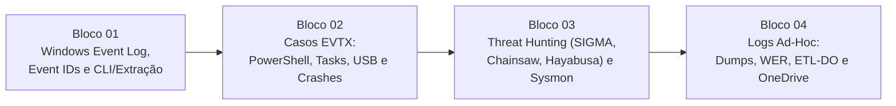

# Capítulo 4 — Logs

Mapa de estudo do **Capítulo 4** de [[00 ASSI|ASSI]] (Prof. Patrício Domingues), cobrindo **127 diapositivos** (Parte 1: 93 slides; Parte 2: 34 slides) e as **Fichas Práticas 16, 17 e 18**, sintetizados em **10 notas focadas no essencial** e **1 Cheat Sheet de revisão rápida**.

> [!TIP] Guia de Consulta Rápida e Treino Interativo
> Para tabelas de retenção, Event IDs críticos, caminhos forenses e comandos essenciais num só ecrã, consulta a **[[Cheat Sheet - Logs no Windows e Threat Hunting]]**.
> Para treinar Event IDs (`-4096` + quiz) e triagem forense por cenário, abre [assi_logs_forense.html](../../_assets/assi_logs_forense.html).

---

## 1. Windows Event Log e Extração (`01 - Windows Event Log e Extração`)

| Nota | Slides / Fichas | Foco Principal |
| :--- | :---: | :--- |
| [[Windows Event Log - Arquitetura, Retenção e Event IDs Críticos]] | P1: 1–24 | Retenção legal (HIPAA, PCI DSS, ISO 27001, GLBA, NIS2, IP PT), `.evt` vs. `.evtx`, gestão circular, Event IDs `4624`/`4625`/`4648`/`1102` e regra `-4096`. |
| [[Ferramentas Nativas e CLI para EVTX (WEVTUtil, psloglist e PowerShell)]] | P1: 31–45 | `wevtutil`, `psloglist` (e limitação de logs clássicos), `Get-WinEvent` vs. `Get-EventLog`, `OAlerts.evtx` e limpeza de logs. |
| [[Extração e Análise Offline de EVTX (evtx_dump, jq, FullEventLogView e EvtxECmd)]] | P1: 16, 51–53; F16 | Pipeline `evtx_dump` + `jq`, `FullEventLogView` (NirSoft), `EvtxECmd.exe` e `TimelineExplorer` (Zimmerman). |

---

## 2. Casos de Estudo Forenses em EVTX (`02 - Casos de Estudo Forenses em EVTX`)

| Nota | Slides | Foco Principal |
| :--- | :---: | :--- |
| [[Deteção Forense de PowerShell e Persistência (Task Scheduler) em EVTX]] | P1: 46–50, 54–60 | PowerShell v5+ (`4103`/`4104`), *downgrade* v2 (`400`), `PSReadLine`; Task Scheduler (`4698`–`4702` e `106`/`141`/`200`/`201`). |
| [[Análise Forense de USB e Crashes nos Logs EVTX]] | P1: 25–30, 61–63 | USB em `Partition%4Diagnostic`/`Storsvc` (ID `1006`, MBR/GPT, `USBDriveLog`); crashes/BSOD (IDs `1000`, `1002`, `1001`). |

---

## 3. Threat Hunting e Monitorização (`03 - Threat Hunting e Monitorização`)

| Nota | Slides / Fichas | Foco Principal |
| :--- | :---: | :--- |
| [[Threat Hunting em EVTX - Regras SIGMA, APT-Hunter, Chainsaw e Hayabusa]] | P1: 65–75, 81–85 | Formato `SIGMA` (analogia YARA) e comparativo prático de `APT-Hunter`, `Chainsaw` (`search`/`hunt`) e `Hayabusa` (`csv-timeline`). |
| [[Monitorização Avançada com Sysmon (Sysinternals)]] | P1: 76–80; F17 | Serviço persistente, `Microsoft-Windows-Sysmon%4Operational.evtx`, eventos monitorizados, XML `SwiftOnSecurity` e comandos `-i`/`-c`/`-s`/`-u`. |

---

## 4. Logs Ad-Hoc no Windows (`04 - Logs Ad-Hoc no Windows`)

| Nota | Slides / Fichas | Foco Principal |
| :--- | :---: | :--- |
| [[Memory Dumps (.dmp) e Windows Error Reporting (WER)]] | P2: 1–18; F18 | *Mini* vs. *full dump* (`WinDbg`, `Process Explorer`, `BlueScreenView`), WER (`UTF-16-LE`, `WerSvc`, ID `1001`, `AppCrashView`, `sfk`) e caso **Storm-0558**. |
| [[Logs ETL e Caso de Estudo Delivery Optimization (IP Externo)]] | P2: 19–25 | Formato `ETL`, `tracerpt`, `domgmt*` vs. `dosvc*` (28 dias, `ExternalIPAddress`) e `Get-DeliveryOptimizationLog`. |
| [[Análise Forense de Logs do OneDrive (ODL, SQLite e OneDriveExplorer)]] | P2: 26–33 | Logs `.odl` (AES-ECB 128-bit, `general.keystore`), `<UserCid>.dat`, SQLite (`sfk hexfind`), `OneDriveExplorer` e privacidade em veículos. |

---

## Navegação

* [[00 ASSI|Voltar ao MOC Geral de ASSI]]
* [[Cheat Sheet - Logs no Windows e Threat Hunting|Ir para a Cheat Sheet do Capítulo 4]]
* [[Capítulo 3 - YARA - MOTW - Strings|Recuar para o Capítulo 3 de ASSI]]
* [[Home|Voltar ao Hub Central do MCIF]]
