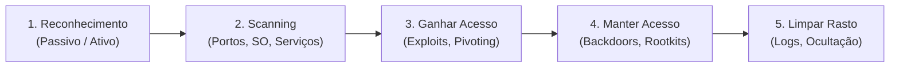

# Fases do *Hacking* e Âmbito do *Ethical Hacking*

O ***Ethical Hacking*** replica de forma controlada e **com autorização expressa da organização** as cinco fases utilizadas por atacantes reais — **Reconhecimento, *Scanning*, Ganhar acesso, Manter acesso e Limpar rasto** — para identificar vulnerabilidades antes que sejam exploradas maliciosamente.

> [!TIP] Lógica de Funcionamento e Valor Operacional
> * **Porque existe (Metodologia)**: *"To beat hackers, you have to think like them."* Um *pentester* segue o mesmo ciclo lógico de um atacante, mas dentro de um âmbito contratual e com foco na remediação.
> * **Porque importa (Organização)**: Permite responder a quatro perguntas operacionais: (1) o que consegue um atacante obter sobre o alvo?; (2) o que consegue fazer com essa informação?; (3) as ações são detetadas/monitorizadas?; (4) os sistemas estão atualizados e protegidos?
> * **Pontos Críticos e Armadilhas para Exame**:
>   * **Reconhecimento Passivo** (sem contacto direto com o alvo: registos públicos, ofertas de emprego) vs. **Reconhecimento Ativo** (interação direta com o alvo: telefonemas para *helpdesk*, sondagem direta).
>   * A fase de **Limpar rasto** num *pentest* autorizado serve para avaliar a capacidade de deteção do *Blue Team* / registos de auditoria, devendo todas as alterações ser documentadas e revertidas.

---

## 1. As 5 Fases do *Hacking* (Slides 37–43)

1. **Reconhecimento**: fase preparatória de recolha de informação sobre sistemas, redes, operações, colaboradores e clientes.
   * **Passivo**: sem contacto direto com o alvo (registos públicos, anúncios de emprego).
   * **Ativo**: interação direta com o alvo (ex.: chamadas para *helpdesk* ou departamento técnico).
2. ***Scanning***: fase pré-ataque usando a informação do reconhecimento; recorre a *scanners* de portos, mapeamento de rede e *scanners* de vulnerabilidades para extrair portos, SO, serviços e tipos de dispositivos.
3. **Ganhar acesso**: exploração efetiva (ex.: *password cracking*, *buffer overflow*, *session hijacking*) com eventual escalonamento de privilégios para controlo total.
4. **Manter acesso**: preservação de controlo exclusivo via *backdoors*, *rootkits* ou *trojans* para manipular dados ou usar o sistema como plataforma de salto.
5. **Limpar rasto**: ocultação de vestígios da intrusão (ex.: eliminação ou manipulação de ficheiros de *log*).

---

## 2. Competências do *Ethical Hacker* (Slides 47–48)

* **Competências técnicas**: domínio de sistemas operativos, redes e comunicações, segurança informática e técnicas para espoletar ataques.
* **Competências não técnicas**: adaptação rápida a novas tecnologias, forte sentido ético, boa comunicação e resolução de problemas, compromisso com políticas organizacionais e conhecimento de *standards* e legislação.

---

## Perguntas de revisão

1. **Qual a diferença entre Reconhecimento Passivo e Reconhecimento Ativo?**

> [!success]- Ver Resposta
> No reconhecimento passivo recolhe-se informação sem qualquer contacto ou interação direta com o alvo (ex.: registos públicos, ofertas de emprego); no reconhecimento ativo há interação direta com o alvo ou seus colaboradores (ex.: contacto telefónico com o *helpdesk* ou sondagens diretas).

2. **Quais são as 4 perguntas centrais a que o *Ethical Hacking* procura responder numa organização?**

> [!success]- Ver Resposta
> (1) O que consegue um atacante descobrir sobre o alvo? (2) O que consegue fazer com essa informação? (3) As ações estão a ser identificadas ou monitorizadas? (4) Todos os sistemas estão atualizados e protegidos?

## Notas relacionadas

- [[Conceitos Fundamentais de Segurança (CIA, Ameaça, Vulnerabilidade e Ataque)]]
- [[Testes de Penetração - Metodologia, Pentest Request e Relatórios]]
- [[Footprinting - Conceitos, Objetivos e Motores de Pesquisa (Google Hacking)]]
