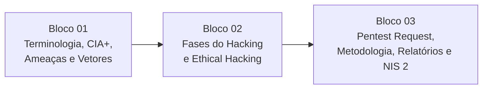

# Capítulo 1 — Introdução à Cibersegurança

Mapa de estudo do **Capítulo 1** de [[00 COD1|COD1]] (Prof. Leonel Santos), cobrindo **82 diapositivos** organizados em **4 notas atómicas** na pasta `COD1/Capítulo 01 - Introdução à Cibersegurança/`, com foco na estruturação legal, contratual e metodológica de um **teste de penetração (*pentest*) a uma organização**.

---

## 1. Conceitos e Vetores de Ataque (`01 - Conceitos e Vetores de Ataque`)

| Nota | Slides | O que vais estudar |
| :--- | :---: | :--- |
| [[Conceitos Fundamentais de Segurança (CIA, Ameaça, Vulnerabilidade e Ataque)]] | 4–32 | *Data breaches*, terminologia essencial (*hack value*, *vulnerability*, *threat*, *exploit*, *payload*, *zero-day*, *pivoting/daisy chaining*, *bot*), fórmula do ataque e vetores por rede, máquina e aplicação. |

---

## 2. *Ethical Hacking* e Fases do *Hacking* (`02 - Ethical Hacking e Fases do Hacking`)

| Nota | Slides | O que vais estudar |
| :--- | :---: | :--- |
| [[Fases do Hacking e Âmbito do Ethical Hacking]] | 33–48 | As 5 fases do *hacking* (Reconhecimento passivo/ativo, *Scanning*, Ganhar acesso, Manter acesso, Limpar rasto), definição e questões-chave do *Ethical Hacking* e competências técnicas/não técnicas. |

---

## 3. Testes de Penetração, Relatórios e Legislação (`03 - Testes de Penetração, Relatórios e Legislação`)

| Nota | Slides | O que vais estudar |
| :--- | :---: | :--- |
| [[Testes de Penetração - Metodologia, Pentest Request e Relatórios]] | 58–76 | *Red Team* vs. *Blue Team*, *Black/White/Grey-box*, metodologia em 6 fases, conteúdo obrigatório do ***Pentest Request***, modelos de relatório (Conformidade, *Footprinting*, Testes) e organização segura (`Joplin`, `VeraCrypt`). |
| [[Controlos de Segurança, Standards e Legislação (NIS 2, ISO 27001, NIST CSF)]] | 49–57, 77–84 | *Information Assurance*, políticas de segurança, segurança física e por zonas (DMZ, Produção, Intranet), soluções (`EDR`/`XDR`, `SIEM`/`SOAR`), `NIS 2`, `ISO/IEC 27001`, `NIST CSF`, `PCI-DSS`, `HIPAA` e regime CNCS. |

---

## Navegação

- [[00 COD1|Voltar ao MOC Geral de COD1]]
- [[Capítulo 2 - Preparação do Ambiente Laboratorial|Avançar para o Capítulo 2 de COD1]]
