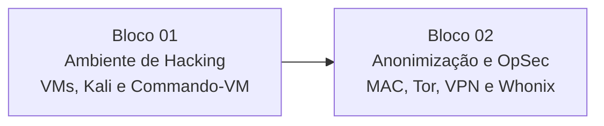

# Capítulo 2 — Preparação do Ambiente Laboratorial

Mapa de estudo do **Capítulo 2** de [[00 COD1|COD1]] (Prof. Leonel Santos), cobrindo **13 diapositivos** de `2026.27_MCIF_COD1_02_Preparação_Ambiente.pdf` organizados em **2 notas atómicas** na pasta `COD1/Capítulo 02 - Preparação do Ambiente Laboratorial/`, focadas na montagem de um laboratório de *pentesting* isolado e operacionalmente seguro (*OpSec*).

---

## 1. Ambiente de Hacking e Virtualização (`01 - Ambiente de Hacking e Virtualização`)

| Nota | Fonte | O que vais estudar |
| :--- | :---: | :--- |
| [[Ambiente de Hacking - Kali Linux, Commando VM e Virtualização]] | Slides 2–9 | Hardware/VMs/Docker, distribuições Linux (`Kali`, `Parrot`, `BackBox`, `Attify OS`, etc.), `Commando-VM`/`Pentestbox`, credenciais `kali/kali`, Hyper-V e ferramentas base. |

---

## 2. Anonimização e Segurança Operacional (`02 - Anonimização e Segurança Operacional`)

| Nota | Fonte | O que vais estudar |
| :--- | :---: | :--- |
| [[Anonimização - MAC, Proxy, VPN, kali-anonsurf e Whonix]] | Slides 10–13 | Spoofing MAC (`macchanger`), `ProxyChains`, `Tor`, VPNs, `kali-anonsurf`, e-mails descartáveis e arquitetura de 2 VMs do `Whonix`. |

---

## Ligações Transversais

- **Anterior:** [[Capítulo 1 - Introdução à Cibersegurança]]
- **Seguinte:** [[Capítulo 3 - Rastreamento e Reconhecimento]]
- **Playbook Prático:** [[Cheat Sheet - Playbook de Pentesting e Footprinting Organizacional]]
- **Índice da UC:** [[00 COD1]]
