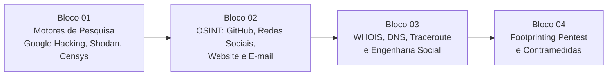

# Capítulo 3 — Rastreamento e Reconhecimento (*Footprinting*)

Mapa de estudo do **Capítulo 3** de [[00 COD1|COD1]] (Prof. Leonel Santos), cobrindo **64 diapositivos** de `2026.27_MCIF_COD1_03_Reconhecimento_Footprinting.pdf` organizados em **4 notas atómicas** na pasta `COD1/Capítulo 03 - Rastreamento e Reconhecimento/`, essenciais para executar o **footprinting organizacional** antes de qualquer interação ativa.

---

## 1. Conceitos e Motores de Pesquisa (`01 - Conceitos e Motores de Pesquisa`)

| Nota | Fonte | O que vais estudar |
| :--- | :---: | :--- |
| [[Footprinting - Conceitos, Objetivos e Motores de Pesquisa (Google Hacking)]] | Slides 3–25 | Objetivos (rede, sistemas, organização), `Netcraft`, `Shodan`, `Censys`, `Fullhunt`, `FOFA`, geolocalização, pesquisa de pessoas e operadores de *Google Hacking* (`GHDB`, `Pagodo`). |

---

## 2. OSINT em Plataformas, Redes Sociais, Websites e E-mail (`02 - OSINT, Redes Sociais, Web e Email`)

| Nota | Fonte | O que vais estudar |
| :--- | :---: | :--- |
| [[OSINT - Plataformas (GitHub, Trello), Redes Sociais, Website e E-mail]] | Slides 26–40 | `GitHub` dorks (`gitleaks`, `gitrob`, `keyhacks`), `Trello`, redes sociais, *website footprinting* (`Wappalyzer`, `HTTrack`, `wget`, `archive.org`), cabeçalhos/tracking de e-mail e OSINT competitivo. |

---

## 3. WHOIS, DNS, Rede e Engenharia Social (`03 - WHOIS, DNS, Rede e Engenharia Social`)

| Nota | Fonte | O que vais estudar |
| :--- | :---: | :--- |
| [[WHOIS, DNS, Networking Footprinting e Engenharia Social]] | Slides 41–53 | RIRs (`RIPE NCC`, `ARIN`, etc.), consultas `WHOIS`, registos DNS e `AXFR` (`dig`, `host`, `dnsrecon`, `fierce`), `traceroute`, `wigle.net`, engenharia social e suites (`Maltego`, `Amass`, `theHarvester`, `Recon-ng`). |

---

## 4. Metodologia Pentest e Contramedidas (`04 - Metodologia Pentest e Contramedidas`)

| Nota | Fonte | O que vais estudar |
| :--- | :---: | :--- |
| [[Footprinting Pentest e Contramedidas (Metodologia Prática)]] | Slides 55–64 | Contramedidas defensivas, os 11 passos práticos de um *Footprinting Pentest* e modelo completo de relatório por fonte. |

---

## Ligações Transversais

- **Anterior:** [[Capítulo 2 - Preparação do Ambiente Laboratorial]]
- **Seguinte:** [[Capítulo 4 - Scanning de Redes]]
- **Playbook Prático:** [[Cheat Sheet - Playbook de Pentesting e Footprinting Organizacional]]
- **Índice da UC:** [[00 COD1]]
