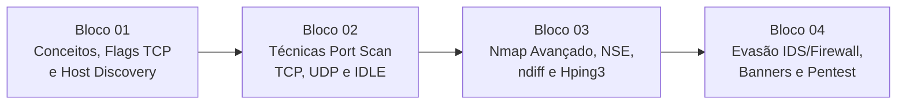

# Capítulo 4 — Scanning de Redes

Mapa de estudo do **Capítulo 4** de [[00 COD1|COD1]] (Profs. Leonel Santos e Miguel Frade), cobrindo **40 + 38 diapositivos** (`2026.27_MCIF_COD1_04_Scanning.pdf` e `nmap_avancado.pdf`) organizados em **4 notas atómicas** e **1 Cheat Sheet** na pasta `COD1/Capítulo 04 - Scanning de Redes/`.

> [!TIP] Guia de Consulta Rápida
> Para comandos prontos a executar de *Host Discovery*, *Port Scanning*, `NSE`, evasão e `ndiff`, consulta a **[[Cheat Sheet - Scanning de Redes e Nmap]]**.

---

## 1. Conceitos e Host Discovery (`01 - Conceitos e Host Discovery`)

| Nota | Fonte | O que vais estudar |
| :--- | :---: | :--- |
| [[Scanning de Redes - Conceitos, Flags TCP e Descoberta ICMP]] | Scanning 3–15; Nmap 1–16 | Pacotes RAW, IPv6 multicast, e descoberta de hosts (`ICMP -PE/-PP/-PM`, `TCP SYN -PS`, `ACK -PA`, `UDP -PU`, `ARP -PR`, `Protocol -PO`). |

---

## 2. Técnicas de Port Scanning (`02 - Técnicas de Port Scanning`)

| Nota | Fonte | O que vais estudar |
| :--- | :---: | :--- |
| [[Técnicas de Port Scanning TCP, UDP e IDLE Scan]] | Scanning 16–24; Nmap 18–28 | Os 6 estados de portos no Nmap e técnicas `-sT`, `-sS`, `-sN/-sF/-sX`, `-sA`, `-sW`, `-sM`, `-sU`, `-sO` e `IDLE Scan (-sI)`. |

---

## 3. Nmap Avançado e Hping3 (`03 - Nmap Avançado e Hping3`)

| Nota | Fonte | O que vais estudar |
| :--- | :---: | :--- |
| [[Nmap Avançado e Hping3 - Descoberta, Port Scanning e Evasão]] | Scanning 26–29; Nmap 17, 29–36 | Temporização (`-T0`–`-T5`), scripts NSE, outputs (`-oA`/`-oG`/`-oX`), comparação `ndiff`, interseção `-sS`/`-sF`/`-sA` e `Hping3`/`Masscan`/`Unicornscan`. |

---

## 4. Evasão, Banners e Metodologia Pentest (`04 - Evasão, Banners e Metodologia Pentest`)

| Nota | Fonte | O que vais estudar |
| :--- | :---: | :--- |
| [[Evasão a IDS-Firewall, Banner Grabbing e Metodologia Pentest]] | Scanning 25, 31–40 | Fragmentação (`-f`), decoys (`-D`), spoofing (`-S`/`-g`), *banner grabbing* ativo/passivo, contramedidas e passos do *Scanning Pentest*. |

---

## Ligações Transversais

- **Anterior:** [[Capítulo 3 - Rastreamento e Reconhecimento]]
- **Seguinte:** [[Capítulo 5 - Enumeração]]
- **Cheat Sheet:** [[Cheat Sheet - Scanning de Redes e Nmap]]
- **Playbook Prático:** [[Cheat Sheet - Playbook de Pentesting e Footprinting Organizacional]]
- **Índice da UC:** [[00 COD1]]
