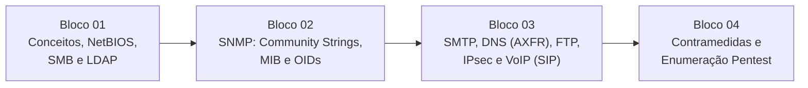

# Capítulo 5 — Enumeração

Mapa de estudo do **Capítulo 5** de [[00 COD1|COD1]] (Prof. Leonel Santos), cobrindo **54 diapositivos** de `2026.27_MCIF_COD1_05_Enumeracao.pdf` organizados em **4 notas atómicas** e **1 Cheat Sheet** na pasta `COD1/Capítulo 05 - Enumeração/`.

> [!TIP] Guia de Consulta Rápida
> Para comandos de enumeração organizados por porto e serviço (`21`, `25`, `53`, `137/139/445`, `161`, `389`, `500`, `5060`), consulta a **[[Cheat Sheet - Enumeração de Serviços e Portos]]**.

---

## 1. Conceitos, NetBIOS, SMB e LDAP (`01 - Conceitos, NetBIOS, SMB e LDAP`)

| Nota | Fonte | O que vais estudar |
| :--- | :---: | :--- |
| [[Conceitos de Enumeração e Enumeração NetBIOS, SMB e LDAP]] | Slides 3–14, 26–29 | Portos críticos, nomes NetBIOS (16 bytes), `nbtstat`/`nbtscan`/`PsTools`, `enum4linux-ng`, `ldapsearch`, `rpcclient` e `NetExec` (`nxc`). |

---

## 2. Enumeração SNMP (`02 - Enumeração SNMP`)

| Nota | Fonte | O que vais estudar |
| :--- | :---: | :--- |
| [[Enumeração SNMP (Community Strings, MIB e OIDs)]] | Slides 16–24 | Gestor/agente, *community strings* (`public`/`private`), `MIB`, `OIDs` críticos e ferramentas (`onesixtyone`, `snmp-check`, `snmpwalk`). |

---

## 3. Enumeração SMTP, DNS, FTP, IPsec e VoIP (`03 - Enumeração SMTP, DNS, FTP, IPsec e VoIP`)

| Nota | Fonte | O que vais estudar |
| :--- | :---: | :--- |
| [[Enumeração SMTP, DNS, FTP, IPsec e VoIP (SIP)]] | Slides 31–46 | `SMTP` (`VRFY`/`EXPN`/`RCPT TO`), `DNS AXFR` (`host`/`dig`/`dnsrecon`), `FTP`, `IPsec` (`500/UDP`, `ike-scan`), `VoIP/SIP` (`svmap`) e `AutoRecon`. |

---

## 4. Contramedidas e Metodologia Pentest (`04 - Contramedidas e Metodologia Pentest`)

| Nota | Fonte | O que vais estudar |
| :--- | :---: | :--- |
| [[Contramedidas de Enumeração e Metodologia Pentest]] | Slides 48–55 | Hardening por protocolo (`SNMPv3`, Split-DNS, `SMTP`, `LDAPS`, `RestrictNullSessAccess`) e os 10 passos práticos da *Enumeração Pentest*. |

---

## Ligações Transversais

- **Anterior:** [[Capítulo 4 - Scanning de Redes]]
- **Seguinte:** [[Capítulo 6 - Análise de Vulnerabilidades]]
- **Cheat Sheet:** [[Cheat Sheet - Enumeração de Serviços e Portos]]
- **Playbook Prático:** [[Cheat Sheet - Playbook de Pentesting e Footprinting Organizacional]]
- **Índice da UC:** [[00 COD1]]
