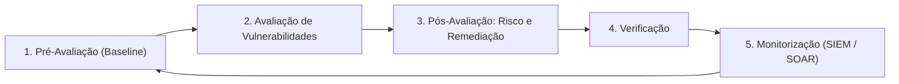

# Análise e Gestão de Vulnerabilidades - Ciclo de Vida e Classificação

A análise e gestão de vulnerabilidades organiza a deteção, classificação e remediação de falhas num ciclo contínuo — da criação da *baseline* (pré-avaliação) à monitorização contínua em `SIEM`/`SOAR`.

> [!TIP] Lógica de Funcionamento e Valor Operacional
> * **Porque existe (Sistema)**: Infraestruturas evoluem constantemente com novos patches, configurações e serviços expostos.
> * **Porque importa (Pentesting / Segurança)**: Sem inventário de ativos críticos e processo de pós-avaliação, um scanner gera apenas alertas ignorados sem redução real do risco.
> * **Pontos Críticos e Armadilhas para Exame**:
>   * Avaliação **ativa** (envia sondas, pode impactar rede) vs. **passiva** (*sniffing* sem interferência).
>   * O ciclo inclui **Pré-avaliação (*baseline*) $\rightarrow$ Avaliação $\rightarrow$ Pós-avaliação (Risco, Remediação, Verificação, Monitorização `SIEM`/`SOAR`)**.

## 1. Conceitos e Classificação de Vulnerabilidades

- **Análise de vulnerabilidades:** Processo de pesquisa de vulnerabilidades e falhas de desenvolvimento/implementação que permitem a exploração de falhas em sistemas operativos e aplicações. Classifica-se tipicamente por **severidade** (*baixo, médio, alto, crítico*) e **alcance** (*local* ou *remoto*).
- **Avaliação de vulnerabilidades (*Vulnerability Assessment*):** Verificação da capacidade de um sistema, aplicação e respetivos controlos resistirem a um ataque, reconhecendo, medindo e classificando falhas exploráveis e prevendo a eficácia de medidas adicionais.
- **Importância para Sysadmins:** (1) acompanhar tendências de ameaças/ataques, (2) descobrir falhas e vetores antes da exploração, (3) obter informação preventiva e (4) preparar recuperação pós-incidente.

### As 9 Categorias Principais de Vulnerabilidades
1. **Má configuração e parametrização.**
2. **Instalações com parâmetros por omissão.**
3. **Buffer overflow.**
4. **Servidores *unpatched* (sem atualizações).**
5. **Falhas de design e desenvolvimento.**
6. **Falhas de Sistema Operativo (SO).**
7. **Falhas das aplicações.**
8. **Serviços abertos desnecessários.**
9. **Passwords por omissão.**

## 2. Tipos de Análise de Vulnerabilidades

| Dimensão | Modalidades |
| :--- | :--- |
| **Interação** | **Ativa** (usa scanner de rede para sondar hosts/serviços) vs. **Passiva** (usa sniffing de tráfego sem injetar sondas). |
| **Perspetiva** | **Externa** (ponto de vista de atacante no perímetro) vs. **Interna** (varrimento à infraestrutura interna). |
| **Camada / Alvo** | **Host** (configurações de um servidor específico) vs. **Rede** (serviços e segurança da rede) vs. **Aplicacional** (web, cliente-servidor) vs. **Redes sem fios** (Wi-Fi). |

## 3. Ciclo de Vida da Gestão de Vulnerabilidades

### Fase 1: Pré-Avaliação — Criação da Baseline (8 Passos)
1. Identificar e compreender os processos de negócio.
2. Identificar aplicações, dados e serviços que suportam esses processos.
3. Criar inventário de todos os ativos e **priorizar os ativos críticos**.
4. Mapear a infraestrutura de rede.
5. Identificar controlos já instalados.
6. Perceber políticas implementadas e conformidade com standards.
7. Definir o âmbito da avaliação.
8. Criar procedimentos de proteção da informação recolhida.

### Fase 2: Avaliação de Vulnerabilidades (6 Passos)
1. Verificar e avaliar a segurança física.
2. Pesquisar por más configurações e erros humanos.
3. Executar análise de vulnerabilidades com ferramentas especializadas.
4. Identificar e priorizar as vulnerabilidades encontradas.
5. Obter informação através de **OSINT** para validar/contextualizar vulnerabilidades.
6. Criar o relatório de análise de vulnerabilidades.

### Fase 3: Pós-Avaliação (Risco, Remediação, Verificação e Monitorização)
- **Avaliação do risco:** Determinar o nível de impacto real das vulnerabilidades no negócio.
- **Remediação:** Priorizar recomendações, definir plano de ação, aplicar *patches*/*fixes*, registar lições aprendidas e reforçar formação.
- **Verificação:** Executar análises dinâmicas e rever superfícies de ataque para confirmar que as correções foram eficazes.
- **Monitorização:** Correlacionar logs de IDS/IPS através de **`SIEM`** e/ou **`SOAR`** e reforçar políticas, procedimentos e controlos.

## Além da aula

> [!NOTE] Conteúdo Complementar (Além da aula)
> Distinção essencial para o relatório ao cliente:

- **Vulnerability Assessment vs. Penetration Testing:** A análise de vulnerabilidades identifica e classifica potenciais falhas (muitas vezes com falsos positivos que exigem triagem); o **Pentest** vai mais longe ao validar manualmente se a falha é realmente explorável e qual o impacto encadeado (*chaining*) no negócio. Num pentest completo, o scanner de vulnerabilidades é um **acelerador**, nunca o fim da auditoria.

## Perguntas de revisão

1. **Qual a diferença entre uma análise de vulnerabilidades *ativa* e uma *passiva*?**
   > [!success]- Ver Resposta
   > A análise **ativa** envia pacotes sonda através de um scanner de rede para interrogar hosts e serviços (podendo consumir largura de banda ou impactar sistemas sensíveis), enquanto a **passiva** analisa o tráfego de rede por *sniffing* numa máquina dedicada sem interferir com os sistemas.

2. **Porque é que a criação de inventário e priorização de ativos críticos acontece na fase de *Pré-Avaliação*?**
   > [!success]- Ver Resposta
   > Porque sem saber quais os ativos que suportam processos críticos de negócio e qual o âmbito exato, não é possível priorizar corretamente o risco nem interpretar o impacto real dos resultados obtidos pelo scanner.

## Notas relacionadas
- [[Sistemas de Pontuação (CVSS e CVE) e Abordagens de Avaliação]]
- [[Ferramentas de Análise - Nessus e OpenVAS (Instalação e Setup)]]
- [[Controlos de Segurança, Standards e Legislação (NIS 2, ISO 27001, NIST CSF)]]
