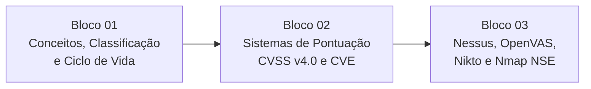

# Capítulo 6 — Análise de Vulnerabilidades

Mapa de estudo do **Capítulo 6** de [[00 COD1|COD1]] (Prof. Leonel Santos), cobrindo **36 diapositivos** de `2026.27_MCIF_COD1_06_Analise_Vulnerabilidades.pdf` e os **2 guias práticos** de instalação (`Nessus` e `OpenVAS`), organizados em **3 notas atómicas** na pasta `COD1/Capítulo 06 - Análise de Vulnerabilidades/`.

---

## 1. Conceitos e Ciclo de Vida (`01 - Conceitos e Ciclo de Vida`)

| Nota | Fonte | O que vais estudar |
| :--- | :---: | :--- |
| [[Análise e Gestão de Vulnerabilidades - Ciclo de Vida e Classificação]] | Slides 3–18 | As 9 categorias de falhas, tipos de análise (ativa/passiva, externa/interna, host/rede/app/wireless) e ciclo de vida (baseline, avaliação, remediação, `SIEM`/`SOAR`). |

---

## 2. Sistemas de Pontuação e Abordagens (`02 - Sistemas de Pontuação e Abordagens`)

| Nota | Fonte | O que vais estudar |
| :--- | :---: | :--- |
| [[Sistemas de Pontuação (CVSS e CVE) e Abordagens de Avaliação]] | Slides 20–29 | Abordagens `product-based` vs. `service-based`, árvore vs. dedução, `CVSS v4.0` e bases `CVE` (`MITRE`, `EUVD-ENISA`, `NVD`, `MSRC`). |

---

## 3. Ferramentas Nessus, OpenVAS e Relatórios (`03 - Ferramentas Nessus, OpenVAS e Relatórios`)

| Nota | Fonte | O que vais estudar |
| :--- | :---: | :--- |
| [[Ferramentas de Análise - Nessus e OpenVAS (Instalação e Setup)]] | Slides 31–36; guias `.txt` | `Nessus` (`8834`), `OpenVAS`/`GVM` (`9392`, troubleshooting PostgreSQL 14$\rightarrow$15 e feeds SCAP), `Nikto`, scripts `Nmap NSE` (`vulners`/`vulscan`) e relatórios. |

---

## Ligações Transversais

- **Anterior:** [[Capítulo 5 - Enumeração]]
- **Playbook Prático:** [[Cheat Sheet - Playbook de Pentesting e Footprinting Organizacional]]
- **Índice da UC:** [[00 COD1]]
