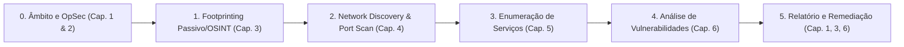

# Cheat Sheet - Playbook de Pentesting e Footprinting Organizacional

**Voltar a:** [[00 COD1]]

> [!ABSTRACT] Objetivo do Playbook
> Guia operacional ponta-a-ponta para conduzir um **Footprinting** e **Pentest de Rede/Infraestrutura** a uma organização, integrando os 6 capítulos da UC numa sequência executável em laboratório e em auditorias reais.



---

## Fase 0 — Autorização, Âmbito e Preparação do Ambiente (Cap. 1 & 2)

- **Formalização legal:** Garantir *Pentest Request*, âmbito exato (domínios, blocos IP/CIDR, exclusões, janela horária), *NDA* e *Rules of Engagement*. Ver [[Testes de Penetração - Metodologia, Pentest Request e Relatórios]].
- **Laboratório limpo:** Criar *snapshot* inicial na VM (`Kali Linux` / `Commando-VM`), estruturar pasta de evidências (`recon/`, `scans/`, `enum/`, `vulns/`, `report/`). Ver [[Ambiente de Hacking - Kali Linux, Commando VM e Virtualização]].
- **OpSec (quando aplicável):** Configurar `macchanger`, VPN dedicada, `ProxyChains`/`Tor` ou `Whonix` se o teste exigir anonimização de origem. Ver [[Anonimização - MAC, Proxy, VPN, kali-anonsurf e Whonix]].

---

## Fase 1 — Footprinting e OSINT Organizacional (Cap. 3)

Objetivo: Construir o **inventário externo** (domínios, subdomínios, blocos IP, e-mails, tecnologias, fugas de segredos) sem interagir de forma intrusiva.

1. **WHOIS & Blocos de Rede:**
   ```bash
   whois <dominio.pt>
   whois <IP_principal>   # Confirmar RIR (RIPE/ARIN) e IP range
   ```
2. **DNS & Transferência de Zona:**
   ```bash
   dig <dominio> ANY +noall +answer
   dig <dominio> MX TXT NS
   dig @<ns_autoritativo> <dominio> AXFR
   dnsrecon -d <dominio>
   ```
3. **Subdomínios, OSINT & Fugas:**
   - Ferramentas: `theHarvester`, `AMASS`, `Sublist3r`, `Spiderfoot`, `Maltego`, `Recon-ng`.
   - Motores: `Shodan`, `Censys`, `Netcraft`, `archive.org`.
   - **Google Dorks:** `site:<dominio> filetype:pdf`, `site:<dominio> intitle:index.of`, `inurl:admin`.
   - **GitHub / Código:** procurar segredos com `gitleaks`, `gitrob` ou dorks (`filename:.ftpconfig`, `filename:id_rsa`).
4. **Website & E-mail:**
   - Identificar stack com `Wappalyzer` / `BuiltWith` e cabeçalhos (`Server`, `X-Powered-By`).
   - Copiar estrutura se necessário (`wget -mk -w 10 <url>` / `HTTrack`) e extrair metadados (`FOCA` / `metagoofil`).

**Checklist de saída da Fase 1:** Lista validada de domínios/subdomínios, blocos CIDR, IPs externos, nomes de utilizadores/e-mails e tecnologias web. Ver [[Footprinting Pentest e Contramedidas (Metodologia Prática)]].

---

## Fase 2 — Descoberta de Rede, Port Scanning e Banners (Cap. 4)

Objetivo: Confirmar **hosts ativos**, **portos TCP/UDP abertos**, **regras de firewall** e **versões exatas de SO/serviços**.

```bash
# 1. Host Discovery (adaptar se ICMP estiver bloqueado)
sudo nmap -sn -PE -PP -PS21,22,25,80,443,3389 -PA80,443 -n -T4 -oG 01_hosts.gnmap <CIDR_ou_IPs>
awk '/Up$/{print $2}' 01_hosts.gnmap > live_hosts.txt

# 2. Port Scan TCP completo e rápido
sudo nmap -sS -Pn -n -p- -T4 -iL live_hosts.txt -oA 02_tcp_full

# 3. Port Scan UDP focado (DNS, SNMP, NTP, TFTP, IPsec)
sudo nmap -sU -Pn -n -p 53,69,123,161,162,500 -iL live_hosts.txt -oA 03_udp_top

# 4. Deteção de versões, SO, banners e scripts padrão nos portos abertos
sudo nmap -sS -sV -O -sC -Pn -n -p <portos_descobertos> -iL live_hosts.txt -oA 04_detalhado

# 5. Se houver portos filtered -> cruzar -sF e -sA para mapear firewall
sudo nmap -sF -T4 <IP> -oX sF.xml && sudo nmap -sA -T4 <IP> -oX sA.xml && ndiff sF.xml sA.xml
```

Ver [[Cheat Sheet - Scanning de Redes e Nmap]].

---

## Fase 3 — Enumeração Direcionada por Serviço (Cap. 5)

Objetivo: Extrair **contas válidas, partilhas, políticas e configurações** a partir dos portos descobertos na Fase 2.

| Porto Aberto | Comandos Imediatos |
| :--- | :--- |
| **`21/TCP` (FTP)** | `sudo nmap -p 21 --script "*ftp* and safe" <IP>` \| testar `anonymous` |
| **`25/TCP` (SMTP)** | `smtp-user-enum -M VRFY -D <dominio> -u users.txt -t <IP>` |
| **`53` (DNS)** | `dig @<IP> <dominio> axfr` \| `dnsrecon -d <dominio> -t axfr` |
| **`137/139/445` (SMB/NB)** | `nbtscan -r <rede>` \| `enum4linux-ng -A <IP>` \| `nxc smb <IP> -u '' -p '' --shares --users` \| `rpcclient -U "" -N <IP>` |
| **`161/UDP` (SNMP)** | `onesixtyone <IP> public` \| `snmp-check -c public -v 1 <IP>` \| `snmpwalk -c public -v1 <IP>` |
| **`389/3268` (LDAP)** | `ldapsearch -x -H ldap://<IP> -b "" -s base namingContexts` |
| **`500/UDP` (IPsec)** | `sudo ike-scan -M <IP>` |
| **`5060/5061` (VoIP)** | `svmap <IP>` |

*Atalho automatizado:* `autorecon <IP>` para orquestrar scanning + enumeração por serviço. Ver [[Cheat Sheet - Enumeração de Serviços e Portos]].

---

## Fase 4 — Análise de Vulnerabilidades (Cap. 6)

Objetivo: Mapear versões e configurações a **CVEs**, pontuar severidade (**CVSS**) e validar achados antes de qualquer exploração.

1. **Scanner de Rede (`Nessus` `8834` ou `OpenVAS/GVM` `9392`):** Correr scan completo (e **autenticado** se o âmbito incluir credenciais internas).
2. **Nmap NSE de Vulnerabilidades:**
   ```bash
   nmap -sV --script vulners <IP>
   nmap -sV --script "vuln and safe" <IP>
   ```
3. **Web Scanner CLI:** `nikto -h https://<IP> -ssl`
4. **Triagem e Priorização:** Cruzar com `cve.org`, `nvd.nist.gov`, `euvd.enisa.europa.eu` e `CVSS v4.0`, eliminando falsos positivos.

---

## Fase 5 — Relatório e Contramedidas (Cap. 1, 3, 4, 5, 6)

- **Estrutura dupla:** Sumário Executivo (risco de negócio, conformidade [[Controlos de Segurança, Standards e Legislação (NIS 2, ISO 27001, NIST CSF)|NIS 2 / ISO 27001 / NIST CSF]]) + Relatório Técnico (evidências reproduzíveis, CVSS, passos de reprodução e plano de remediação priorizado).
- **Pós-remediação:** Re-testar (*Verificação*) e integrar alertas em `SIEM`/`SOAR`.

---

## Além da aula

> [!NOTE] Conteúdo Complementar (Além da aula)
> Mecanismos adicionais que elevam um pentest organizacional de nível académico para nível profissional:

1. **Higiene de Escopo (*Scope Guardrails*):** Manter um ficheiro `scope.txt` e `exclude.txt` (`nmap --excludefile exclude.txt`) para garantir que IPs de terceiros (CDNs como Cloudflare/Akamai ou fornecedores partilhados descobertos no DNS) nunca são varridos fora de autorização.
2. **Ordem de Execução Segura (*Low-Noise First*):** Seguir sempre Passivo (`Cap. 3`) -> Descoberta mínima (`Cap. 4`) -> Enumeração segura (`Cap. 5`) -> Vulnerability Scan não destrutivo (`Cap. 6`). Nunca lançar scripts `intrusive` ou `brute` sem confirmar impacto e janelas de manutenção.
3. **Registo de Evidências com Timestamp (`script` / `asciinema`):** Gravar sessões de terminal e guardar sempre todos os outputs (`-oA`) com data/hora, facilitando a rastreabilidade caso o cliente questione um alerta no IDS/SIEM durante a auditoria.
4. **Matriz de Priorização Negócio x CVSS:** Combinar a pontuação técnica (`CVSS`) com a criticidade do ativo (*Crown Jewels*: AD Domain Controllers, bases de dados de clientes, gateways VPN) e a facilidade de exploração para entregar um plano de ação de 30/60/90 dias ao cliente.
