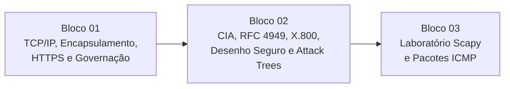

# Capítulo 1 — Fundamentos de Redes e Segurança

Mapa de estudo do **Capítulo 1** de [[00 SRC|SRC]], cobrindo os **26 diapositivos** de `1_fundamentals.pdf`, o **Capítulo 1 de Stallings** (*Computer and Network Security Concepts*, 27 páginas) e os scripts laboratoriais `1scapy.py` e `pinging.py`, organizados em **6 notas atómicas** na pasta `SRC/Capítulo 01 - Fundamentos de Redes e Segurança/`.

---

## 1. Arquitetura TCP/IP e Governação da Internet (`01 - Arquitetura TCP-IP e Governação da Internet`)

| Nota                                                                    |           Fonte            | O que vais estudar                                                                                                                                                                        |
| :---------------------------------------------------------------------- | :------------------------: | :---------------------------------------------------------------------------------------------------------------------------------------------------------------------------------------- |
| [[Modelo TCP-IP, Encapsulamento e Visibilidade de Tráfego HTTPS]]       |     Slides 2–6, 12–13      | Funcionamento da Internet (`ead.ulo.pt`), camadas TCP/IP, encapsulamento até *frame*, metadados visíveis vs. protegidos em HTTPS e revisão de redes (IPv4/IPv6, TCP/UDP, NAT/PAT, VLANs). |
| [[Governação da Internet - IXPs, Infraestrutura Submarina, DNS e RFCs]] | Slides 7–11; Stallings 1.9 | *Internet Exchange Points* (`GigaPIX`), cabos submarinos, gestão de nomes/endereços (DNS, AS, *Internet Registries*) e normalização aberta via `RFCs`, ISO, NIST, IETF e ITU.             |

---

## 2. Conceitos, Serviços e Mecanismos de Segurança (`02 - Conceitos, Serviços e Mecanismos de Segurança`)

| Nota | Fonte | O que vais estudar |
| :--- | :---: | :--- |
| [[Conceitos Fundamentais de Segurança (CIA, Ameaça, Vulnerabilidade e Ataque)]] | Slides 14–20; Stallings 1.1–1.3 | Definição NIST, tríade CIA + Autenticidade/Responsabilização, distinção Vulnerabilidade/Ameaça/Ataque (cenário da câmara de rede) e ataques passivos vs. ativos (`RFC 4949`). |
| [[Serviços e Mecanismos de Segurança (ITU-T X.800)]] | Slides 22–24; Stallings 1.4–1.5 | Os 5 serviços de segurança `X.800` (Confidencialidade, Integridade, Controlo de Acesso, Autenticação, Não-Repúdio + Disponibilidade) e mecanismos específicos vs. pervasivos. |
| [[Princípios Fundamentais de Desenho Seguro, Attack Surfaces e Attack Trees]] | Slides 25–26; Stallings 1.6–1.7 | Os 13 princípios de desenho seguro (*Saltzer & Schroeder* + NCAE), redução de *attack surfaces* (rede, software, humana) e modelação com *attack trees* (`AND`/`OR`). |

---

## 3. Laboratório Scapy e ICMP (`03 - Laboratório Scapy e ICMP`)

| Nota | Fonte | O que vais estudar |
| :--- | :---: | :--- |
| [[Laboratório Scapy - Envio e Resposta de Pacotes ICMP]] | `1scapy.py`; `pinging.py` | Construção, envio e *sniffing*/resposta automática de pacotes ICMP com `scapy` em Python (empilhamento `IP()/ICMP()/payload`). |

---

## Navegação

- [[00 SRC|Voltar ao MOC Geral de SRC]]
- [[Capítulo 2 - Criptografia Aplicada|Avançar para o Capítulo 2 de SRC]]
