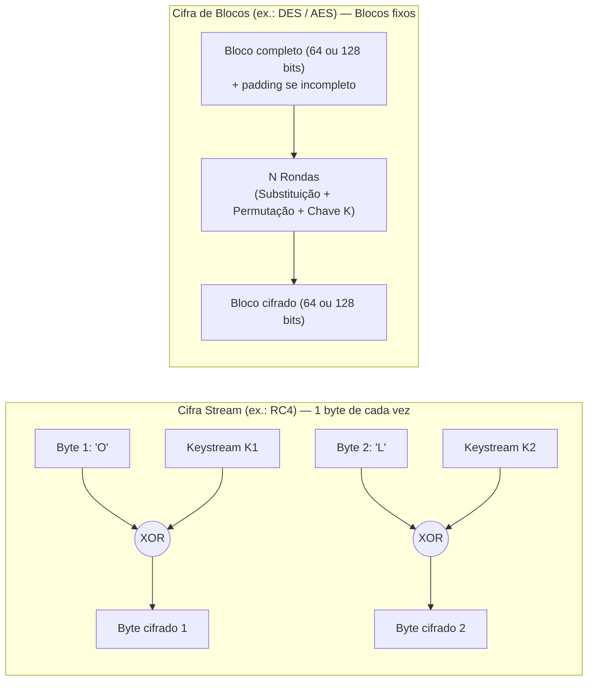
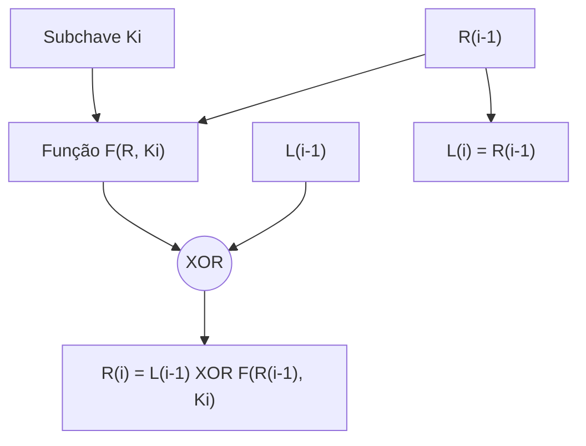

# Cifras de Blocos vs. *Stream* — Feistel, DES, 3DES, AES e RC4

As cifras simétricas modernas classificam-se em **cifras de *stream*** (processam um bit, byte ou palavra de cada vez) e **cifras de blocos** (processam blocos de tamanho fixo de cada vez, aplicando **difusão** e **confusão** de Shannon).

> [!TIP] Lógica de Funcionamento e Valor de Segurança
> * **Porque existe (Engenharia)**: Cifras de blocos combinam múltiplas rondas de substituição e permutação (estrutura de **Feistel**) para que cada bit do texto cifrado dependa de forma complexa de muitos bits da chave e do texto claro (*avalanche effect*).
> * **Porque importa (Segurança)**: O `DES` (`56` bits de chave efetiva) tornou-se vulnerável a busca exaustiva ($2^{56} \approx 7.2 \times 10^{16}$ chaves), motivando a transição para `Triple DES` e posteriormente `AES` (chaves até `256` bits).
> * **Pontos Críticos e Armadilhas para Exame**:
>   * **`RC4`** é uma cifra de ***stream*** (não é uma cifra de blocos — questão clássica do `TBL #2`).
>   * **Difusão** (dissipa a estrutura estatística do *plaintext* por vários dígitos do *ciphertext*) vs. **Confusão** (torna o mais complexa possível a relação entre chave e *ciphertext*).

---

## 1. *Stream* vs. Blocos

| Tipo | Unidade Processada | Exemplos Referidos na UC |
| :--- | :--- | :--- |
| **Cifra *Stream*** | 1 bit ou 1 byte/palavra de cada vez | César, Vigenère, Vernam, **`RC4`** |
| **Cifra de Blocos** | Bloco de tamanho fixo (ex.: `64` ou `128` bits) | **`Feistel`**, **`DES`**, **`3DES`**, **`AES`**, **`RC5`** |

---

## 2. Estrutura de Feistel e Parâmetros de Desenho

Proposta como aplicação prática dos princípios de **difusão** e **confusão** de Claude Shannon:
1. Divide o bloco de entrada em duas metades ($L_0, R_0$).
2. Executa $n$ rondas (*rounds*), combinando em cada ronda uma função de substituição $F(R_{i-1}, K_i)$ com `XOR` sobre a outra metade e trocando as metades (permutação).
3. A decifragem usa exatamente a mesma estrutura com as subchaves $K_i$ aplicadas por ordem inversa.

**7 parâmetros fundamentais de uma cifra de Feistel (Slide 15 / Stallings 4.1):**
1. Tamanho do bloco;
2. Número de *rounds*;
3. Tamanho da chave e das subchaves $K_i$;
4. Algoritmo de geração das subchaves;
5. Função de substituição $F$;
6. Rapidez de cifragem/decifragem;
7. Facilidade de análise do resultado.

### Explicação Intuitiva por Fases (Analogia das 4 Cartas `C · A · F · E`)

Para visualizar o diagrama acima sem matemática, imagina que o bloco é formado por **4 cartas na mesa (`C · A · F · E`)**:

> [!example]- Fase 1 — Confusão (Substituição): trocar cada carta segundo a chave
> Trocas cada letra por outra usando uma regra secreta ligada à chave (ex.: `C` $\rightarrow$ `X`, `A` $\rightarrow$ `Q`, `F` $\rightarrow$ `M`, `E` $\rightarrow$ `Z`, ficando `X · Q · M · Z`).
> **Objetivo:** quem olha para a saída não consegue adivinhar a chave usada.

> [!example]- Fase 2 — Difusão (Permutação): baralhar os lugares
> Mudas as posições das cartas (ex.: a 3.ª vai para 1.ª, a 1.ª vai para 2.ª $\rightarrow$ `M · X · Z · Q`).
> **Objetivo:** se mudares uma única carta antes de começar, essa mudança espalha-se pelo bloco inteiro (*avalanche effect*). Fazer as Fases 1 e 2 **10 a 16 vezes seguidas** são as **rondas** (*rounds*) de uma cifra de blocos.

> [!example]- Fase 3 — Truque de Feistel (`CA | FE`): porque partir o bloco ao meio?
> 1. Partes o bloco em duas metades: **Esquerda (`CA`)** e **Direita (`FE`)**.
> 2. Guardas a **Direita (`FE`) intacta** (passa para a nova Esquerda) e usas-na + a chave para baralhar a **Esquerda (`CA`)** (que vira a nova Direita, ex.: `XZ`).
> 3. **Porque funciona:** como metade do bloco não foi destruída em cada ronda, na hora de **decifrar** basta passar pela **mesma máquina ao contrário** com as subchaves invertidas!

> [!TIP] Simulador Interativo Offline
> Para testar visualmente no navegador a diferença entre *Stream* vs. *Blocos*, Confusão vs. Difusão e o truque de Feistel passo a passo, abre [cripto_intuicao.html](file:///home/ian/MCIF-Vault/_assets/cripto_intuicao.html).

---

## 3. `DES`, `3DES` e `AES`

| Algoritmo | Bloco | Chave | Estrutura / Notas |
| :--- | :---: | :---: | :--- |
| **DES** (*Data Encryption Standard*) | `64` bits | `56` bits efetivos (`64` com paridade) | 3 fases: permutação inicial ($IP$), **16 *rounds*** (substituição/permutação com *S-boxes* e subchaves $K_i$ por ronda), $IP^{-1}$. Apresenta forte *avalanche effect*. **Constrangimentos**: $2^{56}$ chaves é quebrável por força bruta; desenho das *S-boxes* era opaco. |
| **Triple DES (`3DES`)** | `64` bits | Múltiplas chaves DES | Atualização do DES com cifragem e chaves múltiplas para aumentar o espaço efetivo de chaves. |
| **AES** (*Advanced Encryption Standard*) | `128` bits | `128` / `192` / **`256` bits** | Substituto moderno do DES (nos slides destacado com chave de `256` bits). |

---

## Perguntas de revisão

1. **Qual a diferença entre os conceitos de *difusão* e *confusão* de Shannon numa cifra de blocos?**

> [!success]- Ver Resposta
> A **difusão** dissipa a estrutura estatística do *plaintext* por longo alcance no *ciphertext* (cada dígito do *plaintext* afeta muitos dígitos do *ciphertext*); a **confusão** torna o mais complexa possível a relação entre as estatísticas do *ciphertext* e o valor da chave de cifragem.

2. **Porque deixou o `DES` de ser considerado seguro apesar de usar 16 rondas e apresentar um forte *avalanche effect*?**

> [!success]- Ver Resposta
> Porque o tamanho efetivo da chave de `56` bits ($2^{56} \approx 7.2 \times 10^{16}$ chaves) tornou-se vulnerável a ataques de pesquisa exaustiva (*brute force*) com poder computacional moderno.

---

## Navegação e Notas Relacionadas

| Percurso | Nota | Contexto |
| :--- | :--- | :--- |
| **Anterior** | [[Criptografia Simétrica - Modelo Convencional, Criptanálise e Cifras Clássicas]] | `mesmo bloco` |
| **Seguinte** | [[Criptografia Assimétrica - Princípios, Diffie-Hellman, ECC e Algoritmo RSA]] | `muda para Bloco 02` |
| **Índice** | [[Capítulo 2 - Criptografia Aplicada]] · [[00 SRC]] | `Bloco 01` |

### Conceitos Relacionados

* [[TBL 2 - Fundamentos de Criptografia]] · `Bloco 05`
