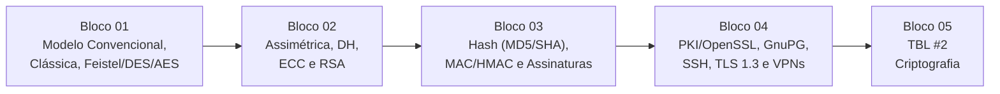

# Capítulo 2 — Criptografia Aplicada

Mapa de estudo do **Capítulo 2** de [[00 SRC|SRC]], cobrindo os **68 diapositivos** de `aula_02_update.pdf` (Prof. Mário Antunes), os **9 diapositivos** de `2_crypto_projectKickoff.pdf`, os excertos de Stallings (`aula02_leituras_resumo.pdf`) e o `TBL #2` (`TBL_Cryptography_EN_202627.pdf`), organizados em **9 notas atómicas** e **1 Cheat Sheet de revisão rápida** na pasta `SRC/Capítulo 02 - Criptografia Aplicada/`.

> [!TIP] Guia de Consulta Rápida para Exame
> Para notação criptográfica (`E(PRa, X)`, `E(PUb, X)`), propriedades de *hash*/`MAC`, comandos `OpenSSL` CA, `GnuPG`, `SSH -L`/`-R` e `OpenVPN`, consulta a **[[Cheat Sheet - Criptografia, Hash, PKI e VPNs]]**.

---

## 1. Criptografia Clássica e Cifras Simétricas (`01 - Criptografia Clássica e Cifras Simétricas`)

| Nota | Fonte | O que vais estudar |
| :--- | :---: | :--- |
| [[Criptografia Simétrica - Modelo Convencional, Criptanálise e Cifras Clássicas]] | Slides 3–13; Stallings Cap. 3 | Criptografia vs. criptanálise, modelo convencional e requisitos, cifras de substituição (César, monoalfabéticas, `26!`), transposição (*rail fence*, colunas) e máquinas de rotores (*Enigma*). |
| [[Cifras de Blocos vs. Stream - Feistel, DES, 3DES, AES e RC4]] | Slides 7, 14–19; Stallings Cap. 4 | Classificação *stream* (`RC4`, Vernam) vs. *block*, difusão e confusão (Shannon), estrutura de `Feistel`, `DES` (`64` bits bloco / `56` bits chave, `16` rounds, *avalanche effect*), `3DES` e `AES`. |

---

## 2. Criptografia Assimétrica e RSA (`02 - Criptografia Assimétrica e RSA`)

| Nota | Fonte | O que vais estudar |
| :--- | :---: | :--- |
| [[Criptografia Assimétrica - Princípios, Diffie-Hellman, ECC e Algoritmo RSA]] | Slides 20–33; Stallings Cap. 9–10 | Motivação (`n(n-1)/2` vs. `n` pares), troca de chaves `Diffie-Hellman`, curvas elípticas (`ECDHE`, `ed25519`), notação de confidencialidade/autenticação e matemática do `RSA`. |

---

## 3. Integridade, Hash, MAC e Assinaturas (`03 - Integridade, Hash, MAC e Assinaturas`)

| Nota | Fonte | O que vais estudar |
| :--- | :---: | :--- |
| [[Funções de Hash Criptográficas (MD5, SHA-1, SHA-2, SHA-3 e RIPEMD)]] | Slides 34–35, 40–45; Stallings Cap. 11 | Propriedades de funções de *hash*, `MD5` (`128` bits, `md5sum`), família `SHA` (`SHA-1` `160` bits, `SHA-2`, `SHA-3`, `sha256sum`) e `RIPEMD`. |
| [[Autenticação de Mensagens (MAC, HMAC) e Assinaturas Digitais]] | Slides 36–39, 46–49; Stallings Cap. 11–12 | Esquemas com/sem confidencialidade ($E(K, M \parallel H(M))$, $M + H(M \parallel S)$), assinatura digital ($H(M)$ cifrado com $PR_A$), `MAC` (`C(K, M)`) e `HMAC` (`RFC 2104`). |

---

## 4. PKI, Aplicações Criptográficas e VPNs (`04 - PKI, Aplicações Criptográficas e VPNs`)

| Nota | Fonte | O que vais estudar |
| :--- | :---: | :--- |
| [[PKI, Autoridades de Certificação (OpenSSL) e GnuPG]] | Slides 50–57 | Gestão de chaves públicas, certificados `X.509` e `CA`, configuração de CA privada e revogação com `openssl`, e `GnuPG` (`OpenPGP`, `RFC 4880`, `--gen-key`, `--import`, `--export`). |
| [[SSH (Secure Shell), Port Forwarding e TLS 1.3]] | Slides 58–63; Kickoff 2–4 | Arquitetura `SSH` (negociação simétrica AES + autenticação por chaves `ssh-keygen`/`ssh-copy-id`), `scp`/`sshfs`, túneis `-L` (local) e `-R` (remoto), e `TLS 1.3` (`RSA 2048` + `X25519` + `AES-GCM 128`). |
| [[Redes Privadas Virtuais (VPN) - IPSec e OpenVPN]] | Slides 64–67 | `IPSec` (camada de rede, interligação de redes) vs. `OpenVPN` (camada de transporte sobre SSL/TLS, *road warriors*), setup com `easy-rsa` e interface `tun`. |

---

## 5. TBL 2 — Criptografia (`05 - TBL 2 - Criptografia`)

| Nota | Fonte | O que vais estudar |
| :--- | :---: | :--- |
| [[TBL 2 - Fundamentos de Criptografia]] | `TBL_Cryptography_EN_202627.pdf` | As 10 questões de avaliação *Team-Based Learning* sobre requisitos de cifragem, criptanálise, cifras de blocos vs. *stream*, notação assimétrica, *hash* e `MAC`. |

---

## Navegação

- [[00 SRC|Voltar ao MOC Geral de SRC]]
- [[Cheat Sheet - Criptografia, Hash, PKI e VPNs|Ir para a Cheat Sheet do Capítulo 2]]
- [[Capítulo 1 - Fundamentos de Redes e Segurança|Recuar para o Capítulo 1 de SRC]]
- [[Capítulo 3 - Segurança em IoT|Avançar para o Capítulo 3 de SRC]]
