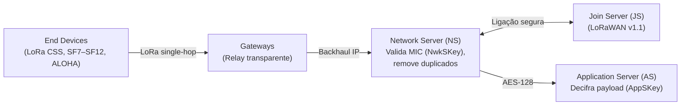

# `LPWAN` e Arquitetura `LoRaWAN` — Entidades, Classes e Chaves (*Stanco*)

As redes **`LPWAN`** (*Low Power Wide Area Networks*, como `LoRaWAN`, `Sigfox` e `NB-IoT`) combinam **longo alcance** (quilómetros) com **baixo consumo energético** e **baixo débito**, distinguindo-se das redes de curto alcance (`BLE`, `ZigBee`, `Wi-Fi`) e das redes celulares tradicionais (Fig. 3 de *Stanco*).

> [!TIP] Lógica de Funcionamento e Valor de Segurança
> * **Porque existe (Arquitetura)**: No `LoRaWAN`, a topologia em estrela liga *end devices* a múltiplos *gateways* (que apenas retransmitem via IP) até ao *Network Server* (`NS`), *Join Server* (`JS`, desde v1.1) e *Application Server* (`AS`), permitindo operar com *gateways* de terceiros sem lhes expor os dados aplicacionais.
> * **Porque importa (Segurança)**: A separação de chaves (`NwkSKey` para integridade/autenticação no `NS` e `AppSKey` para cifragem fim-a-fim no `AS`) impede que um *gateway* comprometido leia medições ou forje mensagens sem deteção — **mas um *gateway* comprometido pode ainda descartar ou atrasar mensagens legítimas**.
> * **Pontos Críticos e Armadilhas para Exame**:
>   * **`AppSKey`** (cifra dados de aplicação `AES-128` entre *End Device* e **`AS`**) vs. **`NwkSKey`** (calcula `MIC` via `AES-CMAC` entre *End Device* e **`NS`**).
>   * **Ativação `ABP` (*Activation By Personalization*)**: usa chaves estáticas; se o dispositivo reiniciar e perder o *frame counter* mantendo as chaves, é vulnerável a *replay* ou rejeição de pacotes — deve preservar-se os contadores ou aprovisionar novas chaves de sessão.
>   * A estrutura de pacotes `LoRaWAN` **não inclui dados baseados em tempo nem assinatura digital**.

---

## 1. Arquitetura `LoRaWAN` (Secção 4.2 e Fig. 5)

* **Camada física (`LoRa`)**: usa bandas ISM sub-GHz não licenciadas com modulação *Chirp Spread Spectrum* (`CSS`) e 6 *Spreading Factors* (`SF7` = maior débito/menor alcance a `SF12` = maior alcance/menor débito).
* **Camada MAC**: esquema **ALOHA** simples baseado em *duty cycle* (sem *Clear Channel Assessment* — CCA), o que reduz latência e consumo, mas aumenta colisões.
* **Três Classes de *End Devices***:
  1. **Class A**: bidirecional, abre 2 janelas curtas de receção *downlink* após cada *uplink* (menor consumo).
  2. **Class B**: bidirecional com *slots* de receção agendados e sincronizados com a estação base.
  3. **Class C**: janelas de receção quase continuamente abertas (maior consumo, menor latência *downlink*).

---

## 2. Garantias Criptográficas e Comparação `LPWAN` (Tabela 7 de *Stanco*)

| Tecnologia | Confidencialidade | Integridade e Autenticação | Disponibilidade / Notas |
| :--- | :--- | :--- | :--- |
| **`LoRaWAN`** | `AES-128` com **`AppSKey`** (*End Device* $\leftrightarrow$ `AS`) | `AES-CMAC` (`MIC`) com **`NwkSKey`**, *Frame counter*, *nonce* | Espectro não licenciado; `ABP` (chaves estáticas, risco se *counter* reiniciar) vs. `OTAA` (novas chaves por sessão via `JS` na v1.1). Integridade entre `NS` e `AS` não é tratada pelo protocolo LoRaWAN base. |
| **`Sigfox`** | Opcional (`AES-128 CTR` derivada da `NAK`; por omissão sem cifragem) | `HMAC` / `CBC-MAC` com `NAK` + *Sequence Number* (12 bits) | Múltiplas transmissões em 3 frequências aleatórias; chave estática `NAK` vitalícia. |
| **`NB-IoT`** | `ATR-128 CTR` ou `SNOW 3G` | `ATR-128 CTR CMAC`, vinculação SIM/UE, *Sequence Number*, *nonce* | Espectro licenciado (menor interferência), *frequency hopping*. |

---

## Perguntas de revisão

1. **Numa rede `LoRaWAN` onde os *gateways* são geridos por um fornecedor externo, o operador do *gateway* consegue ler ou forjar medições dos sensores?**

> [!success]- Ver Resposta
> Não consegue ler as medições porque o *payload* aplicacional é cifrado entre o sensor e o *Application Server* (`AS`) com a `AppSKey`, nem forjar mensagens sem deteção porque o *Network Server* (`NS`) verifica a integridade (`MIC`) com a `NwkSKey`. Contudo, um *gateway* comprometido **pode descartar ou atrasar mensagens legítimas**.

2. **Porque é perigoso reiniciar o contador de *frames* no `Network Server` quando um sensor `ABP` reinicia mantendo as mesmas chaves de sessão?**

> [!success]- Ver Resposta
> Porque reutilizar chaves de sessão estáticas com contadores de *frames* reiniciados a zero permite ataques de repetição (*replay*) com pacotes capturados anteriormente; a solução segura é preservar os contadores em memória não volátil ou aprovisionar novas chaves de sessão.

## Notas relacionadas

- [[Modelo de Ameaças em LPWAN - Vetores, Atores e Classificação de Ataques (Stanco)]]
- [[TBL 3 - Segurança em IoT (BLE, LoRaWAN e MQTT)]]
- [[Desafios e Requisitos de Segurança em Arquiteturas IoT (Sharma)]]
