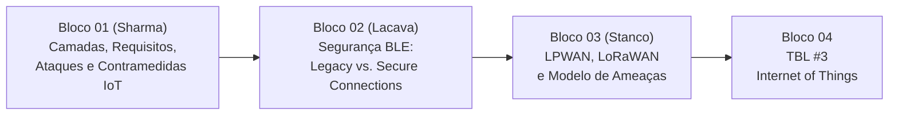

# Capítulo 3 — Segurança em IoT

Mapa de estudo do **Capítulo 3** de [[00 SRC|SRC]], cobrindo **estritamente as secções destacadas a amarelo** dos três artigos científicos (`Sharma_yellow.pdf`, `Lacava_yellow.pdf` e `Stanco_yellow.pdf`) e os 10 cenários do `TBL #3` (`TBL_3_EN_IoT.pdf`), organizados em **6 notas atómicas** e **1 Cheat Sheet de revisão rápida** na pasta `SRC/Capítulo 03 - Segurança em IoT/`.

> [!TIP] Guia de Consulta Rápida para Exame
> Para tabelas comparativas das 5 camadas IoT, modos de emparelhamento `BLE` (*LE Legacy* vs. *LE Secure Connections*), arquitetura/chaves `LoRaWAN` (`NwkSKey` vs. `AppSKey`), vetores de ameaça `LPWAN` e segurança em `MQTT`, consulta a **[[Cheat Sheet - Segurança em IoT (BLE, LoRaWAN e MQTT)]]**.

---

## 1. Arquitetura, Requisitos e Ameaças em IoT (`01 - Arquitetura, Requisitos e Ameaças em IoT`)

| Nota | Fonte (Secções Destacadas) | O que vais estudar |
| :--- | :---: | :--- |
| [[Desafios e Requisitos de Segurança em Arquiteturas IoT (Sharma)]] | *Sharma* Secções 3.1–3.5, 4.1–4.4, 7.2.1–7.2.4 | As 5 camadas IoT (*Perception*, *Network*, *Application*, *Processing*, *Business*), desafios comuns (armazenamento, energia, tempo real, privacidade) e requisitos específicos (identidade, mobilidade, privacidade, energia/computação). |
| [[Ataques e Contramedidas por Camada em IoT (Sharma)]] | *Sharma* Secções 8.1.1–8.1.3, 9.1–9.8, Tabela 8 | Taxonomia de ataques por camada (*Perception*, *Network*, *Application*) e contramedidas (*routing*, *DDoS*, *MITM*, *code injection*, *side-channel*, *IDS*, autenticação forte e cifragem). |

---

## 2. Segurança em *Bluetooth Low Energy* (`02 - Segurança em Bluetooth Low Energy (BLE)`)

| Nota | Fonte (Secções Destacadas) | O que vais estudar |
| :--- | :---: | :--- |
| [[Segurança em BLE - Pairing Feature Exchange, LE Legacy e LE Secure Connections (Lacava)]] | *Lacava* Secções 3, 3.1–3.3 | *Pairing Feature Exchange* (`SMP`, flags `SC`/`MitM`/`IO`), *LE Legacy Pairing* (`Just Works`, `Passkey Entry`, `OOB`, `TK`/`STK`) e *LE Secure Connections* (`ECDH P-256`, `Numeric Comparison`, `LTK`/`MacKey`). |

---

## 3. Segurança em LPWAN e LoRaWAN (`03 - Segurança em LPWAN e LoRaWAN`)

| Nota | Fonte (Secções Destacadas) | O que vais estudar |
| :--- | :---: | :--- |
| [[LPWAN e Arquitetura LoRaWAN - Entidades, Classes e Chaves (Stanco)]] | *Stanco* Secções 3, 4.2, Fig. 3 e Fig. 5 | Posicionamento das `LPWANs` (alcance vs. débito), arquitetura `LoRaWAN` (*End Devices*, *Gateways*, *Network Server*, *Join Server*, *Application Server*), classes `A`/`B`/`C`, `ABP` vs. `OTAA` e chaves `NwkSKey`/`AppSKey`. |
| [[Modelo de Ameaças em LPWAN - Vetores, Atores e Classificação de Ataques (Stanco)]] | *Stanco* Secções 5, 5.1–5.4 | Ativos críticos e propriedades `CIAA`, os 5 vetores de ataque (Fig. 7), 4 perfis de atores de ameaça e classificação em 6 categorias (`DoS`/bateria, `MITM`, *Replay*, *Wormhole*, *Jamming*, *Physical tampering*). |

---

## 4. `TBL #3` — Internet of Things (`04 - TBL 3 - Internet of Things`)

| Nota | Fonte | O que vais estudar |
| :--- | :---: | :--- |
| [[TBL 3 - Segurança em IoT (BLE, LoRaWAN e MQTT)]] | `TBL_3_EN_IoT.pdf` | Análise dos 10 cenários práticos de decisão arquitetural em IoT: firmware, `LoRaWAN` (`ABP`/contadores), `BLE` (`OOB`/`Just Works`), `MQTT` (ACL por tópico, cifragem de *payload*) e *throttling*. |

---

## Navegação

- [[00 SRC|Voltar ao MOC Geral de SRC]]
- [[Cheat Sheet - Segurança em IoT (BLE, LoRaWAN e MQTT)|Ir para a Cheat Sheet do Capítulo 3]]
- [[Capítulo 2 - Criptografia Aplicada|Recuar para o Capítulo 2 de SRC]]
- [[Capítulo 4 - Deteção de Intrusões e Zero Trust|Avançar para o Capítulo 4 de SRC]]
