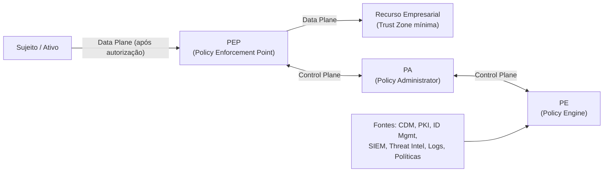

# *Zero Trust Architecture* (`NIST SP 800-207`) — Fundamentos, Componentes Lógicos e Planos

O ***Zero Trust* (`ZT`)** é um paradigma de cibersegurança focado na proteção de recursos sob a premissa de que **a confiança nunca é concedida implicitamente** (nem pela localização física ou de rede), devendo ser **continuamente avaliada por cada pedido** através de decisões de acesso de menor privilégio.

> [!TIP] Lógica de Funcionamento e Valor de Segurança
> * **Porque existe (Arquitetura)**: O modelo tradicional baseado em perímetro (*firewalls* / `TIC`) permite movimento lateral irrestrito após um atacante entrar na rede interna e não protege trabalhadores remotos, *cloud* ou dispositivos *edge*.
> * **Porque importa (Segurança)**: Uma ***Zero Trust Architecture* (`ZTA`)** reduz a **zona de confiança implícita** ao mínimo possível, movendo o `PDP`/`PEP` para junto do recurso e separando logicamente o plano de controlo do plano de dados.
> * **Pontos Críticos e Armadilhas para Exame**:
>   * **`PDP` = `PE` + `PA`**: na arquitetura lógica (Secção 3), o *Policy Decision Point* (`PDP`) divide-se em **`Policy Engine` (`PE`)** (toma e regista a decisão usando algoritmo de confiança) e **`Policy Administrator` (`PA`)** (executa a decisão, gera credenciais de sessão e ordena ao `PEP`).
>   * **`PEP` (*Policy Enforcement Point*)**: é o **único** ponto de passagem para recursos empresariais (os recursos não devem ser descobertos nem acedidos sem passar por um `PEP`).
>   * **Control Plane vs. Data Plane (Secção 3.4)**: `PE`, `PA` e `PEP` comunicam num ***Control Plane*** logicamente separado e inacessível diretamente pelos ativos; o tráfego aplicacional só flui no ***Data Plane*** após autorização.

---

## 1. Fundamentos de *Zero Trust* (Secção 2)

* **Definição operativa**:
  * ***Zero Trust* (`ZT`)**: conjunto de conceitos destinados a minimizar a incerteza na aplicação de decisões de acesso precisas e de menor privilégio por pedido (*per-request*), assumindo que a rede está comprometida.
  * ***Zero Trust Architecture* (`ZTA`)**: plano de cibersegurança organizacional que utiliza conceitos `ZT`, abrangendo relações entre componentes, planeamento de fluxos e políticas de acesso.
* **Zona de Confiança Implícita (*Implicit Trust Zone*)**: área onde todas as entidades têm pelo menos o nível de confiança do último *gateway* `PDP`/`PEP` (analogia da segurança de aeroporto). O objetivo da `ZTA` é **encolher esta zona ao mínimo possível**, aproximando `PDP`/`PEP` de cada recurso.
* **Avaliação dinâmica baseada em risco**: cada pedido avalia identidade (pessoas e entidades não-pessoa / `NPE`), postura de segurança do dispositivo, hora, localização e contexto — sem assumir que pedidos subsequentes numa sessão antiga permanecem válidos.

---

## 2. Componentes Lógicos da `ZTA` (Secção 3, Fig. 2)

### 2.1. Componentes Centrais
* **`Policy Engine` (`PE`)**: decide conceder, negar ou revogar acesso a um recurso para um sujeito, alimentando um algoritmo de confiança (*trust algorithm*) com políticas internas e fontes externas; regista a decisão.
* **`Policy Administrator` (`PA`)**: estabelece ou encerra o caminho de comunicação entre sujeito e recurso (via comandos ao `PEP` no *Control Plane*); gera tokens/credenciais específicos de sessão.
* **`Policy Enforcement Point` (`PEP`)**: ativa, monitoriza e termina ligações entre sujeito e recurso (pode ser agente cliente + *gateway* do recurso, ou portal único).

### 2.2. Fontes de Dados e Sistemas de Apoio (incluindo p. 20)
* **`Enterprise PKI`**: gera e regista certificados emitidos para recursos, sujeitos, serviços e aplicações (pode ou não integrar com `X.509` / CAs globais).
* **`ID Management System`**: cria, armazena e gere contas e registos de identidade (ex.: `LDAP`), papéis, atributos de acesso e ativos atribuídos (frequentemente articulado com a `PKI` e federação).
* **`Continuous Diagnostics and Mitigation` (`CDM`)**: recolhe o estado atual do ativo (versão/patches do SO, integridade de software, vulnerabilidades).
* **Outras fontes**: *Industry compliance system*, *Threat intelligence feeds*, *Network and system activity logs*, *Data access policies* e **`SIEM`**.

---

## 3. Separação *Control Plane* vs. *Data Plane* e Requisitos de Rede (Secção 3.4)

* ***Control Plane***: usado por `PE`, `PA` e `PEP` (e infraestrutura) para configurar ativos, avaliar/autorizar acesso e estabelecer caminhos de comunicação. Deve ser **logicamente separado** e não diretamente acessível por ativos/utilizadores comuns.
* ***Data Plane***: usado exclusivamente pelo tráfego aplicacional/de serviço após o caminho ter sido estabelecido via *Control Plane*.
* **Requisitos-chave (Secção 3.4.1)**:
  * Distinguir ativos geridos e sua postura através de **credenciais emitidas pela empresa** (nunca por informação falsificável como endereços `MAC`);
  * Observar todo o tráfego no *Data Plane* (ao menos metadados: destino, hora, identidade) para alimentar o `PE`;
  * **Recursos não alcançáveis sem passar por um `PEP`** (impede descoberta por *scans* e reduz exposição a `DoS`);
  * Ativos remotos não devem ser obrigados a passar primeiro por uma `VPN` corporativa para aceder a serviços SaaS/cloud pública.

---

## Perguntas de revisão

1. **Qual a distinção funcional entre o `Policy Engine` (`PE`), o `Policy Administrator` (`PA`) e o `Policy Enforcement Point` (`PEP`)?**

> [!success]- Ver Resposta
> O **`PE`** toma e regista a decisão de acesso com base em políticas e fontes de contexto/risco; o **`PA`** executa essa decisão gerando credenciais de sessão e instruindo o `PEP`; o **`PEP`** é o ponto de aplicação no caminho de rede que ativa, monitoriza e termina a ligação entre o sujeito e o recurso.

2. **Porque exige a `NIST SP 800-207` separação entre *Control Plane* e *Data Plane*?**

> [!success]- Ver Resposta
> Para isolar as comunicações críticas de gestão e autorização (`PE` $\leftrightarrow$ `PA` $\leftrightarrow$ `PEP`) do tráfego aplicacional dos utilizadores/serviços, impedindo que ativos no *Data Plane* acedam diretamente aos componentes de decisão de confiança e garantindo que nenhum fluxo aplicacional ocorra antes de autorizado pelo *Control Plane*.

## Notas relacionadas

- [[IDS - Taxonomia (SIDS, AIDS, Híbridos) e Posicionamento (HIDS vs. NIDS) (Khraisat)]]
- [[Assinaturas Digitais, PKI e GnuPG]]
- [[Princípios Fundamentais de Desenho Seguro, Attack Surfaces e Attack Trees]]
