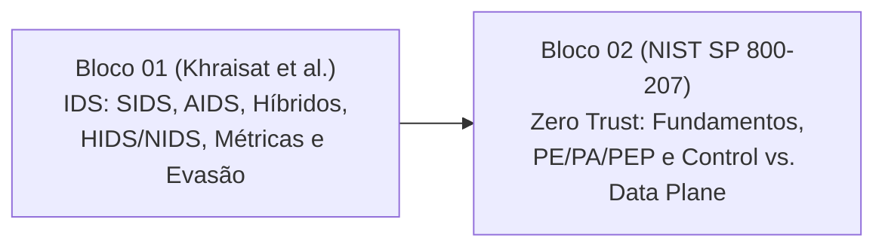

# Capítulo 4 — Deteção de Intrusões (`IDS`) e *Zero Trust Architecture* (`ZTA`)

Mapa de estudo do **Capítulo 4** de [[00 SRC|SRC]], cobrindo **estritamente as secções destacadas a amarelo** do *survey* sobre Sistemas de Deteção de Intrusões (`s42400-019-0038-7.pdf`, *Khraisat et al., 2019*) e da norma `NIST SP 800-207` (`NIST.SP.800-207.pdf`), organizados em **3 notas atómicas** e **1 Cheat Sheet e Questionário de Consolidação** na pasta `SRC/Capítulo 04 - Deteção de Intrusões e Zero Trust/`.

> [!TIP] Guia de Consulta Rápida e Autoavaliação
> Para tabelas de revisão rápida (`SIDS` vs. `AIDS` vs. Híbridos, `HIDS` vs. `NIDS`, fórmulas da matriz de confusão, os 7 *Tenets* do Zero Trust e `PE`/`PA`/`PEP`) e um questionário de consolidação com soluções comentadas, consulta **[[Cheat Sheet e Questionário - IDS e Zero Trust Architecture]]**.

---

## 1. Sistemas de Deteção de Intrusões (`01 - Sistemas de Deteção de Intrusões (IDS)`)

| Nota | Fonte (Secções Destacadas) | O que vais estudar |
| :--- | :---: | :--- |
| [[IDS - Taxonomia (SIDS, AIDS, Híbridos) e Posicionamento (HIDS vs. NIDS) (Khraisat)]] | *Khraisat et al.* p. 1–5, 11 (Tabelas 2 e 4) | Conceito de intrusão e IDS, `SIDS` (*Knowledge/Misuse Detection*) vs. `AIDS` vs. **técnicas híbridas**, e comparação de posicionamento **`HIDS` vs. `NIDS`** e fontes de dados. |
| [[IDS - Métricas de Desempenho, Técnicas de Evasão e Desafios (Khraisat)]] | *Khraisat et al.* p. 11, 17–19 (Tabela 6) | Matriz de confusão (`TP`, `TN`, `FP`, `FN`), **técnicas de evasão** (*Fragmentation*, *Flooding*, *Obfuscation*, *Encryption*) e desafios futuros (ICS/SCADA, evasão e *datasets*). |

---

## 2. *Zero Trust Architecture* (`02 - Zero Trust Architecture`)

| Nota | Fonte (Secções Destacadas) | O que vais estudar |
| :--- | :---: | :--- |
| [[Zero Trust Architecture (NIST SP 800-207) - Fundamentos, Componentes Lógicos e Planos]] | `NIST SP 800-207` Secções 2, 3 e 3.4 | Premissa Zero Trust e *implicit trust zones*, componentes lógicos **`PE`**, **`PA`** e **`PEP`**, fontes de dados (`PKI`, `ID Management`, `CDM`, `SIEM`) e separação ***Control Plane* vs. *Data Plane***. |

---

## Navegação

- [[00 SRC|Voltar ao MOC Geral de SRC]]
- [[Cheat Sheet e Questionário - IDS e Zero Trust Architecture|Ir para a Cheat Sheet e Questionário do Capítulo 4]]
- [[Capítulo 3 - Segurança em IoT|Recuar para o Capítulo 3 de SRC]]
